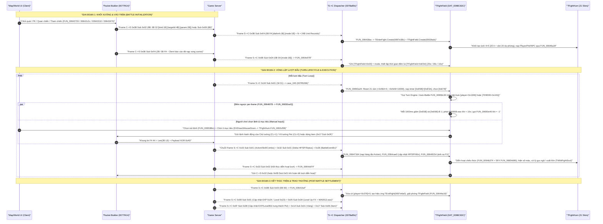
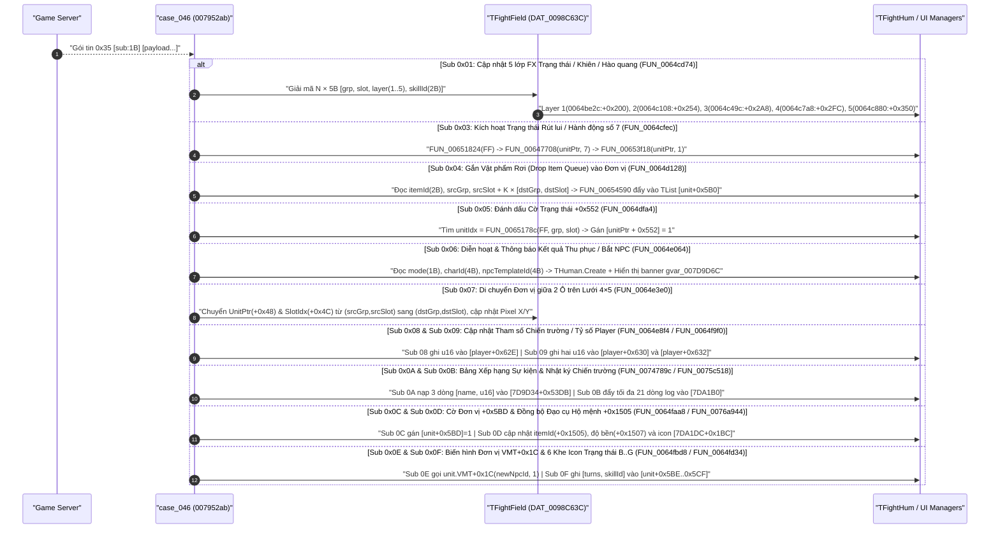

# ĐẶC TẢ KỸ THUẬT ĐẢO NGƯỢC MODULE BATTLE (TS ONLINE CLIENT `aLogin.exe`)

**Đối tượng phân tích**: Thực thi nhị phân `aLogin.exe` (Delphi x86, Calling Convention `__register`: `EAX`, `EDX`, `ECX` + Stack)
**Nguồn dữ liệu đối chiếu**: Thư mục mã nguồn decompile C/ASM/HEX `client_pseudo_c/`, chỉ mục `.scratch/battle-refactor/README.md` và cơ sở dữ liệu kỹ năng `Data/skills.json`.

## 1. Sơ đồ Kiến trúc & Luồng Bản tin Toàn trình (Mermaid Sequence Diagrams)

### 1.1. Luồng Khởi tạo Trận chiến, Vòng lặp Lượt đấu & Kết thúc Trận


### 1.2. Sơ đồ Phân luồng 14 Nhánh Sub-opcode của Kênh `0x35` (`BattleEventEx` @ `0x007952AB`)


## 2. Phần A: Cấu trúc Giao thức & Phân luồng Opcode (Framing & Wire Layout)

### 2.1. Khung tin Nhị phân (Wire Framing) & Giải thuật Mã hóa Tĩnh XOR `0xAD`
Toàn bộ lưu lượng TCP hai chiều giữa `aLogin.exe` và Game Server đều đi qua lớp đóng gói/bóc tách khung nhị phân có cấu trúc cố định:

| Offset | Kích thước | Kiểu dữ liệu | Tên trường | Giá trị / Quy tắc | Bằng chứng mã nguồn |
| :--- | :--- | :--- | :--- | :--- | :--- |
| `+0x00` | `2 bytes` | `uint8[2]` | `MagicHeader` | `F4 44` (trên đường truyền sau khi XOR `0xAD` với chuỗi nguồn `\x59\xE9` hoặc ghi trực tiếp header) | `0078a89c_FUN_0078a89c.c`, `0050a248_FUN_0050a248.c` |
| `+0x02` | `2 bytes` | `uint16 LE` | `PayloadLength` | Độ dài phần payload theo thứ tự Little-Endian (`N` bytes) | `0050a248_FUN_0050a248.asm.txt` |
| `+0x04` | `N bytes` | `uint8[N]` | `EncryptedPayload` | Mỗi byte `B[i]` được biến đổi bằng phép `B[i] ^ 0xAD` (`B[0]` sau giải mã là `Opcode`, `B[1]` là `SubOpcode`) | `0050a248_FUN_0050a248.c`, `0050a2fc_FUN_0050a2fc.c` |

* **Hàm giải mã/mã hóa chiều nhận (`FUN_0050a248` @ `0x0050A248`)**: Được gọi từ `TForm1.ClientSocket1Read` (`0x0050CD6C` tại `0x0050CE63`). Trong `0050a248_FUN_0050a248.c` (dòng 35–48) và `0050a248_FUN_0050a248.asm.txt` (`0x0050A265: MOV byte ptr [EBP-0x0D], 0xAD`), nếu tham số khóa `param_3 == 0` thì client gán khóa tĩnh `local_d = 0xAD` rồi lặp qua từng byte chuỗi `AnsiString` để thực hiện `bVar1 ^ local_d` (`0x0050A2B9: XOR BL, [EBP-0x0D]`).
* **Hàm mã hóa chiều gửi (`FUN_0050a2fc` @ `0x0050A2FC`)**: Được gọi từ `TForm1.CY_DelSedQueue` (`0x005163E4` tại `0x0051646F`). Trong `0050a2fc_FUN_0050a2fc.c` và `0050a2fc_FUN_0050a2fc.asm.txt` (`0x0050A319: MOV byte ptr [EBP-0x0D], 0xAD`), hàm thực thi cùng phép biến đổi đối xứng `XOR 0xAD` trước khi đẩy gói tin xuống Winsock.

### 2.2. Bộ Điều phối Tổng Chiều Server→Client (`FUN_0078a89c` @ `0x0078A89C`)
Hàm `0078a89c_FUN_0078a89c.c` (kèm mã máy tại `0078a89c_FUN_0078a89c.asm.txt`) là trung tâm phân luồng toàn bộ gói tin Server→Client sau khi đã tách header và giải mã XOR `0xAD`:
* **Cơ chế tra bảng nhảy hai tầng (Two-level Jump Table)**:
  - Tại địa chỉ `0x0078A8CD..0x0078A8E7` trong `0078a89c_FUN_0078a89c.asm.txt`:
    ```assembly
    0078a8cd: 8B45FC            MOV EAX, dword ptr [EBP - 0x04] ; Con trỏ chuỗi payload (1-indexed Delphi string)
    0078a8d0: 0FB64001          MOVZX EAX, byte ptr [EAX + 0x01]; Đọc byte đầu tiên = Opcode
    0078a8d8: 3DC7000000        CMP EAX, 0xC7                   ; Kiểm tra Opcode <= 199 (0xC7)
    0078a8dd: 0F8755BA0000      JA 0x00796338                   ; Vượt biên -> thoát
    0078a8e3: 8A80EEA87800      MOV AL, byte ptr [EAX + 0x78A8EE]      ; Tầng 1: Ánh xạ Opcode -> case_index (0..52)
    0078a8e9: FF2485B6A97800    JMP dword ptr [EAX*4 + 0x78A9B6]       ; Tầng 2: Nhảy tới địa chỉ handler
    ```
  - **Bảng Tầng 1 (`jumptable_byte200_0x78A8EE.hex`, 200 bytes tại `0x0078A8EE`)**: Chuyển đổi `Opcode` (`0x00..0xC7`) sang chỉ số nhánh `case_index` (`0x00..0x34`, trong đó `0x34 = 52` là nhánh mặc định thoát tại `0x00796338`).
  - **Bảng Tầng 2 (`jumptable_dword200_0x78A9B6.hex`, mảng DWORD Little-Endian tại `0x0078A9B6`)**: Lưu địa chỉ tuyệt đối của từng nhánh xử lý. Đối chiếu thực tế hai bảng `.hex` cho các Opcode liên quan trực tiếp đến trận chiến:

| Opcode S→C | Giá trị tại `0x78A8EE[Opcode]` (`case_idx`) | Offset trong `0x78A9B6` | Địa chỉ đích (LE DWORD) | Tập tin Handler trong `client_pseudo_c/` | Vai trò trong Module Battle |
| :--- | :--- | :--- | :--- | :--- | :--- |
| **`0x05`** (5) | `0x05` (Case 5) | `+0x14` | `0x0078C7DB` (`DB C7 78 00`) | `case_005_0078C7DB_FUN_0078c7db.c` | Sub `0x0A`: Hiệu ứng & âm thanh Level Up (`FUN_0072f970`) |
| **`0x08`** (8) | `0x09` (Case 9) | `+0x24` | `0x0078D125` (`25 D1 78 00`) | `case_009_0078D125_FUN_0078d125.c` | Sub `0x01`: Cập nhật EXP (`0x24`), Level (`0x23`), HP/SP/Stats của Player |
| **`0x0B`** (11) | `0x0B` (Case 11) | `+0x2C` | `0x0078D5D1` (`D1 D5 78 00`) | `case_011_0078D5D1_FUN_0078d5d1.c` | Kênh lệnh điều khiển vòng đời trận đấu (12 nhánh Sub-opcode) |
| **`0x0F`** (15) | `0x0F` (Case 15) | `+0x3C` | `0x0078E367` (`67 E3 78 00`) | `case_015_0078E367_FUN_0078e367.c` | Sub `0x08`: Cập nhật EXP, Level, HP/SP, Độ trung thành (`0x43`) cho Pet |
| **`0x13`** (19) | `0x13` (Case 19) | `+0x4C` | `0x0078FEAF` (`AF FE 78 00`) | `case_019_0078FEAF_FUN_0078feaf.c` | Quản lý Võ tướng xuất chiến / nghỉ ngơi / bắt giữ (Sub `0x01..0x0A`) |
| **`0x17`** (23) | `0x14` (Case 20) | `+0x50` | `0x007902FB` (`FB 02 79 00`) | `case_020_007902FB_FUN_007902fb.c` | Sub `0x06`: Nhận vật phẩm thưởng/drop (record 12B); Sub `0x0E`: Tiêu hao item |
| **`0x1A`** (26) | `0x16` (Case 22) | `+0x58` | `0x0079157C` (`7C 15 79 00`) | `case_022_0079157C_FUN_0079157c.c` | Sub `0x01`: Cộng tiền vàng nhận được sau trận (`FUN_0072b084`) |
| **`0x32`** (50) | `0x2C` (Case 44) | `+0xB0` | `0x0079522C` (`2C 52 79 00`) | `case_044_0079522C_FUN_0079522c.c` | Sub `0x01`: Cập nhật Delta HP/SP/Status/Hồn của đơn vị (`FUN_0064cae0`) |
| **`0x33`** (51) | `0x2B` (Case 43) | `+0xAC` | `0x007951DA` (`DA 51 79 00`) | `case_043_007951DA_FUN_007951da.c` | Sub `0x01`: Chuỗi đòn đánh/Skill/Combo (`FUN_00647164`); Sub `0x02`: Hoàn tất lượt (`FUN_0064dd74`) |
| **`0x34`** (52) | `0x2D` (Case 45) | `+0xB4` | `0x00795266` (`66 52 79 00`) | `case_045_00795266_FUN_00795266.c` | Sub `0x01`: Reset lượt đấu mới & Khởi chạy Countdown (`FUN_00650a24`) |
| **`0x35`** (53) | `0x2E` (Case 46) | `+0xB8` | `0x007952AB` (`AB 52 79 00`) | `case_046_007952AB_FUN_007952ab.c` | BattleEventEx: 14 nhánh biến cố trận đánh trên `TFightField` & UI |

### 2.3. Chi tiết Kênh lệnh Server→Client (`0x0B`, `0x13`, `0x32`, `0x33`, `0x34`)

#### 2.3.1. Opcode `0x0B` (`case_011_0078D5D1_FUN_0078d5d1.c` @ `0x0078D5D1`) — 12 Nhánh Sub-opcode
Trong `case_011_0078D5D1_FUN_0078d5d1.c`, hàm cắt bỏ byte đầu (`Opcode = 0x0B`) vào `local_8fd`, đọc `SubOpcode = *(byte *)(local_8fd + 1)` và điều phối 12 nhánh:

| Sub-opcode | Hàm xử lý đích | Cấu trúc Payload (sau `0B <sub>`) | Chức năng chi tiết & Bằng chứng mã nguồn |
| :--- | :--- | :--- | :--- |
| **`0x00`** (0) | `FUN_00641fa4` (`0x00641FA4`) | *(Rỗng - tổng frame 2B: `0B 00`)* | **Kết thúc / Thoát trận chiến**: Đặt `[player+0x376] = 0`, đóng toàn bộ bảng hội thoại/UI chiến đấu, khởi tạo hiệu ứng `TExitFight.Create` (`00641fa4_FUN_00641fa4.c`). |
| **`0x01`** (1) | `FUN_0064bb24` (`0x0064BB24`) | `<grp:1B> <slot:1B> [mode:1B]` (tổng 4B hoặc 5B) | **Xóa / Rút đơn vị khỏi ô lưới `(grp, slot)`**: Gọi `FUN_0064ba04` giải phóng `TFightHum` tại ô `(grp, slot)` hoặc kích hoạt chạy thoát/bay xác khi `mode == 1` (`0064bb24_FUN_0064bb24.c`). |
| **`0x03`** (3) | `FUN_00644b84` (`0x00644B84`) | `<errCode:1B>` (`1..4`, tổng 3B) | **Thông báo lỗi tham chiến/quan chiến**: Hiển thị banner thông báo lên `gvar_007DA084` ứng với mã `1` (`0x644C14`), `2` (`0x644C38`), `3` (`0x644C5C`), `4` (`0x644C80`) (`00644b84_FUN_00644b84.c`). |
| **`0x04`** (4) | `FUN_00642244` (`0x00642244`) | `<charId:4B LE> <fightState:1B>` (tổng 7B) | **Cập nhật biểu tượng trạng thái chiến đấu trên bản đồ**: Tìm người chơi `charId` (hoặc bản thân `gvar_007DA7BC`) và gán `[entity+0x376] = fightState`, xóa lời mời giao dịch/party đang treo (`00642244_FUN_00642244.c`). |
| **`0x05`** (5) | `FUN_00644294` (`0x00644294`) | `<sideFlag:1B> + N × <Record 23B>` | **Nạp đơn vị viện trợ / tham chiến giữa trận**: Giải mã mảng `N` bản ghi 23 bytes (`0x17` bytes/record), khởi tạo đơn vị mới trên `TFightField` (`00644294_FUN_00644294.c`). |
| **`0x06`** (6) | `FUN_0072c9e8` (`0x0072C9E8`) | `<data...>` | Đồng bộ trạng thái nhân vật liên quan đến chiến đấu (`*(undefined4 *)gvar_007DA7BC`). |
| **`0x07`** (7) | `FUN_00733650` (`0x00733650`) | `<subType:1B> [count:2B LE]` (3B hoặc 5B) | **Quản lý chế độ Tự động đánh (Auto-battle / Công kích tự động)**: Cập nhật cờ `[player+0x1306]` (`0` hoặc `1`) và bộ đếm lượt `[player+0x130C]` (`00733650_FUN_00733650.c`). |
| **`0x09`** (9) | *Inline tại `0x0078D6D8`* | `<count:2B LE>` (tổng 4B) | Đọc `u16` qua `FUN_0078a82c`, ghi vào `[player+0x1308]` và hiển thị chuỗi thông báo số lượt còn lại qua `Format` (`0x00796348`). |
| **`0x0A`** (10) | `FUN_0064e978` (`0x0064E978`) | `<battleMode:1B>` (tổng 3B: `0B 0A <mode>`) | **Trailer hoàn tất khởi tạo & ấn định thời gian lượt đấu**: Ghi `[TFightField+0x04] = battleMode`; thiết lập `[TFightField+0xE5A]` = `30` giây (`0x1E`) nếu `mode in {2,4,7,8,9}`, `10` giây (`0x0A`) nếu `mode == 14`, hoặc `20` giây (`0x14`) cho các chế độ còn lại (`0064e978_FUN_0064e978.c`). |
| **`0x0B`** (11) | `FUN_005ba604` (`0x005BA604`) | `<data...>` | Cập nhật giao diện điều khiển phụ trợ trong trận (`gvar_007D9D00`). |
| **`0x0C`** (12) | `FUN_0060e2a8` (`0x0060E2A8`) | `<data...>` | Cập nhật trạng thái chiến trường công thành / đoàn chiến (`gvar_007D9FB0`). |
| **`0xFA`** (250)| `FUN_006438ac` (`0x006438AC`) | `<diahinh:1B> <mode:1B> + N × <Record 24B>` | **Khởi tạo trận chiến (Battle Init)**: Tạo `TEnterFight`, khởi tạo `TFightField` (`DAT_0098C63C`), giải mã `N` bản ghi 24 bytes đặt vào lưới 4×5 (`006438ac_FUN_006438ac.c`). |

#### 2.3.2. Opcode `0x13` (`case_019_0078FEAF_FUN_0078feaf.c` @ `0x0078FEAF`) — Kênh Quản lý Võ tướng (BattlePet)
Trong `case_019_0078FEAF_FUN_0078feaf.c`, Opcode `0x13` điều phối 10 nhánh (`0x01..0x0A`):
* **Sub `0x01`**: Gọi `FUN_00626dd4` — Thu phục / bắt thành công NPC làm Võ tướng mới vào danh sách Pet.
* **Sub `0x02`**: Gọi `FUN_0071ca14` — Giải phóng / thả Võ tướng.
* **Sub `0x03`**: Gọi `FUN_00729c08` — Xác nhận chọn Võ tướng xuất chiến (`[player+0x12E5]`).
* **Sub `0x04`**: Gọi `FUN_0064246c` (`0x0064246C`) — Đồng bộ trạng thái Võ tướng ngay trong trận chiến (`TFightManage`).
* **Sub `0x05`**: Đọc `npcId = FUN_0078a82c()` (`u16`), tra tên NPC trong `gvar_007D9DE4` và hiện thông báo liên quan đến Võ tướng.
* **Sub `0x06` / `0x07` / `0x08` / `0x09` / `0x0A`**: Xử lý cưỡi ngựa / thu hồi ngựa (`FUN_007339ac`, `FUN_00733ae4`), đổi tên Pet (`FUN_0073580c`) và đồng bộ trạng thái Pet phụ trợ (`FUN_007392e0`, `FUN_0073943c`).

#### 2.3.3. Sự đối xứng và phân định chính xác giữa Opcode `0x32` S→C, `0x33` S→C và `0x34` S→C
Khi đối chiếu trực tiếp `case_043_007951DA_FUN_007951da.c` (ứng với Opcode `0x33`, vì `byte_table_0x78A8EE[0x33] = 0x2B = 43`) và `case_044_0079522C_FUN_0079522c.c` (ứng với Opcode `0x32`, vì `byte_table_0x78A8EE[0x32] = 0x2C = 44`), mã máy thực tế của `aLogin.exe` phân chia nhiệm vụ như sau:
* **Opcode `0x32` Sub `0x01` S→C (`case_044` @ `0x0079522C` → `FUN_0064cae0` @ `0x0064CAE0`)**:
  - Kiểm tra `DAT_0098C63C != NULL` và gọi `FUN_0064cae0(DAT_0098C63C, local_8fd)` (`0064cae0_FUN_0064cae0.c`).
  - **Cấu trúc gói tin (9 bytes cả Opcode)**: `32 01 <grp:1B> <slot:1B> <attrCode:1B> <deltaOrFlag:4B Signed LE>`.
  - **Vai trò**: Đẩy biến động chỉ số tức thời hoặc kết thúc sinh mạng của đơn vị tại ô `(grp, slot)` vào hàng đợi sự kiện của `TFightField` (trừ/hồi HP `0x19`, trừ/hồi SP `0x1A`, giải trừ/gán trạng thái khống chế `0x0E`, kích hoạt trạng thái Hồn bay `0xDF`).
* **Opcode `0x33` Sub `0x01` & `0x02` S→C (`case_043` @ `0x007951DA` → `FUN_00647164` & `FUN_0064dd74`)**:
  - **Sub `0x01` (`FUN_00647164` @ `0x00647164` trong `00647164_FUN_00647164.c`)**: Gói tin **Diễn hoạt Đòn đánh / Kỹ năng / Chuỗi Combo (Action & Combo Sequence)**.
    + Header sau `33 01` (6 bytes): `attackerGrp(1B)`, `attackerSlot(1B)`, `skillId(2B LE)`, `unkFlag(1B)`, `targetCount(1B)`.
    + Theo sau là mảng `targetCount × 8 bytes` cho từng mục tiêu chịu tác động (hoặc từng nhịp trong chuỗi combo):
      `targetGrp(1B)`, `targetSlot(1B)`, `hitFlag(1B: 1=Trúng, 0=Né/Miss)`, `damageOrHeal(2B LE)`, `statusCode(1B)`, `pad(1B)`, `attackMode(1B: hiển thị hiệu ứng Combo / Bạo kích)`.
  - **Sub `0x02` (`FUN_0064dd74` @ `0x0064DD74` trong `0064dd74_FUN_0064dd74.c`)**: Tín hiệu kết thúc toàn bộ chuỗi hành động của lượt hiện tại, cho phép client dọn hàng đợi diễn hoạt và chuyển sang lượt kế tiếp.
* **Opcode `0x34` Sub `0x01` S→C (`case_045` @ `0x00795266` → `FUN_00650a24` @ `0x00650A24`)**:
  - Trong `case_045_00795266_FUN_00795266.c`, khi nhận gói `34 01` (2 bytes) và `DAT_0098C63C != NULL`, client gọi `FUN_00650a24(DAT_0098C63C)` (`00650a24_FUN_00650a24.c`) để tái lập trạng thái 21 slot chiến đấu, khởi động lại đồng hồ đếm ngược và kích hoạt động cơ chọn lệnh lượt mới `FUN_00658c30`.

### 2.4. Đào sâu Toàn diện 14 Nhánh Sub-opcode của `0x35` (`BattleEventEx` — `case_046_007952AB_FUN_007952ab.c`)

Trong `case_046_007952AB_FUN_007952ab.c` (`0x007952AB`), sau khi `FUN_0078a89c` cắt bỏ byte đầu (`Opcode = 0x35`) và lưu phần còn lại vào chuỗi `*(int *)(unaff_EBP - 0x0C)` (`local_c`), hàm đọc `SubOpcode = *(byte *)(local_c)` (tức byte đầu tiên sau `0x35`) và phân nhánh qua 14 giá trị (`1, 3, 4, 5, 6, 7, 8, 9, 10, 11, 12, 13, 14, 15`; không có nhánh `2`).

#### Bảng Tổng hợp Cấu trúc Byte-level của 14 Nhánh `0x35` (`BattleEventEx`)

| Sub-opcode | Hàm xử lý đích (`Entry`) | Đối tượng `this` (`EAX`) | Cấu trúc Byte-level (sau `35 <sub>`) | Chức năng Kỹ thuật & Tác động Bộ nhớ |
| :--- | :--- | :--- | :--- | :--- |
| **`0x01`** (1) | `FUN_0064cd74` (`0064cd74_FUN_0064cd74.c`) | `gvar_007D9CE4` (`TFightManage`) | `N × [grp:1B, slot:1B, layer:1B (1..5), skillId:2B LE]` ($N = \lfloor(\text{len}-1)/5\rfloor$) | **Đồng bộ 5 Lớp Hiệu ứng Trạng thái/Khiên/Aura trên `TFightField`**: Tra `unitIdx = FUN_0065178c(FF, grp, slot)` và gọi 5 hàm con ứng với `layer = 1..5` để cập nhật 5 mảng con trỏ FX (`+0x200`, `+0x254`, `+0x2A8`, `+0x2FC`, `+0x350`). |
| **`0x03`** (3) | `FUN_0064cfec` (`0064cfec_FUN_0064cfec.c`) | `gvar_007D9CE4` (`TFightManage`) | `<grp:1B> <slot:1B>` (Tổng frame: 4B) | **Kích hoạt Trạng thái Rút lui / Hành động số 7**: Gọi `FUN_00651824(FF)` xóa chọn mục tiêu, lấy `unitIdx` tại ô `(grp, slot)` và gọi `FUN_00647708(unitPtr, 7)` $\rightarrow$ gán `[unitPtr+0x391] = 7` và gọi `FUN_00653f18(unitPtr, 1)`. |
| **`0x04`** (4) | `FUN_0064d128` (`0064d128_FUN_0064d128.c`) | `gvar_007D9CE4` (`TFightManage`) | `<itemId:2B LE> <srcGrp:1B> <srcSlot:1B> + K × [dstGrp:1B, dstSlot:1B]` ($K = \lfloor(\text{len}-5)/2\rfloor$) | **Nạp Hàng đợi Rơi Vật phẩm (Drop Item Queue) vào Đơn vị**: Với mỗi cặp `(dstGrp, dstSlot)`, gọi `FUN_00654590(srcUnitPtr, dstGrp, dstSlot, itemId)` cấp phát node 4B và thêm vào `TList` tại `[srcUnitPtr + 0x5B0]`. |
| **`0x05`** (5) | `FUN_0064dfa4` (`0064dfa4_FUN_0064dfa4.c`) | `gvar_007D9CE4` (`TFightManage`) | `<grp:1B> <slot:1B>` (Tổng frame: 4B) | **Đánh dấu Cờ Trạng thái Đặc biệt `+0x552`**: Tìm `unitIdx = FUN_0065178c(FF, grp, slot)`; nếu hợp lệ (`!= -1`), gán `*(uint8 *)(unitPtr + 0x552) = 1`. |
| **`0x06`** (6) | `FUN_0064e064` (`0064e064_FUN_0064e064.c`) | `gvar_007D9CE4` (`TFightManage`) | `<mode:1B> <charId:4B LE> <npcTemplateId:4B LE>` (Tổng frame: 11B) | **Hiển thị Hoạt cảnh & Thông báo Kết quả Thu phục / Bắt Tướng**: Tạo `THuman` từ `npcTemplateId`, đưa vào UI `gvar_007D9D6C` (`FUN_0063c1d0`), tra tên người bắt `charId` và hiển thị lời thoại thành công/thất bại (`0x64E2E4..0x64E3B4`). |
| **`0x07`** (7) | `FUN_0064e3e0` (`0064e3e0_FUN_0064e3e0.c`) | `gvar_007D9CE4` (`TFightManage`) | `<srcGrp:1B> <srcSlot:1B> <dstGrp:1B> <dstSlot:1B>` (Tổng frame: 6B) | **Di chuyển Đơn vị giữa 2 Ô trên Lưới Chiến đấu 4×5**: Dọn đơn vị cũ ở ô đích nếu `+0x391 == 7` (`FUN_006540b0`), chuyển `UnitPtr` (`+0x48`) & `SlotIndex` (`+0x4C`) sang `(dstGrp, dstSlot)`, xóa ô nguồn và cập nhật tọa độ Pixel của `TFightHum`. |
| **`0x08`** (8) | `FUN_0064e8f4` (`0064e8f4_FUN_0064e8f4.c`) | `gvar_007D9CE4` (`TFightManage`) | `<val:2B LE>` (Tổng frame: 4B) | **Cập nhật Tham số Chiến trường `+0x62E` của Player**: Giải mã `u16` qua `FUN_0077eb9c` và ghi vào `*(uint16 *)(*(int *)gvar_007DA7BC + 0x62E)`. |
| **`0x09`** (9) | `FUN_0064f9f0` (`0064f9f0_FUN_0064f9f0.c`) | `gvar_007D9CE4` (`TFightManage`) | `<val1:2B LE> <val2:2B LE>` (Tổng frame: 6B) | **Cập nhật Cặp Tham số Tỷ số / Điểm Chiến trường `+0x630` & `+0x632`**: Ghi `val1` vào `[player+0x630]` và `val2` vào `[player+0x632]`. |
| **`0x0A`** (10)| `FUN_0074789c` (`0074789c_FUN_0074789c.c`) | `gvar_007D9D34` | `1..3 × [<nameLen:1B> <name:nameLen B> <score:2B LE>]` | **Cập nhật Bảng Xếp hạng / Danh sách 3 Đội/Nhân vật**: Ghi tối đa 3 bản ghi `(AnsiString name, uint16 score)` vào `[gvar_007D9D34 + 0x53DB + i*6]` và `+0x53DF + i*6` (`i = 1..3`). |
| **`0x0B`** (11)| `FUN_0075c518` (`0075c518_FUN_0075c518.c`) | `gvar_007DA250` | `K × [<msgType:1B (1..3)> <len:1B> <str:len B>]` ($K \le 21$) | **Đẩy Thông báo / Nhật ký Sự kiện Trận đấu**: Ghép tiền tố màu/nhãn ứng với `msgType` (`1`=`0x75C6A8`, `2`=`0x75C6B8`, `3`=`0x75C6C8`) và gọi `FUN_007ab870(gvar_007DA1B0, 0, msg, 0)`. |
| **`0x0C`** (12)| `FUN_0064faa8` (`0064faa8_FUN_0064faa8.c`) | `gvar_007D9CE4` (`TFightManage`) | `<grp:1B> <slot:1B>` (Tổng frame: 4B) | **Bật Cờ Trạng thái `+0x5BD` trên Đơn vị**: Kiểm tra ô `(grp, slot)` có đơn vị, lấy `unitIdx` và gán `*(uint8 *)(unitPtr + 0x5BD) = 1`. |
| **`0x0D`** (13)| `FUN_0076a944` (`0076a944_FUN_0076a944.c`) | `gvar_007DA0D0` (`TInventory`) | `<itemId:2B LE> <durability:1B> <showMsg:1B>` (Tổng frame: 6B) | **Đồng bộ Đạo cụ Phúc thần / Bùa Hộ mệnh Đeo trên Người (`+0x1505`)**: Ghi `itemId` vào `[player+0x1505]`, `durability` vào `[player+0x1507]`, cập nhật icon `[gvar_007DA1DC + 0x1BC]`; nếu `durability == 0` thì xóa icon, nếu `showMsg == 1` thì hiện thông báo độ bền còn lại. |
| **`0x0E`** (14)| `FUN_0064fbd8` (`0064fbd8_FUN_0064fbd8.c`) | `gvar_007D9CE4` (`TFightManage`) | `<grp:1B> <slot:1B> <newNpcId:2B LE>` (Tổng frame: 6B) | **Biến hình / Đổi Ngoại hình Đơn vị Ngay trong Trận**: Lấy `unitPtr` tại ô `(grp, slot)` và gọi `(**(code **)(*unitPtr + 0x1C))(unitPtr, newNpcId, 1)` để nạp lại sprite/template mới. |
| **`0x0F`** (15)| `FUN_0064fd34` (`0064fd34_FUN_0064fd34.c`) | `gvar_007D9CE4` (`TFightManage`) | `<grp:1B> <slot:1B> <slotKey:1B ('B'..'G')> <turns:1B> <skillId:2B LE>` (Tổng frame: 8B) | **Cập nhật 6 Khe Biểu tượng Buff/Debuff & Số lượt tồn tại (`'B'..'G'`)**: Ghi `(turns:1B, skillId:2B)` vào `[unitPtr + 0x5BE..0x5CF]` và gọi `FUN_0058f5e0` cập nhật giao diện trạng thái `gvar_007DA530`. |

#### Phân tích Chuyên sâu Từng Nhánh Trọng yếu của `0x35`

##### 1. Nhánh `35 01` (`FUN_0064cd74`) & Kiến trúc 5 Lớp Phủ Hiệu ứng Trạng thái (`+0x200..+0x3A3` trong `TFightField`)
Khi một đơn vị trên bàn cờ bị trúng kỹ năng khống chế, được buff khiên, hoặc bật hào quang nghề/chuyển sinh, Server gửi gói `35 01` chứa một hoặc nhiều bản ghi 5-byte `[grp:1B, slot:1B, layerType:1B, skillId:2B LE]`.
Trong `0064cd74_FUN_0064cd74.c` (dòng 77–161):
* Một đơn vị chiến đấu `unitIdx` (`0..20`) có thể mang **đồng thời tối đa 5 lớp hiệu ứng hình ảnh độc lập** mà không bị ghi đè lên nhau, được quản lý bởi 5 mảng con trỏ 21 phần tử (`21 × 4 = 84 = 0x54 bytes`/mảng) nằm nối tiếp nhau trong `TFightField`:
  1. **Layer 1 (`TFightField + 0x200 + unitIdx * 4`, điều khiển bởi `0064be2c_FUN_0064be2c.c` $\rightarrow$ `FUN_0066d450`) — Lớp Khống chế cứng (Hard CC)**:
     - Nhận `fxId = 0x0B` (Xóa hiệu ứng) khi `skillId == 0` hoặc khi nhận kỹ năng giải trạng thái như `10009`, `10014`, `11012`, `11015..11019`, `11025`, `11031`, `14007` (Giải hôn), `14056`, `20015`, `20019`.
     - Hiển thị dây leo/cát trói (`fxId = 0x15` cho `10004` Cây tinh / `20025`; `fxId = 0x26` cho `10033` Sa Bộc Cầm).
     - Hiển thị tảng băng (`fxId = 0x2E` cho `11014` Băng phong / `11027` / `20026`; `fxId = 0x3E` cho `11028`).
     - Hiển thị lốc xoáy (`fxId = 0x6C` cho `13002` Tuyền phong / `13015..13018` Thanh Long / `20027`).
     - Hiển thị sao choáng trên đầu (`fxId = 0x77` cho `13007` Huyền Kích / `13029` Sơn Lam / `20016` / `20020`).
     - Hiển thị bong bóng ngủ mê (`fxId = 0x87` cho `14008` Hôn mê) và hiệu ứng khóa cung tiễn (`fxId = 0x89` cho `14033`, `14036`, `14037`, `14042`).
  2. **Layer 2 (`TFightField + 0x254 + unitIdx * 4`, điều khiển bởi `0064c108_FUN_0064c108.c` $\rightarrow$ `FUN_0066d804`) — Lớp Khiên chắn & Buff phòng vệ**:
     - `fxId = 0x10` (`10010` Kết giới), `0x1C` (`10015` Kính), `0x2D` (`10026` Linh Kính), `0x24` (`10031` Kim Chung Tráo), `0x30` (`11002` Băng tường), `0x69` (`12024`), `0x75` (`13003` Lẩn tránh), `0x73` (`13005` Ẩn mình / `13032`), `0x6E` (`13012` Phóng đại), `0x82` (`13021` Đẩu Chuyển Tinh Di), `0x86` (`13025` Vô Ảnh Vô Tướng), `0x8E` (`14012` Đồng tâm), `0x8F` (`14013` Khiêu khích), `0x0D` (`20005`), hoặc `0x0B` (Xóa khiên).
  3. **Layer 3 (`TFightField + 0x2A8 + unitIdx * 4`, điều khiển bởi `0064c49c_FUN_0064c49c.c` $\rightarrow$ `FUN_0066de54`) — Lớp Debuff / Độc / Hỗn loạn / Thu nhỏ**:
     - `fxId = 0x90` (`14015` Bỏ độc / `20023` / `21008`), `0x92` (`14020` Hoạch lí phản), `0x93` (`14021` Hỗn loạn / `20014`), `0x6D` (`13011` Thu nhỏ), `0x60` (`12030..12032` Dương Viêm / `21014`), `0x2C` (`10025`), `0x7E` (`13030`), `0xE8` (`14029`), `0x100` (`10016..10019` / `21001` / `21028`), `0x0C` (`20004`), hoặc `0x0B` (Xóa debuff).
  4. **Layer 4 (`TFightField + 0x2FC + unitIdx * 4`, điều khiển bởi `0064c7a8_FUN_0064c7a8.c` $\rightarrow$ `FUN_0066e37c`) — Lớp Hộ chủ**:
     - `fxId = 0x95` khi bật `20006` (`0x4E26` Hộ chủ), `fxId = 0x98` cho `14056` (`0x36E8`), `fxId = 0x0E` cho `20008` (`0x4E28`), và `fxId = 0x0B` khi nhận `20007` (`0x4E27` Giải hộ chủ) hoặc `0`.
  5. **Layer 5 (`TFightField + 0x350 + unitIdx * 4`, điều khiển bởi `0064c880_FUN_0064c880.c` $\rightarrow$ `FUN_006bac4c`) — Lớp Hào quang Kỹ năng Đặc biệt / Tiên-Ma / Nghề**:
     - `fxId = 0x48` (`11024` Minh Kính Chỉ Thủy), `0x42` (`11032` Băng Phách Hàn Quang), `0x6A` (`12025` Nộ Hỏa), `0x81` (`13020` Phong Chi Linh), `0xB2` (`14040` Bá Ý), `0xB6` (`14044` Vương Sát), `0xB4` (`14046` Tiên Linh), `0xB3` (`14053` Thánh Linh), `0xE4` (`21026`), hoặc `0x0B` (Xóa hào quang).

##### 2. Nhánh `35 0F` (`FUN_0064fd34`) & Cấu trúc 6 Khe Trạng thái (`+0x5BE..+0x5CF`) trong `TFightHum`
Trong khi `35 01` điều khiển **hiệu ứng đồ họa (FX Sprites)** vẽ đè lên nhân vật trên bàn cờ, nhánh **`35 0F`** (`0064fd34_FUN_0064fd34.c`) cập nhật **dữ liệu logic (số lượt còn lại `local_10` và mã kỹ năng gây trạng thái `local_12`)** vào 6 khe trạng thái của đối tượng `TFightHum` (mỗi khe 3 bytes = `1B turns + 2B skillId`, đánh mã bằng ký tự ASCII từ `'B'` đến `'G'`) và gọi `FUN_0058f5e0` để hiển thị icon trạng thái kèm số hiệp lên giao diện `gvar_007DA530`:

| Mã Khe (`local_f`) | Offset `turns/flag` (`1B`) trong `TFightHum` | Offset `skillId` (`2B LE`) trong `TFightHum` | Nhóm Trạng thái Tương ứng |
| :--- | :--- | :--- | :--- |
| **`'B'` (`0x42`)** | `unit + 0x5BE` | `unit + 0x5BF` | Khe 1: Khống chế cứng (Băng phong, Tuyền phong, Cây tinh, Hôn mê, Huyền kích) |
| **`'C'` (`0x43`)** | `unit + 0x5C1` | `unit + 0x5C2` | Khe 2: Phòng vệ / Khiên chắn (Kết giới, Kính, Băng tường, Lẩn tránh, Ẩn mình) |
| **`'D'` (`0x44`)** | `unit + 0x5C4` | `unit + 0x5C5` | Khe 3: Trạng thái bất lợi (Bỏ độc, Hỗn loạn, Thu nhỏ, Hoạch lí phản) |
| **`'E'` (`0x45`)** | `unit + 0x5C7` | `unit + 0x5C8` | Khe 4: Trạng thái Hộ chủ / Hỗ trợ đặc biệt |
| **`'F'` (`0x46`)** | `unit + 0x5CA` | `unit + 0x5CB` | Khe 5: Trạng thái Hào quang Nghề / Tiên-Ma (Bá Ý, Vương Sát, Tiên Linh, Thánh Linh) |
| **`'G'` (`0x47`)** | `unit + 0x5CD` | `unit + 0x5CE` | Khe 6: Trạng thái mở rộng / Đặc thù sự kiện |

##### 3. Nhánh `35 07` (`FUN_0064e3e0`) — Giải thuật Hoán đổi & Dịch chuyển Ô Lưới Không Gián đoạn
Trong `0064e3e0_FUN_0064e3e0.c`, khi một đơn vị đổi vị trí từ ô `(srcGrp, srcSlot)` sang `(dstGrp, dstSlot)` (ví dụ khi Võ tướng mới từ slot dự phòng bước vào thay thế Võ tướng cũ tại hàng tiền đạo `grp 1` hoặc `grp 3`), client thực hiện tuần tự 5 phép gán nguyên tử trên `TFightField` (`DAT_0098C63C`):
1. Kiểm tra đơn vị đang đứng ở ô đích `(dstGrp, dstSlot)`: nếu `dstUnit->actionState (+0x391) == 7`, gọi `FUN_006540b0(dstUnit)` để thu hồi ngay đơn vị cũ.
2. Sao chép con trỏ đối tượng `UnitPtr` (`+0x48`) và chỉ số mảng `SlotIndex` (`+0x4C`) từ ô nguồn sang ô đích:
   ```c
   dstCell->UnitPtr   = srcCell->UnitPtr;   // Offset +0x48
   dstCell->SlotIndex = srcCell->SlotIndex; // Offset +0x4C
   srcCell->UnitPtr   = NULL;               // Xóa ô nguồn
   srcCell->SlotIndex = 0;
   ```
3. Cập nhật thuộc tính tọa độ lưới nội bộ của đơn vị (`unitIdx = dstCell->SlotIndex`):
   `unitPtr->grp (+0x56E) = dstGrp`, `unitPtr->slot (+0x56F) = dstSlot`.
4. Đọc tọa độ gốc Isometric `(ScreenX, ScreenY)` của ô đích tại `dstCell + 0x40` và `dstCell + 0x44`, sau đó đồng bộ cả 3 cặp thanh ghi tọa độ hiển thị của `unitPtr`:
   - Tọa độ gốc neo ô cờ: `unitPtr+0x54 = ScreenX`, `unitPtr+0x58 = ScreenY`.
   - Tọa độ render hiện tại: `unitPtr+0x1C = ScreenX`, `unitPtr+0x20 = ScreenY`.
   - Tọa độ đích di chuyển: `unitPtr+0x4C = ScreenX`, `unitPtr+0x50 = ScreenY`.

### 2.5. Kênh lệnh Client→Server (`FUN_0077f414` @ `0x0077F414`) & Giải mã Sự thật về `0x0B` Sub `02`/`08` và `0x32`

#### 2.5.1. Kiến trúc Bộ đóng gói tổng `FUN_0077f414`
Trong `0077f414_FUN_0077f414.asm.txt` (`0x0077F414..0x0077F46D`), hàm nhận 3 tham số thanh ghi theo chuẩn Delphi `__register`:
* `EAX` (`[EBP-0x04]`): Con trỏ đối tượng mạng (`*(undefined4 *)gvar_007D9D30`).
* `DL` (`[EBP-0x05]`): `Opcode` chính (`0x00..0xC7`).
* `CL` (`[EBP-0x06]`): `SubOpcode` (`0x00..0xFF`).
* Hàm kiểm tra cờ kết nối `*gvar_007DA3A0 != 0` và `Opcode <= 0xC7`, sau đó tra bảng `table_0x77F474_200B.hex` (`MOV AL, [EAX + 0x77F474]`) và nhảy qua bảng con trỏ `table_0x77F53C_dword200.hex` (`JMP dword ptr [EAX*4 + 0x77F53C]`). Sau khi ghép xong chuỗi byte payload, từng nhánh gọi `TForm1.CY_AddSedQueue` (`0x0051633C`) để đóng khung `F4 44 <len:2B LE>` và mã hóa XOR `0xAD`.

#### 2.5.2. Bảng Phân nhánh Opcode `0x0B` C→S (`0x00780420` & `asm_cs0b_78048d_builders.asm.txt`)
Khi `DL = 0x0B`, bảng `0x77F474[0x0B] = 0x0B` nhảy tới `0x00780420`. Tại đây client kiểm tra `CL` (`SubOpcode`): nếu `CL <= 4` thì nhảy qua jump table 5 phần tử `cs0b_780440_jmptbl_5xDWORD.hex` (`0x00780440`); nếu `CL > 4` thì rẽ nhánh trực tiếp (`0x06`, `0x07`, `0x08`, `0x09`, `0x0A`, `0xFA`). Chi tiết toàn bộ các builder trong `asm_cs0b_78048d_builders.asm.txt` và `0077f414_FUN_0077f414.asm.txt`:

| Sub-opcode (`CL`) | Địa chỉ Builder | Độ dài Payload | Cấu trúc Byte-level (trước khi bọc `F4 44 <len>`) | Nguồn dữ liệu trong bộ nhớ Client & Call-site |
| :--- | :--- | :--- | :--- | :--- |
| **`0x00`** | `0x0078048D` | **3 bytes** | `0B 00 <val:1B>` | `val = *(uint8 *)([0x007DA5AC] + 0x130)` |
| **`0x01`** | `0x00780511` | **3 bytes** | `0B 01 <val:1B>` | `val = *(uint8 *)([0x007DA5AC] + 0x130)` (Xác nhận kết thúc diễn hoạt/thoát) |
| **`0x02`** | `0x00780595` | **9 bytes** | `0B 02 <kind:1B> <targetId:4B LE> <param:2B LE>` | Đọc từ `TFightManage` (`[0x007D9CE4]`): `+0x24` (`1B`), `+0x1E` (`4B LE` qua `FUN_0077ee84`), `+0x22` (`2B LE` qua `FUN_0077eb1c`). Được gọi bởi `00642720_FUN_00642720.c` (`kind=3` đánh NPC), `00642c2c_FUN_00642c2c.c` (`kind=2` thách đấu PK), `FUN_00643310` (`kind=4` quan chiến), `FUN_00643470` (`kind=5` tham chiến/chen ngang), `0064ea20_FUN_0064ea20.c` (`kind=9`), `0064ed14_FUN_0064ed14.c` (`kind=10`), `0064edf8_FUN_0064edf8.c` (`kind=11`), `0064eecc_FUN_0064eecc.c` (`kind=12`), `0064efa0_FUN_0064efa0.c` (`kind=14`/`9`), `0064f60c_FUN_0064f60c.c` (`kind=18`), `0064f6e4_FUN_0064f6e4.c` (`kind=19`), `0064f7bc_FUN_0064f7bc.c` (`kind=21`). |
| **`0x03`** | `0x00780671` | **8 bytes** | `0B 03 <targetId:4B LE> <param:2B LE>` | Đọc từ `TFightManage` (`[0x007D9CE4]`): `+0x1E` (`4B LE`), `+0x22` (`2B LE`). Được gọi bởi `00644078_FUN_00644078.c`. |
| **`0x04`** | `0x00780721` | **8 bytes** | `0B 04 <targetId:4B LE> <param:2B LE>` | Đọc từ `TFightManage` (`[0x007D9CE4]`): `+0x1E` (`4B LE`), `+0x22` (`2B LE`). |
| **`0x06`** | `0x007807D1` | **2 bytes** | `0B 06` | Gói tin rỗng 2 byte báo trạng thái trận đấu. |
| **`0x07`** | `0x00780826` | **4 bytes** | `0B 07 <flag1:1B> <dir:1B>` | Đọc từ `player` (`[0x007DA7BC]`): `+0x384` (`1B`) và `+0xE3` (`1B`). |
| **`0x08`** | `0x007808E2` | **8 bytes** | `0B 08 <kind:1B> <targetId:4B LE> <param:1B>` | Đọc từ `TFightManage` (`[0x007D9CE4]`): `+0x24` (`1B`), `+0x1E` (`4B LE` qua `FUN_0077ee84`), và **1 byte thấp** của `+0x22` (`MOV DX, [EDX+0x22]; CALL @LStrFromChar 0x00403FA0`). |
| **`0x09`** | `0x007809B8` | **2 bytes** | `0B 09` | Gói tin 2 byte yêu cầu/xác nhận trạng thái auto. |
| **`0x0A`** | `0x00780A0D` | **7 bytes** | `0B 0A <kind:1B> <targetId:4B LE>` | Đọc từ `TFightManage` (`[0x007D9CE4]`): `+0x24` (`1B`) và `+0x1E` (`4B LE`). |
| **`0xFA`** | `0x00780ABD` | **2 bytes** | `0B FA` | Client gửi xác nhận đã khởi tạo xong `TFightField` ngay ở cuối `FUN_006438ac`. |

#### 2.5.3. Làm rõ sự thật về Opcode `0x32` C→S vs `0x0B` Sub `02` / `08`
* **Tại sao trong `0077f414_FUN_0077f414.c` nhánh `case 0x32:` không thấy lệnh gửi gói tin (`TForm1_CY_AddSedQueue`) và `case 0x0b:` chỉ thấy 1 nhánh?**
  - Trong `0077f414_FUN_0077f414.c` (dòng 1033–1048), decompiler của Ghidra chỉ nhận diện được 2 tham số (`EAX`, `EDX`) mà bỏ sót tham số thứ 3 truyền qua thanh ghi `CL` (`[EBP-0x06]`).
  - Tại địa chỉ `0x00788BCA` (nhánh `case 0x32` trong `0077f414_FUN_0077f414.asm.txt`), hàm gọi `Random(0xDC)` (`CALL 0x00402CF0`) rồi kiểm tra biên `CMP EAX, 0xFF; JBE 0x00788BE0`. Vì Ghidra hiểu nhầm cờ điều kiện sau `_LStrCmp` (`0x00788BF8`), bộ decompiler đã **cắt cụt (dead-code elimination sai)** toàn bộ đoạn mã máy từ `0x00788C24` đến `0x007890B3`! Tương tự, tại `0x00780439` (`case 0x0B`), Ghidra không phục hồi được bảng nhảy `0x780440` nên các builder `0x0B` Sub `02` (9 bytes tại `0x00780595`) và Sub `08` (8 bytes tại `0x007808E2`) không xuất hiện trong file `.c` mà chỉ nằm trong `asm_cs0b_78048d_builders.asm.txt` và `0077f414_FUN_0077f414.asm.txt`.
* **Sự phân tách vai trò thực sự trong kiến trúc Client**:
  1. **Kênh `0x0B` Sub `02` (9 bytes) & Sub `08` (8 bytes)**: Là kênh lệnh dùng cho toàn bộ các tác vụ **khởi xướng / tương tác chiến đấu từ bản đồ** (đánh quái NPC `kind=3`, thách đấu PK `kind=2`, quan chiến `kind=4`, tham chiến `kind=5`, lôi đài/công thành `kind=9, 10, 11, 12, 14, 18, 19, 21`), lấy dữ liệu từ đối tượng `TFightManage` (`[0x007D9CE4]` tại các offset `+0x1E`, `+0x22`, `+0x24`).
  2. **Kênh bên trong lưới `TFightField` khi chọn mục tiêu (`TFightHum::FUN_0063cf58` @ `0x0063CF58`)**:
     - Khi sử dụng **Vật phẩm đặc biệt tiêu hao ngay từ túi đồ** (loại item `0x0D..0x0F`, `0x34`, `0xB9..0xBB`), client gọi `FUN_0077f414(..., DL=0x17, CL=0x0F)` (`0x0063D76C` / `0x0063D838`).
     - Khi xác nhận **Đòn đánh thường / Kỹ năng (`+0x5A8 != 0`, tại `0x0063D5B5` với `CL=0x01`, `DL=0x32`)** hoặc **Vật phẩm chiến đấu mục tiêu trên lưới (`+0x5AA != 0`, tại `0x0063E1FB` với `CL=0x02`, `DL=0x32`)**, đoạn mã máy bị Ghidra ẩn tại `0x00788C38` (`CL=1`) và `0x00788E7A` (`CL=2`) trong `0077f414_FUN_0077f414.asm.txt` đóng gói khung 10 bytes gửi lên Server:
       `[32] [01 hoặc 02] [srcGrp:1B (+0x56E)] [srcSlot:1B (+0x56F)] [dstGrp:1B (+0x56E)] [dstSlot:1B (+0x56F)] [skillOrItemId:2B LE (+0x5A8 hoặc +0x5AA)] [rand1:1B] [rand2:1B]`.

## 3. Phần B: Trước Trận Chiến (Battle Initialization & Scene Loading)

### 3.1. Frame Khởi động Trận đấu (`0x0B` Sub `0xFA` — `FUN_006438ac` @ `0x006438AC`) & Đối tượng `TFightField`

#### 3.1.1. Cấu trúc Gói tin `0B FA` và Vòng lặp Giải mã Mảng Record 24-byte
Trong `006438ac_FUN_006438ac.c` (kèm hợp ngữ `006438ac_FUN_006438ac.asm.txt`):
* Khi `case_011` cắt byte `0x0B` đầu tiên, chuỗi `param_2` truyền vào `FUN_006438ac` có byte `[1] = 0xFA`, byte `[2] = diahinh` (ID bản đồ nền chiến trường `.map`), byte `[3] = mode` (chế độ/loại hình trận chiến).
* Số lượng thực thể tham chiến `N` được tính bằng công thức (dòng 126–134):
  $$N = \left\lfloor \frac{\text{Length}(\text{param\_2}) - 3}{24} \right\rfloor \quad (\text{với } 24 = \text{0x18 bytes/record})$$
* Vòng lặp giải mã chạy từ `local_c = 0` đến `N - 1`, lấy `base_offset = local_c * 0x18` (dòng 150) và bóc tách từng trường trong **Record 24-byte** như sau:

| Offset trong Record 24B | Offset trong `param_2` (1-indexed) | Kích thước | Kiểu | Biến cục bộ (`006438ac.c`) | Ý nghĩa kỹ thuật |
| :--- | :--- | :--- | :--- | :--- | :--- |
| **`+0x00`** | `base + 4` | `1 byte` | `uint8` | `local_12` | Cờ phe / trạng thái khởi tạo (`fightSideFlag`) |
| **`+0x01`** | `base + 5` | `1 byte` | `uint8` | `local_f` | **Loại thực thể (`entityType`)**: `1` = NPC/Quái, `2` = Người chơi (Player), `4` = Võ tướng (Pet), `9` = Khí cụ/vật thể công thành |
| **`+0x02`** | `base + 6` | `4 bytes` | `uint32 LE` | `local_18` | **Định danh thực thể (`charId` / `templateId`)**: Với `type == 2` là `CharID`; với `type == 1` hoặc `4` là `NPCTemplateID` |
| **`+0x06`** | `base + 10` (`0x0A`) | `2 bytes` | `uint16 LE` | `local_22` | Chỉ số tham chiếu phụ / `ownerIdx` (`u16`) |
| **`+0x08`** | `base + 12` (`0x0C`) | `1 byte` | `uint8` | `local_d` | **Nhóm hàng (`grp`)**: `0..3` (Phe địch: `0, 1`; Phe ta: `2, 3`) |
| **`+0x09`** | `base + 13` (`0x0D`) | `1 byte` | `uint8` | `local_e` | **Vị trí cột (`slot`)**: `0..4` (từ trên xuống dưới theo đường chéo Isometric) |
| **`+0x0A`** | `base + 14` (`0x0E`) | `2 bytes` | `uint16 LE` | `local_1a` | **MaxHP** (`uint16`) |
| **`+0x0C`** | `base + 16` (`0x10`) | `2 bytes` | `uint16 LE` | `local_1c` | **MaxSP** (`uint16`) |
| **`+0x0E`** | `base + 18` (`0x12`) | `2 bytes` | `uint16 LE` | `local_1e` | **Current HP (HP hiện tại)** (`uint16`) |
| **`+0x10`** | `base + 20` (`0x14`) | `2 bytes` | `uint16 LE` | `local_20` | **Current SP (SP hiện tại)** (`uint16`) |
| **`+0x12`** | `base + 22` (`0x16`) | `1 byte` | `uint8` | `local_10` | **Cấp độ (`Level`)** (`uint8`) |
| **`+0x13`** | `base + 23` (`0x17`) | `1 byte` | `uint8` | `local_11` | **Hệ ngũ hành (`Element`)**: `1`=Địa, `2`=Thủy, `3`=Hỏa, `4`=Phong, `5`=Tâm |
| **`+0x14`** | `base + 24` (`0x18`) | `1 byte` | `uint8` | `local_23` | Trạng thái khống chế / debuff đang mang khi vào trận (`statusState`) |
| **`+0x15`** | `base + 25` (`0x19`) | `1 byte` | `uint8` | `local_24` | Cờ hiệu ứng / hướng hoặc trạng thái phụ (`extraState`) |
| **`+0x16`** | `base + 26` (`0x1A`) | `1 byte` | `uint8` | `local_25` | **Cấp chuyển sinh (`Rebirth` / `Chuyển sinh`)**: `0`=Chưa CS, `1`=CS 1, `2`=Tái sinh (CS 2) |
| **`+0x17`** | `base + 27` (`0x1B`) | `1 byte` | `uint8` | `local_26` | **Nghề nghiệp (`Job` / `Career`)**: `0..4` (`1`=Hiệp khách, `2`=Bá vương, `3`=Hiền sĩ, `4`=Tiên sư) |

#### 3.1.2. Layout Bộ nhớ của Đối tượng Toàn cục `DAT_0098C63C` (`TFightField`)
Được khởi tạo bởi constructor `0063fadc_TFightField.Create.c` (`0x0063FADC`, VMT `0x0063F9AC`), cấu trúc bộ nhớ của `TFightField` bao gồm:

| Offset trong `TFightField` | Kích thước | Kiểu dữ liệu | Ý nghĩa & Bằng chứng trong `0063fadc` / `00650a24` / `0065178c` / `0064cd74` |
| :--- | :--- | :--- | :--- |
| **`+0x04`** | `1 byte` | `uint8` | `battleMode`: Chế độ trận đấu (nhận từ `0B FA` byte 3 và cập nhật lại ở `0B 0A`). |
| **`+0x05`** | `1 byte` | `uint8` | Cờ trạng thái khởi tạo (`1` khi đang mở trận). |
| **`+0x06`** | `1 byte` | `uint8` | Cờ hiển thị số đếm ngược lớn giữa màn hình (bật lên `1` khi còn $\le 10$ giây). |
| **`+0x08..+0x3C`** | `56 bytes` | `struct` | Tọa độ camera bản đồ chiến trường và cấu trúc tải tệp nền `\scen\<diahinh>.map`. |
| **`+0x40..+0x157`**| `280 bytes`| `Grid[4][5]` | **Ma trận 20 ô lưới chiến đấu**: Công thức địa chỉ ô: `base = this + grp * 0x46 + slot * 0x0E` (`0x46 = 70 = 5 × 14`). Mỗi ô dài `14 bytes` (`0x0E`): `+0x40` = `ScreenX (int32)`, `+0x44` = `ScreenY (int32)`, `+0x48` = `UnitPtr (TFightHum*)`, `+0x4C` = `SlotIndex (uint8: 0..20)`. |
| **`+0x158..+0x1AB`**| `84 bytes` | `TFightHum*[21]`| **Mảng 21 con trỏ thực thể (`0..20`)**: Slot `0` luôn dành cho **Chủ tướng (Local Player)**; các slot `1..19` dành cho Pet và các đơn vị khác trên 20 ô lưới; slot `20` (`0x14`) là slot dự phòng khi đổi Pet/viện trợ. |
| **`+0x1AC..+0x1FF`**| `84 bytes` | `DropItems` | Vùng quản lý vật phẩm rơi trên lưới chiến trường. |
| **`+0x200..+0x3A3`**| `420 bytes`| `FXLayers[5][21]`| **5 Mảng Con trỏ Lớp Hiệu ứng Trạng thái (`35 01`)**: Layer 1 (`+0x200` Khống chế cứng), Layer 2 (`+0x254` Khiên/Kết giới), Layer 3 (`+0x2A8` Debuff/Độc/Hỗn loạn), Layer 4 (`+0x2FC` Hộ chủ), Layer 5 (`+0x350` Hào quang Tiên-Ma/Nghề). |
| **`+0xE5A`** | `1 byte` | `int8` | **Thời gian tối đa của 1 lượt đấu** (mặc định `0x14 = 20s`, hoặc `30s` / `10s` theo `0B 0A`). |
| **`+0xE5B`** | `1 byte` | `int8` | **Bộ đếm giây còn lại để người chơi chọn lệnh** (giảm 1 mỗi 1000ms; bằng `-1`/`0xFF` khi đã khóa lệnh hoặc hết giờ). |
| **`+0xE60`** | `8 bytes` | `double` | Mốc thời gian `TDateTime` (`Now()`) phục vụ đếm lùi `[+0xE5B]`. |
| **`+0xE68`** | `1 byte` | `int8` | **Bộ đếm giây hiển thị đồng hồ lượt đấu trên màn hình** (`20..0`). |
| **`+0xE70`** | `8 bytes` | `double` | Mốc thời gian `TDateTime` (`Now()`) phục vụ đếm lùi `[+0xE68]`. |
| **`+0xE78`** | `1 byte` | `int8` | **Chỉ số đơn vị đang chờ người chơi ra lệnh (`activeUnitIdx`)**: `0` = Nhân vật chính (Player), `>0` = Chỉ số slot của Võ tướng (Pet), `-1` (`0xFF`) = Đã ra lệnh xong. |
| **`+0xEAA`** | `1 byte` | `int8` | Chỉ số slot mục tiêu vừa được người chơi click chọn (`0..20`). |
| **`+0xEB4`** | `1 byte` | `uint8` | Cờ cho phép người chơi nhập lệnh (`1` = Nhân vật chính tham chiến trực tiếp, `0` = Quan chiến). |

### 3.2. Nạp Thực thể Viện trợ (`0x0B` Sub `0x05` — `FUN_00644294`) & Cơ chế Ánh xạ Võ tướng (`type == 4`)

#### 3.2.1. So sánh Sự lệch Offset giữa Record 24-byte (`0B FA`) và Record 23-byte (`0B 05`)
Trong `00644294_FUN_00644294.c` và `asm_644294_rec23.asm.txt` (`0x00644314..0x006443F0`), gói tin `0B 05` nạp thêm đơn vị tham chiến/viện trợ vào trận có công thức tính số lượng record là $N = (\text{len} - 2) / 23$ (`0x17` bytes/record).
* **Nguyên nhân lệch `-1 byte`**: Ở gói `0B FA`, byte `sideFlag` (`local_12`) nằm riêng ở **offset `+0x00` của từng record 24B**. Ngược lại, ở gói `0B 05`, cờ này được đưa lên làm **header chung toàn gói tin** tại byte đầu tiên sau `0B 05` (`local_d = *(byte *)(param_2 + 1)`). Do đó, mỗi record của `0B 05` chỉ còn **23 bytes**, bắt đầu ngay bằng trường `entityType` (`local_e`), làm toàn bộ các trường từ `entityType` đến `career` dịch lùi đúng **1 byte** so với record 24B:

| Trường dữ liệu | Offset trong Record 24B (`0B FA`) | Offset trong Record 23B (`0B 05`) | Chỉ thị Assembly trong `asm_644294_rec23.asm.txt` |
| :--- | :--- | :--- | :--- |
| `sideFlag` | `+0x00` (1B) | *(Nằm ở header gói tin)* | `local_d = *(byte *)(param_2 + 1)` |
| `entityType` (`1,2,4,9`) | `+0x01` (1B) | **`+0x00`** (1B) | `00644326: MOV AL, [EAX + EDX + 0x02]` (`local_e`) |
| `charOrNpcId` (`u32 LE`) | `+0x02..+0x05` (4B) | **`+0x01..+0x04`** (4B) | `00644335..0064434A` (`local_14`) |
| `ownerOrRefIdx` (`u16 LE`) | `+0x06..+0x07` (2B) | **`+0x05..+0x06`** (2B) | `00644353..00644360` (`local_1e`) |
| `grp` (`0..3`) | `+0x08` (1B) | **`+0x07`** (1B) | `00644369: MOV AL, [EAX + EDX + 0x09]` (`local_c`) |
| `slot` (`0..4`) | `+0x09` (1B) | **`+0x08`** (1B) | `00644374: MOV AL, [EAX + EDX + 0x0A]` (`local_19`) |
| `maxHP` (`u16 LE`) | `+0x0A..+0x0B` (2B) | **`+0x09..+0x0A`** (2B) | `0064437F..0064438C` (`local_16`) |
| `maxSP` (`u16 LE`) | `+0x0C..+0x0D` (2B) | **`+0x0B..+0x0C`** (2B) | `00644395..006443A2` (`local_18`) |
| `curHP` (`u16 LE`) | `+0x0E..+0x0F` (2B) | **`+0x0D..+0x0E`** (2B) | `006443AB..006443B8` (`local_1a`) |
| `curSP` (`u16 LE`) | `+0x10..+0x11` (2B) | **`+0x0F..+0x10`** (2B) | `006443C1..006443CE` (`local_1c`) |
| `level` (`u8`) | `+0x12` (1B) | **`+0x11`** (1B) | `006443D7: MOV AL, [EAX + EDX + 0x13]` (`local_f`) |
| `element` (`u8`) | `+0x13` (1B) | **`+0x12`** (1B) | `006443E2: MOV AL, [EAX + EDX + 0x14]` (`local_10`) |
| `statusState` (`u8`) | `+0x14` (1B) | **`+0x13`** (1B) | `006443ED: MOV AL, [EAX + EDX + 0x15]` (`local_1f`) |
| `extraState` (`u8`) | `+0x15` (1B) | **`+0x14`** (1B) | `MOV AL, [EAX + EDX + 0x16]` (`local_20`) |
| `rebirth` (`u8`) | `+0x16` (1B) | **`+0x15`** (1B) | `MOV AL, [EAX + EDX + 0x17]` (`local_21`) |
| `career` (`u8`) | `+0x17` (1B) | **`+0x16`** (1B) | `MOV AL, [EAX + EDX + 0x18]` (`local_22`) |

#### 3.2.2. Vai trò của `type == 4` (Võ tướng / Pet) và Hàm Ánh xạ `FUN_0071d1bc` (`0x0071D1BC`)
Khi nạp một đơn vị vào `TFightField` thông qua `FUN_00646a34` (`00646a34_FUN_00646a34.c`, dòng 120–162):
* Nếu `entityType == 4` (Võ tướng/Pet), trường `id` (`param_2`) gửi từ Server là **Mã khuôn mẫu NPC (`NPCTemplateID`)** trong `Npc.dat`.
* Để phân biệt Võ tướng của chính người chơi với NPC hay Võ tướng của người khác, `FUN_00646a34` kiểm tra xem đơn vị đứng cùng cột (`slot`) ở hàng sau/trước (`grp - 1` nếu `grp in {1,3}`) có phải là Chủ tướng (`index == 0`) hay không. Nếu đúng, client gọi `FUN_0071d1bc(*(int *)gvar_007DA7BC, templateId)` (`0071d1bc_FUN_0071d1bc.c`).
* Trong `0071d1bc_FUN_0071d1bc.c` (dòng 31–54), hàm quét mảng **4 ô chứa Võ tướng mang theo người** tại `[player + 0x57C + idx * 4]` (`idx = 1..4`):
  ```c
  iVar2 = *(int *)(param_1 + 0x57c + uVar1 * 4);
  if ((iVar2 != 0) && (*(int *)(iVar2 + 4) == param_2)) {
      local_c = (byte)uVar1; // Trả về vị trí slot Pet (1..4) trong túi Pet
      break;
  }
  ```
* Sau khi tìm được `petSlotIdx` (`1..4`), `FUN_00646a34` sao chép tên riêng của Pet (`+0x09`, 17 bytes), 6 món trang bị của Pet (`+0x2C + i*4`) và khối trạng thái chiến đấu 93 bytes (`0x5D` bytes tại `+0x56C`) từ hồ sơ Pet sang đối tượng `TFightHum` trên bàn cờ.

### 3.3. Lưới Chiến đấu (Battle Grid 4×5) & Công thức Tọa độ Pixel Isometric

#### 3.3.1. Cấu trúc Lưới 4 Nhóm Hàng (`grp` `0..3`) × 5 Cột (`slot` `0..4`) = 20 Vị trí
* Hàm kiểm tra hợp lệ biên lưới `0065178c_FUN_0065178c.c` (`0x0065178C`):
  ```c
  if ((param_2 < 4) && (param_3 < 5)) {
      if (*(int *)(param_1 + param_2 * 0x46 + param_3 * 0xe + 0x48) != 0)
          return *(byte *)(param_1 + param_2 * 0x46 + param_3 * 0xe + 0x4c);
  }
  return 0xffffffff;
  ```
* Quy tắc phân định Phe Ta vs Phe Địch trong `00646634_FUN_00646634.c` (`0x00646634`):
  - **`grp < 2` (`grp == 0` hàng sau địch, `grp == 1` hàng tiền đạo/Võ tướng địch)**: Trả về **`2` (Phe Địch / Phe 2)**, đứng ở nửa trên bên trái màn hình Isometric, mặt quay hướng Đông-Nam (`dir = 1` / `0x11`).
  - **`2 <= grp < 4` (`grp == 2` hàng sau chủ tướng ta, `grp == 3` hàng tiền đạo/Võ tướng ta)**: Trả về **`1` (Phe Ta / Phe 1)**, đứng ở nửa dưới bên phải màn hình Isometric, mặt quay hướng Tây-Bắc (`dir = 0` / `0x10`).

#### 3.3.2. Công thức Tính toán Pixel Isometric Đặt Nhân vật lên Màn hình
Trong constructor `0063fadc_TFightField.Create.c` (dòng 123–191) và các hàm `00651094_FUN_00651094.c`, `00651e3c_FUN_00651e3c.c`:
* Các cột `slot = 0..4` được xếp từ tâm ra hai cánh theo thứ tự mảng `slot_order = [2, 1, 3, 0, 4]` (`slot 2` ở chính giữa đội hình, kế đến là `slot 1` và `slot 3` ở hai bên, ngoài cùng là `slot 0` và `slot 4`).
* Vector bước nhảy cột dọc theo đường chéo đội hình là **`ΔX_slot = +60` (`0x3C`), `ΔY_slot = -50` (`-0x32`)** (tương ứng từ cánh trái-dưới `slot 3` lên cánh phải-trên `slot 0`: $\text{rank}(s) \in \{0, 1, 2, 3, 4\}$ ứng với `slot` $\{3, 4, 2, 1, 0\}$).
* **Bảng tọa độ Pixel `(ScreenX, ScreenY)` chính xác của toàn bộ 20 ô trên lưới `TFightField`**:

| Nhóm hàng (`grp`) | `slot = 3` (Ngoại cánh trái) | `slot = 4` (Cận cánh trái) | `slot = 2` (Trung tâm) | `slot = 1` (Cận cánh phải) | `slot = 0` (Ngoại cánh phải) |
| :--- | :--- | :--- | :--- | :--- | :--- |
| **`grp = 0` (Địch - Hàng sau)** | `(70, 360)` | `(130, 310)` | **`(190, 260)`** | `(250, 210)` | `(310, 160)` |
| **`grp = 1` (Địch - Hàng trước)** | `(145, 395)` | `(205, 345)` | **`(265, 295)`** | `(325, 245)` | `(385, 195)` |
| **`grp = 3` (Ta - Hàng trước)** | `(335, 495)` | `(395, 445)` | **`(455, 395)`** | `(515, 345)` | `(575, 295)` |
| **`grp = 2` (Ta - Hàng sau)** | `(410, 530)` | `(470, 480)` | **`(530, 430)`** | `(590, 380)` | `(650, 330)` |

### 3.4. Hiệu ứng Chuyển cảnh (`TEnterFight` @ `0x0067E38C`) & Trailer `0B 0A` (`FUN_0064e978`)
* Khi nhận `0B FA`, nếu nhân vật chưa ở trạng thái quan chiến (`[player+0x376] != 4`), `FUN_006438ac` gọi `TEnterFight.Create` (`0067e38c_TEnterFight.Create.c`) để tạo hiệu ứng xoáy màn hình bước vào trận và phát tệp âm thanh `sound\WA0006.wav`.
* Sau khi dựng xong `TFightField` và gửi `0B FA` (2B) báo cáo lên Server, Server trả về trailer `0B 0A <mode>` (`FUN_0064e978` trong `0064e978_FUN_0064e978.c`) để khóa chế độ trận đấu `[TFightField+0x04]` và thời gian đếm ngược mỗi lượt `[TFightField+0xE5A]`, sẵn sàng nhận tín hiệu mở lượt `34 01`.

## 4. Phần C: Trong Trận Chiến (Turn Lifecycle, Countdown, Actions & Damage Math)

### 4.1. Khởi động Lượt đấu (`34 01`), Đếm ngược Thời gian (Countdown), Timeout & Auto-Battle

#### 4.1.1. Nhận tín hiệu bắt đầu lượt qua Frame `34 01` (`FUN_00650a24` @ `0x00650A24`)
Trong `00650a24_FUN_00650a24.c`:
1. Quét vòng lặp 21 phần tử (`local_c = 0..20`) tại `[TFightField + 0x158 + local_c * 4]`:
   - Đặt `unit+0x56A = 0` (xóa cờ "đã gửi lệnh lượt này").
   - Đặt `unit+0x590 = 1` (bật cờ "đang suy nghĩ / chờ nhập lệnh").
   - Đặt `unit+0x5A8 = 10000` (`0x2710` — mặc định chọn kỹ năng `10000` "Đấu vật / Đánh thường").
   - Đặt `unit+0x5AA = 0` (xóa ID vật phẩm chiến đấu).
2. Ghi nhận mốc thời gian thực `Now()` (`FUN_00409b20`) vào 2 biến `double` tại `[TFightField+0xE70]` và `[TFightField+0xE60]`.
3. Sao chép tổng số giây của lượt từ `[TFightField+0xE5A]` sang `[TFightField+0xE68]` (đồng hồ hiển thị) và `[TFightField+0xE5B]` (đồng hồ nhập lệnh).
4. Xác định đơn vị nhận lệnh đầu tiên `[TFightField+0xE78]`:
   - Nếu Nhân vật chính (`slot 0`) còn sống (`curHP != 0` tại `+0x3E6`) và không bị trạng thái khóa hành động, gán `[TFightField+0xE78] = 0`.
   - Nếu Nhân vật chính đã gục (`curHP == 0`), gọi `FUN_00650f40` (`00650f40_FUN_00650f40.c`) để chuyển thẳng quyền nhập lệnh sang **Võ tướng (Pet)** của người chơi (hoặc đặt `-1` nếu Pet cũng không thể hành động).
5. Gọi `FUN_00654898` để mở bảng menu chiến đấu và gọi động cơ tự động `FUN_00658c30(param_1)`.

#### 4.1.2. Cơ chế Bộ đếm Countdown (`FUN_00650ce0` @ `0x00650CE0`) & Vòng lặp SFX (`FUN_00654d90` @ `0x00654D90`)
* **Sự phân tách chính xác giữa `FUN_00650ce0` và `FUN_00654d90`**:
  - Hàm `00650ce0_FUN_00650ce0.c` (được gọi mỗi frame từ vòng lặp render/update chính `FUN_00646f78` trong `00646f78_FUN_00646f78.c`) đảm nhận **Bộ đếm lùi thời gian lượt đấu (Countdown Timer)**.
  - Hàm `00654d90_FUN_00654d90.c` (kích thước 87KB, được gọi từ `FUN_0064b374`) là **Bộ điều phối âm thanh chiêu thức theo frame diễn hoạt (Per-frame Skill Audio/SFX Dispatcher)**, kiểm tra tiến độ frame của từng hiệu ứng kỹ năng để phát các tệp `sound\WA*.wav` và `sound\WB*.wav`.
* **Đơn vị tính của Countdown Timer và Thời gian tối đa 1 lượt**:
  - Trong `00650ce0_FUN_00650ce0.c` (dòng 36–78), client gọi `FUN_007c4d30(1000)` để so sánh khoảng thời gian trôi qua tính bằng **mili-giây (`1000 ms = 1 giây`)** giữa `Now()` và mốc `[TFightField+0xE60]` / `[TFightField+0xE70]`. Cứ mỗi `1000 ms`, bộ đếm giây `[TFightField+0xE5B]` và `[TFightField+0xE68]` giảm đi `1`.
  - **Thời gian tối đa cho 1 lượt (`[TFightField+0xE5A]`)**:
    + **20 giây (`0x14`)**: Mặc định cho tất cả trận đánh thường (PVE, nhiệm vụ thường — khởi tạo tại `0063fadc_TFightField.Create.c` dòng 195 và `0064e978.c` dòng 46).
    + **30 giây (`0x1E`)**: Cho các chế độ `battleMode` thuộc `{2, 4, 7, 8, 9}` (PK, Lôi đài, Công thành, Boss lớn — `0064e978.c` dòng 39).
    + **10 giây (`0x0A`)**: Cho chế độ `battleMode == 14` (`0x0E` — `0064e978.c` dòng 43).
* **Hiệu ứng Hình ảnh & Âm thanh khi gần hết giờ**:
  - Khi bộ đếm hiển thị `[TFightField+0xE68] == 10` (còn 10 giây cuối), client gán `*(undefined1 *)(param_1 + 6) = 1` (`00650ce0.c` dòng 72) để bật hiển thị chữ số đếm ngược cỡ lớn giữa màn hình chiến đấu.
  - Khi người chơi chưa hoàn tất chọn lệnh mà bộ đếm `[TFightField+0xE5B]` giảm xuống dưới 10 (`0 <= [param_1 + 0xE5B] < 10`, tức là từ giây thứ `9` về `0`), mỗi giây client đều ghép chuỗi `"sound\\WA0008.wav"` và gọi `FUN_007a7f20` để **phát tiếng bíp cảnh báo đếm lùi** (`00650ce0.c` dòng 48–52).
* **Cơ chế xử lý Timeout (`FUN_00650e40` @ `0x00650E40`)**:
  - Khi `[TFightField+0xE5B]` giảm xuống `-1` (hết giờ), `FUN_00650ce0` gọi `FUN_00650e40(param_1)` (`00650e40_FUN_00650e40.c`).
  - Trong `FUN_00650e40`: Client gán `[TFightField+0xE5B] = 0xFF` (`-1`), khóa quyền điều khiển `[TFightField+0xE78] = 0xFF` (`-1`), đóng tất cả cửa sổ chọn kỹ năng/vật phẩm/bắt tướng/triệu hồi đang mở (`gvar_007DA0B4`, `7DA32C`, `7D9D7C`, `7D9E5C`, `7D9EB8`, `7DA1F0`) và **không tự gửi thêm gói tin lệnh nào lên Server**. Vì ở đầu lượt (`FUN_00650a24`) mọi đơn vị được khởi tạo sẵn `+0x5A8 = 10000` (Đánh thường) nhưng chưa gửi gói `0x32`, Server khi hết hạn chờ lệnh phía Server sẽ tự động xử lý đơn vị chưa gửi lệnh theo quy tắc timeout của Server.

#### 4.1.3. Chế độ Tự động đánh (Auto-Battle — `0B 07` `FUN_00733650` & `FUN_00658c30`)
* Trong `00733650_FUN_00733650.c` (Opcode `0x0B` Sub `0x07`):
  - Nhánh `sub == 1`: Đọc `u16` số lượt tự động còn lại ghi vào `[player+0x130C]`, bật cờ `[player+0x1306] = 1` (nếu `> 0`) và hiện thông báo kích hoạt tự động công kích.
  - Nhánh `sub == 2`: Tắt cờ `[player+0x1306] = 0`, xóa `[player+0x130C] = 0`.
  - Nhánh `sub == 3`: Bật `[player+0x1306] = 1` (chế độ tự động đánh không giới hạn lượt).
* Trong `00658c30_FUN_00658c30.c` (Turn Engine): Nếu `[player+0x1306] != 0` hoặc cờ điều khiển tự động nội bộ `[gvar_007D9D00 + 0x101] != 0`, vòng lặp `while (*(char *)(param_1 + 0xE78) != -1)` sẽ tự động lập lệnh cho cả Chủ tướng (`0xE78 == 0`) và Võ tướng (`0xE78 > 0`) dựa theo mã chiến thuật `[player+0x1305]`:
  - `case 1`: Chọn mục tiêu qua `FUN_006531b8(..., 1)` và đánh thường (`+0x5A8 = 10000`).
  - `case 2` / `case 4`: Chọn mục tiêu qua `FUN_006531b8(..., 2)`, kiểm tra kỹ năng đặt tại ô phím tắt đầu tiên (`[gvar_007DA530 + 0x150] + 0xE4`); nếu đủ SP (`FUN_00658b0c` trả về khác 0) và loại kỹ năng là tấn công (`skillType 1` hoặc `2`) thì gán `+0x5A8 = skillId`, ngược lại đánh thường `10000`, rồi kích hoạt `VMT+0x10` (`TFightHum::FUN_0063cf58`).
  - `case 3`: Đánh thường mục tiêu ngẫu nhiên/ưu tiên (`+0x5A8 = 10000`).
  - `case 5`: Tự động **Phòng ngự** (`+0x5A8 = 0x4269 = 17001`).

### 4.2. Thiết lập Hành động của Người chơi & Võ tướng (`0050bff8`, `00652454`, `006538bc`, `0063cf58`)

#### 4.2.1. Click Chuột Chọn Mục tiêu (`0050bff8_TForm1.DXDraw1MouseDown.c`) & Giải thuật Quét Mục tiêu (`FUN_00652454`)
* Trong `0050bff8_TForm1.DXDraw1MouseDown.c` (`0x0050BFF8`): Khi đang trong trận (`[player+0x376] != 0`) và người chơi nhấn chuột trái vào một đơn vị trên bàn cờ, hàm kiểm tra xem bảng UI phụ có đang chặn click hay không (`FUN_00652130`), sau đó gọi phương thức ảo `VMT+0x10` của mục tiêu được click: `TFightHum::FUN_0063cf58` (`0x0063CF58`).
* Trong `00652454_FUN_00652454.c` (`0x00652454`), khi di chuột lên ô `(grp, slot)` trên bàn cờ, client tra cứu thuộc tính `nbTarget` (phạm vi mục tiêu, offset `+0x22` trong `Skill.dat`, đọc qua `FUN_0075a948`) của kỹ năng đang chọn (`unit+0x5A8`) để tô sáng (highlight `unit+0x56B = 1`) toàn bộ các ô sẽ chịu ảnh hưởng:

| Mã `nbTarget` (`local_13`) | Phạm vi Mục tiêu (Target Pattern) | Giải thuật Quét Ô trên Lưới 4×5 trong `FUN_00652454` | Ví dụ Kỹ năng (từ `skills.json`) |
| :--- | :--- | :--- | :--- |
| **`1`** | **Đơn thể (Single Target)** | Chỉ đánh dấu duy nhất ô `(grp, slot)` đang trỏ chuột (`00652454.c` dòng 177). | `10000` (Đấu vật), `10001` (Thuật mưa đá), `11014` (Băng phong) |
| **`2`** | **2 mục tiêu kề nhau / Trước-Sau** | Đánh dấu ô `(grp, slot)` và ô kề theo hàng/cột phụ thuộc vị trí đứng (`00652454.c` dòng 182–229). | `10007` (Đá lăn), `12031` (Dương Viêm), `14006` (Đại hô) |
| **`3`** | **3 mục tiêu hàng ngang (Row 3)** | Đánh dấu ô tâm `(grp, slot)` và 2 ô lân cận cùng nhóm hàng `grp` theo thứ tự kề Isometric (`slot 2` lấy `{1,2,4}`; `slot 1` lấy `{0,1,2}`; `slot 4` lấy `{2,3,4}`). | `10005` (Ném đá), `12003` (Hỏa tiễn), `10016` (Nham quái) |
| **`4`** | **Loạn kích / 4 mục tiêu** | Đánh dấu đơn thể tâm hoặc cụm 4 mục tiêu trên phe đích (`00652454.c` dòng 282). | `13013` (Loạn kích), `13033` (Chấn Điện) |
| **`5`** | **4 mục tiêu chữ thập / hàng dọc** | Đánh dấu ô tâm, 2 ô hai bên cùng hàng `grp` và ô đối diện ở hàng trước/sau (`grp ^ 1` hoặc `grp ± 1`). | `10008` (Phi sa tẩu thạch), `11011` (Băng đá), `12029` (Xích Long Cự) |
| **`6`** | **6 mục tiêu (2 hàng × 3 cột)** | Quét 3 cột liên tiếp trên cả 2 hàng của phe đích (`grp 0..1` nếu trỏ địch, `grp 2..3` nếu trỏ ta). | `10023` (Khu Tượng Đột), `12012` (Cuồng diêm trảm), `13023` (Long Quyển Cụ Phong) |
| **`7`** | **5 mục tiêu nguyên hàng ngang (Full Row 5)** | Quét toàn bộ 5 cột `slot = 0..4` trong cùng nhóm hàng `grp` (`00652454.c` dòng 430–448). | `10024` (Hoành Tảo Thiên Quân), `11008` (Hồng thủy), `12026` (Ngũ Lôi Oanh Đỉnh) |
| **`8`** (hoặc `10`) | **Toàn thể Phe (Full Team 10 ô)** | Nếu `grp < 2` (Phe Địch): quét toàn bộ `grp = 0..1, slot = 0..4` (10 ô địch). Nếu `grp >= 2` (Phe Ta): quét toàn bộ `grp = 2..3, slot = 0..4` (10 ô ta) (`00652454.c` dòng 451–482). | `10012` (Thiên Băng Địa Liệt), `12014` (Phong Hỏa Liêu Nguyên), `14012` (Đồng tâm) |

#### 4.2.2. Phân tích Bộ lệnh trong `FUN_006538bc` (`0x006538BC`), `TFightHum::FUN_0063cf58` (`0x0063CF58`) & `FUN_005ab678` (`0x005AB678`)
Khi người chơi nhấn các nút lệnh trên thanh công cụ chiến đấu, client truyền mã lệnh giả kỹ năng (`param_2`) vào `006538bc_FUN_006538bc.c` và xác nhận thực thi trong `0063cf58_FUN_0063cf58.c` cùng `asm_00653dd0_00653ecc_player_command_ext.asm.txt`:
1. **Tấn công vật lý thường (Normal Attack — Skill ID `10000` / `0x2710`)**:
   - Gán `unit+0x5A8 = 10000`, `unit+0x5AA = 0`, đổi con trỏ chuột sang hình thanh kiếm (`FUN_0079b620(..., 6)`). Khi click lên mục tiêu hợp lệ, `FUN_0063cf58` đặt `unit+0x56A = 1`, gửi gói lệnh `0x32` Sub `0x01`, phát âm thanh xác nhận `sound\WA0018.wav` và gọi `FUN_00651094` chuyển quyền nhập lệnh sang Võ tướng (`[TFightField+0xE78] = petIdx`).
2. **Thi triển Kỹ năng (Skill Cast)**:
   - **Kiểm tra điều kiện học nghề & vũ khí (`FUN_006538bc` & `FUN_005ab678`)**:
     + Các kỹ năng bị động (Passive: `10020` Địa Động Quyết, `11020` Băng Tâm Quyết, `12020` Hỏa Dương Quyết, `13019` Phong Ngạo Quyết, và các kỹ năng Tâm bị động `14001, 14003..14005, 14009..14011, 14016..14019, 14023..14028, 14031..14032, 14034..14035`) bị chặn ngay ở đầu `FUN_006538bc` (dòng 67–80) với thông báo lỗi `DAT_00653E44`.
     + Các kỹ năng Cung tiễn của nghề Bá Vương/Hiệp Khách (`14033 = 0x36D1` Xạ Tiễn, `14036 = 0x36D4` Bách Xuyên, `14037 = 0x36D5` Tiễn Vũ): `FUN_006538bc` (dòng 83–98) kiểm tra trang bị vũ khí tay phải của nhân vật (`[unit+0x38]+4`) qua `FUN_00774b50`; nếu loại vũ khí khác `7` (`!= '\a'`, tức không cầm Cung) thì báo lỗi `DAT_00653E74`.
     + Kiểm tra đã học kỹ năng: Đối với Chủ tướng (`0xE78 == 0`), nếu `param_2 != 0x4E26` (`20006`), client tra chỉ số kỹ năng trong bảng kỹ năng nhân vật `[player + 0xFD4 + idx * 3]`; đối với Võ tướng (`type == 4`), client gọi `FUN_00716f48` kiểm tra 4 ô kỹ năng của Pet.
   - **Kiểm tra SP và Mục tiêu khi click (`TFightHum::FUN_0063cf58` dòng 556–708)**:
     + Lấy lượng SP tiêu hao qua `FUN_0075a9a0(gvar_007DA554, skillId)`. So sánh với SP hiện tại của Player (`[player+0x3EC]`) hoặc của Pet (`[pet+0x3EC]`); nếu không đủ SP thì báo lỗi `DAT_0063E2FC`.
     + Kiểm tra phe của mục tiêu (`unit+0x58C`): Kỹ năng tấn công/debuff (`skillType` `1, 2, 3, 11, 15`) cấm đánh vào đồng đội (`DAT_0063E38C`); kỹ năng hồi phục/hồi sinh (`skillType` `6, 7, 8, 14`) cấm bơm cho kẻ địch (`DAT_0063E3C0`).
3. **Sử dụng Vật phẩm trong Túi chiến đấu (Battle Items)**:
   - Khi chọn một vật phẩm từ túi đồ trong trận, ID vật phẩm được ghi vào `unit+0x5AA`, đồng thời xóa `unit+0x5A8 = 0`.
   - Khi click mục tiêu trong `TFightHum::FUN_0063cf58` (dòng 108–547):
     + Nếu vật phẩm là sách học thuật/vật phẩm dùng ngay (`type` `0x0D..0x0F`, `0x34`, `0xB9..0xBB`), client tìm vị trí ô túi đồ `slotIdx = FUN_00768d94(..., itemId, 0)`, ghi vào `[gvar_007DA0D0 + 9] = slotIdx`, `+10 = 1`, `+11 = 0` và gửi gói **`0x17` Sub `0x0F`** (`0063cf58.c` dòng 164, 193).
     + Nếu là vật phẩm hồi HP/SP hoặc ném trong trận: kiểm tra điều kiện mục tiêu qua `FUN_00659954`, đặt `unit+0x56A = 1` và gửi gói lệnh **`0x32` Sub `0x02`** (`CL=2, DL=0x32` tại `0x0063E1FB`).
4. **Chế độ Phòng thủ (Defend — Skill ID `17001` / `0x4269`)**:
   - Khi nhấn nút Phòng thủ, client gọi `FUN_006538bc(TFightField, 0x4269)` để gán `unit+0x5A8 = 0x4269`, sau đó trong `asm_00653dd0_00653ecc_player_command_ext.asm.txt` (`0x00653FA0..0x00653FE0`) lập tức tự gọi `VMT+0x10` (`TFightHum::FUN_0063cf58`) lên chính bản thân đơn vị đang chọn (`[TFightField+0xE78]`), gửi lệnh `17001` lên Server mà không cần người chơi click chuột lên lưới.
5. **Chế độ Bắt NPC / Võ tướng (Capture — Skill ID `15001` / `0x3A9A` hoặc Item Lưới bắt `0x61FD`)**:
   - Khi click lên mục tiêu trong `TFightHum::FUN_0063cf58` (dòng 362–486 và 631–638), client thực thi **chuỗi 8 bước kiểm tra điều kiện bắt tướng**:
     1. Chỉ Nhân vật chính (`caster->type == 2`) mới được bắt (`0063cf58.c` dòng 368).
     2. **Kiểm tra chênh lệch Cấp độ (Level Gap $\le 40$)**: Tra cấp độ gốc của NPC trong `Npc.dat` (`[gvar_007D9DE4 + npcIdx*92 + 0x2D]`) trừ đi cấp độ của người chơi (`[player+0x3FA]`); nếu `npcLevel - playerLevel > 0x28` (**quá 40 cấp**) thì báo lỗi `DAT_0063E4F0` (`0063cf58.c` dòng 388–395).
     3. **Kiểm tra Loại thực thể mục tiêu**: Nếu `target->type` thuộc `{2 (Player), 4 (Pet đã có chủ), 9 (Khí cụ), 14 (0x0E)}` thì báo lỗi `DAT_0063E370` (dòng 398–403).
     4. **Kiểm tra cờ `NoCapture` trong `Npc.dat`**: Nếu byte `[gvar_007D9DE4 + npcIdx*92 + 0x2A] == 1` thì từ chối (`DAT_0063E370`, dòng 416).
     5. **Kiểm tra trùng lặp Võ tướng**: Gọi `FUN_0071d1bc` (đã mang trong 4 slot Pet), `FUN_0077b5a4` (trong nhà trọ `gvar_007DA694`), và `FUN_00751cb8` (`gvar_007DA454`); nếu đã sở hữu võ tướng có cùng `templateId` thì từ chối (dòng 422–449).
     6. **Kiểm tra chỗ trống túi Pet**: Gọi `FUN_0071d164(player)` kiểm tra xem 4 slot Pet có còn ô trống không; nếu đã đầy 4/4 thì báo lỗi `DAT_0063E5A0` (dòng 451–456).
     7. **Kiểm tra kỹ năng "Triệu gọi" (`14026 = 0x36D2`)**: Nếu NPC có thuộc tính đặc biệt `FUN_00625128 == 0x16` mà người chơi chưa học kỹ năng `0x36D2` (`14026` Triệu gọi) thì báo lỗi `DAT_0063E5BC` (dòng 464–470).
     8. **Ngoại lệ NPC đặc biệt (`templateId == 0x9486 = 38022` và `35029..35034`, `35054..35056`)**: Yêu cầu `playerLevel >= 10` và trạng thái đặc biệt.
6. **Chế độ Bỏ chạy (Flee / Escape — Skill ID `18001` / `0x4651` hoặc Kỹ năng `14002` Thuật đào tẩu)**:
   - **Điều kiện cấm chạy trốn tại Client (`0063cf58.c` dòng 677–689)**: Nếu chế độ trận đấu `[TFightField+0x04] == 11` (`0x0B`) và kỹ năng có `skillType == 12` (`0x0C` — Đào tẩu / Chạy trốn), client chặn ngay và hiện thông báo `DAT_0063E3EC`.
   - **Xử lý thành công / thất bại và Penalty**: Nếu thành công, Server gửi `33 01` với `skillId = 18001` (`0x4651`) hoặc `35 03` (`FUN_0064cfec`), tiếp theo là `0B 01` và `0B 00`. Nếu thất bại, Server gửi `33 01` với `skillId = 18002` (`0x4652` "Chạy trốn thất bại"): nhân vật chạy ngược về phía sau nhưng bị **vấp ngã tại chỗ** (mất lượt).
7. **Triệu hồi / Thay đổi Võ tướng xuất trận (Summon Pet — `0x36B1 = 14001`)**:
   - Trong `FUN_006538bc` (dòng 48–57): Bật cờ `[DAT_0098C640 + 0x25] = 1` và mở hộp thoại chọn Võ tướng (`FUN_0079b620(..., 3)`). Khi chọn Pet mới, Server phản hồi bằng Frame **`35 07`** (`FUN_0064e3e0`) và **`0B 05`** (`FUN_00644294`).

### 4.3. Công thức Tính toán Chỉ số / Sát thương (`0065a02c`..`0065ad10`) & Quy tắc Combo

#### 4.3.1. Cấu trúc Bảng Hệ số `\Data\Formula.Dat` (`gvar_007DA6B8` / `TCalculator`) & Công thức MaxHP / MaxSP
* Trong `0065a02c_FUN_0065a02c.c`, client đọc `\Data\Formula.Dat` (`0xEB = 235 bytes`) vào đối tượng `TCalculator` (`gvar_007DA6B8`, khởi tạo bởi `0065a288_TCalculator.Create.c`).
* Phân tích `0065a300_FUN_0065a300.c`, `0065a3d0_FUN_0065a3d0.c`, `0065a554_FUN_0065a554.c`, và `0065ad10_FUN_0065ad10.c` cùng hợp ngữ `asm_00659c8b_0065a300_formula_damage.asm.txt`:
  - **Công thức Lõi MaxHP (`FUN_0065a554(this, Level, HPGrowth/Con, Rebirth, Career)`)**:
    + **Khi chưa Chuyển sinh (`Rebirth == 0`)**:
      $$\text{MaxHP} = \text{ROUND}\!\left(\left(\text{BaseHP}_{0} + \text{Level}^{\,k_{\text{HP},0}} \times C_{\text{HP},0}\right) \times \left(1 + \frac{\text{CON} \times M_{\text{HP},0}}{\text{Div}_{\text{HP},0}}\right)\right)$$
      Với $\text{BaseHP}_0 = \text{double}[+0x09]$ (`29`), $k_{\text{HP},0} = \text{double}[+0x29]$ (`0.95`), $C_{\text{HP},0} = \text{double}[+0x19]$ (`2.0`), $M_{\text{HP},0} = \text{double}[+0x39]$ (`2.7`), $\text{Div}_{\text{HP},0} = \text{double}[+0x59]$ (`100.0`).
    + **Khi đã Chuyển sinh 1 (`Rebirth == 1`)**:
      $$\text{MaxHP} = \text{ROUND}\!\left(\left(\text{double}[+0x09] + \text{Level}^{\,\text{double}[+0xAC]} \times \text{double}[+0x19]\right) \times \left(1 + \frac{\text{CON} \times \text{double}[+0xCC]}{\text{double}[+0xDC]}\right) \times K_{\text{Job}}\right)$$
      Với hệ số nghề $K_{\text{Job}}$: Nghề `1` (Hiệp khách) $= 1.1$, Nghề `2` (Bá vương) $= 1.2$, Nghề `3` (Hiền sĩ) $= 1.0$, Nghề `4` (Tiên sư) $= 0.9$.
    + **Khi Tái sinh / Chuyển sinh 2 (`Rebirth == 2`)**:
      $$\text{MaxHP} = \text{ROUND}\!\left(\left(180 + \text{Level}^{\,\text{double}[+0xAC]} \times (\text{double}[+0x19] + K_{\text{Add}})\right) \times \left(1 + \frac{\text{CON} \times (\text{double}[+0xCC] + 1)}{\text{double}[+0xDC]}\right) \times K_{\text{Job2}}\right)$$
      Với $(K_{\text{Add}}, K_{\text{Job2}})$: Nghề `1` $=(1.5, 1.1)$; Nghề `2` $=(2.0, 1.3)$; Nghề `3` $=(1.0, 1.0)$; Nghề `4` $=(0.5, 0.9)$.
  - **Công thức Lõi MaxSP (`FUN_0065ad10(this, Level, SPGrowth/Mag, Rebirth, Career)`)**:
    + **Chưa Chuyển sinh (`Rebirth == 0`)**:
      $$\text{MaxSP} = \text{ROUND}\!\left(\left(\text{double}[+0x11] + \text{Level}^{\,\text{double}[+0x31]} \times \text{double}[+0x21]\right) \times \left(1 + \frac{\text{MAG} \times \text{double}[+0x41]}{\text{double}[+0x61]}\right)\right)$$
      ($\text{double}[+0x11]=9$, $\text{double}[+0x21]=1.5$, $\text{double}[+0x31]=0.5$, $\text{double}[+0x41]=2.0$, $\text{double}[+0x61]=100.0$).
    + **Chuyển sinh 1 (`Rebirth == 1`)**: Dùng mũ $\text{double}[+0xB4]$, hệ số $\text{double}[+0xD4] / \text{double}[+0xE4]$, nhân hệ số nghề $K_{\text{SP,Job1}} \in \{1.0, 0.9, 1.1, 1.2\}$ cho Nghề `1..4`.
    + **Tái sinh (`Rebirth == 2`)**: Cơ sở `80`, cộng thêm hệ số nghề $K_{\text{SP,Add}} \in \{0.5, 0.1, 1.5, 2.0\}$ và nhân $K_{\text{SP,Job2}} \in \{0.9, 0.8, 1.1, 1.2\}$ tương ứng cho Nghề `1..4`.

#### 4.3.2. Quy tắc Combo & Giải mã Kỹ năng Ảo `20006` (`0x4E26`) và `20007` (`0x4E27`)
* **Xác minh Combo là Server-side hay Client-side**:
  - **Combo được tính toán hoàn toàn phía Server (100% Server-side)**. Trong `FUN_00647164` (`00647164_FUN_00647164.c`), client chỉ đọc danh sách các đòn đánh trong gói `33 01` do Server gửi về và hiển thị bộ đếm `Combo` (`[TFightField+0xDF8]`) tăng dần theo số nhịp liên kích.
* **Điều kiện kích hoạt Combo & Quy tắc Giới hạn Số mục tiêu AoE**:
  - Các đơn vị phải **cùng phe** (`grp` cùng `< 2` hoặc cùng `>= 2`), **nhắm vào cùng một mục tiêu chính**, không bị trạng thái khống chế làm mất lượt, và thứ tự hành động nối tiếp nhau với **độ lệch Nhanh nhẹn $|\Delta \text{AGI}|$ nằm trong ngưỡng hợp kích**.
  - **Đòn đánh thường (`10000`) và Kỹ năng đơn thể / AoE từ 3 mục tiêu trở xuống (`nbTarget <= 3`)**: **CÓ hỗ trợ tham gia chuỗi Combo** (ví dụ: Đấu vật `10000` `nbTarget=1`, Đá lăn `10007` `nbTarget=2`, Ném đá `10005` `nbTarget=3`, Hỏa tiễn `12003` `nbTarget=3`).
  - **Kỹ năng AoE từ 4 mục tiêu trở lên (`nbTarget >= 4`)**: **BỊ VÔ HIỆU HÓA COMBO** (ví dụ: Loạn kích `13013` `nbTarget=4`, Phi sa tẩu thạch `10008` `nbTarget=5`, Hồng thủy `11008` `nbTarget=7`, Thiên Băng Địa Liệt `10012` `nbTarget=8`, Phong Hỏa Liêu Nguyên `12014` `nbTarget=8`).
* **Ý nghĩa của Skill `20006` (`0x4E26`) và `20007` (`0x4E27`)**:
  - **`20006` (`0x4E26`)**: Trong `skills.json` là **"Hộ chủ"** (*"Thay thế chủ nhân đỡ công kích"*, `spCost = 0`, `skillType = 17`, `state = 241`).
  - **`20007` (`0x4E27`)**: Trong `skills.json` là **"Giải hộ chủ"** (`spCost = 0`, `skillType = 17`, `state = 0`).
  - Trong `005ab678_FUN_005ab678.c` (dòng 197) và `006538bc_FUN_006538bc.c` (dòng 127), client phải miễn kiểm tra bảng kỹ năng đã học (`local_10 != 0x4E26`) vì `20006` là lệnh chiến thuật mặc định cho phép gắn lên thanh phím tắt mà không nằm trong mảng kỹ năng học bằng điểm Skill Point (`[player + 0xFD4 + idx * 3]`).

### 4.4. Hiệu ứng Kỹ năng (FX Mapping `00648154`), Tử vong & Xuất hồn (`0064cae0`, `TWildFightSoul`)

#### 4.4.1. Bảng Ánh xạ Hiệu ứng `FUN_00648154` (`0x00648154` — Hơn 240 nhánh Skill ID)
Hàm `00648154_FUN_00648154.c` ánh xạ `skillId` (`*(ushort *)(param_1 + 0x310)`) sang các lớp đối tượng hiệu ứng đồ họa (`TFallStone`, `TWood`, `TTrap`, `TTreeSpirit`, `TThrowStone`, `TEarthTooth`, `TRollStone`, `TSandStorm`, `TBoundary`, `TMtTai`, `TEarthQuake`, `THorseStampede`, `TMirror`, `TRockMonster`, `TFlood`, `TIceWall`, `TIceSword`, `TClearStream`, `TSpringWater`, `TIceStone`, `TRevive`, `TIceSeal`, `TWaterGod`, `TFire`, `TRagingFire`, `TFireArrow`, `TFireBall`, `TFireWheel`, `TCritStrike`, `TFireSword`, `TFireDragon`, `TEightFireWheel`, `TBlazeSlash`, `TPrairieFire`, `TPhoenix`, `TWindControl`, `TWhirlwind`, `TDodge`, `TGale`, `TClone`, `TTornado`, `TShrink`, `TEnlarge`, `TChaosStrike`, `TBlueDragon`, `TPoison`, `TChaos`, `TProtectMe`...) và gắn vào con trỏ `[TFightField + 0xDF4]`.

#### 4.4.2. Cơ chế Tử vong & Xuất hồn (`FUN_0064cae0`, `TWildFightSoul` & `TWildFightSoulME`)
Trong `0064cae0_FUN_0064cae0.c` (Opcode `0x32` Sub `0x01`):
* **`attrCode == 0x19` (25 — Biến thiên HP)**: Khi `curHP` (`+0x3E6`) về `0` nhưng `unit+0x591 == 0`, đơn vị chuyển sang tư thế **nằm gục tại chỗ trên ô cờ** (có thể được cứu sống bằng `11013` Thuật hồi sinh hoặc Hoàn Hồn Đan).
* **`attrCode == 0xDF` (223 — Kích hoạt Xuất hồn)**: Ghi `*(char *)(unitPtr + 0x591) = (char)val`. Khi `unit+0x591 == 1`, client khởi tạo hiệu ứng linh hồn bay lên trời:
  - **`006bafdc_TWildFightSoul.Create.c` (`0x006BAFDC`)**: Nạp `\effect\soul.jmg` + `\effect\soul.ting`, phát âm thanh `sound\WA0005.wav` cho nhân vật khác.
  - **`006bd124_TWildFightSoulME.Create.c` (`0x006BD124`)**: Dành riêng cho **Nhân vật chính (`ME`)**, đưa nhân vật bay về điểm lưu trữ / hồi sinh sau khi hoàn tất quỹ đạo xuất hồn.

## 5. Phần D: Sau Trận Chiến (Battle End, EXP, Gold & Rewards Settlement)

### 5.1. Thoát khỏi Trận chiến (`0x0B` Sub `0x00` — `FUN_00641fa4`) & Hiệu ứng `TExitFight` (`0x0067E6A0`)
Trong `00641fa4_FUN_00641fa4.c` (`0x00641FA4`):
1. Khởi tạo hiệu ứng chuyển cảnh kết thúc trận **`TExitFight.Create`** (`0067e6a0_TExitFight.Create.c` @ `0x0067E6A0`).
2. Giải phóng `TObject.Free(DAT_0098C63C)` và gán `DAT_0098C63C = NULL` qua `FUN_00644a18` (`00644a18_FUN_00644a18.c`).
3. **Xóa cờ trạng thái chiến đấu của nhân vật**: Gán `*(undefined1 *)(*(int *)gvar_007DA7BC + 0x376) = 0` (`00641fa4.c` dòng 83).

### 5.2. Quy cách Tính & Nhận Điểm Kinh nghiệm (EXP), Cấp độ (Level) và Hệ số Cấp độ
* **Công thức Tính Mốc Kinh nghiệm theo Cấp độ trong `0065b0dc_FUN_0065b0dc.c` (`0x0065B0DC`)**:
  $$\text{EXP\_Need}(\text{lv}, \text{rebirth}) = \text{base} + \text{ROUND}\!\left((\text{lv})^{\,k(\text{rebirth})}\right)$$
  Với `base = *(int *)(TCalculator + 0xA8) = 6`, số mũ $k(0) = \text{double}[+0x80]$, $k(1) = 3.0$ (`0x0065B1C0`), $k(2) = 3.05$ (`0x0065B1CC`).
* **Cập nhật EXP & Level Player (`0x08` Sub `0x01` — `case_009_0078D125_FUN_0078d125.c`)**:
  - `08 01 24 <exp DWORD>`: Cập nhật tổng EXP tuyệt đối tại `[player+0x3FC]`, tính lượng EXP vừa nhận `delta = newExp - oldExp` và phần trăm thanh EXP.
  - `08 01 23 <lv BYTE>`: Cập nhật cấp độ mới tại `[player+0x3FA]`, tự động gọi `FUN_0065a300` và `FUN_0065aaa0` tính lại `MaxHP`/`MaxSP` qua bảng hệ số `gvar_007DA6B8` (`lvlcoef_7da6b8_wide.hex`).
* **Hiệu ứng Level Up (`0x05` Sub `0x0A` — `0072f970_FUN_0072f970.c`)**: Bật cờ hiệu ứng hào quang thăng cấp (`+0x4F4 = 1`, `+0x4F8 = 1`) và phát âm thanh **`sound\WA0013.wav`**.
* **Cập nhật EXP, Level & Độ Trung thành Võ tướng (`0x0F` Sub `0x08` — `case_015_0078E367_FUN_0078e367.c`)**:
  - `0F 08 <petSlot:1B> 24 <exp DWORD>`: Cập nhật EXP Pet tại `[pet+0x3FC]`.
  - `0F 08 <petSlot:1B> 23 <lv DWORD>`: Cập nhật Level Pet tại `[pet+0x3FA]`, gọi `FUN_0065a358` / `FUN_0065aaf8` tính lại MaxHP/MaxSP của Pet.
  - `0F 08 <petSlot:1B> 43 <fidelity DWORD>`: Cập nhật độ trung thành tại `[pet+0x405]`.

### 5.3. Nhận Tiền Vàng (`1A 01`) & Vật phẩm Thưởng (`17 06`)
* **Frame Cộng tiền vàng `1A 01 <goldDelta:4B LE>` (`0072b084_FUN_0072b084.c`)**: Cộng dồn `goldDelta` vào `[player+0x408]` (trần `9,999,999` vàng = `0x98967F`) và hiển thị thông báo nhận tiền.
* **Frame Thêm vật phẩm thưởng/drop `17 06 <ItemRecord 12B>` (`case_020_007902FB_FUN_007902fb.c`)**: Giải mã bản ghi 12 bytes (`itemId:2B LE`, `qty:1B`, `durability:1B`, `refine:1B`, `attr:7B`) và gọi `FUN_007683ec` đưa vật phẩm vào túi đồ `gvar_007DA0D0`.