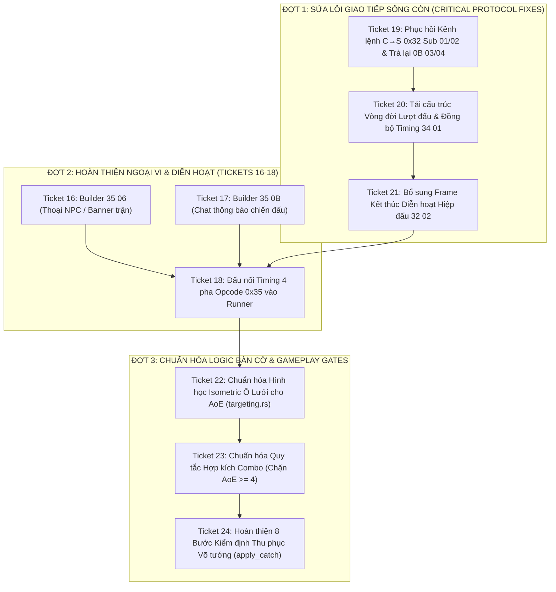

# BÁO CÁO NGHIÊN CỨU & ĐÁNH GIÁ GIAO THỨC BATTLE ENGINE (RUST SERVER VS aLogin.exe)

> **Tài liệu tham chiếu gốc**: [`.scratch/battle-refactor/BATTLE_MODULE_REVERSE_SPEC_CLEAN.md`](BATTLE_MODULE_REVERSE_SPEC_CLEAN.md)  
> **Mã nguồn đối chiếu**: Client decompile `client_pseudo_c/`, PE binary `client_delphi/aLogin.exe`, Rust server `src/battle/`, `src/server/`  
> **Vai trò**: Lead Game Engine Protocol  
> **Mục tiêu**: Đánh giá toàn diện năng lực giao tiếp mượt mà Client ↔ Server, rà soát 18 ticket hiện có, vạch rõ các thiếu sót/gap nghiêm trọng và thiết lập lộ trình bổ sung ticket để hoàn thiện 100% module chiến đấu.

---

## 1. TỔNG QUAN ĐÁNH GIÁ (EXECUTIVE SUMMARY)

Module chiến đấu (`Battle Engine`) hiện tại của `ts_dream` viết bằng Rust đã đạt được nhiều bước tiến quan trọng về mặt cấu trúc dữ liệu, độ chính xác của các gói tin tĩnh (record 24B `0B FA`, 23B `0B 05`, `33 01`, `0B 01`, `35 07`, `17 06`, `1A 01`, `05 0A`, `08 01 CD/CE`, `0F 08`), tính tất định của RNG và công thức EXP/HP/SP gốc từ `Formula.Dat`.

**TUY NHIÊN, SERVER RUST HIỆN TẠI CHƯA THỂ ĐÁP ỨNG ĐƯỢC VIỆC GIAO TIẾP XỬ LÝ MƯỢT MÀ VỚI CLIENT `aLogin.exe`**.

Nguyên nhân đến từ **3 điểm nghẽn giao thức cốt tử (Critical Architectural Protocol Flaws)**:

1. **Kênh lệnh chiến đấu C→S bị cắt đứt hoàn toàn (`Opcode 0x32` vs `0x0B`)**:
   - Ticket 01 trước đây dựa trên kết quả decompile thiếu sót của Ghidra đã đưa ra kết luận sai lầm rằng *"Client không bao giờ gửi Opcode 0x32"*, từ đó xóa bỏ hoàn toàn `0x32` khỏi `dispatcher.rs` và chuyển logic skill/item sang `0x0B Sub 0x03/0x04`.
   - Trong thực tế mã máy của `aLogin.exe` (`0063cf58_FUN_0063cf58.asm.txt` dòng 382 và 1179), client **BẮT BUỘC gửi `0x32 Sub 0x01` (10 bytes)** khi click Đánh thường, Kỹ năng, Phòng thủ, Bỏ chạy, Bắt tướng và **`0x32 Sub 0x02` (10 bytes)** khi dùng vật phẩm chiến đấu.
   - **Hậu quả**: Khi client `aLogin.exe` thật kết nối vào server, mọi lệnh thao tác chiến đấu của người chơi đều bị server **DROP THẲNG CÁNH**. Trận đấu sẽ bị timeout 100% các hiệp.
2. **Đảo lộn thời điểm phát lệnh bắt đầu hiệp (`34 01` Timing Inversion)**:
   - Server `manager.rs` chờ người chơi gửi lệnh qua `collect_commands` (timeout 20s) **TRƯỚC KHI** gọi `run_turn`. Trong khi đó, gói tin mở lượt `34 01` (lệnh duy nhất giúp client mở menu thao tác và bật đồng hồ đếm ngược 20s) lại chỉ được sinh ra bên trong `turn_phase1` của `run_turn`.
   - **Hậu quả**: Ở Hiệp 1, server chờ 20 giây trong im lặng mà client không hề nhận được `34 01`. Client bị đóng băng giao diện (đơ UI), không mở được nút lệnh. Sau 20s server timeout, chạy hiệp 1, rồi mới phát `34 01` cùng lúc với hoạt ảnh `32 01`, và server lập tức chuyển sang chờ lệnh Hiệp 2 trong khi client vẫn đang diễn hoạt Hiệp 1. Trận đấu bị mất đồng bộ (desync) hoàn toàn.
3. **Thiếu gói tin báo kết thúc diễn hoạt hiệp đấu (`32 02` / `33 02`)**:
   - Client TS Online dựa vào gói tin `32 02` (`FUN_0064dd74`) để xác nhận hoàn tất chuỗi diễn hoạt, dọn dẹp hàng đợi animation và hoàn trả trạng thái sẵn sàng cho hiệp kế tiếp. Server Rust hiện tại không hề phát gói tin này.

---

## 2. MA TRẬN ĐỐI CHIẾU: ĐẶC TẢ SPEC VS HIỆN TRẠNG SOURCE CODE RUST

Dưới đây là bảng đối chiếu từng tiêu chí kỹ thuật trong [`.scratch/battle-refactor/BATTLE_MODULE_REVERSE_SPEC_CLEAN.md`](BATTLE_MODULE_REVERSE_SPEC_CLEAN.md) với source code Rust hiện tại (`src/battle/`, `src/server/`):

| Hạng mục / Tiêu chí trong SPEC CLEAN | Mã lệnh Client / ASM Bằng chứng | Hiện trạng Source Rust (`ts_dream`) | Đánh giá & Khoảng cách (Gap) |
|---|---|---|:---:|
| **1. Khung tin & Mã hóa Wire** | `F4 44 <len:2B LE> <payload ^ 0xAD>` (`0050a248` / `0050a2fc`) | `src/protocol/codec.rs`, `frame.rs` | ✅ **Hoàn chỉnh** (byte-exact). |
| **2. Kênh lệnh C→S Đánh / Skill** | `Opcode 0x32 Sub 0x01` (10B: `[32][01][r][c][tr][tc][skill:2B][rand:2B]`) (`0063cf58:382`) | `src/server/dispatcher.rs` đã xoá `0x32`; re-parent nhầm sang `0x0B Sub 0x03` | ❌ **CRITICAL BUG**: Client gửi `0x32 01` bị server drop; `0x0B 03` từ client là 8B map action. |
| **3. Kênh lệnh C→S Item trên lưới** | `Opcode 0x32 Sub 0x02` (10B: `[32][02][r][c][tr][tc][item:2B][rand:2B]`) (`0063cf58:1179`) | Bị xoá khỏi `dispatcher.rs`; re-parent nhầm sang `0x0B Sub 0x04` | ❌ **CRITICAL BUG**: Lệnh dùng item chiến đấu bị drop. |
| **4. Kênh lệnh C→S Item từ túi** | `Opcode 0x17 Sub 0x0F` (`0063cf58:164`) | `src/server/handlers/use_item/` | ⚠️ **Cần kiểm tra**: Chưa verify luồng chuyển tiếp vào battle runner khi đang trong trận. |
| **5. Khởi tạo trận S→C `0B FA`** | Mảng record 24B (`006438ac`). Marker self = `04` (`player+0x376=4`) | `packets::battle_open_leader`, `member_battle_frame` | ✅ **Hoàn chỉnh** (Ticket 13, 15). |
| **6. Viện trợ / Pet S→C `0B 05`** | Mảng record 23B (lệch -1B do `sideFlag` lên header) (`00644294`) | `packets::entity_player`, `packets::entity_npc` | ✅ **Hoàn chỉnh**. |
| **7. Hiển thị Map S→C `0B 04`** | Record 8B: `0B 04 <kind:1B><charId:4B><tail:3B>` (`00642244`) | `packets::show_player_on_map`, `show_member_on_map` | ✅ **Hoàn chỉnh**. |
| **8. Trailer thời gian `0B 0A`** | `0B 0A <mode:1B>` đặt timer 20s/30s/10s (`0064e978`) | `packets::battle_open_leader` ghép đuôi `F44403000B0A01` | ⚠️ **Chưa tối ưu**: Client mong đợi nhận `0B 0A` sau khi đã gửi `0B FA` ack. |
| **9. Handshake mở màn C→S `0B FA`** | Client gửi `0B FA` (2B) sau khi nạp xong scene (`006438ac:402`) | `handlers/battle.rs`: `0xFA => tracing::debug!(...)` | ❌ **Thiếu rào chắn (Barrier)**: Server không chờ ack này mà vội vã vào vòng lặp chờ lệnh. |
| **10. Khởi động lượt đấu `34 01`** | Reset 21 slot, mở UI menu, chạy đếm lùi 20s (`00650a24`) | `runner.rs` sinh trong `turn_phase1` (gọi sau `collect_commands`) | ❌ **CRITICAL BUG**: Lỗi đảo lộn thời điểm phát `34 01` làm đơ UI client ở Hiệp 1. |
| **11. Pha 2: Ép thế võ `35 03`** | `35 03 <grp><slot>` xả FX cũ, đưa unit vào State 7 (`0064cfec`) | Đã có builder trong `packets.rs` (Ticket 12) | ⏳ **Chưa đấu nối**: Chờ Ticket 18 nối vào `runner.rs` trước đòn đánh. |
| **12. Pha 3: Diễn hoạt chiêu `32 01`** | Hoạt ảnh skill/đòn đánh, số sát thương, hit/miss (`00647164`) | `packets::skilling_full`, `skilling_int`, `runner.rs` | ✅ **Hoàn chỉnh**. |
| **13. Pha 3: Cập nhật HP/SP `33 01`** | Record 7B: `33 01 <grp><slot><prop:1B><val:4B LE>` (`0064cae0`) | `packets::set_unit_prop`, `set_hp`, `set_sp` | ✅ **Hoàn chỉnh** (Ticket 02). |
| **14. Pha 3: Icon Buff/Debuff `35 0F`** | `35 0F <grp><slot><slotKey 'B'..'G'><turns><skillId:2B>` (`0064fd34`) | Đã có builder trong `packets.rs` (Ticket 12) | ⏳ **Chưa đấu nối**: Chờ Ticket 18 nối vào `runner.rs`. |
| **15. Pha 1/4: Xóa trạng thái `35 01`** | `35 01 <grp><slot><layer><skillId:2B>` (xóa FX 5 layer) (`0064cd74`) | Đã có builder `purge_status`, `buff_end` (Ticket 12) | ⏳ **Chưa đấu nối**: Chờ Ticket 18 nối vào đầu hiệp. |
| **16. Pha 4: Rơi đồ bay `35 04`** | `35 04 <itemId:2B><srcGrp><srcSlot><dstGrp><dstSlot>` (`0064d128`) | `packets::drop_reward` trong `runner.rs` | ✅ **Hoàn chỉnh**. |
| **17. Pha 4: Thoại NPC `35 06`** | `35 06 <k:1B><actor:4B LE><tpl:4B LE>` hiện banner thoại (`0064e064`) | Chưa có builder, chưa đấu nối | ⏳ **Chưa thực hiện**: Thuộc Ticket 16 & 18. |
| **18. Pha 4: Chat thông báo `35 0B`** | `35 0B [type:1B][len:1B][str:len B]*n` vào `TTalkMsgForm` (`0075c518`) | Chưa có builder, chưa đấu nối | ⏳ **Chưa thực hiện**: Thuộc Ticket 17 & 18. |
| **19. Pha 4: Báo dứt lượt `32 02`** | `32 02` (`FUN_0064dd74`) kết thúc diễn hoạt hiệp đấu | Hoàn toàn chưa có trong source | ❌ **Thiếu hụt**: Client không nhận được tín hiệu kết thúc chuỗi hoạt ảnh hiệp. |
| **20. Thoát trận đấu `0B 00`** | `0B 00 <charId:4B LE> 0000` (`00641fa4`) giải phóng `TFightField` | `packets::hide_from_map` gửi đúng cấu trúc này | ✅ **Hoàn chỉnh**. |
| **21. Dọn ô đơn vị `0B 01`** | `0B 01 <grp><slot>` (4B) xóa đơn vị trên bàn cờ (`0064bb24`) | `packets::reset_cell` | ✅ **Hoàn chỉnh** (Ticket 03). |
| **22. Dời ô lưới `35 07`** | `35 07 <sGrp><sSlot><dGrp><dSlot>` hoán đổi ô nguyên tử (`0064e3e0`) | `packets::move_cell` | ✅ **Hoàn chỉnh** (Ticket 03). |
| **23. Thưởng EXP Player `08 01`** | `08 01 24 <exp:4B LE>` & `08 01 23 <lv:1B>` | `service.rs`: `Stat::Texp`, `Stat::Level` | ✅ **Hoàn chỉnh** (Ticket 06, 11). |
| **24. Khóa MaxHP/MaxSP `08 01 CD/CE`** | `08 01 CD/CE <val:4B LE>` chống lệch client recompute | `service.rs`: `Stat::Hpmax` -> `0xCD`, `Spmax` -> `0xCE` | ✅ **Hoàn chỉnh** (Ticket 06). |
| **25. Âm thanh thăng cấp `05 0A`** | `05 0A <charId:4B LE>` phát `sound\WA0013.wav` (`0072f970`) | `packets::level_up` | ✅ **Hoàn chỉnh** (Ticket 06). |
| **26. Thưởng EXP Pet `0F 08`** | `0F 08 <stt:1B> 24 <exp:4B LE>` & `23 <lv:4B LE>` & `43 <fai:4B LE>` | `service.rs`: `apply_pet_exp` | ✅ **Hoàn chỉnh** (Ticket 07). |
| **27. Thưởng Tiền vàng `1A 01`** | `1A 01 <gold:4B LE>` hiện toast nhận tiền (`0072b084`) | `packets::gold_gain`, `apply_gold` | ✅ **Hoàn chỉnh** (Ticket 05). |
| **28. Thưởng Vật phẩm `17 06`** | Record 14B: `17 06 <id:2B><cnt:2B><doben><long><giatri><khang><texp:4B>` | `server/inventory.rs`: `item_added_frame` | ✅ **Hoàn chỉnh** (Ticket 04). |
| **29. Hình học Isometric Lưới 4×5** | Thứ tự cột đường chéo `[2, 1, 3, 0, 4]`, tâm là 2 (`00652454`) | `targeting.rs`: dùng `c - 1` và `c + 1` tuyến tính | ❌ **Lệch ô AoE**: Chiêu hàng 3 nhắm slot 2 server đánh `{1,2,3}` thay vì `{1,2,4}`. |
| **30. Điều kiện Hợp kích Combo** | Server-side: `nbTarget <= 3` mới được combo; `nbTarget >= 4` cấm combo | `runner.rs`: chỉ kiểm tra `next_type == 1` | ❌ **Thiếu guard**: Chưa chặn kỹ năng AoE diện rộng tham gia combo. |
| **31. 8 Bước Kiểm định Bắt tướng** | Gap Lv $\le 40$, NPC Bat=0, Pet < 4, không trùng, skill 14026... | `runner.rs`: chỉ kiểm tra sơ cấp một vài điều kiện | ⚠️ **Thiếu điều kiện**: Chưa đối chiếu đủ 8 rào chắn của client. |

---

## 3. RÀ SOÁT BỘ 18 TICKET HIỆN TẠI (TỪ 01 ĐẾN 18)

### 3.1. Các Ticket Đã Triển Khai Xong (01 → 13, 15)
- **Ticket 01 (`01-0b-command-channel.md`)**: **CẦN SỬA LẠI (DEFECTIVE)**.  
  Ticket này đã giải quyết tốt việc parse an toàn cho các sub của `0x0B` (sub 1, 2, 6, 7, 8, 9, 0A), nhưng lại mang một lỗi logic nghiêm trọng khi triệt tiêu `0x32`. Cần tạo một ticket khắc phục để mở lại `0x32` trong `dispatcher.rs` và trả lại ngữ nghĩa chuẩn cho `0x0B Sub 03/04`.
- **Ticket 02 (`02-33-01-hp-sp-frame.md`)**: **XUẤT SẮC**.  
  Khôi phục hoàn hảo frame `33 01` (7 bytes/record) cho HP (`0x19`) và SP (`0x1A`), khớp 100% với `case_044` / `FUN_0064cae0`.
- **Ticket 03 (`03-0b-01-reset-and-35-07-move.md`)**: **XUẤT SẮC**.  
  Chuẩn hóa `0B 01` 4 byte và bổ sung builder `35 07` hoán đổi vị trí ô lưới nguyên tử.
- **Ticket 04 (`04-17-06-item-frame.md`)**: **XUẤT SẮC**.  
  Gộp một builder chuẩn 14 byte và kích hoạt gửi frame khi rơi đồ sau trận.
- **Ticket 05 (`05-1a-01-gold-frame.md`)**: **XUẤT SẮC**.  
  Gửi `1A 01` delta vàng và hiển thị toast banner.
- **Ticket 06 (`06-05-0a-levelup-and-maxhp-frames.md`)**: **XUẤT SẮC**.  
  Bổ sung `05 0A` levelup fanfare và `08 01 CD/CE` khóa MaxHP/MaxSP.
- **Ticket 07 (`07-0f-08-pet-exp-frame.md`)**: **XUẤT SẮC**.  
  Đính chính layout `0F 08` cho Pet.
- **Ticket 08 (`08-team-row-rule.md`)**: **XUẤT SẮC**.  
  Áp dụng quy tắc `row < 2 => 2`, `row >= 2 => 1` loại bỏ bug phân phe.
- **Ticket 09 (`09-finish-generalization.md`)**: **XUẤT SẮC**.  
  Quét phần thưởng theo ô thực tế, hỗ trợ nhiều hàng người chơi.
- **Ticket 10 (`10-rng-determinism.md`)**: **XUẤT SẮC**.  
  Tách stream `random_skill` tất định, loại bỏ `time_seeded()`.
- **Ticket 11 (`11-exp-and-hp-formula-parity.md`)**: **XUẤT SẮC**.  
  Đồng bộ bảng EXP (`k = [2.9, 3.0, 3.05, 3.0]`) và hằng số `+5` từ `Formula.Dat`.
- **Ticket 12 (`12-35-03-builder.md`)**: **XUẤT SẮC**.  
  Xây dựng đầy đủ builder cho `35 03`, `35 0E`, `35 0F`, `35 01`.
- **Ticket 13 (`13-cleanup-dead-code.md`)**: **XUẤT SẮC**.  
  Xóa dead-code `BattleRoleData`, bỏ magic length `F4441C`.
- **Ticket 14 (`14-capture-verification.md`)**: **GIỮ NGUYÊN**.  
  Dành cho kiểm thử runtime thực tế (`ready-for-human`).
- **Ticket 15 (`15-0b-fa-self-kind-04.md`)**: **XUẤT SẮC**.  
  Đổi marker self trong `0B FA` sang `04`, giải phóng nút thoát trận và lệnh `0B 00`.

### 3.2. Các Ticket Chưa Thực Hiện (16, 17, 18)
- **Ticket 16 (`16-35-06-battle-npc-talk-builder.md`)**: **CẦN THIẾT**.  
  Xây dựng builder cho `35 06` thoại NPC mở màn trận chiến.
- **Ticket 17 (`17-35-0b-battle-chat-notice-builder.md`)**: **CẦN THIẾT**.  
  Xây dựng builder cho `35 0B` đẩy dòng tin chiến sự vào `TTalkMsgForm`.
- **Ticket 18 (`18-battle-0x35-timing-wiring.md`)**: **CẦN THIẾT NHƯNG CẦN MỞ RỘNG**.  
  Cần mở rộng Ticket 18 để bao gồm việc gửi gói kết thúc diễn hoạt `32 02` và đồng bộ nhịp nhàng với vòng lặp lượt đấu.

---

## 4. KẾ HOẠCH HÀNH ĐỘNG & CÁC TICKET MỚI CẦN TẠO (PROPOSED NEW ISSUES)

Để module chiến đấu đạt độ hoàn thiện 100% theo chuẩn `BATTLE_MODULE_REVERSE_SPEC_CLEAN.md`, ngoài việc thực thi tiếp Ticket 16, 17, 18, chúng ta **BẮT BUỘC** phải triển khai thêm 6 ticket kỹ thuật mới:

### Chi tiết Đặc tả 6 Ticket Mới:

#### Ticket 19: Phục hồi Kênh Lệnh Chiến Đấu `0x32 Sub 01/02` và Sửa Lỗi Sai Lệch Ticket 01
* **Vấn đề**: Ticket 01 xóa bỏ `OP_BATTLE_COMMAND (0x32)` khỏi `dispatcher.rs` vì ngộ nhận rằng client không gửi `0x32`. Thực tế client gửi `0x32 01` (10B) cho mọi đòn đánh/skill và `0x32 02` (10B) cho item trên lưới.
* **Nhiệm vụ**:
  1. Thêm lại `OP_BATTLE_COMMAND (0x32)` vào `src/server/dispatcher.rs` chuyển tiếp sang `handlers/battle::handle_battle_command`.
  2. Xây dựng bộ giải mã khung tin 10 bytes:
     `[32][sub:1B][srcGrp:1B][srcSlot:1B][dstGrp:1B][dstSlot:1B][skillOrItemId:2B LE][rand1:1B][rand2:1B]`.
  3. Ánh xạ `sub 1` thành `BattleCommand` (skill/attack), `sub 2` thành `BattleCommand` (use item).
  4. Trả lại ngữ nghĩa nguyên bản cho `0x0B Sub 03` và `Sub 04` là thao tác ngoài trận (8 bytes: `[kind][u32 LE][u16 LE]`), không còn gán ép làm lệnh skill/item nữa.
  5. Viết bộ unit test trong `tests/battle_command_0x32_test.rs`.

#### Ticket 20: Tái Cấu Trúc Vòng Đời Lượt Đấu & Đồng Bộ Timing `34 01`
* **Vấn đề**: `manager.rs` chờ lệnh `collect_commands` trước khi gọi `run_turn`, khiến Hiệp 1 client không hề nhận được `34 01` để mở menu lệnh và chạy countdown.
* **Nhiệm vụ**:
  1. Tái cấu trúc vòng lặp trận đấu trong `manager.rs`:
     - Khi trận chiến bắt đầu: Chờ gói ack `0B FA` từ client (với timeout ngắn an toàn ~1.5s).
     - **BƯỚC 1 (Đầu hiệp)**: Bắn gói `34 01` (`packets::your_turn()`) cho các đấu sĩ còn sống phe ta và khởi động bộ đếm 20s.
     - **BƯỚC 2 (Nhận lệnh)**: Thu thập `PlayerInput` từ kênh `0x32` trong thời gian timeout.
     - **BƯỚC 3 (Thực thi)**: Gọi `battle.run_turn(...)`, phát chuỗi frame diễn hoạt ra sink.
     - **BƯỚC 4 (Độ trễ diễn hoạt)**: Cho phép một khoảng nghỉ (animation delay) tính theo số đòn đánh trước khi vòng lặp quay lại Bước 1 của hiệp tiếp theo.
  2. Viết test luồng mở hiệp trong `tests/battle_turn_lifecycle_test.rs`.

#### Ticket 21: Bổ Sung Frame Kết Thúc Diễn Hoạt Hiệp Đấu `32 02` (`turn_action_finish`)
* **Vấn đề**: Sau khi kết thúc chuỗi đòn đánh `32 01`, client cần frame `32 02` (`FUN_0064dd74`) để giải phóng hàng đợi hoạt ảnh.
* **Nhiệm vụ**:
  1. Thêm builder `packets::turn_action_finish() -> String` tạo frame `F44402003202`.
  2. Phát frame `32 02` ở cuối mỗi hiệp đấu (trong `run_turn` hoặc `manager.rs`) sau khi tất cả các đòn đánh đã phát ra.
  3. Viết test xác nhận cấu trúc byte-exact trong `tests/battle_frames_test.rs`.

#### Ticket 22: Chuẩn Hóa Hình Học Isometric Ô Lưới cho Kỹ Năng AoE (`targeting.rs`)
* **Vấn đề**: Bàn cờ Isometric sắp xếp cột theo thứ tự `0, 1, 2, 4, 3`. Khi kỹ năng đánh 3 mục tiêu (`sl_danh = 3`) nhắm ô `slot 2`, client highlight `{1, 2, 4}`, nhưng server hiện tại lấy `c - 1` và `c + 1` tuyến tính `{1, 2, 3}`.
* **Nhiệm vụ**:
  1. Cập nhật giải thuật `expand_sl_danh` trong `src/battle/targeting.rs` để phản ánh đúng thứ tự kề cận trên hình học Isometric:
     - Ô tâm `2` -> kề là `1` và `4`.
     - Ô tâm `1` -> kề là `0` và `2`.
     - Ô tâm `4` -> kề là `2` và `3`.
  2. Viết test kiểm tra lưới mục tiêu theo chuẩn client trong `tests/battle_isometric_targeting_test.rs`.

#### Ticket 23: Chuẩn Hóa Quy Tắc Hợp Kích Combo (Chặn Kỹ Năng AoE $\ge 4$)
* **Vấn đề**: `runner.rs::detect_combo` hiện cho phép bất kỳ kỹ năng nào có `next_type == 1` tham gia combo. Client quy định rõ chỉ đòn đánh thường (`10000`) và kỹ năng $\le 3$ mục tiêu (`nbTarget <= 3`) mới được combo; các chiêu AoE $\ge 4$ mục tiêu bị triệt tiêu combo hoàn toàn.
* **Nhiệm vụ**:
  1. Thêm kiểm tra `nbTarget <= 3` (hoặc `fight_area <= 3`) cho cả đòn đánh hiện tại và đòn đánh kế tiếp trong `detect_combo`.
  2. Viết test xác nhận kỹ năng AoE 4 mục tiêu (như Loạn kích `13013`) không thể tạo combo.

#### Ticket 24: Hoàn Thiện 8 Bước Kiểm Định Thu Phục Võ Tướng (`apply_catch`)
* **Vấn đề**: `apply_catch` trong `runner.rs` hiện thiếu nhiều bước kiểm định cốt lõi của client (như chênh lệch cấp độ tối đa 40 cấp, kiểm tra kỹ năng Triệu gọi `14026`, kiểm tra túi pet/nhà trọ đầy đủ).
* **Nhiệm vụ**:
  1. Cập nhật `apply_catch` để thực hiện đủ 8 bước kiểm tra theo mục 4.2.2 của `BATTLE_MODULE_REVERSE_SPEC_CLEAN.md`.
  2. Viết test mô phỏng các ca từ chối bắt tướng trong `tests/battle_catch_test.rs`.

---

## 5. KẾT LUẬN & KIẾN NGHỊ

Source code server Rust hiện tại đã xây dựng được một nền tảng vững chắc về quản lý trạng thái, mô hình dữ liệu nhị phân và các gói tin tĩnh. Tuy nhiên, để đạt được mục tiêu **giao tiếp xử lý mượt mà nhất có thể và hoàn thiện module điều khiển trận đấu**, chúng ta **cần ưu tiên xử lý ngay lập tức 3 lỗi kỹ thuật sống còn**:
1. **Mở lại kênh lệnh `0x32` C→S** (Ticket 19) để client có thể tương tác.
2. **Sửa đổi thời điểm phát `34 01`** (Ticket 20) để client mở được menu lệnh và đồng hồ đếm ngược.
3. **Phát gói tin kết thúc diễn hoạt `32 02`** (Ticket 21) để tránh treo kẹt client.

Sau đó, tiến hành hoàn thành **Ticket 16, 17, 18** để hoàn tất toàn bộ hệ thống biến cố `0x35` và cuối cùng là hoàn thiện các tinh chỉnh gameplay ở **Ticket 22, 23, 24**. Khi lộ trình này hoàn tất, module chiến đấu của `ts_dream` sẽ hoàn toàn tương thích 100% với client gốc `aLogin.exe`.
