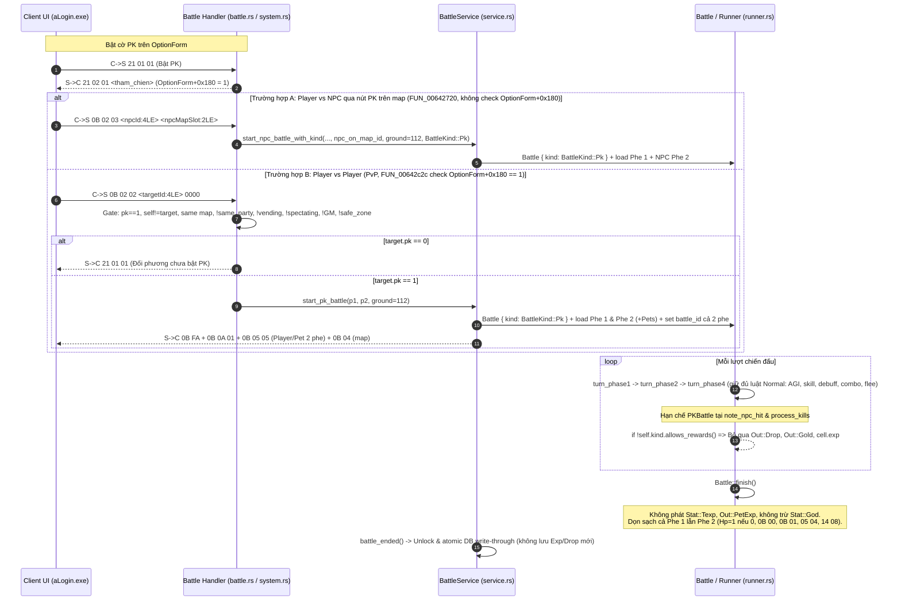
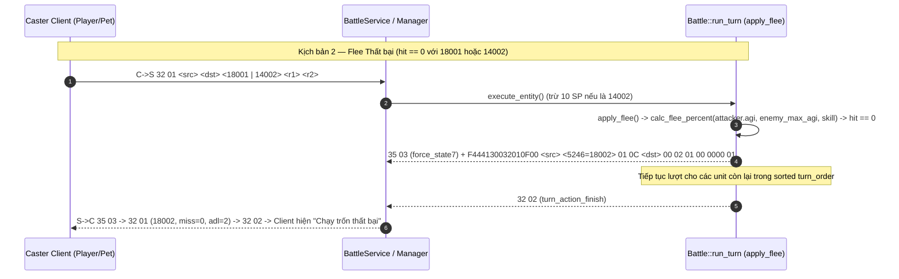

# NGHIÊN CỨU & THIẾT KẾ CHUYÊN SÂU: PHÂN LOẠI TRẬN CHIẾN (NORMAL VS PK) & TÍNH NĂNG CHẠY TRỐN (FLEE)

- **Dự án**: `ts_dream` (Rust Battle Server cho TS Online PC `aLogin.exe`)
- **Tài liệu tham chiếu nền tảng**:
  - [handoff-battle-refactor.md](file:///D:/VUDT/GIT_PCC/ts_dream/.scratch/battle-refactor/handoff-battle-refactor.md) (Tickets 16–25)
  - [0006-battle-protocol-parity-and-turn-lifecycle.md](file:///D:/VUDT/GIT_PCC/ts_dream/docs/adr/0006-battle-protocol-parity-and-turn-lifecycle.md) (ADR 0006)
- **Tệp báo cáo**: [research-pk-and-flee.md](file:///D:/VUDT/GIT_PCC/ts_dream/.scratch/battle-refactor/research-pk-and-flee.md)
- **Phạm vi**: Audit nguồn sơ cấp (`client_pseudo_c/`, `Data/skills.json`, `src/`, `tests/`, `docs/`, `spec/`) và đề xuất kiến trúc + kế hoạch kiểm thử (**chưa chỉnh sửa mã nguồn**).

> [!NOTE]
> **Ghi chú nguồn sơ cấp client đã xác minh**:
> Báo cáo này đối chiếu trực tiếp các tệp decompile & hex dump trong [`client_pseudo_c/`](file:///D:/VUDT/GIT_PCC/ts_dream/client_pseudo_c), bao gồm hai hàm khởi tạo PK trực tiếp từ bản đồ vừa được bổ sung: [`00642720_FUN_00642720.c`](file:///D:/VUDT/GIT_PCC/ts_dream/client_pseudo_c/00642720_FUN_00642720.c) (Tấn công/PK NPC, `0B 02 kind=3`), [`00642c2c_FUN_00642c2c.c`](file:///D:/VUDT/GIT_PCC/ts_dream/client_pseudo_c/00642c2c_FUN_00642c2c.c) (PK Player, `0B 02 kind=2`), cùng [`004c9bf0_FUN_004c9bf0.c`](file:///D:/VUDT/GIT_PCC/ts_dream/client_pseudo_c/004c9bf0_FUN_004c9bf0.c), [`lit_006429f0_ev_00642a50.hex`](file:///D:/VUDT/GIT_PCC/ts_dream/client_pseudo_c/lit_006429f0_ev_00642a50.hex), [`lit_006431d4_ev_00643460.hex`](file:///D:/VUDT/GIT_PCC/ts_dream/client_pseudo_c/lit_006431d4_ev_00643460.hex) và chuỗi hàm chiến đấu `007928e4`, `00602f68`, `0064ea20`, `0064efa0`, `0064ed14`, `00643310`, `00643470`, `006438ac`, `0064e978`, `00642244`, `00641fa4`, `0064bb24`, `00590ba8`, `006538bc`, `0063cf58`, `0064cfec`, `00652454`, `00648154`, `0070f7b4`, `0077f414`, `asm_cs0b_78048d_builders`.

---

## TỔNG QUAN & BẢNG ĐỐI CHIẾU LỖ HỔNG (GAP MATRIX)

### Bảng tổng hợp các lỗ hổng phát hiện

| Mã | Chủ đề | Hiện trạng code `ts_dream` | Tác động thực tế | Mức độ | Vị trí nguồn đã xác minh |
|---|---|---|---|---:|---|
| **PK-1** | Phân loại Battle | `Battle` chỉ có `is_40_npc` và `fight_type`, chưa có `BattleKind` (`Normal` vs `Pk`) | Không phân biệt được PvE thường với PKBattle (PvP hoặc PK NPC) | 🔴 Critical | [construction.rs](file:///D:/VUDT/GIT_PCC/ts_dream/src/battle/construction.rs#L63-L66) |
| **PK-2** | PK NPC trên map (`0B 02 03`) | `handle_attack_npc` tạo trận `Normal` và đọc nhầm `payload[5..7]` làm `ground` (`DiaHinh`), truyền `npc_on_map_id = 0` | Trên client (`FUN_00642720`), bấm nút PK chém NPC gửi `0B 02 03` **không kiểm tra `OptionForm+0x180`** và gửi `payload[5..7] = uVar5` (index NPC trên map `1..=100`). Server nhận Drop/Gold/EXP sai và lấy nhầm slot làm `DiaHinh` | 🔴 Critical | [battle.rs](file:///D:/VUDT/GIT_PCC/ts_dream/src/server/handlers/battle.rs#L261-L278), [00642720_FUN_00642720.c](file:///D:/VUDT/GIT_PCC/ts_dream/client_pseudo_c/00642720_FUN_00642720.c#L75-L86) |
| **PK-3** | Hạn chế thưởng PK | `note_npc_hit`, `process_kills`, `finish` phát Drop (`35 04`), Gold (`1A 01`), Player EXP (`Stat::Texp`), Pet EXP (`Out::PetExp`) và trừ `Stat::God` cho mọi NPC `typ == 3 \| 7` | PK NPC vẫn rơi đồ, nhận vàng/EXP và bị trừ lượt Ngọc Phúc Thần | 🔴 Critical | [runner.rs](file:///D:/VUDT/GIT_PCC/ts_dream/src/battle/runner.rs#L2963-L3094), [runner.rs](file:///D:/VUDT/GIT_PCC/ts_dream/src/battle/runner.rs#L3168-L3240) |
| **PK-4** | `Battle::finish` bỏ rơi Phe 2 | `if cell.id <= 0 \|\| cell.typ != 2 \|\| cell.team != 1 { continue; }` bỏ qua toàn bộ người chơi Phe 2 (`rows 0..1`) | Trong PvP, Phe 2 không nhận `0B 00`, `0B 01`, không hồi `Hp = 1` nếu tử trận | 🔴 Critical | [runner.rs](file:///D:/VUDT/GIT_PCC/ts_dream/src/battle/runner.rs#L3162-L3257) |
| **PK-5** | Khởi tạo PvP lỗi toàn diện | `start_pk_battle` không load pet Phe 2, không set `opp.battle_id`, gửi `entity_npc` (`0B 05 03`) cho Phe 2, dùng `member_battle_frame` làm đối thủ không thấy Phe 1 và tự trùng bản thân | Đối thủ PvP không có Pet, lệnh `0x32` bị drop do `battle_id == 0`, lưới hiển thị sai phe | 🔴 Critical | [service.rs](file:///D:/VUDT/GIT_PCC/ts_dream/src/battle/service.rs#L1081-L1116), [construction.rs](file:///D:/VUDT/GIT_PCC/ts_dream/src/battle/construction.rs#L497-L700) |
| **PK-6** | Guard thách đấu PK | `handle_pk_challenge` thiếu kiểm tra tự PK chính mình, khác map, cùng tổ đội, target đang rao bán/quan chiến/GM, hoặc vùng cấm PK | Thiếu bảo vệ server-side tương ứng các rule trên `FUN_00642c2c` | 🟡 High | [battle.rs](file:///D:/VUDT/GIT_PCC/ts_dream/src/server/handlers/battle.rs#L230-L257), [00642c2c_FUN_00642c2c.c](file:///D:/VUDT/GIT_PCC/ts_dream/client_pseudo_c/00642c2c_FUN_00642c2c.c#L85-L215) |
| **FL-1** | Công thức Flee sai tham số | `get_random_miss_flee` tính `60 + (lv1-lv2) + (lvtb1-lvtb2)` theo LV và đọc `target.lv` từ `(row_attack, col_attack)` | Hoàn toàn **không dùng AGI**; self-target hoặc ô trống đọc `target.lv` sai lệch | 🔴 Critical | [damage.rs](file:///D:/VUDT/GIT_PCC/ts_dream/src/battle/damage.rs#L64-L77), [runner.rs](file:///D:/VUDT/GIT_PCC/ts_dream/src/battle/runner.rs#L2433-L2439) |
| **FL-2** | Bypass `14002` | `if hit == 1 \|\| skill == 14002` ép `Thuật đào tẩu` luôn thắng 100% | Bỏ qua roll & AGI cho kỹ năng `14002` | 🔴 Critical | [runner.rs](file:///D:/VUDT/GIT_PCC/ts_dream/src/battle/runner.rs#L2440) |
| **FL-3** | Sai mã skill khi Flee trượt | `apply_flee` lấy `skill + 1`; với `14002` phát nhầm `14003` (`Thuật mua bán`, `skillType: 0`) | Client chỉ nhận `18002` (`0x4652`) làm Flee thất bại trong `00652454` & `00648154` | 🔴 Critical | [runner.rs](file:///D:/VUDT/GIT_PCC/ts_dream/src/battle/runner.rs#L2475-L2494), [Data/skills.json](file:///D:/VUDT/GIT_PCC/ts_dream/Data/skills.json) |
| **FL-4** | Zombie cell & dọn tổ đội | Khi member chạy trốn, `execute_entity` ghi đè lại clone `attacker` sau `clear_cell`, `apply_flee` gọi nhầm `npc_respawn`, lặp `reset_cell(r,c)` 2 lần, `apply_fled` không xóa khỏi `battle_participants` | Member/Pet đã thoát vẫn tồn tại ma trên lưới server, làm NPC hồi sinh giữa trận, và bị `battle_ended` ghi đè state/Eve về sau | 🔴 Critical | [runner.rs](file:///D:/VUDT/GIT_PCC/ts_dream/src/battle/runner.rs#L1228-L1396), [runner.rs](file:///D:/VUDT/GIT_PCC/ts_dream/src/battle/runner.rs#L2444-L2473), [service.rs](file:///D:/VUDT/GIT_PCC/ts_dream/src/battle/service.rs#L223-L278) |
| **FL-5** | Lệch UI `0B FA kind=04` vs `18001` | `battle_open_leader` & `member_battle_frame` ghi `kind = 0x04` vào `player+0x376`; `00590ba8 case 9` thấy `0x376 == 4` liền gửi `0B 01 03` thoát thẳng thay vì `32 01 18001` | Nút Bỏ chạy trên UI client hiện đang đi qua `handle_leave_battle` (`0B 01 03`) bỏ qua toàn bộ lượt đánh & roll AGI | 🟠 Design Blocker | [packets.rs](file:///D:/VUDT/GIT_PCC/ts_dream/src/battle/packets.rs#L8-L29), [battle.rs](file:///D:/VUDT/GIT_PCC/ts_dream/src/server/handlers/battle.rs#L167-L193), [00590ba8_FUN_00590ba8.c](file:///D:/VUDT/GIT_PCC/ts_dream/client_pseudo_c/00590ba8_FUN_00590ba8.c#L157-L179) |

---

# PHẦN I — AUDIT & THIẾT KẾ PHÂN LOẠI TRẬN CHIẾN (`NORMAL` VS `PKBATTLE`)

## 1. Bằng chứng phía Client `aLogin.exe`

### 1.1. Cờ PK trên giao diện & Opcode `0x21`
1. **Đồng bộ khi đăng nhập / bật tắt Option**:
   - Server phát `21 02 <pk:1B> <tham_chien:1B>` lúc vào game ([spawn.rs](file:///D:/VUDT/GIT_PCC/ts_dream/src/server/spawn.rs#L608-L611)) và phản hồi ngay sau khi nhận C→S `21 01 <flag>` hoặc `21 02 <flag>` ([system.rs](file:///D:/VUDT/GIT_PCC/ts_dream/src/server/handlers/system.rs#L32-L58)).
   - Trên client, handler của `0x21` ([007928e4_FUN_007928e4.c](file:///D:/VUDT/GIT_PCC/ts_dream/client_pseudo_c/007928e4_FUN_007928e4.c) / [case_029_007928E4_FUN_007928e4.c](file:///D:/VUDT/GIT_PCC/ts_dream/client_pseudo_c/case_029_007928E4_FUN_007928e4.c#L24-L79)):
     - **`T == 1`**: `switch(RP[1])` với `1..=8` hiển thị thông báo banner `2000ms` (ví dụ `K == 1`: đối phương chưa bật PK -> `F4440300210101`).
     - **`T == 2`**: ghi `*(TCY_OptionForm + 0x180) = RP[1]` (cờ PK) và `*(TCY_OptionForm + 0x181) = RP[2]` (cờ Tham Chiến), rồi gọi [00602f68_FUN_00602f68.c](file:///D:/VUDT/GIT_PCC/ts_dream/client_pseudo_c/00602f68_FUN_00602f68.c#L25-L50) để chuyển trạng thái texture `"btn_off"` / `"btn_on"` trên 2 nút option (`form + 0x16c + i*4`). Con trỏ `*gvar_007D9F74 = TCY_OptionForm` được xác minh tại [0051189c_FUN_0051189c.c](file:///D:/VUDT/GIT_PCC/ts_dream/client_pseudo_c/0051189c_FUN_0051189c.c#L1588-L1590).
2. **Hiển thị & gate PK ngoài bản đồ**:
   - Hàm render tên thực thể trên map [0070f7b4_FUN_0070f7b4.c](file:///D:/VUDT/GIT_PCC/ts_dream/client_pseudo_c/0070f7b4_FUN_0070f7b4.c#L495-L540) kiểm tra byte `*(player + 0x1437)` kết hợp `*(player + 0x376)` và `*(target + 0x16f)` để đổi màu tên đối tượng khi vào chế độ PK/trận chiến.
   - Hàm click-attack player trên map [0064ea20_FUN_0064ea20.c](file:///D:/VUDT/GIT_PCC/ts_dream/client_pseudo_c/0064ea20_FUN_0064ea20.c#L34-L129) kiểm tra `*gvar_007D9D5C == 0 && *(player + 0x1437) != 0`, từ chối nếu `target + 0x376 == 4`, chặn GM (`4..=8`), yêu cầu khoảng cách `|Δx| < 0x97 && |Δy| < 0x97`, gán `TFightManage + 0x24 = 9` rồi gọi `FUN_0077f414(..., CL=0x08, DL=0x0B)` ([0064ea20_FUN_0064ea20.asm.txt](file:///D:/VUDT/GIT_PCC/ts_dream/client_pseudo_c/0064ea20_FUN_0064ea20.asm.txt#L171-L178)).
   - **So sánh trực tiếp [`00642720_FUN_00642720.c`](file:///D:/VUDT/GIT_PCC/ts_dream/client_pseudo_c/00642720_FUN_00642720.c) (PK NPC) vs [`00642c2c_FUN_00642c2c.c`](file:///D:/VUDT/GIT_PCC/ts_dream/client_pseudo_c/00642c2c_FUN_00642c2c.c) (PK Player)** — cả hai đều được `FUN_0070d43c` gọi khi `*gvar_007D9D5C == 1` (bật con trỏ PK trên toolbar map), tự đứng dậy (`*(self+900) == ';'` → `FUN_0072b390(self, 8)`), chặn các khu vực cấm PK chung (`player+0x1338`, `player+0x1459`, [`00504c9c`](file:///D:/VUDT/GIT_PCC/ts_dream/client_pseudo_c/00504c9c_FUN_00504c9c.c), `00735ef8`, [`00634f3c(..., 10)`](file:///D:/VUDT/GIT_PCC/ts_dream/client_pseudo_c/00634f3c_FUN_00634f3c.c), `00525ae8(..., 1)`, map `0x2aef`, `0x2af2`, `0x2f94`, `0x326f`), nhưng có **5 điểm khác biệt cốt lõi**:
     1. **Công tắc Option PK (`*(TCY_OptionForm + 0x180)`)**: `FUN_00642c2c` (PvP) **bắt buộc** `*(gvar_007D9F74 + 0x180) != 0` (`"Công tắc tắt mở đã đóng, không thể PK người chơi"`, [`lit_006431d4_ev_00643460.hex`](file:///D:/VUDT/GIT_PCC/ts_dream/client_pseudo_c/lit_006431d4_ev_00643460.hex)); ngược lại `FUN_00642720` (PK NPC) **KHÔNG kiểm tra** công tắc này.
     2. **Giá trị `TFightManage + 0x22` (`payload[5..7]` trong `0B 02`)**: `FUN_00642c2c` (`kind = 2`) luôn gửi **`0`**; còn `FUN_00642720` (`kind = 3`) gửi **`(u16)uVar5` — index slot NPC trên map (`1..=100`)** lấy từ `*(gvar_007D9D34 + 0x7b)` (để tra `gvar_007DA6DC[slot] + 4`), **không phải `DiaHinh`**.
     3. **Xác định Target ID (`+0x1E`) & Tổ đội**: `FUN_00642720` gửi NPC ID `*(gvar_007DA6DC[slot] + 4)`; `FUN_00642c2c` nếu mục tiêu đang theo sau/trong tổ đội (`target+0x35f == 2`) thì chặn nếu là đồng đội của mình (`target+0x548 == self.id` → `"Không thể PK đội viên của mình"`), ngược lại **tự chuyển Target ID sang ID đội trưởng đối phương (`target+0x548`)**.
     4. **Khoảng cách & Trạng thái mục tiêu**: `FUN_00642c2c` chặn nếu `|Δx| >= 0x97` hoặc `|Δy| >= 0x97` (`"Cự ly quá xa"`), đang quan chiến (`target+0x376 == 4`), là GM/Thiên Thần ([`FUN_004c9bf0`](file:///D:/VUDT/GIT_PCC/ts_dream/client_pseudo_c/004c9bf0_FUN_004c9bf0.c) trả về `5..=8`), hoặc đang rao bán (`target+0x5c0 != 0`). `FUN_00642720` chỉ cần `uVar5 != 0`.
     5. **Map cấm riêng**: `FUN_00642720` chặn thêm `0x3076..0x3077`, `0x3082..0x3083`, `0xc289..0xc28b`, `0xc2f5` (`"Nơi này cấm PK võ tướng"`, [`lit_006429f0_ev_00642a50.hex`](file:///D:/VUDT/GIT_PCC/ts_dream/client_pseudo_c/lit_006429f0_ev_00642a50.hex#L4-L8)); `FUN_00642c2c` chặn thêm `player+0x1458 != 0`, `FUN_00634f3c(..., 3)`, `0xc2f5`, và vòng lặp 7 map đặc biệt ở `PTR_gvar_007D9A60_007da4bc` với NPC `0x3b3e`.

### 1.2. Kênh kích hoạt trận đấu C→S (`0x0B`) & Khung mở trận S→C (`0B FA`, `0B 0A`, `0B 04`)
1. **Builder `0B 02` & `0B 08` phía client**:
   - `0x0B sub 2` ([asm_cs0b_78048d_builders.asm.txt](file:///D:/VUDT/GIT_PCC/ts_dream/client_pseudo_c/asm_cs0b_78048d_builders.asm.txt#L76-L131), `0x00780595`): khung **9 byte** `[0B][02][TFightManage+0x24:1B][+0x1E:4B LE][+0x22:2B LE]`:
     - `kind = 2`: PK Challenge người chơi ([`00642c2c_FUN_00642c2c.c`](file:///D:/VUDT/GIT_PCC/ts_dream/client_pseudo_c/00642c2c_FUN_00642c2c.c#L224-L225), `[+0x1E] = targetId`, `[+0x22] = 0`).
     - `kind = 3`: Tấn công / PK NPC trên map ([`00642720_FUN_00642720.c`](file:///D:/VUDT/GIT_PCC/ts_dream/client_pseudo_c/00642720_FUN_00642720.c#L79-L86), `[+0x1E] = npcId`, `[+0x22] = npcMapSlot 1..=100`).
     - `kind = 4`: Quan chiến — `CL=0x02, DL=0x0B` ([00643310_FUN_00643310.c](file:///D:/VUDT/GIT_PCC/ts_dream/client_pseudo_c/00643310_FUN_00643310.c), [00643310_FUN_00643310.asm.txt](file:///D:/VUDT/GIT_PCC/ts_dream/client_pseudo_c/00643310_FUN_00643310.asm.txt#L76-L83)).
     - `kind = 5`: Tham chiến / Chen ngang — `CL=0x02, DL=0x0B` ([00643470_FUN_00643470.c](file:///D:/VUDT/GIT_PCC/ts_dream/client_pseudo_c/00643470_FUN_00643470.c), [00643470_FUN_00643470.asm.txt](file:///D:/VUDT/GIT_PCC/ts_dream/client_pseudo_c/00643470_FUN_00643470.asm.txt#L251-L258)).
   - `0x0B sub 8` ([0077f414_FUN_0077f414.asm.txt](file:///D:/VUDT/GIT_PCC/ts_dream/client_pseudo_c/0077f414_FUN_0077f414.asm.txt#L830-L883), `0x007808E2`): khung **8 byte** `[0B][08][kind:1B][target:4B LE][param_lo:1B]` — các thao tác PK/map ngoài trận (`kind = 9` tại `0064ea20`, `kind = 10` tại [0064ed14_FUN_0064ed14.asm.txt](file:///D:/VUDT/GIT_PCC/ts_dream/client_pseudo_c/0064ed14_FUN_0064ed14.asm.txt#L68-L75), `kind = 14/9` tại [0064efa0_FUN_0064efa0.asm.txt](file:///D:/VUDT/GIT_PCC/ts_dream/client_pseudo_c/0064efa0_FUN_0064efa0.asm.txt#L317-L324)).
2. **Xử lý S→C `0B FA`, `0B 0A`, `0B 04`**:
   - **`0B FA`** ([006438ac_FUN_006438ac.c](file:///D:/VUDT/GIT_PCC/ts_dream/client_pseudo_c/006438ac_FUN_006438ac.c#L269-L290)): đọc `mode = RP[1], sub = RP[2]`, tạo `TFightField(VMT_63CC84, 1, mode, sub)`. Khi đọc record bản thân (`type == 2 && id == selfId`), client gán `*(player + 0x376) = kind`; nếu `kind == 4 || kind == 7` đặt `player + 0x1307 = 1`; nếu `kind == 4` đặt `DAT_0098c640 + 0x25 = 1`.
   - **`0B 0A <battleMode>`** ([0064e978_FUN_0064e978.c](file:///D:/VUDT/GIT_PCC/ts_dream/client_pseudo_c/0064e978_FUN_0064e978.c#L47-L57)): ghi `*(DAT_0098c63c + 4) = mode` và cấu hình đồng hồ đếm ngược lượt `*(DAT_0098c63c + 0xe5a)`:
     - `mode ∈ {2, 4, 7, 8, 9}` → **`30s`** (`0x1e`)
     - `mode == 14` (`0x0e`) → **`10s`** (`0x0a`)
     - Mặc định (gồm `mode == 1`) → **`20s`** (`0x14`)
     - **Quan trọng**: chỉ khi `mode == 11` (`'\v'`), client mới chặn skill có `skillType == 12` (Flee) tại [0063cf58_FUN_0063cf58.c](file:///D:/VUDT/GIT_PCC/ts_dream/client_pseudo_c/0063cf58_FUN_0063cf58.c#L689-L708).
   - **`0B 04`** ([00642244_FUN_00642244.c](file:///D:/VUDT/GIT_PCC/ts_dream/client_pseudo_c/00642244_FUN_00642244.c#L116-L151)): đọc các record 8 byte `[kind:1][id:4LE][w:2LE][val:1]`; với `kind == 2`, ghi `*(actor + 0x376) = val` để hiển thị trạng thái chiến đấu/PK của actor khác trên map (`2` = PK leader, `3` = player, `5` = member).

---

## 2. Audit Hiện trạng Server Rust (`src/`)

### 2.1. Các điểm khởi tạo trận đấu và thiếu sót phân loại
Toàn bộ entry point mở trận hiện nằm trong [service.rs](file:///D:/VUDT/GIT_PCC/ts_dream/src/battle/service.rs):

| Entry point | Caller thực tế | Phe đối đầu | Trạng thái hiện tại |
|---|---|---|---|
| `start_pk_battle` ([service.rs](file:///D:/VUDT/GIT_PCC/ts_dream/src/battle/service.rs#L1081-L1116)) | `handle_pk_challenge` (`0B 02 02`, [battle.rs](file:///D:/VUDT/GIT_PCC/ts_dream/src/server/handlers/battle.rs#L230-L257)) | Player (và nên kèm Pet/Party) | Không gắn cờ PK; lỗi khởi tạo Phe 2 nghiêm trọng |
| `start_npc_battle` ([service.rs](file:///D:/VUDT/GIT_PCC/ts_dream/src/battle/service.rs#L1032-L1049)) | `handle_attack_npc` (`0B 02 03`, [battle.rs](file:///D:/VUDT/GIT_PCC/ts_dream/src/server/handlers/battle.rs#L261-L278)) | NPC (`typ = 3`) | Đọc nhầm `payload[5..7]` (slot NPC `1..=100`) làm `ground` (`DiaHinh`), truyền `npc_on_map_id = 0`; mọi trận đều gán `Normal` *(xem Open Decision về phân loại `0B 02 03`)* |
| `start_encounter_battle` / `start_eve_encounter` ([service.rs](file:///D:/VUDT/GIT_PCC/ts_dream/src/battle/service.rs#L1228-L1394)) | Đụng độ ngẫu nhiên ([movement.rs](file:///D:/VUDT/GIT_PCC/ts_dream/src/server/handlers/movement.rs#L337)) / Quest Eve | NPC (`typ = 3`, có `fight_type`) | Trận PvE môi trường / nhiệm vụ (`Normal`) |
| `start_teamdef_battle` ([service.rs](file:///D:/VUDT/GIT_PCC/ts_dream/src/battle/service.rs#L1119-L1147)) | Quái đuổi chạm trên map ([npc_world.rs](file:///D:/VUDT/GIT_PCC/ts_dream/src/battle/npc_world.rs#L164), [dispatcher.rs](file:///D:/VUDT/GIT_PCC/ts_dream/src/server/dispatcher.rs#L256)) | NPC (`typ = 7`) | Trận PvE đội hình quái (`Normal`) |
| `start_40_npc_battle` ([service.rs](file:///D:/VUDT/GIT_PCC/ts_dream/src/battle/service.rs#L1496-L1582)) | Sự kiện 40 NPC ([event_npcs.rs](file:///D:/VUDT/GIT_PCC/ts_dream/src/server/handlers/event_npcs.rs#L360)) | 40 wave NPC (`is_40_npc = true`) | Trận PvE sự kiện (`Normal`) |
| `start_north_star_battle` ([service.rs](file:///D:/VUDT/GIT_PCC/ts_dream/src/battle/service.rs#L1414-L1493)) | Đụng độ Bắc/Nam Tinh Quân ([movement.rs](file:///D:/VUDT/GIT_PCC/ts_dream/src/server/handlers/movement.rs#L278)) | Quiz modal (không chạy turn) | Sự kiện Quiz (`Normal`) |

### 2.2. Các lỗ hổng phát thưởng khi PK NPC trong `runner.rs`
Hiện tại `Battle` ([construction.rs](file:///D:/VUDT/GIT_PCC/ts_dream/src/battle/construction.rs#L34-L66)) không có trường phân loại trận chiến, dẫn tới 4 vi phạm trực tiếp khi người chơi bật PK đánh NPC:
1. **`note_npc_hit`** ([runner.rs](file:///D:/VUDT/GIT_PCC/ts_dream/src/battle/runner.rs#L2963-L2978)): cứ `npc.typ == 7 || npc.typ == 3` là ghi `ts.killed_npcs` và cộng `attacker.exp` (lên tới 100% `hit_exp` khi kết liễu, 10% khi đánh trúng).
2. **`process_kills`** ([runner.rs](file:///D:/VUDT/GIT_PCC/ts_dream/src/battle/runner.rs#L2981-L3094)): với mọi `entry` trong `killed_npcs` khi `npc_dead == true`, đều roll `get_random_drop` phát `Out::Drop` + `packets::drop_item` (`35 04`), cộng `Out::Gold` (`1A 01`), và cộng `reward_exp` / `calc_combo_exp` vào `cell.exp`.
3. **`Battle::finish` EXP & Level-up** ([runner.rs](file:///D:/VUDT/GIT_PCC/ts_dream/src/battle/runner.rs#L3169-L3198) & [`3222-3240`](file:///D:/VUDT/GIT_PCC/ts_dream/src/battle/runner.rs#L3222-L3240)): trao `Out::Db(Stat::Texp)` + `push_level_up_rewards` (`08 01 23`, `05 0A`, `CD`, `19`, `CE`, `1A`, `26`, `25`) cho Player và `Out::PetExp` (`0F 08`) cho Pet.
4. **Trừ điểm Ngọc Phúc Thần (`Stat::God`)** ([runner.rs](file:///D:/VUDT/GIT_PCC/ts_dream/src/battle/runner.rs#L3200-L3217)): cứ `won && !fled && cell.hp > 0 && snap.god > 0` là trừ 1 lượt `Stat::God`. Nếu áp dụng vào `PKBattle`, người chơi thắng PK không nhận EXP/Drop nhưng vẫn mất lượt Ngọc Phúc Thần.

### 2.3. Các lỗ hổng chí mạng của luồng PvP hiện tại (`start_pk_battle` & `finish`)
Dù `combat_formula.rs` đã hỗ trợ hệ số PvP `0.5` khi `target.typ == 2 || target.typ == 4` ([combat_formula.rs](file:///D:/VUDT/GIT_PCC/ts_dream/src/battle/combat_formula.rs#L77-L81)), luồng PK PvP hiện chưa thể vận hành đúng vì 5 lỗi sau:
1. **`Battle::finish` bỏ qua hoàn toàn Phe 2** ([runner.rs](file:///D:/VUDT/GIT_PCC/ts_dream/src/battle/runner.rs#L3162)): điều kiện `if cell.id <= 0 || cell.typ != 2 || cell.team != 1 { continue; }` khiến người chơi ở hàng `0` (`team == 2`) không bao giờ được phát `hide_from_map` (`0B 00`), `reset_cell` (`0B 01`), và không được hồi `Stat::Hp = 1` nếu `cell.hp <= 0`.
2. **Không cập nhật `battle_id` và `player_skills` cho đối thủ** ([service.rs](file:///D:/VUDT/GIT_PCC/ts_dream/src/battle/service.rs#L1097-L1115), [`1885`](file:///D:/VUDT/GIT_PCC/ts_dream/src/battle/service.rs#L1885), [`1904-1922`](file:///D:/VUDT/GIT_PCC/ts_dream/src/battle/service.rs#L1904-L1922)): `start_pk_battle` chỉ đọc `opp.try_read()` rồi thả lock; `spawn_battle` chỉ set `session.battle_id = id` cho người thách đấu (`session`) và chỉ đọc `skills` của `lid` + `session.id_mem`. Hậu quả: `opponent.battle_id` vẫn bằng `0` → mọi gói `0x32` từ đối thủ bị chặn ngay ở cửa `handle_battle_command` ([battle.rs](file:///D:/VUDT/GIT_PCC/ts_dream/src/server/handlers/battle.rs#L292))!
3. **Không nạp Pet (và Party) của Phe 2** ([service.rs](file:///D:/VUDT/GIT_PCC/ts_dream/src/battle/service.rs#L1096-L1101)): Phe 1 gọi `load_leader_pets(session, ..., 3)`, nhưng Phe 2 chỉ gọi `add_player(&opp_guard, opponent, 0, 2)` mà không gọi `load_leader_pets(&opp_guard, opponent, 0)` (cũng chưa nạp tổ đội của hai phe nếu có).
4. **Gửi sai loại gói tin mở trận cho cả 2 phe**:
   - `spawn_battle` gọi `npc_battle_start_packets` ([construction.rs](file:///D:/VUDT/GIT_PCC/ts_dream/src/battle/construction.rs#L570-L581)): duyệt `row in 0..2` và phát `packets::entity_npc` (`0B 05 03`) cho đối thủ ở `(0, 2)` thay vì `packets::entity_player` (`0B 05 05`).
   - `start_pk_battle` gọi `battle.member_battle_frame(terrain, opponent)` ([construction.rs](file:///D:/VUDT/GIT_PCC/ts_dream/src/battle/construction.rs#L592-L700)) cho đối thủ ở `row = 0`: hàm này viết riêng cho thành viên hàng `3`, nên nó lặp lại chính `opponent` hai lần (`04` + `03`), bỏ sót toàn bộ Phe 1 (`rows 2..4`), và phát `entity_npc` cho `rows 0..2` (tức chính Phe 2!).
5. **Thiếu các gate ở `handle_pk_challenge`** ([battle.rs](file:///D:/VUDT/GIT_PCC/ts_dream/src/server/handlers/battle.rs#L230-L257)): chưa chặn tự thách đấu chính mình (`target_id == conn.session.id`), chưa kiểm tra cùng bản đồ (`map_id`), chưa chặn PK đồng đội (`id_leader != 0 && id_leader == target.id_leader`), chưa kiểm tra khu vực cấm PK.

---

## 3. Thiết kế Kiến trúc Phân loại Trận chiến (`BattleKind`)

### 3.1. Mô hình dữ liệu phân loại
Thêm enum thuần tại `src/battle/construction.rs` (hoặc `src/battle/engine.rs` rồi re-export):

```rust
#[derive(Debug, Clone, Copy, PartialEq, Eq, Default)]
pub enum BattleKind {
    /// Trận chiến bình thường: PvE quái map, Random Encounter, Quest/Eve,
    /// TeamDef, 40 NPC, Bắc Tinh Quân. Cho phép Drop, Gold, EXP, Catch, Phúc Thần.
    #[default]
    Normal,
    /// Trận chiến PK (PvP giữa người chơi, hoặc Player tấn công NPC khi bật PK trên UI).
    /// Dùng chung toàn bộ luật combat/turn/status/combo/flee, nhưng CẤM Drop, EXP, Gold.
    Pk,
}

impl BattleKind {
    #[inline]
    pub const fn allows_rewards(self) -> bool {
        matches!(self, Self::Normal)
    }

    #[inline]
    pub const fn is_pk(self) -> bool {
        matches!(self, Self::Pk)
    }
}
```

Gắn `pub kind: BattleKind` vào `Battle` ([construction.rs](file:///D:/VUDT/GIT_PCC/ts_dream/src/battle/construction.rs#L34)).

### 3.2. Quy tắc phân tuyến tại các điểm khởi tạo

| Kịch bản khởi tạo | Điều kiện kích hoạt | `BattleKind` | Lý do thiết kế |
|---|---|---|---|
| `start_pk_battle` (`0B 02 kind=2`) | `conn.session.pk == 1` & `target.pk == 1` & vượt qua gate PvP | **`BattleKind::Pk`** | Mọi trận Player vs Player đều là `PKBattle`. |
| `handle_attack_npc` (`0B 02 kind=3`) | Client gửi từ `FUN_00642720` (bật con trỏ PK `*gvar_007D9D5C == 1` click NPC, **không phụ thuộc** `OptionForm+0x180`) | **`BattleKind::Pk`** *(Đã chốt Q1)* | Mọi `0B 02 03` đều tính là `BattleKind::Pk` bất kể `conn.session.pk`; đọc `payload[5..7]` làm `npc_on_map_id`, `DiaHinh = 112`. |
| `start_encounter_battle` / `start_eve_encounter` | Đụng độ ngẫu nhiên / Quest Eve (`result_type == 3`) | **`BattleKind::Normal`** | Trận môi trường/nhiệm vụ do map/hệ thống mở, giữ đủ thưởng chuẩn. |
| `start_teamdef_battle` / `start_40_npc_battle` / `start_north_star_battle` | Quái đuổi / Tháp 40 NPC / Bắc Tinh Quân | **`BattleKind::Normal`** | Các cơ chế PvE/Event chuẩn phải giữ nguyên phần thưởng bình thường. |

*(Lưu ý thêm về `0B 08`: `handle_battle` sub `8` / `0A` hiện giữ làm `log_map_action` no-op theo [command_channel.rs](file:///D:/VUDT/GIT_PCC/ts_dream/tests/battle/command_channel.rs#L123) & [HANDOFF-client-reverse.md](file:///D:/VUDT/GIT_PCC/ts_dream/.scratch/battle-refactor/HANDOFF-client-reverse.md#L275-L280); nếu sau này mở PK nhanh qua `sub 8 kind 9`, luồng đó cũng tạo `BattleKind::Pk`.)*

### 3.3. Bảng quy tắc hành vi `Normal` vs `PKBattle`

| Quy tắc / Phân hệ | `BattleKind::Normal` | `BattleKind::Pk` (PvP & PK NPC) | Vị trí thực thi |
|---|---|---|---|
| Turn loop, SP cost, Skill validity, Buff/Debuff 3/4/15/19, Berserk, Combo V2, Targeting, Pacing | Hoạt động đầy đủ | **Giữ nguyên 100%** | `runner.rs`, `manager.rs`, `targeting.rs` |
| Hệ số sát thương PvP `0.5x` | Tự động khi `target.typ ∈ {2, 4}` | PvP giữ `0.5x`; PK NPC giữ `1.0x` (`typ ∈ {3, 7}`) | [combat_formula.rs](file:///D:/VUDT/GIT_PCC/ts_dream/src/battle/combat_formula.rs#L77-L81) |
| **Ghi nhận kill để tính Drop/EXP** (`note_npc_hit`) | Cho phép khi `typ ∈ {3, 7}` | **Cấm (`if !self.kind.allows_rewards() { return; }`)** | [runner.rs](file:///D:/VUDT/GIT_PCC/ts_dream/src/battle/runner.rs#L2963) |
| **Rơi vật phẩm & Vàng** (`process_kills`: `Out::Drop`, `35 04`, `Out::Gold`, `1A 01`) | Cho phép | **Cấm hoàn toàn** (`if !self.kind.allows_rewards() { ... return; }`) | [runner.rs](file:///D:/VUDT/GIT_PCC/ts_dream/src/battle/runner.rs#L2981) |
| **Player EXP & Level-up** (`finish`: `Stat::Texp`, `08 01`, `05 0A`) | Cho phép khi `!fled && hp > 0` | **Cấm hoàn toàn** (`self.kind.allows_rewards() && ...`) | [runner.rs](file:///D:/VUDT/GIT_PCC/ts_dream/src/battle/runner.rs#L3170) |
| **Pet EXP** (`finish`: `Out::PetExp`, `0F 08`) | Cho phép khi `!fled` | **Cấm hoàn toàn** (`self.kind.allows_rewards() && ...`) | [runner.rs](file:///D:/VUDT/GIT_PCC/ts_dream/src/battle/runner.rs#L3222) |
| **Trừ Ngọc Phúc Thần** (`finish`: `Stat::God`) | Trừ 1 khi thắng | **Không trừ** khi `PKBattle` (vì không có EXP/Drop) | [runner.rs](file:///D:/VUDT/GIT_PCC/ts_dream/src/battle/runner.rs#L3201) |
| **Bắt Pet** (`apply_catch`) | Cho phép theo 8 gate | **Vẫn cho phép** trong `PKBattle` *(Đã chốt Q2)* | [runner.rs](file:///D:/VUDT/GIT_PCC/ts_dream/src/battle/runner.rs#L2326) |
| **Cleanup cuối trận** (`hide_from_map`, `reset_cell`, hồi `Hp = 1`, `05 04`, `14 08`) | Phe 1 (vì Phe 2 là NPC) | **Cả Phe 1 lẫn Phe 2** nếu là `cell.typ == 2` | [runner.rs](file:///D:/VUDT/GIT_PCC/ts_dream/src/battle/runner.rs#L3162-L3257) |

### 3.4. Thiết kế sửa chuẩn luồng PvP & Luồng dữ liệu

1. **Khởi tạo PvP trong `start_pk_battle` & `Battle::pk_battle_start_packets`**:
   - Nạp cả Phe 1 (`row = 3`, `leader_id = p1_id`) và Phe 2 (`row = 0`, `leader_id = p2_id`), bao gồm cả `load_leader_pets` cho cả 2 phe (và mở rộng tổ đội mỗi phe nếu `id_mem` có thành viên cùng map & sẵn sàng).
   - Cập nhật đồng bộ `battle_id = id` cho **cả hai phe** trong `Arc<RwLock<Session>>` và `lock_online_sessions()`, đồng thời thu thập `player_skills` cho mọi người chơi của Phe 1 và Phe 2 (không chỉ `lid` + `session.id_mem`).
   - Dựng builder gói mở trận riêng `pk_battle_start_packets(&self, diahinh)` gửi tới **mỗi** người chơi tham chiến (Phe 1 lẫn Phe 2):
     - `0B FA`: self-record (`04` hoặc `03`/`05` tùy quyết định `FL-5`) + toàn bộ các ô khác hoặc phát đầy đủ qua `0B 05 05` (`packets::entity_player`) cho **mọi** thực thể `typ == 2 | 4` trên cả `rows 0..2` và `rows 2..4` (tuyệt đối không dùng `entity_npc` `0B 05 03` cho Player/Pet!).
     - Broadcast `show_pk_leader_on_map` (`0B 04 02 <id> 0000 02`) / `show_player_on_map` (`000003`) lên bản đồ cho các trưởng nhóm PK và thành viên.
2. **Dọn dẹp kết thúc trận trong `Battle::finish`**:
   - Duyệt toàn bộ `cell.typ == 2 && cell.id > 0` (**cả `cell.team == 1` và `cell.team == 2`**).
   - Chỉ cấp EXP, Pet EXP và trừ `Stat::God` khi `self.kind.allows_rewards() && cell.team == 1`.
   - Luôn thực hiện cleanup (`if cell.hp <= 0 { Out::Db(Stat::Hp = 1) }`, `hide_from_map`, `reset_cell(row, col)`, `reset_cell(row ^ 1, col)`, `MapBroadcast(hide_from_map)`) cho **cả hai phe**.

### 3.5. Sơ đồ tuần tự PKBattle (PvP & PK NPC)



---

# PHẦN II — AUDIT & THIẾT KẾ TÍNH NĂNG CHẠY TRỐN (FLEE / ESCAPE)

## 1. Bằng chứng phía Client `aLogin.exe` & `Data/skills.json`

### 1.1. Dữ liệu kỹ năng thật trong `Data/skills.json`
Kiểm tra trực tiếp [Data/skills.json](file:///D:/VUDT/GIT_PCC/ts_dream/Data/skills.json) thu được toàn bộ các bản ghi liên quan đến Flee (`skillType == 12`) và các mã kề cận:

| Skill ID | Hex LE | Tên trong `Data/skills.json` | `type` | `spCost` | `skillType` | `nbTarget` | `delay` | `maxLvl` | Vai trò thực tế |
|---:|---|---|---:|---:|---:|---:|---:|---:|---|
| **`18001`** | `51 46` | `"Chạy trốn"` | `9` | `0` | **`12`** | `1` | `15` | `10` | Lệnh nút Chạy trốn trên thanh toolbar chiến đấu (Player & Pet) |
| **`18002`** | `52 46` | `"Chạy trốn thất bại"` | `9` | `0` | **`12`** | `1` | `15` | `10` | **Mã hiệu ứng & thông báo khi chạy trốn thất bại** |
| **`14002`** | `B2 36` | `"Thuật đào tẩu"` | `5` | `10` | **`12`** | `1` | `5` | `1` | Kỹ năng chủ động hệ Tâm/Đặc biệt (`requireSk: 14001`, tốn `10 SP`) |
| **`14003`** | `B3 36` | `"Thuật mua bán"` | `5` | `0` | **`0` (Passive)** | `1` | `20` | `8` | **Kỹ năng thương nhân bị động — KHÔNG liên quan tới Flee!** |
| `20046` | `4E 4E` | `"Đuổi địch"` | `7` | `0` | `12` | `1` | `0` | — | *"Khiến tướng địch cất pet"* (cơ chế khác) |

### 1.2. Luồng gửi lệnh C→S từ Client (`0x32 sub 1` vs `0x0B sub 1`)
1. **Nhấn nút Chạy trốn trên thanh công cụ chiến đấu** ([00590ba8_FUN_00590ba8.c](file:///D:/VUDT/GIT_PCC/ts_dream/client_pseudo_c/00590ba8_FUN_00590ba8.c#L157-L179), `case 9`):
   - Kiểm tra `if *(char *)(*(int *)gvar_007DA7BC + 0x376) == '\x04'` → ghi `1` byte `3` và gửi **`0B 01 03`** (Leave Spectate/Battle).
   - **Chỉ khi `player + 0x376 != 4`** (tức `3` hoặc `5` — chiến đấu viên thật), client mới kiểm tra `TFightField + 0xeb4 == 0`, gọi `FUN_006538bc(TFightField, 0x4651)` (`18001`) rồi gọi ngay `VMT+0x10` ([0063cf58_FUN_0063cf58.c](file:///D:/VUDT/GIT_PCC/ts_dream/client_pseudo_c/0063cf58_FUN_0063cf58.c#L689-L708)) trên đơn vị đang tới lượt `[TFightField + 0xe78]` (dù là **Nhân vật** hay **Pet** đều dùng chính ô đó làm `src` và `dst`!).
2. **Chọn kỹ năng `14002` từ bảng Skill** ([006538bc_FUN_006538bc.c](file:///D:/VUDT/GIT_PCC/ts_dream/client_pseudo_c/006538bc_FUN_006538bc.c#L132)):
   - `0x4269` (`17001` Phòng thủ) và `0x4651` (`18001` Chạy trốn) được miễn kiểm tra kỹ năng đã học, còn `14002` (`0x36b2`) phải có trong danh sách kỹ năng đã học của đơn vị.
3. **Gate client & đóng gói gói tin `32 01`** ([0063cf58_FUN_0063cf58.c](file:///D:/VUDT/GIT_PCC/ts_dream/client_pseudo_c/0063cf58_FUN_0063cf58.c#L689-L708), [0077f414_FUN_0077f414.asm.txt___tsdec](file:///D:/VUDT/GIT_PCC/ts_dream/client_pseudo_c/0077f414_FUN_0077f414.asm.txt___tsdec#L3279-L3419)):
   - Nếu `*(DAT_0098c63c + 4) == 0x0b` (`battleMode == 11`) và `skillType == 12`, client hiển thị toast `&DAT_0063e3ec` (`1200ms`) và **hủy không gửi gói**.
   - Ngược lại, đặt `unit + 0x56a = 1` và gửi **10 byte**:
     `[32][01][srcGrp][srcSlot][dstGrp][dstSlot][skillId:2LE][rand1][rand2]`

### 1.3. Xử lý S→C khi Flee thành công và thất bại
1. **Khi Flee thành công**:
   - **`35 03 <grp> <slot>`** ([0064cfec_FUN_0064cfec.c](file:///D:/VUDT/GIT_PCC/ts_dream/client_pseudo_c/0064cfec_FUN_0064cfec.c#L68-L116)): flush danh sách FX qua `FUN_00651824` rồi ép đơn vị vào state `7` (`FUN_00647708(unit, 7)` — hoạt ảnh lùi/rút).
   - **`0B 01 <grp> <slot>`** ([0064bb24_FUN_0064bb24.c](file:///D:/VUDT/GIT_PCC/ts_dream/client_pseudo_c/0064bb24_FUN_0064bb24.c#L58-L190)): xóa sạch 5 danh sách FX và dọn đơn vị khỏi ô `(grp, slot)` trên lưới `TFightField`.
   - **`0B 00 <playerId:4LE> 00 00`** ([00641fa4_FUN_00641fa4.c](file:///D:/VUDT/GIT_PCC/ts_dream/client_pseudo_c/00641fa4_FUN_00641fa4.c#L55-L106)):
     - Nếu `playerId == selfId`: ẩn UI trận đấu; nếu `player+0x376 == 4` thì tự reset `player+0x376 = 0` và hẹn `LAB_00644A18` hủy `TFightField`; nếu `player+0x376 != 4` thì cần thêm `05 04` (`TExitFight.Create`) để thoát hoàn toàn về map.
     - Nếu `playerId != selfId`: xóa cờ chiến đấu (`actor+0x376 = 0`) của thành viên vừa trốn trên màn hình đồng đội ở lại.
   - **`05 04`** (`battle_exit_move`) & **`14 08`** (`battle_exit_talk`): đóng màn hình chiến đấu và mở khóa di chuyển/hội thoại map.
   - **`32 01`** (nếu có hiệu ứng `14002`): [00648154_FUN_00648154.c](file:///D:/VUDT/GIT_PCC/ts_dream/client_pseudo_c/00648154_FUN_00648154.c#L2064-L2073) ánh xạ `0x36b2` (`14002`) sang FX `9` (trong khi `0x4651` `18001` không có case FX riêng trong `00648154`).
2. **Khi Flee thất bại (`32 01` full frame)**:
   - Chuỗi `32 01` chạy qua `00647164` → `00651e3c` (giải nén record `0x3A`) → `00653020` → [00652454_FUN_00652454.c](file:///D:/VUDT/GIT_PCC/ts_dream/client_pseudo_c/00652454_FUN_00652454.c) & [00648154_FUN_00648154.c](file:///D:/VUDT/GIT_PCC/ts_dream/client_pseudo_c/00648154_FUN_00648154.c):
     - **`00652454.c:107-116`**: khi `*(rec + 7) == 2` (`adl == 2 = LANTRANH`), gọi `FUN_00647708(unit, 6)`.
     - **`00652454.c:396-421`**: khi `*(rec + 6) == 0` (`miss == 0`), **kiểm tra chính xác `*rec == 0x4652` (`18002`)**: nếu đúng thì hiện thông báo chạy trốn thất bại (`&DAT_00652fd4`); nếu là skill ID khác thì rơi xuống nhánh `"Miss"` chung (`&DAT_00652fe4`)!
     - **`00648154.c:1777-1784`**: ánh xạ chính xác **`0x4652` (`18002`)** sang hiệu ứng `7` qua `FUN_00666bf0(..., 7, ...)`.

---

## 2. Audit Chi tiết 5+ Lỗ hổng Server Rust (`src/` & `tests/`)

### 2.1. Lỗ hổng 1: Công thức Flee dùng LV thay AGI và đọc sai `target`
- Tại [damage.rs](file:///D:/VUDT/GIT_PCC/ts_dream/src/battle/damage.rs#L64-L77):
  ```rust
  pub fn get_random_miss_flee(rng: &mut DotNetRandom, lv1: i64, lv2: i64, lvtb1: i64, lvtb2: i64) -> i64 {
      let num = lv1 - lv2;
      let num2 = lvtb1 - lvtb2;
      let percent = 60 + num + num2;
      randomize_with_percent(rng, 1, 0, percent)
  }
  ```
- Tại [runner.rs](file:///D:/VUDT/GIT_PCC/ts_dream/src/battle/runner.rs#L2433-L2439): gọi `get_random_miss_flee(..., attacker.lv, target.lv, avg_of(ts, attacker.team), avg_of(ts, enemy_team))`.
- **Sai lệch**:
  1. Hoàn toàn **không sử dụng `attacker.agi` hay `target.agi`** (vi phạm trực tiếp yêu cầu thiết kế phụ thuộc AGI của Player/Pet).
  2. Phụ thuộc vào `target.lv` lấy từ `pick_targets`: khi client nhấn nút Chạy trốn gửi self-target `(src, src)` (hoặc khi ô `target` đã chết/trống), `pick_targets` ([runner.rs](file:///D:/VUDT/GIT_PCC/ts_dream/src/battle/runner.rs#L1484-L1580)) không có nhánh riêng cho `skill_type == 12`, rơi vào `get_pos_attack_default(..., 1)` nên lấy một ô tùy ý hoặc `0` nếu không có mục tiêu hợp lệ.

### 2.2. Lỗ hổng 2: `14002` (`Thuật đào tẩu`) bypass roll 100%
- Tại [runner.rs](file:///D:/VUDT/GIT_PCC/ts_dream/src/battle/runner.rs#L2440):
  ```rust
  if hit == 1 || skill == 14002 {
  ```
- Bất kể AGI thấp hơn quái hay boss bao nhiêu, hễ dùng `14002` đều trốn thắng 100% ở lượt đầu.

### 2.3. Lỗ hổng 3: Flee thất bại phát nhầm `skill + 1` → `14003` (`Thuật mua bán`)
- Tại [runner.rs](file:///D:/VUDT/GIT_PCC/ts_dream/src/battle/runner.rs#L2475-L2494):
  - Nếu `skill == 18001` → `skill + 1 = 18002` (đúng tình cờ).
  - Nếu `skill == 14002` → `skill + 1 = 14003` (**`Thuật mua bán`**, `skillType = 0` Passive trong `Data/skills.json`)! Client `00652454` & `00648154` không nhận diện `14003` là Flee Fail.
  - Thậm chí trong test [random_encounter.rs](file:///D:/VUDT/GIT_PCC/ts_dream/tests/eve_quest/random_encounter.rs#L515-L522), tác giả test trước đây phải mock giả `14003` thành `skill_type: 12` để khớp với code sai này.

### 2.4. Lỗ hổng 4: Chuỗi 4 bug chí mạng trong nhánh Thành viên tổ đội chạy trốn
Khi `is_leader == false`, nhánh member flee ([runner.rs](file:///D:/VUDT/GIT_PCC/ts_dream/src/battle/runner.rs#L2444-L2473)) mắc 4 lỗi nghiêm trọng:
1. **Zombie Grid Cell (nghiêm trọng nhất)**: `apply_flee` gọi `self.clear_cell(r, c)` & `self.clear_cell(pr, c)` rồi trả về `Outcome::Running`. Tại `execute_entity` ([runner.rs](file:///D:/VUDT/GIT_PCC/ts_dream/src/battle/runner.rs#L1228-L1396)), do kết quả là `Outcome::Running`, hàm **không return sớm** mà chạy tiếp xuống dòng [`1306-1311`](file:///D:/VUDT/GIT_PCC/ts_dream/src/battle/runner.rs#L1306-L1311) (`self.write_cell(&mut attacker, (row, col))`) và [`1394`](file:///D:/VUDT/GIT_PCC/ts_dream/src/battle/runner.rs#L1394) (`self.list_war.insert(war_key(row, col), attacker)`), **ghi đè bản sao `attacker` cũ lên ô vừa xóa — làm thành viên/pet chạy trốn hồi sinh làm bóng ma trên lưới server!**
2. **Respawn NPC giữa trận**: dòng [`2470`](file:///D:/VUDT/GIT_PCC/ts_dream/src/battle/runner.rs#L2470) gọi `self.npc_respawn(data, out)` ngay khi 1 member trốn dù Leader và tổ đội vẫn đang đánh con NPC đó.
3. **`battle_participants` không loại người trốn**: `BattleSinkImpl::apply_fled` ([service.rs](file:///D:/VUDT/GIT_PCC/ts_dream/src/battle/service.rs#L223-L278)) xóa `player` khỏi `self.members`, nhưng **không xóa khỏi `self.battle_participants[id]`**. Khi trận kết thúc sau đó (`battle_ended` tại [service.rs](file:///D:/VUDT/GIT_PCC/ts_dream/src/battle/service.rs#L372-L379)), server vẫn coi thành viên đã trốn là người tham gia để ghi đè `last_battle_end_ms`, kích hoạt lại `resume_eve_for_participant` với outcome Win/Lose, và ghi đè DB.
4. **Dư thừa gói tin & giả định cứng `r ^ 1`**: dòng [`2457-2460`](file:///D:/VUDT/GIT_PCC/ts_dream/src/battle/runner.rs#L2457-L2460) gọi `reset_cell(r, c)` 2 lần; và giả định cứng `(r, c)` / `(r ^ 1, c)` thay vì quét tất cả ô thuộc `owner`. Ngoài ra nếu Leader có 1 cell đặc biệt hoặc pet ngoài `r ^ 1`, việc xóa theo `owner` an toàn hơn hẳn.

### 2.5. Lỗ hổng 5: Gate thực thể NPC & Tương tác nút Chạy UI (`0B FA kind=04` vs `0B 01 03`)
1. **Điều kiện `is_leader` ở `runner.rs:2432`**:
   `attacker.leader_id == 0 || attacker.id == attacker.leader_id || attacker.id_char == attacker.leader_id` — nếu một NPC (`typ == 3 | 7`, vốn luôn có `leader_id == 0` tại [construction.rs](file:///D:/VUDT/GIT_PCC/ts_dream/src/battle/construction.rs#L370)) có skill `skill_type == 12`, biểu thức trên sẽ nhận nhầm NPC là Player Leader và trả về `Outcome::PlayerFled`!
2. **Xung đột nút Chạy trên UI client (`FL-5`)**:
   - [packets.rs](file:///D:/VUDT/GIT_PCC/ts_dream/src/battle/packets.rs#L11-L22) và [construction.rs](file:///D:/VUDT/GIT_PCC/ts_dream/src/battle/construction.rs#L614-L621) cố ý gửi `kind = 0x04` trong `0B FA` cho người chơi vì `0B 00` ([00641fa4_FUN_00641fa4.c](file:///D:/VUDT/GIT_PCC/ts_dream/client_pseudo_c/00641fa4_FUN_00641fa4.c#L69-L76)) tự hủy `TFightField` khi `player+0x376 == 4`.
   - Tuy nhiên, theo [00590ba8_FUN_00590ba8.c](file:///D:/VUDT/GIT_PCC/ts_dream/client_pseudo_c/00590ba8_FUN_00590ba8.c#L159-L175), khi `player+0x376 == 4`, bấm nút Chạy (`case 9`) trên giao diện sẽ gửi **`0B 01 03`** (đi qua [`handle_leave_battle`](file:///D:/VUDT/GIT_PCC/ts_dream/src/server/handlers/battle.rs#L167-L193) thoát ngay lập tức không qua turn/AGI) thay vì gửi **`32 01 ... 51 46`** (`18001`). Hiện chỉ có chọn skill `14002` trong bảng skill (hoặc chiến đấu viên có `0x376 != 4`, tức `3` / `5` dựa vào `0B 00` + `05 04` đóng trận) mới gửi `32 01` vào `apply_flee`! *(Cần quyết định kiến trúc rõ ràng ở mục Open Decisions.)*

---

## 3. Thiết kế Hàm Tính Tỷ lệ Chạy trốn (Đã chốt giữ công thức LV + Bonus `14002`)

> [!IMPORTANT]
> **Quyết định đã chốt (Q5 & Q10)**: Giữ nguyên công thức gốc `get_random_miss_flee` theo LV (`60 + (lv1 - lv2) + (lvtb1 - lvtb2)` với `lv2 = target.lv` từ `(row_attack, col_attack)`), thay vì đổi sang AGI; với kỹ năng `14002` (*Thuật đào tẩu*, tốn `10 SP`), **bỏ bypass thắng 100%** và **cộng thêm `+20%`** vào `percent`, giữ **clamp `[0..=100]`**.

### 3.1. Công thức chuẩn tại `src/battle/damage.rs`

```rust
pub const SKILL_FLEE_NORMAL: i64 = 18001;
pub const SKILL_FLEE_FAIL: i64 = 18002;
pub const SKILL_FLEE_SPELL: i64 = 14002; // Thuật đào tẩu (tốn 10 SP, +20%)
pub const FLEE_SPELL_BONUS_PERCENT: i64 = 20;

/// Flee roll theo LV gốc:
/// `percent = clamp(60 + (lv1 - lv2) + (lvtb1 - lvtb2) + bonus_14002, 0, 100)`.
pub fn get_random_miss_flee_with_skill(
    rng: &mut DotNetRandom,
    lv1: i64,
    lv2: i64,
    lvtb1: i64,
    lvtb2: i64,
    skill_id: i64,
) -> i64 {
    let spell_bonus = if skill_id == SKILL_FLEE_SPELL {
        FLEE_SPELL_BONUS_PERCENT
    } else {
        0
    };
    let percent = (60 + (lv1 - lv2) + (lvtb1 - lvtb2) + spell_bonus).clamp(0, 100);
    randomize_with_percent(rng, 1, 0, percent)
}
```

---

## 4. Thiết kế Xử lý Tổ đội & Chuỗi Gói tin S→C

### 4.1. Hàm phân loại vai trò và Ma trận 4 vai trò tổ đội

```rust
#[derive(Debug, Clone, Copy, PartialEq, Eq)]
pub enum FleeScope {
    /// Leader hoặc Pet của Leader (hoặc solo player) => toàn bộ đội đó thoát trận ngay.
    WholeParty,
    /// Thành viên tổ đội hoặc Pet của thành viên => chỉ thoát riêng thành viên đó (và pet của họ).
    MemberOnly { owner_player_id: i64 },
}
```

Xác định qua helper thuần trên `WarInfo` (**bắt buộc chặn `NPC` `typ ∉ {2, 4}`**):
- Nếu `!matches!(attacker.typ, 2 | 4)` → không thực thi flee người chơi.
- `owner = if attacker.typ == 4 { attacker.id_char } else { attacker.id }`
- `is_leader = attacker.leader_id == 0 || owner == attacker.leader_id`
- Nếu `is_leader` → `FleeScope::WholeParty`; ngược lại → `FleeScope::MemberOnly { owner_player_id: owner }`.

| Vai trò thực hiện lệnh Flee | Điều kiện nhận diện trên `WarInfo` | Khi thành công (`hit == 1`) | Khi thất bại (`hit == 0`) |
|---|---|---|---|
| **1. Solo / Leader** | `typ == 2`, `leader_id == 0 \|\| id == leader_id` | Kết thúc toàn trận (`Outcome::PlayerFled`) *(hoặc dọn cả đội nếu mở rộng Team PvP 2v2)* → toàn bộ tổ đội thoát ngay về map | Phát `32 01` với `skill_id = 18002`, `miss = 0`, `adl = 2`, trận tiếp tục |
| **2. Pet của Leader** | `typ == 4`, `id_char > 0`, `leader_id == 0 \|\| id_char == leader_id` | **Tính như Leader trốn thành công**: trả `Outcome::PlayerFled` → toàn bộ tổ đội thoát trận ngay lập tức | Phát `32 01` với `skill_id = 18002` từ ô của Pet, trận tiếp tục |
| **3. Thành viên tổ đội** | `typ == 2`, `leader_id > 0 && id != leader_id` | Chỉ **thành viên đó + các Pet của họ** rời lưới chiến đấu (`clear_cell` theo `owner`, `Out::Fled { battle_id, player }`); Leader & đồng đội khác đánh tiếp | Phát `32 01` với `skill_id = 18002` từ ô của thành viên, trận tiếp tục |
| **4. Pet của Thành viên** | `typ == 4`, `id_char > 0`, `leader_id > 0 && id_char != leader_id` | **Quy về chủ sở hữu (`owner = id_char`)**: rút thành viên chủ sở hữu + Pet của họ khỏi trận (không ảnh hưởng Leader & đồng đội khác) | Phát `32 01` với `skill_id = 18002` từ ô của Pet, trận tiếp tục |

### 4.2. Sửa dứt điểm chuỗi lỗi Zombie Cell & Dọn dẹp sau Member Flee
1. **Trong `execute_entity` ([runner.rs](file:///D:/VUDT/GIT_PCC/ts_dream/src/battle/runner.rs#L1228-L1396))**:
   - Tách biến cục bộ `let mut attacker_fled_self = false;` (hoặc xử lý return sạch cho `skill_type == 12` khi Flee thành công cấp Member):
   - Khi `apply_flee` dọn toàn bộ ô thuộc `owner` (`cell.id == player || (cell.typ == 4 && cell.id_char == player)`) trên `self.list_war`, `execute_entity` **PHẢI bỏ qua** cả `self.write_cell(&mut attacker, ...)` ([`1306-1311`](file:///D:/VUDT/GIT_PCC/ts_dream/src/battle/runner.rs#L1306-L1311)), `write_cell(&mut target, ...)` nếu `target` cũng nằm trong các ô vừa clear, và bỏ qua `self.list_war.insert(..., attacker)` ([`1394`](file:///D:/VUDT/GIT_PCC/ts_dream/src/battle/runner.rs#L1394))! Phải vẫn đánh dấu `ts.delay` / `emit` đúng và trả về `Outcome::Running`.
2. **Loại bỏ `self.npc_respawn(data, out)` ở nhánh Member Flee** ([runner.rs](file:///D:/VUDT/GIT_PCC/ts_dream/src/battle/runner.rs#L2470)): chỉ gọi `npc_respawn` trong `Battle::finish()` khi trận thực sự kết thúc (`won || fled`) và `self.kind == BattleKind::Normal`.
3. **Đồng bộ `battle_participants` trong `Out::Fled`**: mở rộng `Out::Fled { battle_id: i32, player: i64 }` → `BattleSink::apply_fled(battle_id, player)` xóa `player` khỏi `self.battle_participants[battle_id]` ngoài việc xóa khỏi `self.members`.
4. **Phát hiện thua toàn đội sau khi thành viên cuối cùng trốn**: khi Leader đã gục (`hp <= 0`) và thành viên cuối cùng còn sống trốn thành công, `count_players_alive()` tại cuối `run_turn` ([runner.rs](file:///D:/VUDT/GIT_PCC/ts_dream/src/battle/runner.rs#L519-L521)) sẽ trả về `Outcome::PlayerLose` để giải thoát Leader bị kẹt.

### 4.3. Chuỗi Gói tin S→C chính xác

#### A. Flee Thành công — Toàn tổ đội (Leader / Pet của Leader)
1. `Battle::run_turn` → `emit_phase4_cleanup` → **`Out::Broadcast(32 02)`** (`turn_action_finish`, `F44402003202`). *(Khuyến nghị tùy chọn: đẩy `force_state7(attacker.row, attacker.col)` `35 03` trước `32 02` nếu muốn client thấy hoạt ảnh rút lui.)*
2. `Battle::finish(fled=true, won=false)`:
   - Không cấp EXP, không cấp Pet EXP, không trừ `Stat::God`.
   - Nếu `cell.hp <= 0`: `Out::Db(Stat::Hp = 1)`.
   - Gom và **`Out::Broadcast`**: chuỗi `[0B 00 <playerId:4LE> 00 00] + [0B 01 <row> <col>] + [0B 01 <pet_row> <pet_col>]` cho mọi người chơi (cả 2 phe nếu `PKBattle`).
   - **`Out::MapBroadcast`**: `0B 00 <playerId:4LE> 00 00` ra map ngoài để xóa icon đang chiến đấu.
   - **`Out::Broadcast(05 04)`** (`battle_exit_move`) → **`Out::Broadcast(14 08)`** (`battle_exit_talk`).
   - *(Nếu `BattleKind::Normal` và `talking_battle > 0`)*: `npc_respawn` phát `16 03` + `16 05`.

#### B. Flee Thành công — Riêng Thành viên tổ đội (Member / Pet của Member)
Với mọi ô `(cr, cc)` thuộc `owner` (`id == owner` hoặc `typ == 4 && id_char == owner`) trước khi `clear_cell`:
1. **`Out::Broadcast`**: chuỗi `acting(cr, cc)` (`35 05`) + `reset_cell(cr, cc)` (`0B 01` — **chỉ 1 lần mỗi ô, bỏ lặp thừa**) + `hide_from_map(owner)` (`0B 00 <ownerId:4LE> 00 00`).
2. **`Out::MapBroadcast { player: owner, frame: hide_from_map(owner) }`**.
3. **`Out::ToPlayer(owner, 05 04)`** (`battle_exit_move`) và **`Out::ToPlayer(owner, 14 08)`** (`battle_exit_talk`).
4. **`Out::Fled { battle_id, player: owner }`** (gỡ khỏi `members` và `battle_participants`, đặt `battle_id = 0`, `last_battle_end_ms = now`, `encounter_steps = 0`, persist DB).
5. Cuối `run_turn`: **`Out::Broadcast(32 02)`** gửi riêng tới những người **còn lại** trong `members`.

#### C. Flee Thất bại (`hit == 0`) — Áp dụng chung cho cả `18001` và `14002`
1. `Out::Broadcast(packets::force_state7(attacker.row, attacker.col))` (`35 03 <row> <col>`).
2. **`Out::Broadcast`** khung `32 01` **19 byte payload** (`F4 44 13 00 32 01 0F 00 ...`) qua `skilling_full_frame`:
   - `row = attacker.row`, `col = attacker.col`
   - **`skill_id = 18002` (`52 46` LE — LUÔN là `18002`, kể cả khi caster dùng `14002`!)**
   - `sl_danh = 1`, **`skill_type = 12` (`0C`)**
   - `row_attack = attacker.row`, `col_attack = attacker.col` *(hoặc target hợp lệ)*
   - `miss = 0` (`miss_status::MISS`), `adl = 2` (`attack_status::LANTRANH`)
   - `count = 1`, `troi = 0`, `damage = 0`, `buff = 1`
3. Sau khi toàn bộ đơn vị trong lượt đánh xong: **`Out::Broadcast(32 02)`** (`turn_action_finish`).

### 4.4. Sơ đồ tuần tự Flee (Thành công & Thất bại)

```mermaid
sequenceDiagram
    autonumber
    participant L as Leader Client
    participant M as Member Client
    participant Srv as BattleService / Manager
    participant Run as Battle::run_turn (apply_flee)

    Note over L,Run: Kịch bản 1 — Flee Thành công (Leader hoặc Leader's Pet vs Member)
    alt Leader hoặc Pet của Leader (18001 / 14002)
        L->>Srv: C->S 32 01 <src> <dst> <51 46 | B2 36> <r1> <r2>
        Srv->>Run: run_turn() -> apply_flee() -> calc_flee_percent(attacker.agi, enemy_max_agi) -> hit == 1
        Run-->>Srv: Outcome::PlayerFled
        Srv-->>L: S->C 32 02 -> [0B 00, 0B 01] -> 05 04 -> 14 08 (Toàn party thoát ngay)
        Srv-->>M: S->C 32 02 -> [0B 00, 0B 01] -> 05 04 -> 14 08
        Srv->>Srv: battle_ended(PlayerFled) -> 0 EXP, không drop, DB write-through
    else Thành viên tổ đội hoặc Pet của Thành viên
        M->>Srv: C->S 32 01 <src> <dst> <51 46 | B2 36> <r1> <r2>
        Srv->>Run: apply_flee() -> hit == 1 -> FleeScope::MemberOnly { owner }
        Run->>Run: clear_cell mọi ô thuộc owner (KHÔNG write_cell/insert lại attacker!)
        Run-->>Srv: Out::Broadcast(35 05, 0B 01, 0B 00) + ToPlayer(05 04, 14 08) + Out::Fled(bid, owner)
        Srv-->>M: Nhận 0B 01, 0B 00, 05 04, 14 08 -> Thoát trận
        Srv->>Srv: apply_fled(bid, owner): xóa khỏi members & battle_participants, battle_id=0
        Note over L,Srv: Trận đấu của Leader tiếp tục; Leader nhận 32 02 (Member không nhận nữa)
        Run-->>L: S->C 32 02 (turn_action_finish)
    end
```



---

# PHẦN III — KẾ HOẠCH TRIỂN KHAI & CHECKLIST KIỂM THỬ

## 1. Kế hoạch sửa đổi đề xuất theo từng module (chưa thực thi)

| File | Thay đổi đã chốt | Liên kết |
|---|---|---|
| `src/battle/construction.rs` & `packets.rs` | 1. Thêm `pub enum BattleKind { Normal, Pk }` + trường `pub kind: BattleKind` vào `Battle`.<br>2. Đưa `0B FA` chiến đấu viên về `0x03` (Leader) / `0x05` (Member), giữ `0x04` cho Spectator (`ListQS`).<br>3. Sửa/bổ sung `pk_battle_start_packets(&self, diahinh)` phát `entity_player` (`0B 05 05`) cho cả 2 phe; Phe 2 xếp đối xứng `row = 0` (Player/Member) & `row = 1` (Pet). | [construction.rs](file:///D:/VUDT/GIT_PCC/ts_dream/src/battle/construction.rs#L34-L66), [packets.rs](file:///D:/VUDT/GIT_PCC/ts_dream/src/battle/packets.rs#L8-L40) |
| `src/battle/damage.rs` | Giữ công thức LV gốc (`60 + (lv1 - lv2) + (lvtb1 - lvtb2)`), bổ sung `+20%` cho `14002` (*Thuật đào tẩu*) và giữ clamp `[0..=100]` (`get_random_miss_flee_with_skill`). | [damage.rs](file:///D:/VUDT/GIT_PCC/ts_dream/src/battle/damage.rs#L64-L77) |
| `src/battle/runner.rs` | 1. Cổng `self.kind.allows_rewards()` tại `note_npc_hit`, `process_kills`, và `finish` (EXP, Pet EXP, `Stat::God`); **giữ nguyên `apply_catch` (`15001`) và `npc_respawn`**. <br>2. Sửa `finish()` dọn sạch mọi `cell.typ == 2` cả `team == 1` lẫn `team == 2`.<br>3. Sửa `apply_flee()`: kiểm tra `matches!(attacker.typ, 2 \| 4)`; giữ công thức LV + `+20%` cho `14002` (bỏ `\|\| skill == 14002`); fail luôn phát `18002` (`skill_type = 12`); PvP Leader (hoặc Pet của Leader) hai phe trốn thành công → `Outcome::PlayerFled`; member flee bỏ `npc_respawn` và trùng `reset_cell`; cập nhật `Out::Fled { battle_id, player }`.<br>4. **Sửa Zombie Cell**: khi `apply_flee` đã clear ô thành viên, `execute_entity` không gọi `write_cell` & `list_war.insert(attacker)` ghi đè lại. | [runner.rs](file:///D:/VUDT/GIT_PCC/ts_dream/src/battle/runner.rs#L1228-L1396), [runner.rs](file:///D:/VUDT/GIT_PCC/ts_dream/src/battle/runner.rs#L2422-L2497), [runner.rs](file:///D:/VUDT/GIT_PCC/ts_dream/src/battle/runner.rs#L2963-L3257) |
| `src/battle/manager.rs` & `src/battle/service.rs` | 1. `BattleSink::apply_fled(battle_id, player)` xóa `player` khỏi `battle_participants[battle_id]`.<br>2. `start_npc_battle_with_kind` nhận `BattleKind`.<br>3. `start_pk_battle`: set `battle.kind = BattleKind::Pk`, nạp đầy đủ Player + Pet + thành viên tổ đội cùng map cho cả 2 phe (`Phe 1`: row `3/2`, `Phe 2`: row `0/1`), cập nhật `battle_id` & `player_skills` cho mọi người chơi 2 phe, phát `pk_battle_start_packets`. | [manager.rs](file:///D:/VUDT/GIT_PCC/ts_dream/src/battle/manager.rs#L35-L490), [service.rs](file:///D:/VUDT/GIT_PCC/ts_dream/src/battle/service.rs#L223-L278), [service.rs](file:///D:/VUDT/GIT_PCC/ts_dream/src/battle/service.rs#L1032-L1116) |
| `src/server/handlers/battle.rs` | 1. `handle_attack_npc` (`0B 02 03`): đọc `payload[5..7]` làm `npc_on_map_id`, đặt `ground = 112`, luôn khởi tạo `BattleKind::Pk` (không phụ thuộc `session.pk`).<br>2. `handle_pk_challenge` (`0B 02 02`): bổ sung guard trên người chơi (`target != self`, cùng `map_id`, khác `id_leader`, không rao bán/quan chiến/GM); tạm chưa check Safe Zone theo map.<br>3. `handle_leave_battle` (`0B 01 03`): khóa chỉ cho Spectator (`ListQS`) thoát thẳng. | [battle.rs](file:///D:/VUDT/GIT_PCC/ts_dream/src/server/handlers/battle.rs#L167-L278) |

## 2. Test hiện hành bị ảnh hưởng (Cần cập nhật có chủ đích)
1. **[tests/battle/open_leader.rs](file:///D:/VUDT/GIT_PCC/ts_dream/tests/battle/open_leader.rs#L15-L51)** & **[tests/battle/open_self_kind.rs](file:///D:/VUDT/GIT_PCC/ts_dream/tests/battle/open_self_kind.rs#L62-L135)**: cập nhật khẳng định `0B FA` từ `04` sang `03` (Leader) / `05` (Member), giữ `04` cho Spectator.
2. **[tests/battle/command_channel.rs](file:///D:/VUDT/GIT_PCC/ts_dream/tests/battle/command_channel.rs#L199-L215)**: cập nhật test `0B 01 03` theo rule mới (chỉ Spectator được thoát thẳng; chiến đấu viên bị từ chối).
3. **[tests/eve_quest/random_encounter.rs](file:///D:/VUDT/GIT_PCC/ts_dream/tests/eve_quest/random_encounter.rs#L485-L795)** (`test_player_flee_synchronization_and_cooldown` & `test_party_member_individual_flee`): bỏ mock giả `14003` (`skill_type: 12`) và điều chỉnh assertion do bỏ bypass `|| skill == 14002` (thay bằng `+20%`, clamp `[0..=100]`).
4. **[tests/battle/lifecycle.rs](file:///D:/VUDT/GIT_PCC/ts_dream/tests/battle/lifecycle.rs#L382-L452)**: đảm bảo seed RNG / LV kiểm chứng đúng nhánh thắng & thua của Flee.

## 3. Checklist Kiểm thử mới cần bổ sung
- **Suite `battle_test`** (dưới `tests/battle/`):
  - [ ] **PK NPC (`BattleKind::Pk`)**: Gửi `0B 02 03 <npcId> <slot>` (kể cả `session.pk == 0`) → đọc đúng `npc_on_map_id`, giữ `DiaHinh = 112`, giữ damage/combo/status/`apply_catch`/`npc_respawn`, **0 `Out::Drop`, 0 `35 04`, 0 `Out::Gold`, 0 `1A 01`, 0 `Stat::Texp`, 0 `Out::PetExp`, không trừ `Stat::God`**.
  - [ ] **Normal PvE (`BattleKind::Normal`)**: `start_encounter_battle` / `start_teamdef_battle` giữ đủ Drop, Gold, EXP, trừ `Stat::God` như cũ.
  - [ ] **PK PvP Party End-to-End**: `start_pk_battle` nạp đủ Player + Pet + Party cả 2 phe (`Phe 1`: row `3/2`, `Phe 2`: row `0/1`), gán `battle_id` cho mọi thành viên 2 phe, gửi `0B 05 05`, nhận `0x32` từ cả 2 phe, và `finish()` dọn sạch cả Phe 1 lẫn Phe 2 (`Hp = 1`, `0B 00`, `0B 01`, `05 04`, `14 08`).
  - [ ] **PK Challenge Guards & `0B 01 03` Spectator Gate**: Từ chối tự PK chính mình, khác map, cùng party, target là GM/đang bày sạp/đang quan chiến; từ chối `0B 01 03` đối với chiến đấu viên, chỉ cho phép Spectator (`ListQS`).
  - [ ] **Flee Formula (`get_random_miss_flee_with_skill`)**: Kiểm chứng công thức LV `60 + (lv1 - lv2) + (lvtb1 - lvtb2)` (`18001`) và `+20%` với `14002` clamp `[0..=100]`, không còn bypass 100% ở `lv` quá thấp.
  - [ ] **Flee Fail Wire Parity**: Cả `18001` lẫn `14002` khi roll `hit == 0` đều phát **`18002`** (`skill_type = 12`, `miss = 0`, `adl = 2`), **không bao giờ** phát `14003`.
  - [ ] **Party Flee Matrix (PvE + PvP) & Zombie Cell Regression**:
    - Leader (Phe 1 hoặc Phe 2) / Pet của Leader chạy trốn thành công → cả trận kết thúc (`Outcome::PlayerFled`, hai phe thoát sạch về map).
    - Member / Pet của Member chạy trốn thành công → chỉ Member đó (và Pet của họ) thoát; **chạy tiếp Turn 2 & Turn 3** kiểm chứng ô Member trên `Battle.list_war` bằng `0` (không zombie), không gửi `34 01` cho người đã trốn, không kích hoạt `npc_respawn` giữa trận, và `battle_ended` không ghi đè state Member đã trốn.

---

## 4. Các Quyết định Thiết kế Đã Chốt (Resolved Decisions)

| Hạng mục | Quyết định cuối cùng |
|---|---|
| **Q1 — Phân loại `0B 02 03` & `payload[5..7]`** | Mọi `0B 02 03` (`handle_attack_npc`) đều là **`BattleKind::Pk`** (không phụ thuộc `session.pk`), đọc `payload[5..7]` làm `npc_on_map_id`, `DiaHinh = 112`. |
| **Q2 & Q7 — Ngoại lệ thưởng/bắt tướng trong `PKBattle`** | Cấm Drop, Gold, Player EXP, Pet EXP và **không trừ `Stat::God`**; **vẫn cho phép `apply_catch` (`15001`)** và **giữ `npc_respawn`** cho NPC map (`talking_battle > 0`). |
| **Q3 & Q8 — Phạm vi PvP (`0B 02 02`)** | Hỗ trợ đầy đủ **Player + Pet + Party cùng map cho cả 2 phe** (`Phe 1`: row `3/2`, **`Phe 2`: đối xứng row `0/1`**). Enforce đủ guard trên người chơi (`self`, cùng map, không cùng party, không GM, không đang bày sạp, không đang quan chiến). Nếu Leader một trong 2 phe (hoặc Pet của Leader) Flee thành công → toàn trận PvP kết thúc (`Outcome::PlayerFled`), cả 2 phe thoát sạch về map. |
| **Q4 & Q9 — Nút Bỏ chạy UI (`0B FA` & `0B 01 03`)** | Chuyển `0B FA` chiến đấu viên sang **`0x03` (Leader) / `0x05` (Member)**, dành **`0x04` cho Spectator (`ListQS`)** để nút Bỏ chạy gửi `32 01 18001`. Cập nhật `tests/battle/open_leader.rs` & `open_self_kind.rs`, đồng thời khóa `0B 01 03` chỉ cho Spectator thoát thẳng. |
| **Q5 & Q10 — Công thức Flee & Sửa lỗi vận hành** | **Giữ công thức LV gốc** `60 + (lv1 - lv2) + (lvtb1 - lvtb2)` với `lv2 = target.lv` từ `(row_attack, col_attack)`. Với `14002` (*Thuật đào tẩu*), **bỏ bypass 100%** và **cộng thêm `+20%`**, giữ **clamp `[0..=100]`**. Khi Flee fail luôn gửi **`18002`**, chặn NPC `typ ∉ {2, 4}`, và sửa triệt để **Zombie Cell** + `battle_participants` + bỏ `npc_respawn` ở member flee. |
| **Q6 — Safe Zones theo danh sách map** | Tạm thời chỉ check các guard trên người chơi ở server, chưa enforce danh sách map Safe Zone trên server trong đợt này. |
