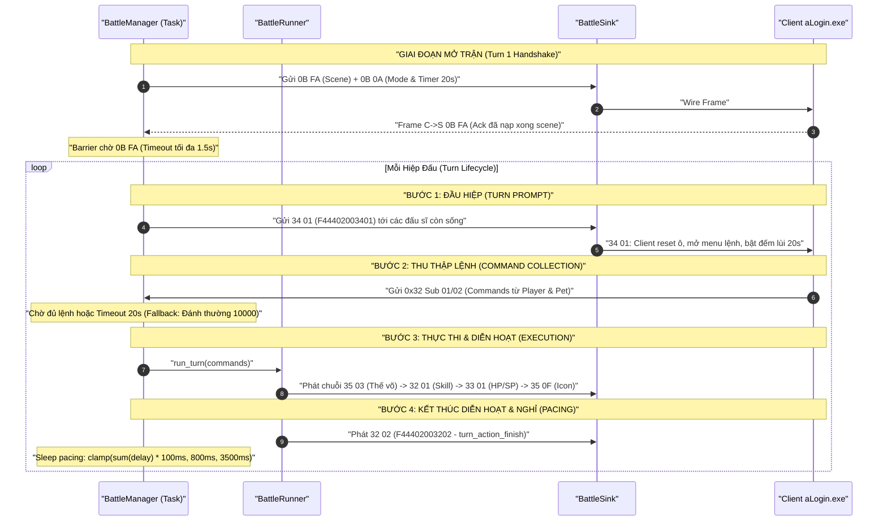

# ĐẶC TẢ KỸ THUẬT MODULE CHIẾN ĐẤU MỚI (BATTLE REFACTOR SPEC V2)

> **Tập tin**: `.scratch/battle-refactor/spec_new.md`  
> **Phiên bản**: 2.0 (Thay thế toàn diện `spec.md` cũ)  
> **Tài liệu căn cứ**:  
> - Báo cáo dịch ngược mã máy Delphi client: [`.scratch/battle-refactor/BATTLE_MODULE_REVERSE_SPEC_CLEAN.md`](BATTLE_MODULE_REVERSE_SPEC_CLEAN.md)  
> - Báo cáo nghiên cứu lỗ hổng & khoảng cách: [`.scratch/battle-refactor/RESEARCH-protocol-eval-and-gaps.md`](RESEARCH-protocol-eval-and-gaps.md)  
> - Quyết định kiến trúc chính thức: [`docs/adr/0006-battle-protocol-parity-and-turn-lifecycle.md`](../../docs/adr/0006-battle-protocol-parity-and-turn-lifecycle.md)  
> - Thuật ngữ miền: [`GLOSSARY.md`](../../GLOSSARY.md)  
> **Quyết định phỏng vấn Grilling**: Q1: A (Wire Parity), Q2: A (Barrier 0B FA 1.5s), Q3: A (Dynamic delay 800-3500ms), Q4: Đồng ý (ADR 0006), Q5: B (Domain Enum `BattleAction`), Q6: A (Timeout tấn công thường), Q7: Đồng ý 3 đợt.

---

## 1. Kế Thừa Tính Đúng Đắn Của Hệ Thống Hiện Tại (Strengths & Foundations)

Đợt refactor trước (từ Ticket 02 đến 15) đã xây dựng thành công một nền tảng vững chắc về khung tin nhị phân, dữ liệu tĩnh và toán học chiến đấu. `spec_new.md` bảo lưu toàn bộ các giá trị chuẩn xác này:

### 1.1. Khung Tin & Mã Hóa Wire (Framing & Cryptography)
- **Chuẩn khung mạng**: Header 2 byte `F4 44`, độ dài payload 2 byte Little-Endian (`len`), toàn bộ payload biến đổi bằng phép toán đối xứng `byte ^ 0xAD` ([`protocol/codec.rs`](../../src/protocol/codec.rs), [`frame.rs`](../../src/protocol/frame.rs)). Khớp 100% mã máy `FUN_0050a248` (nhận) và `FUN_0050a2fc` (gửi).

### 1.2. Khởi Tạo Chiến Trường (Scene Initialization)
- **Khung mở trận `0B FA`**: Giải mã và đóng gói mảng bản ghi 24-byte record chuẩn hóa ([`packets::battle_open_leader`](../../src/battle/packets.rs), [`member_battle_frame`](../../src/battle/construction.rs)).
- **Marker Self = `04` (Ticket 15)**: Gán chính xác `kind = 04` cho đấu sĩ của người chơi chính, khớp gate `player+0x376 == 4` tại `006438ac:262` để kích hoạt giao diện điều khiển và nút rời trận.
- **Khung viện trợ `0B 05`**: Định dạng 23-byte record (lệch -1B do `sideFlag` nằm ở header gói) cho Sủng vật và viện trợ (`00644294`).
- **Khung hiển thị Map `0B 04`**: Cập nhật trạng thái chiến đấu của nhân vật trên bản đồ thế giới (`00642244`).
- **Khung thời gian `0B 0A`**: Thiết lập chế độ chiến đấu và thời lượng hiệp đấu 20s/30s/10s (`0064e978`).
- **Phân chia phe `team_for_row` (Ticket 08)**: Quy tắc bất biến `row < 2 => Phe 2 (Địch)`, `row >= 2 => Phe 1 (Ta)` khớp `00646634`.
- **Dọn ô `0B 01` & Di chuyển ô `35 07` (Ticket 03)**: Payload 4 byte `[0B][01][grp][slot]` và 6 byte `[35][07][sGrp][sSlot][dGrp][dSlot]` hoán đổi ô nguyên tử trên lưới (`0064e3e0`).

### 1.3. Đồng Bộ Dữ Liệu Thời Gian Thực & Hoạt Ảnh Cơ Bản
- **Thanh máu/thể lực `33 01` (Ticket 02)**: Chuỗi bản ghi 7-byte `[grp:1B][slot:1B][prop:1B][val:4B LE]` với thuộc tính HP `0x19` và SP `0x1A` khớp `case_044` / `FUN_0064cae0`.
- **Hoạt ảnh chiêu thức `32 01`**: Đóng gói chuỗi đòn đánh, né tránh, bạo kích qua `packets::skilling_full` và `skilling_int` khớp `case_043` / `FUN_00647164`.
- **Vật phẩm rơi trong trận `35 04`**: Diễn hoạt item bay từ ô quái sang ô người chơi khớp `0064d128`.
- **Bộ builder `0x35` (Ticket 12)**: Đã hoàn thành builder `35 03` (thế võ State 7), `35 0E` (unit action), `35 0F` (icon trạng thái HUD 'B'..'G'), `35 01` (xóa trạng thái).

### 1.4. Quyết Toán Sau Trận (Post-Battle Settlement)
- **Thăng cấp `05 0A` & Khóa MaxHP/MaxSP (Ticket 06)**: Hiệu ứng âm thanh `sound\WA0013.wav` và khóa chỉ số server `08 01 CD/CE`.
- **Kinh nghiệm & Cấp độ `08 01 23/24`**: Cập nhật EXP và Level nhân vật.
- **Kinh nghiệm Sủng vật `0F 08` (Ticket 07)**: Cập nhật EXP, Level, Độ trung thành và chỉ số Pet.
- **Tiền vàng `1A 01` (Ticket 05) & Vật phẩm `17 06` (Ticket 04)**: Cộng tiền kèm toast banner và trao vật phẩm thưởng 14 byte.
- **Thoát trận `0B 00`**: Frame `F4 44 08 00 0B 00 <charId:4B LE> 0000` giải phóng `TFightField`.
- **Toán học & Xác suất**: Bảng EXP `k = [2.9, 3.0, 3.05, 3.0]` + hằng số `+5` từ `Formula.Dat` (Ticket 11); luồng RNG `random_skill` tất định loại bỏ trôi dạt (Ticket 10).

---

## 2. Các Đính Chính Cốt Tử & Thiết Kế Kiến Trúc Mới

### 2.1. Phục Hồi Kênh Lệnh C→S `0x32 Sub 01/02` (Sửa sai lầm Ticket 01)
* **Bằng chứng mã máy đảo ngược**:
  Tại [`0063cf58_FUN_0063cf58.asm.txt`](../../client_pseudo_c/0063cf58_FUN_0063cf58.asm.txt):
  - Dòng 381–384: `MOV CL, 0x01; MOV DL, 0x32; CALL 0x0077f414` $\rightarrow$ Phát lệnh Tấn công / Kỹ năng.
  - Dòng 1178–1181: `MOV CL, 0x02; MOV DL, 0x32; CALL 0x0077f414` $\rightarrow$ Phát lệnh Vật phẩm chiến đấu trên lưới.
* **Cấu trúc Khung tin 10 bytes**:
  ```text
  [32] [sub:1B] [srcGrp:1B] [srcSlot:1B] [dstGrp:1B] [dstSlot:1B] [skillOrItemId:2B LE] [rand1:1B] [rand2:1B]
  ```
* **Đăng ký Dispatcher**:
  Khôi phục `OP_BATTLE_COMMAND (0x32)` trong `src/server/dispatcher.rs`, định tuyến sang `handlers/battle::handle_battle_command`.
* **Trả lại ngữ nghĩa cho `0x0B Sub 03 / Sub 04`**:
  `0x0B Sub 03` và `0x0B Sub 04` là các gói lệnh tương tác bản đồ ngoài trận (8 bytes: `[kind:1B][target:4B LE][param:2B LE]`), không còn bị gán ghép làm lệnh skill/item nữa.

### 2.2. Mô Hình Hóa Miền Lệnh Chiến Đấu (Domain Enum `BattleAction` — Quyết định Q5: B)
Thay thế struct phẳng cũ bằng cấu trúc mô hình hóa rõ ràng theo chuẩn nghiệp vụ:

```rust
/// Hành động chiến đấu phân loại theo nghiệp vụ (Domain Enum)
#[derive(Debug, Clone, PartialEq, Eq)]
pub enum BattleAction {
    /// Đánh thường (Skill 10000)
    NormalAttack,
    /// Thi triển kỹ năng với mã kỹ năng và cấp độ tra cứu từ Session
    CastSkill { skill_id: i64, skill_lv: i64 },
    /// Sử dụng vật phẩm chiến đấu trong trận
    UseItem { item_id: i64 },
    /// Phòng ngự (Skill 17001)
    Defend,
    /// Bỏ chạy / Đào tẩu (Skill 18001)
    Flee,
    /// Thu phục võ tướng / Bắt quái (Skill 15001)
    Capture,
}

/// Lệnh chiến đấu hoàn chỉnh gửi từ client sau khi parse và xác thực quyền sở hữu
#[derive(Debug, Clone)]
pub struct BattleCommand {
    pub row: u8,
    pub col: u8,
    pub target_row: u8,
    pub target_col: u8,
    pub action: BattleAction,
}
```

*Quy tắc biên dịch từ gói wire `0x32` sang `BattleAction`*:
- Nếu `sub == 0x02`: $\rightarrow$ `BattleAction::UseItem { item_id: skillOrItemId }`.
- Nếu `sub == 0x01`:
  - `skillOrItemId == 10000` $\rightarrow$ `BattleAction::NormalAttack`.
  - `skillOrItemId == 17001` $\rightarrow$ `BattleAction::Defend`.
  - `skillOrItemId == 18001` $\rightarrow$ `BattleAction::Flee`.
  - `skillOrItemId == 15001` $\rightarrow$ `BattleAction::Capture`.
  - Các ID khác: Tra cứu `skill_lv` của nhân vật hoặc võ tướng tương ứng $\rightarrow$ `BattleAction::CastSkill { skill_id, skill_lv }`.

### 2.3. Tái Cấu Trúc Vòng Đời Lượt Đấu & Handshake `0B FA` (Quyết định Q2: A)
Loại bỏ hoàn toàn lỗi phát `34 01` muộn. Chu trình 4 bước của một hiệp đấu trong [`manager.rs`](../../src/battle/manager.rs):



### 2.4. Bổ Sung Frame Báo Dứt Diễn Hoạt `32 02` (`turn_action_finish`)
- **Tên hàm**: `packets::turn_action_finish() -> String`.
- **Wire layout**: `F4 44 02 00 32 02`.
- **Vai trò**: Client nhận gói này tại `case_043` gọi `FUN_0064dd74`, đặt `[TFightManage+0x1C] = 1`, xóa sạch danh sách action pending, bảo đảm không bị treo kẹt camera/sprite.

### 2.5. Điều Phối Nhịp Độ Diễn Hoạt (Dynamic Skill Delay Pacing — Quyết định Q3: A)
Sau khi phát `32 02`, server task sleep bất đồng bộ:
$$\text{sleep\_ms} = \text{clamp}\left(\sum_{i=1}^{N} \text{skill\_delay}(i) \times 100\,\text{ms},\, 800\,\text{ms},\, 3500\,\text{ms}\right)$$
Thời gian nghỉ này cho phép client chiếu xong animation trước khi server bắn gói `34 01` của hiệp tiếp theo, bảo vệ trọn vẹn 20 giây đếm lùi cho người chơi.

### 2.6. Chuẩn Hóa Hình Học Isometric Ô Lưới AoE ([`targeting.rs`](../../src/battle/targeting.rs))
Thứ tự cột Isometric trên đường chéo: `0 (ngoại phải) -> 1 -> 2 (tâm) -> 4 -> 3 (ngoại trái)`.
Kỹ năng lan 3 mục tiêu (`sl_danh = 3`) khi nhắm ô trung tâm `slot 2` phải mở rộng lấy `{1, 2, 4}`:
- Ô tâm `slot 2` $\rightarrow$ kề là `slot 1` và `slot 4`.
- Ô tâm `slot 1` $\rightarrow$ kề là `slot 0` và `slot 2`.
- Ô tâm `slot 4` $\rightarrow$ kề là `slot 2` và `slot 3`.
- Ô tâm `slot 0` $\rightarrow$ kề là `slot 1`.
- Ô tâm `slot 3` $\rightarrow$ kề là `slot 4`.

### 2.7. Chuẩn Hóa Điều Kiện Hợp Kích Combo (Mục 4.3.2 SPEC CLEAN)
- Điều kiện cho phép combo: Đòn đánh thường (`10000`) và các kỹ năng có phạm vi tác dụng $\le 3$ mục tiêu (`nbTarget <= 3` hoặc `fight_area <= 3`).
- **Chặn triệt để**: Bất kỳ kỹ năng nào có `nbTarget >= 4` (Loạn kích, Phi sa tẩu thạch, Hồng thủy, Thiên băng địa liệt...) **không được kích hoạt combo**.

### 2.8. Hoàn Thiện 8 Bước Kiểm Định Thu Phục Võ Tướng (`apply_catch`)
Hàm `apply_catch` trong `runner.rs` phải kiểm tra đủ 8 điều kiện:
1. Người bắt phải là Nhân vật chính (`caster.typ == 2`). Sủng vật không thể bắt NPC.
2. **Quy tắc chênh lệch cấp độ (Lệch LV $\le 5$)**: Độ chênh lệch cấp độ giữa nhân vật và võ tướng/NPC không được vượt quá 5 cấp (`target.lv - caster.lv <= 5`). Nếu cấp độ của NPC cao hơn người chơi quá 5 cấp thì không thể bắt (phía client UI cũng có thêm rào cản chặn cứng nếu lệch $> 40$ cấp).
3. Loại mục tiêu hợp lệ: Không bắt Player, Pet có chủ (`typ == 4`), Khí cụ (`typ == 9`).
4. Cờ cấm bắt: `npc.bat == 0` (đọc từ `Npc.dat`).
5. Không trùng lặp: Chưa sở hữu võ tướng cùng `template_id` trong 4 slot Pet tùy thân.
6. Còn chỗ trống: Túi sủng vật có ít nhất 1 ô trống (< 4).
7. Điều kiện chiêu mộ đặc biệt: Nếu NPC yêu cầu Triệu gọi (`FUN_00625128 == 0x16`), người chơi phải học kỹ năng `14026`.
8. Kiểm tra máu: HP mục tiêu $< 50\%$ MaxHP.

---

## 3. Lộ Trình Triển Khai 3 Đợt (9 Ticket Toàn Diện)

```text
.scratch/battle-refactor/issues/
├── [ĐỢT 1: GIAO THỨC & VÒNG ĐỜI LƯỢT ĐẤU - P0]
│   ├── 19-restore-0x32-command-channel.md      # Phục hồi kênh 0x32 Sub 01/02 & Domain Enum BattleAction
│   ├── 20-turn-lifecycle-timing-and-34-01.md    # Tái cấu trúc vòng đời hiệp đấu & Handshake 0B FA barrier
│   └── 21-turn-action-finish-32-02-frame.md     # Builder 32 02 turn_action_finish & dọn hàng đợi diễn hoạt
│
├── [ĐỢT 2: BIẾN CỐ 0x35 & TIMING DIỄN HOẠT - P1]
│   ├── 16-35-06-battle-npc-talk-builder.md      # Builder 35 06 (Thoại NPC / banner diễn hoạt trận)
│   ├── 17-35-0b-battle-chat-notice-builder.md   # Builder 35 0B (Tin nhắn / bảng tin thông báo chiến đấu)
│   └── 18-battle-0x35-timing-wiring.md          # Đấu nối 4 pha timing 0x35 & Dynamic Skill Delay Pacing
│
└── [ĐỢT 3: BÀN CỜ ISOMETRIC & LUẬT CHƠI - P2]
    ├── 22-isometric-grid-aoe-targeting.md       # Chuẩn hóa hình học Isometric ô lưới AoE [2, 1, 3, 0, 4]
    ├── 23-combo-rules-aoe-threshold.md          # Chặn kỹ năng AoE >= 4 tham gia hợp kích Combo
    └── 24-capture-validation-gates.md           # Hoàn thiện 8 bước kiểm định thu phục võ tướng
```

### Chi tiết Phân công Từng Ticket:

#### Đợt 1: Sửa Lỗi Giao Thức Sống Còn (P0 — Ngăn chặn sập/đơ game)
1. **Ticket 19** (`issues/19-restore-0x32-command-channel.md`):
   - Đăng ký `OP_BATTLE_COMMAND (0x32)` trong `dispatcher.rs`.
   - Viết parser 10 bytes C→S cho Sub `0x01` và Sub `0x02`.
   - Định nghĩa `enum BattleAction` và struct `BattleCommand` mới.
   - Trả lại `0x0B Sub 03/04` làm out-of-battle action holders (8 byte).
   - Chuyển đổi toàn bộ test trong `tests/` sang gửi frame `0x32`.
2. **Ticket 20** (`issues/20-turn-lifecycle-timing-and-34-01.md`):
   - Tái cấu trúc loop trong `manager.rs`: Thiết lập barrier chờ ack `0B FA` (1.5s fallback) ở đầu trận.
   - Bắn `34 01` ngay ở đầu mỗi hiệp đấu trước khi mở cổng nhận lệnh.
   - Gán đòn đánh thường `10000` khi hết 20s timeout.
   - Test kiểm tra thứ tự gói tin và trạng thái sẵn sàng.
3. **Ticket 21** (`issues/21-turn-action-finish-32-02-frame.md`):
   - Thêm builder `packets::turn_action_finish() -> String` (`F44402003202`).
   - Bắn `32 02` ở cuối chuỗi hoạt ảnh hiệp đấu.
   - Test unit test byte-exact trong `tests/battle_frames_test.rs`.

#### Đợt 2: Hoàn Thiện Biến Cố `0x35` & Timing Hoạt Ảnh (P1)
4. **Ticket 16** (`issues/16-35-06-battle-npc-talk-builder.md`):
   - Builder `packets::battle_npc_talk` (11 byte payload `[35][06][k][actor_id:4B][tpl_id:4B]`).
   - Helper `packets::battle_npc_dialog(dialog_id: u16)`.
5. **Ticket 17** (`issues/17-35-0b-battle-chat-notice-builder.md`):
   - Builder `packets::battle_chat_notice` (danh sách `[type:1B][len:1B][text:VISCII]`).
   - Helper `packets::battle_system_message(text: &str)`.
6. **Ticket 18** (`issues/18-battle-0x35-timing-wiring.md`):
   - Đấu nối `35 03` trước mỗi đòn đánh trong `runner.rs`.
   - Đấu nối `35 0F` khi buff/debuff và `clear_unit_status` / `35 01` khi hết hạn.
   - Đấu nối `35 06` mở màn trận đánh boss/nhiệm vụ.
   - Đấu nối `sleep` dynamic animation delay (800ms – 3500ms) sau `32 02`.

#### Đợt 3: Chuẩn Hóa Bàn Cờ & Gameplay Parity (P2)
7. **Ticket 22** (`issues/22-isometric-grid-aoe-targeting.md`):
   - Cập nhật `expand_sl_danh` trong `targeting.rs` theo trật tự Isometric `{1, 2, 4}`.
   - Test kiểm chứng tọa độ và ô trúng chiêu.
8. **Ticket 23** (`issues/23-combo-rules-aoe-threshold.md`):
   - Cập nhật `detect_combo` kiểm tra `nbTarget <= 3`. Chặn các chiêu AoE $\ge 4$.
   - Test combo chỉ kích hoạt với đơn thể / chiêu 2-3 mục tiêu.
9. **Ticket 24** (`issues/24-capture-validation-gates.md`):
   - Cập nhật `apply_catch` đầy đủ 8 điều kiện kiểm định (quy tắc chênh lệch level $\le 5$).
   - Test từ chối bắt khi chênh lệch level > 5 hoặc túi đầy.

---

## 4. Ràng Buộc Kỹ Thuật Bất Biến (Coding & Testing Invariants)

1. **Vị trí Test**: Toàn bộ unit/integration test mới **bắt buộc đặt trong `tests/`**. Tuyệt đối không inline `#[cfg(test)]` trong `src/`.
2. **Cơ sở dữ liệu**: Không ghi đè lên `DB/ts_dream.db`. Mọi test DB sử dụng in-memory SQLite `sqlite::memory:?cache=shared`.
3. **Mã hóa chuỗi**: Mọi văn bản gửi xuống client phải mã hóa chuẩn **VISCII 1.1** qua `crate::encoding`.
4. **Git Policy**: Tuyệt đối **không tự ý `git commit`**. Người dùng sẽ tự commit thủ công sau khi review.
5. **Độ ổn định Test Suite**: Mọi thay đổi sau mỗi ticket phải đảm bảo lệnh kiểm thử xanh hoàn toàn:
   ```bash
   cargo test --all-targets --no-fail-fast
   ```
