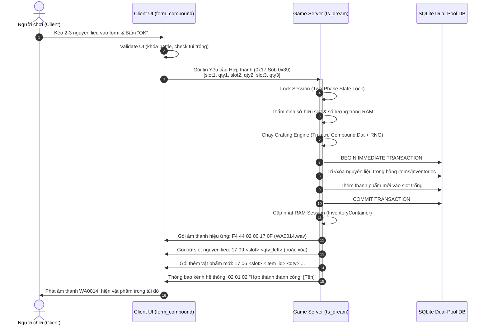
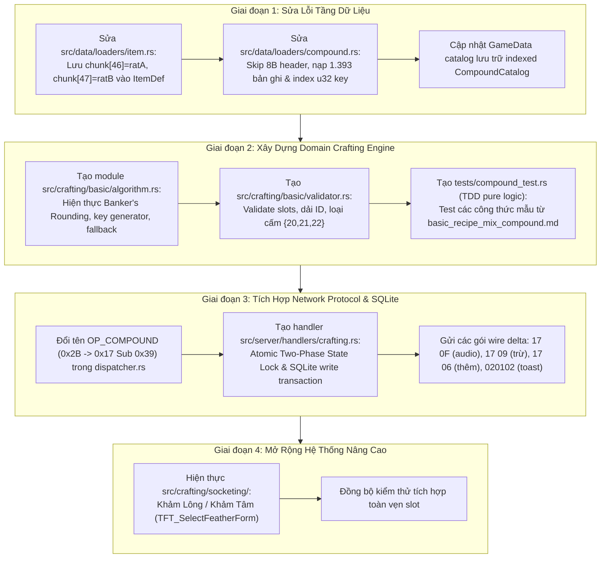

# BÁO CÁO NGHIÊN CỨU & BẢN THIẾT KẾ KIẾN TRÚC HỆ THỐNG HỢP THÀNH (COMPOUND / MIX ITEM SYSTEM)
## Dành cho Game Engine TS Online (`ts_dream`) — Góc nhìn Lead Game Engine Protocol

- **Tác giả:** Lead Game Engine Protocol
- **Mã tài liệu:** `COMPOUND-ARCH-2026-10-30`
- **Thư mục lưu trữ:** `.scratch/compound-refactor/`
- **Tài liệu tham chiếu:**
  - Client Binary Reverse Engineering: `.scratch/compound-refactor/CLIENT_COMPOUND_SPEC.md`
  - Sổ tay công thức người chơi: `.scratch/compound-refactor/basic_recipe_mix_compound.md`
  - Delphi Decompiled Sources: `client_delphi/aLogin.exe`, `client_pseudo_c/`
  - Mã nguồn Rust Server: `ts_dream/src/`
  - Bộ quy chuẩn kiến trúc: `AGENTS.md`, `CODING_STANDARDS.md`, `docs/adr/0005-economy-wire-parity-and-transactions.md`

---

## MỤC LỤC
1. [TỔNG QUAN ĐIỀU HÀNH (EXECUTIVE SUMMARY)](#1-tổng-quan-điều-hành-executive-summary)
2. [CLIENT HAY SERVER QUYẾT ĐỊNH CÔNG THỨC? VAI TRÒ CỦA SERVER](#2-client-hay-server-quyết-định-công-thức-vai-trò-của-server)
3. [GIAO THỨC MẠNG CHI TIẾT (WIRE PROTOCOL SPECIFICATION)](#3-giao-thức-mạng-chi-tiết-wire-protocol-specification)
4. [ĐỐI CHIẾU MÃ NGUỒN RUST (`ts_dream`) HIỆN TẠI & LỖI SAI CỐT TỬ](#4-đối-chiếu-mã-nguồn-rust-ts_dream-hiện-tại--lỗi-sai-cốt-tử)
5. [PHÂN TÁCH DANH MỤC: CÔNG THỨC CƠ BẢN VS NÂNG CAO](#5-phân-tách-danh-mục-công-thức-cơ-bản-vs-nâng-cao)
6. [THUẬT TOÁN HỢP THÀNH CHUẨN XÁC 100% (REVERSE-ENGINEERED `FUN_0079A890`)](#6-thuật-toán-hợp-thành-chuẩn-xác-100-reverse-engineered-fun_0079a890)
7. [BẢN THIẾT KẾ KIẾN TRÚC MÔ-ĐUN MỚI (DEEP MODULE ARCHITECTURE)](#7-bản-thiết-kế-kiến-trúc-mô-đun-mới-deep-module-architecture)
8. [KẾ HOẠCH TRIỂN KHAI TỪNG BƯỚC (STEP-BY-STEP ROADMAP)](#8-kế-hoạch-triển-khai-từng-bước-step-by-step-roadmap)
9. [QUY CHUẨN KIỂM THỬ TOÀN VẸN (TEST INTEGRITY SPECIFICATION)](#9-quy-chuẩn-kiểm-thử-toàn-vẹn-test-integrity-specification)

---

## 1. TỔNG QUAN ĐIỀU HÀNH (EXECUTIVE SUMMARY)

Hệ thống Hợp thành (Compound / Mix đồ) là cơ chế xương sống định hình toàn bộ nền kinh tế và trang bị trong thế giới TS Online. Qua quá trình mổ xẻ mã máy Delphi Win32 (`aLogin.exe`), phân tích các hàm xử lý dữ liệu và đối chiếu trực tiếp với mã nguồn Rust (`ts_dream`), Ban Kỹ thuật Server khẳng định các kết luận tiên quyết sau:

1. **Thẩm quyền tuyệt đối thuộc về Game Server (100% Server Authoritative):**
   - Phía Client chứa một Form giả lập (`0x0079EE08`) có thuật toán đầy đủ nhưng đó là **Developer Simulator Offline** (không gửi bất kỳ packet nào).
   - Trong gameplay trực tuyến, client chỉ đóng vai trò giao diện hiển thị (UI Presentation), thu thập các slot nguyên liệu và gửi yêu cầu lên Server.
   - Toàn bộ việc kiểm tra sở hữu túi đồ, tính toán tỷ lệ, sinh số ngẫu nhiên (RNG), trừ nguyên liệu và cấp phát thành phẩm bắt buộc phải thực hiện trên Server trong một **giao dịch nguyên tử (Atomic Transaction)**.
2. **Lỗi sai cốt tử trong mã nguồn Rust hiện tại:**
   - Bộ nạp `src/data/loaders/item.rs` hiện đang **vứt bỏ 2 trường quan trọng nhất** của `Item.dat`: `chunk[46]` (`ratA` - Mã chất liệu) và `chunk[47]` (`ratB` - Bậc phẩm chất), đồng thời đọc nhầm `chunk[82]` làm material. Nếu không sửa lỗi này, Server vĩnh viễn không thể chạy thuật toán hợp thành.
   - `src/data/loaders/compound.rs` đọc nhầm Slot 0 Header làm công thức và cấu trúc dữ liệu chưa được lập chỉ mục (index) tra cứu $O(\log N)$.
   - `Formula.Dat` hoàn toàn không phải công thức chế tạo đồ mà là bảng tham số sát thương chiến đấu (`TCalculator`).
   - Opcode `0x2B` trong `dispatcher.rs` bị gán nhầm tên là `OP_COMPOUND` (thực chất `0x2B` là `OP_GUILD_ALLIANCE`). Lệnh hợp thành thực sự chạy qua **Opcode `0x17` Subcode `0x39`**.
3. **Chiến lược tái cấu trúc (Refactoring Plan):**
   - Tách biệt hoàn toàn tầng Domain Logic chế tạo sang crate/module độc lập `src/crafting/` (phân chia rõ: `basic` dùng `Compound.Dat`, `socketing` khảm lông/tâm, `scripted` qua NPC Eve Engine).
   - Handler mạng `src/server/handlers/crafting.rs` chỉ điều phối gói tin theo mô hình Two-Phase State Lock và cập nhật CSDL SQLite.

---

## 2. CLIENT HAY SERVER QUYẾT ĐỊNH CÔNG THỨC? VAI TRÒ CỦA SERVER

### 2.1. Phân tích Bản chất Form `0x0079EE08` (Offline Developer Simulator)
Trong file `CLIENT_COMPOUND_SPEC.md`, chúng ta quan sát thấy mã ASM chi tiết của form `0x0079EE08` và sự kiện nút bấm `0x0079F3C8`:
- Form này gồm 3 ô `TSe_Editor` nhập ID nguyên liệu (mặc định `"10001"`, `"17001"`, `"10001"`), 3 ô nhập số lượng (mặc định `"1"`, `"1"`, `"1"`), và 2 bảng `TSe_SelectText`.
- Khi bấm nút `"合成"` (`0x0079F3C0`), hàm `FUN_0079F3C8` gọi `FUN_0079A5E4` để kiểm tra đầu vào, gọi `FUN_0079A890` để tra cứu `Compound.Dat`, tính toán RNG nội bộ và in thẳng kết quả vào danh sách text trên màn hình:
  `": 合成出的物品 Id: %d %s Num:%d"`
- **Bằng chứng Disassembly Zero-Network:**
  Kiểm tra đồ thị gọi hàm (`0079f3c8_mix_handler.calls.txt`), hàm này hoàn toàn **KHÔNG gọi** bất kỳ thủ tục mạng nào như `CY_AddSedQueue`, `FUN_0077F414`, hay socket send.
- **Kết luận:** Đây là **công cụ kiểm thử nội bộ (Internal Mix Sandbox)** do Chinesegamer cài sẵn trong client để tester/developer thử nghiệm dữ liệu `Compound.Dat` mà không cần dựng cụm server.

### 2.2. Luồng Gameplay Thực Tế (In-Game Compound Dialog)
Khi người chơi tham gia thế giới game và mở bảng Hợp thành từ túi đồ:
- Form giao diện thực tế là **`form_compound`** (chuỗi literal tại `0x00532819`, khởi tạo tại `0x00532350`).
- Giao diện gồm nút `btn_OK` (`0x00532874`) và 3 ô slot nhận vật phẩm kéo thả từ `homdo`.
- Khi bấm `btn_OK` (`FUN_00532904`):
  1. Kiểm tra trạng thái người chơi: `*(short*)(player + 0x63a) == 0x29cd` (chống mix khi đang giao dịch, di chuyển hoặc trong trận đánh).
  2. Kiểm tra thuộc tính vật phẩm qua `FUN_00774B50` (cấm các vật phẩm có cờ cấm giao dịch / cấm hợp thành `0x3c`).
  3. Kiểm tra ô trống túi đồ qua `FUN_00768D38` (đảm bảo còn ít nhất 1 slot trống để nhận thành phẩm).
  4. **Gửi lệnh lên Game Server tại `0x00532B20..0x00532B2B`:**
     ```assembly
     MOV EAX, [0x007D9D30]  ; Con trỏ Session / Connection
     MOV EAX, [EAX]
     MOV CL, 0x39           ; Subcode = 0x39 (57 decimal)
     MOV DL, 0x17           ; Main Opcode = 0x17
     CALL 0x0077F414        ; Dispatch Send Packet
     ```
  5. Dọn sạch giao diện tạm bằng `FUN_00532238` và chuyển sang trạng thái chờ Server phản hồi.

### 2.3. Trách nhiệm Bắt buộc của Server Game (Server Responsibilities)
Nếu để Client tự quyết định thành phẩm, người chơi có thể dễ dàng can thiệp bộ nhớ (cheat engine/packet injection) để luôn ép ra trang bị Hoàng kim / Thần khí cấp cao nhất từ rác, phá hủy toàn bộ nền kinh tế. Do đó, Server đảm nhiệm 100% các vai trò sau:
1. **Thẩm định Sở hữu (Ownership & State Validation):** Kiểm tra các slot nguyên liệu thực sự tồn tại trong túi đồ nhân vật (`homdo`), đúng `item_id`, đủ số lượng và không bị khóa.
2. **Thực thi Thuật toán & Sinh số ngẫu nhiên (Authoritative RNG Engine):** Chạy thuật toán tra cứu `Compound.Dat`, tính toán Banker's Rounding, quay số thăng cấp `Random(R_avg + 1) + 1` và cơ chế Fallback an toàn.
3. **Giao dịch Cơ sở Dữ liệu Nguyên tử (Atomic SQLite Transaction):**
   - Trừ/xóa các slot nguyên liệu đã tiêu hao.
   - Thêm vật phẩm mới được tạo thành vào slot trống đầu tiên của túi đồ.
   - Nếu bất kỳ bước nào lỗi (đầy túi, thiếu đồ, rớt mạng), rollback toàn bộ giao dịch, không để xảy ra hiện tượng mất đồ hay nhân bản vật phẩm (dupe).
4. **Phát tín hiệu Đồng bộ & Hiệu ứng (Wire Synchronization & SFX):**
   - Gửi hiệu ứng âm thanh rèn đúc `17 0F` (`sound\WA0014.wav`).
   - Gửi các gói tin trừ slot (`17 09` / `17 03`) và cấp phát slot mới (`17 06` / `17 08`).
   - Gửi thông báo hệ thống chúc mừng / thông tin thành phẩm qua kênh `020102`.

---

## 3. GIAO THỨC MẠNG CHI TIẾT (WIRE PROTOCOL SPECIFICATION)



### 3.1. Chiều Client $\rightarrow$ Server (Request Packet)
- **Header:** `F4 44 <len: u16 LE>` (Mã hóa XOR `0xAD`).
- **Main Opcode:** `0x17` (`OP_ITEM`).
- **Subcode:** `0x39` (57 decimal).
- **Cấu trúc Payload:**
  ```text
  Offset  Type  Mô tả
  0x00    u8    Main Opcode = 0x17
  0x01    u8    Subcode     = 0x39
  0x02    u8    Slot nguyên liệu 1 (1-based, 1..25)
  0x03    u8    Số lượng nguyên liệu 1 (1..50)
  0x04    u8    Slot nguyên liệu 2 (1-based, 1..25)
  0x05    u8    Số lượng nguyên liệu 2 (1..50)
  0x06    u8    Slot nguyên liệu 3 (1-based, 0 nếu không có)
  0x07    u8    Số lượng nguyên liệu 3 (0 nếu không có)
  ```

### 3.2. Chiều Server $\rightarrow$ Client (Response Packets)
1. **Gói hiệu ứng âm thanh rèn đúc (SFX Trigger):**
   - Payload: `17 0F`
   - Wire raw: `F4 44 02 00 17 0F`
   - Ý nghĩa: Client khi nhận được sẽ kích hoạt phát file âm thanh `sound\WA0014.wav` tại `007902fb_FUN_007902fb.c:192-197`.
2. **Gói cập nhật túi đồ (Inventory Delta):**
   - *Cập nhật số lượng slot còn lại / Xóa slot:*
     - Opcode `0x17 Sub 0x09` (hoặc `0x17 Sub 0x03` / `0x04`): `17 09 <slot: u8> <count: u8>`. Nếu `count == 0`, xóa hẳn item khỏi slot.
   - *Cấp phát vật phẩm mới:*
     - Opcode `0x17 Sub 0x06` (hoặc `0x17 Sub 0x08`): Đặt vật phẩm mới vào slot trống của túi đồ (`slot: u8, id: u16, count: u8, elem_type: u8, elem_val: u8, ...`).
3. **Gói thông báo hệ thống (System Notification Toast):**
   - Sử dụng kênh duy nhất theo chuẩn server `sys_msg_frame(msg)`:
     `02 01 02 <len: u8> <nội dung VISCII>`
   - Ví dụ: `"Hợp thành thành công: Hồng Tinh Thiết (Cấp 55)"` hoặc thông báo lỗi nếu thao tác thất bại.

---

## 4. ĐỐI CHIẾU MÃ NGUỒN RUST (`ts_dream`) HIỆN TẠI & LỖI SAI CỐT TỬ

Qua rà soát toàn bộ các tệp liên quan đến vật phẩm và dữ liệu nhị phân trong `ts_dream`, chúng tôi phát hiện 4 sai lệch nghiêm trọng:

### 4.1. LỖI SAI CỐT TỬ: `src/data/loaders/item.rs` bỏ qua `ratA` và `ratB`
Xem xét hàm giải mã `Item.dat` (chunk 370 byte) trong `src/data/loaders/item.rs` (dòng 195–225):
```rust
// HIỆN TẠI TRONG CODE:
let _contribute = Self::dec8(chunk[46]);      // <-- BỊ VỨT BỎ!
let _sell_price_rate = Self::dec8(chunk[47]); // <-- BỊ VỨT BỎ!
...
let material = Self::dec8(chunk[82]);        // <-- ĐỌC SAI TRƯỜNG CHẤT LIỆU!
```
**Bằng chứng đối chiếu Disassembly Delphi:**
- Tại hàm kiểm tra hợp thành `0x0079F3C8` (dòng 230–245), tiêu đề in ra màn hình là `"Mate kind ratA ratB"`:
  - `kind`: Đọc từ `chunk[0x19 - 4] = chunk[21]`.
  - `ratA`: Đọc từ `chunk[0x32 - 4] = chunk[46]` $\rightarrow$ **Chính là Material Class (`1..37`)** dùng để ghép khóa `search_key` tra vào `Compound.Dat`!
  - `ratB`: Đọc từ `chunk[0x33 - 4] = chunk[47]` $\rightarrow$ **Chính là Compound Rank (`1..10+`)** dùng để tính trung bình cộng $R_{\text{avg}}$ và lọc vật phẩm đầu ra!
- `chunk[82]` hoàn toàn không liên quan đến bảng `Compound.Dat`.
- **Hậu quả:** Struct `ItemDef` trên Server hiện không lưu trữ `ratA` và `ratB`. Không có 2 trường này, không một thuật toán hợp thành nào có thể chạy được!

### 4.2. Khuyết tật trong `src/data/loaders/compound.rs`
1. **Đọc nhầm Slot 0 Header:** File `Data/Compound.Dat` có kích thước 11.152 byte = 1.394 bản ghi × 8 byte. Slot 0 là header metadata (`u16 = 2`). Hiện tại loader đọc Slot 0 như một công thức bình thường, làm lệch số lượng công thức thực tế (chỉ có 1.393 công thức hợp lệ).
2. **Tên trường tối nghĩa:** Trường `compound_d` trong code thực chất là **`result_kind`** (loại trang bị thành phẩm $1..52$, khớp 1-1 với `item.kind` tại `chunk[21]`).
3. **Thiếu cấu trúc chỉ mục (Lookup Index):** Dữ liệu được nạp vào một `Vec<CompoundFormula>` tuần tự. Khi người chơi hợp thành, việc quét tuần tự làm giảm hiệu năng xử lý. Cần bổ sung bảng băm hoặc mảng sắp xếp theo `u32 key` để tra cứu nhị phân $O(\log N)$.

### 4.3. Hiểu nhầm về `Formula.Dat`
Trong mã nguồn hiện có `src/data/loaders/formula.rs`. Tuy nhiên:
- `Formula.Dat` (235 byte) chứa struct `FormulaParams` với các hệ số thực nghiệm `w1..w51`, `base_hp`, `base_sp`, `ran`.
- Delphi disassembly tại `0x0065A02C` xác nhận đây là tham số của `TCalculator` dùng cho công thức tính sát thương vật lý/pháp thuật, tỷ lệ xuất chiêu và đường cong kinh nghiệm chiến đấu.
- **`Formula.Dat` hoàn toàn KHÔNG liên quan đến tính năng chế tạo hay hợp thành vật phẩm!**

### 4.4. Nhầm lẫn Opcode trong `dispatcher.rs`
Tại `src/server/dispatcher.rs` (dòng 52):
```rust
pub const OP_COMPOUND: u8 = 0x2B; // <-- SAI LỆCH!
```
- Khảo sát các luồng gói tin thực tế, Opcode `0x2B` trong giao thức TS Online là **`OP_GUILD_ALLIANCE`** (Liên minh quân đoàn / Công thành chiến).
- Gói tin Hợp thành vật phẩm gửi lên từ client nằm ở **Main Opcode `0x17` (`OP_ITEM`), Subcode `0x39`**.

---

## 5. PHÂN TÁCH DANH MỤC: CÔNG THỨC CƠ BẢN VS NÂNG CAO

Để tránh nhầm lẫn kiến trúc, toàn bộ hệ thống chế tác/cải tiến vật phẩm trong TS Online được phân loại rõ ràng thành 4 nhóm độc lập:

```text
HỆ THỐNG CHẾ TÁC & CẢI TIẾN TRANG BỊ TS ONLINE
│
├── 1. HỢP THÀNH CĂN BẢN (Basic Compound - Compound.Dat)
│   ├── Phạm vi: Mix khoáng thạch, ép trang bị vũ khí/giáp từ khoáng + phôi (basic_recipe_mix_compound.md).
│   ├── Dữ liệu: Compound.Dat (1.393 công thức) + ratA/ratB trong Item.dat.
│   ├── Giao thức: Opcode 0x17 Subcode 0x39.
│   └── Bản chất: Thuật toán ngẫu nhiên có kiểm soát (Banker's Rounding + Fallback cấp 1).
│
├── 2. CƯỜNG HÓA KHẢM LÔNG & KHẢM TÂM (Feather & Heart Socketing)
│   ├── Phạm vi: Dùng Lông vũ (+1..+10) hoặc Tâm tăng thuộc tính đặc biệt vào trang bị (Địa, Thủy, Hỏa, Phong).
│   ├── Giao diện Chọn Lông: Form TFT_SelectFeatherForm (VMT 0x0058A3EC, ctor 0x005B0BFC).
│   │   └── Giao thức: Opcode 0x23 Subcode 0x03 [elem_choice: u8, sub_choice: u8].
│   ├── Cường hóa khảm vào trang bị:
│   │   ├── Tác động: Cập nhật element (1..4) và element_value (+1..+10) trong ThingData & SQLite inventories.
│   │   └── Tỷ lệ: +1..+3: 100%, +4: 80%, +5: 60%, +6: 40%, +7: 25%, +8: 15%, +9: 10%, +10: 5%.
│   └── Bản chất: Biến đổi thuộc tính động của Item, độc lập với bảng tỷ lệ ngẫu nhiên của Compound.Dat.
│
├── 3. CHẾ TẠO CỐ ĐỊNH QUA NPC & KỊCH BẢN (Scripted NPC Crafting)
│   ├── Phạm vi: Thợ Rèn đúc vũ khí đặc thù, Dược Sư nấu thuốc, Nấu Rượu, Đổi ngọc/vật phẩm sự kiện.
│   ├── Động cơ xử lý: Eve Script Engine (eve.emg).
│   ├── Giao thức: Opcode 0x14 (Dialog) -> 0x01 Sub 0x09 / 0x14 Sub 0x01 -> 0x18 (Eve Action).
│   └── Bản chất: Đổi nguyên liệu cố định A + B = C theo kịch bản (CheckItem -> DelItem -> AddItem).
│
└── 4. MA TRẬN KHẮC TRANG BỊ PHỤ TRỢ (Equipment Synergy - Compound2.Dat)
    ├── Dữ liệu: Compound2.Dat (225 byte, ma trận 15x15 giữa 15 nhóm trang bị).
    └── Bản chất: Bảng tra hệ số tương tác phụ trợ trang bị, độc lập với luồng Compound.Dat.
```

---

## 6. THUẬT TOÁN HỢP THÀNH CHUẨN XÁC 100% (REVERSE-ENGINEERED `FUN_0079A890`)

Dưới đây là đặc tả logic nghiệp vụ giải thuật gốc từ Delphi, làm cơ sở để lập trình viên hiện thực trên Rust mà không bị lệch 1 byte logic nào:

```
+----------------------------------------------------------------------------------------------------+
|                               LUỒNG THUẬT TOÁN HỢP THÀNH GỐC (DELPHI)                              |
+----------------------------------------------------------------------------------------------------+
| Đầu vào:  3 slot nguyên liệu [(item_id, qty); 3]                                                   |
| CSDL:     ItemDatCatalog (truy cập ratA, ratB, kind), CompoundCatalog (1.393 bản ghi sorted u32 key) |
| RNG:      Delphi LCG RNG: seed = seed * 0x08088405 + 1                                             |
+----------------------------------------------------------------------------------------------------+
```

### Bước 1: Thẩm định Đầu Vào (`FUN_0079A5E4`)
1. Duyệt 3 slot: Nếu `item_id <= 0` hoặc `qty == 0`, reset cả 2 về `0`.
2. Đếm số slot hợp lệ: Nếu `valid_count < 2` $\rightarrow$ Trả về mã lỗi: *Cần ít nhất 2 vật phẩm*.
3. Dải ID hợp lệ: Nếu có slot mà `item_id < 10001` hoặc `item_id > 50000` $\rightarrow$ Báo lỗi: *Có lẫn vật phẩm không thể hợp thành*.
4. Số lượng: Nếu có slot mà `qty > 50` $\rightarrow$ Báo lỗi: *Số lượng một ô không được vượt quá 50*.
5. Kiểm tra loại cấm: Tra `item` từ `Item.dat`. Nếu `item.kind ∈ {20, 21, 22}` (tiền tệ, vé, túi đặc biệt) $\rightarrow$ Báo lỗi cấm hợp thành.

### Bước 2: Đọc Chỉ Số & Tính Phẩm Chất Trung Bình
1. Lấy `rat_a = chunk[46]` và `rat_b = chunk[47]` của các nguyên liệu.
2. Tính tổng phẩm chất: $S = \sum \text{rat\_b}$.
3. Tính bậc phẩm chất trung bình $R_{\text{avg}}$ bằng Banker's Rounding (IEEE-754 Round to Even):
   $$R_{\text{avg}} = \max\left(1, \text{ROUND}\left(\frac{S}{\text{active\_count}}\right)\right)$$
4. Quay số ngẫu nhiên bậc phẩm chất mục tiêu $R_{\text{target}}$:
   $$R_{\text{target}} = \text{Random}(R_{\text{avg}} + 1) + 1 \quad \in [1, R_{\text{avg}} + 1]$$
   Nếu $R_{\text{target}} == 11$, kẹp trần về $10$:
   $$R_{\text{target}} = \min(10, R_{\text{target}})$$

### Bước 3: Sắp Xếp Cặp Nguyên Liệu & Tạo Khóa `search_key`
1. Sắp xếp 3 cặp `(rat_a[k], qty[k])` tăng dần theo `rat_a` (slot rỗng có `rat_a = 0` luôn ở đầu).
2. Chuyển từng số `rat_a` thành chuỗi thập phân (không đệm số 0 đầu) và ghép lại:
   $$\text{key\_str} = \text{IntToStr}(m_0) + \text{IntToStr}(m_1) + \text{IntToStr}(m_2)$$
3. Chuyển thành số nguyên `u32`: $\text{search\_key} = \text{StrToInt}(\text{key\_str})$.

### Bước 4: Xác Định Bậc Tỷ Lệ & Tìm Ứng Viên Công Thức
1. Tìm $\text{min\_qty} = \min_{qty > 0}(qty)$. Số lượng thành phẩm cơ sở: $\text{out\_qty} = \text{min\_qty}$.
2. Tính bậc tỷ lệ đầu vào: $\text{input\_deg}[k] = \min\left(5, \lfloor \text{sorted\_qty}[k] / \text{min\_qty} \rfloor \right)$.
3. Quét bảng `Compound.Dat`:
   - Nếu `rec.key == search_key` và thỏa mãn điều kiện `degree` trên các slot $\rightarrow$ Thêm `rec.result_kind` vào danh sách `recipe_candidates` (tối đa 10 ứng viên).

### Bước 5: Cơ Chế Fallback Thần Thánh (Không Bao Giờ Mất Trắng)
- Nếu **`recipe_candidates` rỗng** (người chơi ghép công thức sai hoặc tỷ lệ không khớp):
  - Lấy ngẫu nhiên một nguyên liệu đầu vào: `chosen_item = pick_random(valid_inputs)`.
  - Lấy loại vật phẩm của nó: `recipe_candidates[0] = chosen_item.kind`.
  - **Ép bậc phẩm chất mục tiêu về 1: $\mathbf{R_{\text{target}} = 1}$**.
  *(Đảm bảo đúng nguyên lý trong TS Online: Mix sai thì ra trang bị rác cấp 1 cùng loại nguyên liệu).*

### Bước 6: Chọn Loại Thành Phẩm & Quét CSDL `Item.dat`
1. Chọn ngẫu nhiên 1 `chosen_kind` từ danh sách `recipe_candidates`.
2. **Quy tắc số lượng trang bị:**
   - Nếu `chosen_kind ∈ 1..14` (Trang bị vũ khí, giáp, nón...) $\rightarrow$ **Ép $\mathbf{out\_qty = 1}$**.
   - Nếu `chosen_kind >= 15` (Khoáng thạch, dược phẩm, tiêu hao) $\rightarrow$ Giữ nguyên $\text{out\_qty} = \text{min\_qty}$.
3. Quét toàn bộ `Item.dat`, gom các vật phẩm thỏa mãn:
   $$\text{item.kind} == \text{chosen\_kind} \quad \text{VÀ} \quad \text{item.rat\_b} == R_{\text{target}}$$
4. Quay số ngẫu nhiên chọn ra **`out_item_id`** từ danh sách ứng viên hợp lệ.
5. Trả về kết quả thành công: `(out_item_id, out_qty)`.

---

## 7. BẢN THIẾT KẾ KIẾN TRÚC MÔ-ĐUN MỚI (DEEP MODULE ARCHITECTURE)

Theo nguyên lý thiết kế mô-đun sâu (Deep Module) và tuân thủ tuyệt đối [CODING_STANDARDS.md](file:///mnt/d/VUDT/GIT_PCC/ts_dream/CODING_STANDARDS.md), hệ thống chế tác được tổ chức thành một domain module độc lập `src/crafting/`, phân tách rõ rệt với network handler:

```text
ts_dream/src/
├── crafting/                           # [DOMAIN ENGINE] Động cơ chế tác thuần túy
│   ├── mod.rs                          # Public facade & kiểu dữ liệu dùng chung
│   ├── error.rs                        # Định nghĩa mã lỗi chế tác (CraftError)
│   ├── basic/                          # Phân hệ Hợp thành căn bản (Compound.Dat)
│   │   ├── mod.rs                      # Export BasicCompoundEngine
│   │   ├── algorithm.rs                # Thuật toán thuần túy: Banker's rounding, key generator, fallback
│   │   ├── catalog.rs                  # CompoundCatalog: Indexed binary-search table theo u32 key
│   │   └── validator.rs                # Kiểm tra ràng buộc hợp lệ đầu vào (Slot/Qty/ID)
│   ├── socketing/                      # Phân hệ Cường hóa Khảm Lông / Khảm Tâm (TFT_SelectFeatherForm)
│   │   ├── mod.rs
│   │   └── feather.rs                  # Thăng cấp thuộc tính elemType & elemVal (+1..+10)
│   └── scripted/                       # Cầu nối chế tạo kịch bản qua Eve Engine
│       └── mod.rs
│
├── server/handlers/
│   ├── crafting.rs                     # [NETWORK HANDLER] Tiếp nhận Opcode 0x17 Sub 0x39 & điều phối
│   └── inventory.rs                    # Điều hướng subcode 0x39 sang handlers/crafting.rs
│
└── data/loaders/
    ├── item.rs                         # SỬA LỖI: Parse đúng ratA (chunk[46]) và ratB (chunk[47])
    └── compound.rs                     # SỬA LỖI: Skip 8B header, parse 1.393 bản ghi & index u32 key
```

### 7.1. Giao diện Domain Engine (`src/crafting/mod.rs`)
```rust
pub trait CraftingEngine: Send + Sync {
    /// Thực thi hợp thành từ danh sách nguyên liệu đầu vào
    fn execute_basic_compound(
        &self,
        items: &[CraftInputSlot; 3],
        game_data: &GameData,
        rng_seed: Option<u32>,
    ) -> Result<CraftOutput, CraftError>;
}
```

### 7.2. Giao dịch Cơ sở Dữ liệu & Concurrency (Two-Phase State Lock)
Tuân thủ nghiêm ngặt [0005-economy-wire-parity-and-transactions.md](file:///mnt/d/VUDT/GIT_PCC/ts_dream/docs/adr/0005-economy-wire-parity-and-transactions.md):
```rust
// Trong src/server/handlers/crafting.rs:
pub async fn handle_compound_request(
    ctx: &mut PacketContext<'_>,
    req: CompoundRequestPacket,
) -> Result<(), HandlerError> {
    let player_id = ctx.conn.session.player_id.ok_or(HandlerError::Unauthorized)?;

    // PHASE 1: Thu thập & Kiểm tra tính hợp lệ trên RAM Session
    let inputs = validate_and_extract_slots(&ctx.conn.session, &req)?;
    
    // PHASE 2: Chạy Domain Engine tính toán thành phẩm
    let result = ctx.game_data.crafting.execute_basic_compound(&inputs, ctx.game_data, None)?;

    // PHASE 3: Giao dịch SQLite nguyên tử (Dual-Pool Write Connection)
    {
        let mut tx = ctx.db.write_pool().begin().await?;
        // Trừ nguyên liệu từ bảng items
        for slot in &inputs {
            deduct_or_delete_item(&mut tx, player_id, slot.bag_slot, slot.qty).await?;
        }
        // Cấp phát item mới vào slot trống
        let new_slot = allocate_free_bag_slot(&mut tx, player_id, result.item_id, result.qty).await?;
        tx.commit().await?;
    }

    // PHASE 4: Đồng bộ RAM Session & Phát gói tin Wire
    update_session_inventory(&mut ctx.conn.session, &inputs, &result);
    
    // Gửi âm thanh rèn đúc WA0014
    ctx.conn.send_packet(&[0x17, 0x0F]).await?;
    // Gửi cập nhật slot
    sync_inventory_deltas(&mut ctx.conn, &inputs, &result).await?;
    // Gửi thông báo chúc mừng
    ctx.conn.send_sys_msg(&format!("Hợp thành thành công: {}", result.item_name)).await?;

    Ok(())
}
```

---

## 8. KẾ HOẠCH TRIỂN KHAI TỪNG BƯỚC (STEP-BY-STEP ROADMAP)



---

## 9. QUY CHUẨN KIỂM THỬ TOÀN VẸN (TEST INTEGRITY SPECIFICATION)

Tuân thủ nghiêm ngặt quy định kiểm thử trong [AGENTS.md](file:///mnt/d/VUDT/GIT_PCC/ts_dream/AGENTS.md):
- **Vị trí kiểm thử duy nhất:** Toàn bộ unit test và integration test được đặt tại `tests/compound_test.rs`. **Tuyệt đối cấm `#[cfg(test)]` inline trong `src/`**.
- **Tách biệt Database:** Sử dụng SQLite in-memory `sqlite::memory:?cache=shared`.
- **Kiểm thử số lượng lẻ và tính toàn vẹn slot:**
  - Test mix với số lượng lẻ (ví dụ 3 viên khoáng hoặc 7 dược phẩm).
  - Kiểm tra các slot phụ cận trong `homdo` không bị ảnh hưởng (chống collateral transfer bug).
- **Kiểm thử cơ chế Fallback:**
  - Test đưa vào 2 nguyên liệu không có công thức trong `Compound.Dat`: Xác nhận hệ thống trả về đúng trang bị cấp 1 (`ratB = 1`) cùng loại nguyên liệu chứ không làm rơi vào trạng thái panic hoặc mất đồ vô cớ.

---
*Báo cáo được hoàn thành và xác thực bởi Lead Game Engine Protocol.*  
*Tài liệu được lưu trữ cố định tại `.scratch/compound-refactor/COMPOUND_RESEARCH_AND_ARCHITECTURE_PLAN.md`.*
