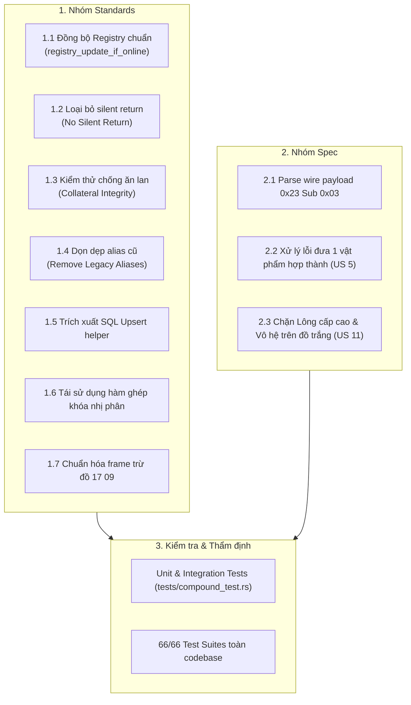

# Kế hoạch Chi tiết Sửa đổi Hệ Thống Hợp Thành & Cường Hóa Khảm Lông (Compound & Socketing Fix Plan)

Tài liệu này lập kế hoạch chi tiết khắc phục toàn diện các vấn đề đã được phát hiện trong phiên `/code-review`, bao gồm:
1. **Standards**: 4 Hard Violations + 3 Code Smells
2. **Spec**: Bóc tách wire payload `0x23 Sub 0x03` + 2 lỗi nghiệp vụ hiện thực chưa chính xác (1-item compound error & high-level feather trên đồ trắng).

---

## 1. Danh Mục Các Hạng Mục Cần Khắc Phục (Scope of Fixes)



---

## 2. Chi Tiết Thực Hiện Từng Hạng Mục (Detailed Implementation Steps)

### Phase 1: Khắc phục Nhóm Standards

#### 1.1. Chuẩn hóa Đồng bộ Registry (`CODING_STANDARDS.md §1.2`)
- **Tập tin**: [`src/server/session.rs`](file:///mnt/d/VUDT/GIT_PCC/ts_dream/src/server/session.rs), [`src/server/handlers/crafting.rs`](file:///mnt/d/VUDT/GIT_PCC/ts_dream/src/server/handlers/crafting.rs), [`src/server/handlers/trade_storage.rs`](file:///mnt/d/VUDT/GIT_PCC/ts_dream/src/server/handlers/trade_storage.rs).
- **Hiện trạng**: `crafting.rs` gọi trực tiếp `lock_online_sessions().insert(...)` tại các dòng 254, 377, 527.
- **Giải pháp**:
  1. Trong `src/server/session.rs`, công khai hàm:
     ```rust
     pub fn registry_update_if_online(s: &Session) {
         let mut sessions = lock_online_sessions();
         if sessions.contains_key(&s.id) {
             sessions.insert(s.id, s.clone());
         }
     }
     ```
  2. Trong `crafting.rs`, thay thế 3 vị trí gọi trực tiếp thành:
     ```rust
     crate::server::session::registry_update_if_online(&ctx.conn.session);
     ```
  3. Trong `trade_storage.rs`, xóa hàm private `registry_update_if_online` trùng lặp và dùng hàm chung từ `session.rs`.

#### 1.2. Loại bỏ Silent Return (`CODING_STANDARDS.md §2.2`)
- **Tập tin**: [`src/server/handlers/crafting.rs`](file:///mnt/d/VUDT/GIT_PCC/ts_dream/src/server/handlers/crafting.rs).
- **Hiện trạng**:
  - Dòng 406: `if equip_slot == feather_slot { return; }` làm client đứng im không phản hồi.
  - Dòng 290: `if !(1..=4).contains(&elem_choice) { return; }` không báo lỗi.
- **Giải pháp**:
  - Thêm frame thông báo toast:
    ```rust
    if equip_slot == feather_slot {
        ctx.out.send(sys_msg_frame("Không thể chọn cùng một ô trang bị và lông!"));
        return;
    }
    ```
    ```rust
    if !(1..=4).contains(&elem_choice) {
        ctx.out.send(sys_msg_frame("Lựa chọn bảo vật không hợp lệ!"));
        return;
    }
    ```

#### 1.3. Kiểm thử Chống Ăn Lan Slot Phụ Cận (`CODING_STANDARDS.md §3.2`)
- **Tập tin**: [`tests/compound_test.rs`](file:///mnt/d/VUDT/GIT_PCC/ts_dream/tests/compound_test.rs).
- **Hiện trạng**: Các bài test biến động túi đồ chỉ kiểm tra slot 1 & 2.
- **Giải pháp**:
  - Trong `test_handle_compound_wire_and_db_flow`:
    - Tạo sẵn slot 3 (item `10003`, số lượng lẻ `7`) và slot 4 (item `10004`, số lượng lẻ `13`) trong `session.homdo` và SQLite `inventories`.
    - Sau khi chạy hợp thành, assert: slot 3 và slot 4 giữ nguyên 100% item ID và số lượng cả trong RAM lẫn DB.
  - Trong `test_handle_socket_feather_wire_and_db_flow`:
    - Tạo sẵn slot 3 (item `10003`, số lượng lẻ `5`) và slot 4 (item `10004`, số lượng lẻ `9`).
    - Sau khi khảm lông, assert slot 3 và slot 4 hoàn toàn không bị ăn lan dữ liệu.

#### 1.4. Dọn dẹp Triệt Để Legacy Aliases (`CODING_STANDARDS.md §4`)
- **Tập tin**: [`src/data/loaders/compound.rs`](file:///mnt/d/VUDT/GIT_PCC/ts_dream/src/data/loaders/compound.rs), [`src/data/loaders/item.rs`](file:///mnt/d/VUDT/GIT_PCC/ts_dream/src/data/loaders/item.rs).
- **Giải pháp**:
  - Xóa 7 trường thừa trong `CompoundDef`: `compound_d`, `material_a`, `material_b`, `material_c`, `a_degree`, `b_degree`, `c_degree`.
  - Giữ lại cấu trúc chuẩn:
    ```rust
    pub struct CompoundDef {
        pub result_kind: u16,
        pub materials: [u8; 3],
        pub degrees: [u8; 3],
        pub lookup_key: u32,
    }
    ```
  - Xóa trường alias `pub material: u8` trong `ItemDef` (đã có `display_material` và `compound_material`).

#### 1.5. Khử Duplicated Code: Trích xuất SQL Upsert Helper
- **Tập tin**: [`src/server/inventory.rs`](file:///mnt/d/VUDT/GIT_PCC/ts_dream/src/server/inventory.rs) hoặc [`src/server/handlers/crafting.rs`](file:///mnt/d/VUDT/GIT_PCC/ts_dream/src/server/handlers/crafting.rs).
- **Hiện trạng**: Đoạn lệnh SQL Upsert `inventories` với 23 bind parameters bị lặp 2 lần giữa `handle_compound` và `handle_select_feather`.
- **Giải pháp**:
  - Tạo hàm helper:
    ```rust
    pub async fn upsert_inventory_slot<'a, E>(
        executor: E,
        char_id: i64,
        storage_type: i64,
        item: &InventoryItem,
    ) -> Result<(), sqlx::Error>
    where
        E: sqlx::Executor<'a, Database = sqlx::Sqlite>,
    ```
  - Thay thế 2 khối code lặp bằng 1 dòng gọi helper duy nhất.

#### 1.6. Khử Duplicated Code: Tái Sử Dụng Hàm Ghép Khóa Thập Phân
- **Tập tin**: [`src/crafting/basic/algorithm.rs`](file:///mnt/d/VUDT/GIT_PCC/ts_dream/src/crafting/basic/algorithm.rs), [`src/data/loaders/compound.rs`](file:///mnt/d/VUDT/GIT_PCC/ts_dream/src/data/loaders/compound.rs).
- **Giải pháp**:
  - Trích xuất hàm public helper `CompoundDatLoader::compute_key_and_sort` để dùng chung giữa việc nạp `Compound.Dat` và thuật toán `execute_compound`.

#### 1.7. Khử Primitive Obsession: Chuẩn Hóa Frame Trừ Đồ `17 09`
- **Tập tin**: [`src/server/inventory.rs`](file:///mnt/d/VUDT/GIT_PCC/ts_dream/src/server/inventory.rs).
- **Giải pháp**:
  - Bổ sung helper:
    ```rust
    pub fn item_count_changed_frame(slot: u8, count: u8) -> String {
        let body = format!("{:02X}{:02X}", slot, count);
        crate::protocol::frame("1709", &body)
    }
    ```
  - Thay thế các chuỗi literal hex `format!("F44404001709{:02X}{:02X}", ...)` bằng hàm này.

---

### Phase 2: Khắc phục Nhóm Spec

#### 2.1. Phân Tích Wire Payload `0x23 Sub 0x03` Chuẩn Client Delphi
- **Tập tin**: [`src/server/handlers/crafting.rs`](file:///mnt/d/VUDT/GIT_PCC/ts_dream/src/server/handlers/crafting.rs), [`src/server/handlers/system.rs`](file:///mnt/d/VUDT/GIT_PCC/ts_dream/src/server/handlers/system.rs).
- **Yêu cầu Spec (dòng 109-110)**:
  `Opcode 0x23 Subcode 0x03` nhận payload dạng: `[str1_len, str1..., str2_len, str2..., elem_choice, sub_choice]` hoặc định dạng ngắn `[elem_choice, sub_choice]`.
- **Giải pháp**:
  - Chuyển chữ ký `handle_select_feather(ctx: &mut OpcodeCtx<'_>)`.
  - Phân tích payload:
    - Nếu payload bắt đầu bằng 2 len-prefixed strings (tương thích form client gửi kèm ID/tên form), bóc 2 chuỗi và đọc byte `elem_choice`, `sub_choice` phía sau.
    - Nếu payload ngắn (1..2 bytes), đọc trực tiếp `elem_choice = payload[0]`, `sub_choice = payload.get(1)`.
  - Kiểm tra `elem_choice == 0` $\implies$ Toast: *"Hãy chọn lựa một trong các loại bảo vật"*.
  - Kiểm tra `elem_choice \notin 1..=4` $\implies$ Toast: *"Lựa chọn bảo vật không hợp lệ!"*.
  - Trong `src/server/handlers/system.rs`, router nhánh `Sub 3` trực tiếp chuyển tiếp context sang `crafting::handle_select_feather(ctx)`.

#### 2.2. Xử Lý Lỗi Đưa 1 Vật Phẩm Hợp Thành Không Bị Masked (US 5)
- **Tập tin**: [`src/server/handlers/crafting.rs`](file:///mnt/d/VUDT/GIT_PCC/ts_dream/src/server/handlers/crafting.rs).
- **Yêu cầu Spec (dòng 58)**:
  Khi người chơi chỉ đưa 1 vật phẩm vào form và nhấn hợp thành, hệ thống phải báo lỗi yêu cầu ít nhất 2 vật phẩm (`CraftError::NeedAtLeastTwoItems` $\rightarrow$ *"Hợp thành cần ít nhất 2 vật phẩm!"*).
- **Giải pháp**:
  - Thay đổi logic kiểm tra đầu vào của `handle_compound`:
    - Cho phép payload chứa 1 cặp `(slot1, qty1)` (độ dài $\ge 2$).
    - Nếu các slot tiếp theo không có (`slot2 == 0 && slot3 == 0` hoặc payload ngắn), không ném lỗi `"Vị trí vật phẩm không hợp lệ!"` mà trả về ngay toast chuẩn:
      ```rust
      ctx.out.send(sys_msg_frame("Hợp thành cần ít nhất 2 vật phẩm!"));
      return;
      ```
    - Đảm bảo lỗi US 5 được kích hoạt chính xác thay vì bị ngắt bởi guard clause.

#### 2.3. Ràng Buộc Cấp Lông Khởi Đầu & Chặn Lông Vô Hệ Trên Đồ Trắng (US 11)
- **Tập tin**: [`src/crafting/socketing/feather.rs`](file:///mnt/d/VUDT/GIT_PCC/ts_dream/src/crafting/socketing/feather.rs).
- **Yêu cầu Spec (dòng 94, 97, US 11)**:
  - Trang bị trắng (`element == 0`) chỉ được phép khảm bằng Lông nguyên tố cấp 1 (`feather.element in 1..=4` và `feather.level == 1`).
  - Không tự tiện gán mặc định Lông Đồng Thoại / Vô hệ (`element == 0`) thành hệ Địa.
  - Chặn việc dùng Lông cấp cao (C2..C10) khảm vào đồ trắng gây mất đồ oan.
- **Giải pháp**:
  ```rust
  if equip.long_val == 0 {
      // Must be an elemental feather (Earth/Water/Fire/Wind)
      if feather.element == 0 {
          return Err(CraftError::InvalidFeather);
      }
      // Must be a level 1 feather
      if feather.level != 1 {
          return Err(CraftError::InvalidFeatherLevel);
      }
      equip.long_val = feather.element;
      equip.giatri_long = 1;
      return Ok(SocketOutcome {
          success: true,
          new_element: feather.element,
          new_element_value: 1,
          is_element_switched: false,
      });
  }
  ```

---

## 3. Kế Hoạch Kiểm Thử Bổ Sung (Test Verification Plan)

Trong [`tests/compound_test.rs`](file:///mnt/d/VUDT/GIT_PCC/ts_dream/tests/compound_test.rs), bổ sung 4 ca kiểm thử chuyên biệt:
1. `test_compound_1_item_triggers_need_at_least_two_items_toast`:
   Gửi payload hợp thành chỉ có 1 slot $\implies$ Khẳng định nhận toast *"Hợp thành cần ít nhất 2 vật phẩm!"*.
2. `test_socket_blank_gear_with_high_level_feather_rejected`:
   Khảm Lông Cấp 2 hoặc Đồng Thoại Cấp 5 vào trang bị trắng $\implies$ Khẳng định trả về lỗi `InvalidFeatherLevel` hoặc `InvalidFeather`, trang bị và lông nguyên vẹn.
3. `test_select_feather_wire_payload_variants`:
   Kiểm tra `handle_select_feather` với cả dạng payload ngắn `[3, 0]` và dạng Delphi string prefix $\implies$ Khẳng định sinh ra Lông Hỏa `24023`.
4. `test_collateral_slot_preservation_on_compound_and_socketing`:
   Tạo các slot 3, 4, 5 với số lượng lẻ, thực hiện hợp thành và khảm lông $\implies$ Khẳng định các slot phụ cận không suy suyển.

Chạy toàn bộ test suites:
```bash
cargo test --test compound_test
cargo test --all-targets --no-fail-fast
```
Yêu cầu đạt 100% passed (66/66 test suites).

---

## 4. Bảng Phân Công & Tác Động Tệp

| Tệp | Thay đổi chính | Mục đích |
|---|---|---|
| `src/server/session.rs` | Thêm `pub fn registry_update_if_online` | Sửa vi phạm §1.2 |
| `src/server/inventory.rs` | Thêm `item_count_changed_frame` & `upsert_inventory_slot` | Khử code smell & magic hex |
| `src/server/handlers/crafting.rs` | Áp dụng registry helper, upsert helper, parse wire 0x23, sửa lỗi 1-item | Sửa §1.2, §2.2, US 5, Wire 0x23 |
| `src/server/handlers/trade_storage.rs` | Dùng `session::registry_update_if_online` | Khử code lặp |
| `src/server/handlers/system.rs` | Chuyển tiếp context gói 0x23 sub 3 sang crafting | Wire 0x23 Sub 03 |
| `src/crafting/socketing/feather.rs` | Chặn lông C2..C10 & lông vô hệ trên đồ trắng | Sửa lỗi US 11 & Spec 94/97 |
| `src/data/loaders/compound.rs` | Xóa 7 trường legacy alias | Sửa vi phạm §4 |
| `src/data/loaders/item.rs` | Xóa trường alias `material` | Sửa vi phạm §4 |
| `tests/compound_test.rs` | Thêm bài test collateral và các ca biên US 5, US 11 | Sửa vi phạm §3.2 |
