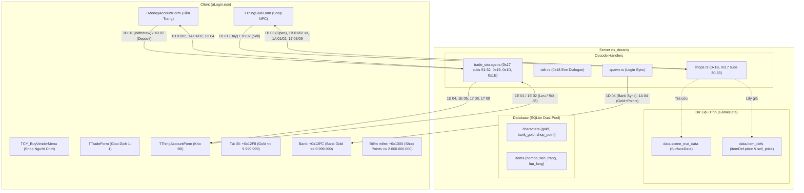

# Kế Hoạch Nghiên Cứu & Hoàn Thiện Hệ Thống Kinh Tế Game (Mua / Bán / Giao Dịch / Tiền Tệ)

> **Mục tiêu**: Làm rõ 100% các hạng mục còn mở (mục 1 đến 5 tại Mục 8 tài liệu `.scratch/client-pseudo-op-code/economy/README.md`) bằng chứng cứ dịch ngược nhị phân client `aLogin.exe` (Mức bằng chứng A), từ đó xây dựng kế hoạch chi tiết từng bước để hoàn thiện server Rust `ts_dream` mà không làm thay đổi source code trước khi được người dùng kiểm duyệt.

---

## 1. Kết Quả Dịch Ngược 5 Hạng Mục Còn Mở (Evidence Level A)

Qua việc kết hợp REA (Reverse Engineer Anything), đọc trực tiếp assembly jump table, decompiled C từ Ghidra và tháo mã các hàm sự kiện Delphi trong `client_delphi/aLogin.exe`, 5 hạng mục còn mở đã được làm sáng tỏ hoàn toàn với độ tin cậy tuyệt đối (Level A):

### 1.1 Mục 1: C→S `0x17` Stall Builders (Subs `0x1E`, `0x1F`, `0x20`, `0x21`, `0x22`)
- **Vị trí trong binary**: Jump table tại `0x00783405` điều hướng qua 61 DWORDs.
- **Chi tiết từng SubOp Client gửi lên Server**:
  1. **`17 1E`** (`0x007840A7`): Mở quầy bán hàng (Open Stall).
     - Wire: `17 1E <name_len: u8> <name: VISCII> <stall_id: u8> <payload>` (truyền danh sách item bày bán).
  2. **`17 1F`** (`0x0078418C`): Đóng quầy bán hàng (Close Stall).
     - Wire: `17 1F` (2 bytes cố định).
  3. **`17 20`** (`0x007841E1`): Xem quầy của người khác (Click vào nhân vật đang mở stall).
     - Wire: `17 20 <vendor_uid: u32 LE>` (6 bytes tổng cộng).
  4. **`17 21`** (`0x00784261`): Mua vật phẩm từ quầy người chơi khác.
     - Wire: `17 21 <vendor_uid: u32 LE> <slot: u8> <count: u8>` (8 bytes tổng cộng).
     - *Đặc tả*: Đọc `vendor_uid` (DWORD LE), slot trên quầy (Byte), số lượng cần mua (Byte).
  5. **`17 22`** (`0x0078434F`): Làm mới quầy của chính mình (Refresh own stall).
     - Wire: `17 22 <stall_id: u8>`.

### 1.2 Mục 2: S→C `17 21` Catalogue Shop Người Chơi (`FUN_00610290` / `TCY_BuyVenderMenu`)
- **Tập tin phân tích**: `test/ts_decompile/functions/00610290_FUN_00610290.c` (3,656 bytes).
- **Kết quả**: Cấu trúc frame hoàn toàn byte-exact, nâng cấp từ Level B lên **Level A**:
  - **Header (17 bytes - `0x11`)**:
    - `0x00`: SubOp `0x21` (1B)
    - `0x01..0x04`: `vendor_uid` (4B DWORD Little-Endian)
    - `0x05..0x10`: 12 bytes đệm zero (`00 00 00 00 00 00 00 00 00 00 00 00`)
  - **Entries (Tối đa 10 vật phẩm, mỗi entry đúng 16 bytes)**:
    - Offset `+0x00`: `slot: u8` (Vị trí ô trong stall 1..10)
    - Offset `+0x01..0x02`: `item_id: u16 LE` (Mã vật phẩm)
    - Offset `+0x03`: `count: u8` (Số lượng bán)
    - Offset `+0x04`: `long_val: u8` (Độ bền / Thuộc tính lông)
    - Offset `+0x05..0x08`: `price: u32 LE` (Đơn giá vàng bán)
    - Offset `+0x09`: `giatri_long: u8` (Chỉ số ép lông / ngọc)
    - Offset `+0x0A`: `khang: u8` (Kháng tính tâm linh)
    - Offset `+0x0B`: `pad: u8` (`0x00`)
    - Offset `+0x0C..0x0F`: `texp: u32 LE` (Điểm kinh nghiệm trang bị)

### 1.3 Mục 3: Phân Biệt C→S `1D 01` và `1D 02` Trong Tiền Trang (Bank)
- **Tập tin phân tích**: `client_delphi/aLogin.exe` tháo mã tại offset `0x1d79c4` (VA `0x005D85C4`) và `0x1d7bb4` (VA `0x005D87B4`).
- **Logic sự kiện Delphi**:
  - `btn_Bank_Gold_R` (`0x005D85C4`): Nút mũi tên PHẢI (từ Bank sang Túi đồ). Kiểm tra `pocket_gold < 9,999,999` và `bank_gold >= amount`, sau đó gọi `SendCommand(main=0x1D, sub=0x01, amount: u32 LE)`.
    => **C→S `1D 01` = RÚT TIỀN (Withdraw: Bank → Túi)**.
  - `btn_Bank_Gold_L` (`0x005D87B4`): Nút mũi tên TRÁI (từ Túi đồ vào Bank). Kiểm tra `bank_gold < 9,999,999` và `pocket_gold >= amount`, sau đó gọi `SendCommand(main=0x1D, sub=0x02, amount: u32 LE)`.
    => **C→S `1D 02` = NỘP TIỀN (Deposit: Túi → Bank)**.
- **Phản hồi S→C tương ứng từ Server**:
  - `1D 01 <amount: u32 LE>`: Server báo Bank tăng thêm `amount` (nạp thành công).
  - `1D 02 <amount: u32 LE>`: Server báo Bank giảm đi `amount` (rút thành công).
  - `1D 03`: Báo lỗi "Dung lượng tiền trang không đủ".
  - `1D 04 <val: u32 LE>`: Cài đặt giá trị tuyệt đối cho Bank gold (`player+0x12FC`).
  - `1D 05`: Mở giao diện `TMoneyAccountForm`.

### 1.4 Mục 4: Hệ Thống Mini-Game & Cờ Bạc (`TFBlissBag`, `TFRollEgg`, `TFWheel`)
- **`TFWheel`**: Không phải tính năng roulette cờ bạc, mà là lớp đồ họa animation sprite hiển thị chiêu thức lửa ("Bánh xe lửa") trong chiến đấu.
- **`TFBlissBag`**: Bộ nạp dữ liệu cục bộ đọc `Data\BlissBag.Dat` để client hiển thị preview tỉ lệ túi may mắn (túi quà Phúc Lộc), dùng kèm khi dùng vật phẩm `17 15`.
- **`TFRollEgg`**: Đọc `Data\RG.Dat` tại `0x00772788`, nạp vào mảng toàn cục `DAT_009d13d0` rồi tự hủy giải phóng bộ nhớ.
- **Hệ thống cá cược mạng thực sự**: Được điều phối qua `TSportManage` với Opcode `0x39` (`case 50` trong `FUN_0078a89c`):
  - Panel 1: **Tài Xỉu (Big/Small)** — Opcode `0x3A`
  - Panel 2: **Domino (Pai Gow)** — Opcode `0x3B`
  - Panel 3: **Cờ Tướng (Xiangqi)** — Opcode `0x3C`
  - Panel 4: **Lotto (Vé số)** — Opcode `0x36` (gồm 20x5 ma trận số)
  - Panel 6: **Slot Machine (Máy đánh xèng)** — Opcode `0x36`

### 1.5 Mục 5: Hệ Thống Kho Chứa Đồ `1E 01..0D`
- Client quản lý 3 mảng bộ nhớ kho riêng biệt cho nhân vật:
  - `player + 0xA48`: Kho cá nhân 1 (51 ô)
  - `player + 0xB14`: Kho cá nhân 2 (51 ô)
  - `player + 0xDC0`: Kho Thủy binh (26 ô)
- **Đặc tả wire packet**:
  - `1E 01`: Gửi danh sách hàng loạt vật phẩm trong kho (batch entries, mỗi record 12B).
  - `1E 04`: Thêm 1 vật phẩm vào kho (12B record).
  - `1E 05 <slot: u8> <count: u8>`: Rút bớt số lượng `count` khỏi ô `slot` trong kho.
  - `1E 08`: Xóa toàn bộ kho hiển thị trên client.
  - `1E 0C`: Thêm vật phẩm vào kho Thủy binh (mỗi record 14B).
  - `1E 0D <slot: u8> <count: u8>`: Rút vật phẩm khỏi kho Thủy binh.
- **Bug đã phát hiện trong Rust hiện tại**: File `src/server/handlers/trade_storage.rs` (dòng 677, 684, 701) đang hardcode số lượng `0x32` (`"32"`) thay vì format số lượng thực tế `{:02X}` của vật phẩm (`item.count`).

---

## 2. Thiết Kế Kiến Trúc Kinh Tế Tổng Thể

### 2.1 Mô Hình Tiền Tệ 3 Thành Phần Chuẩn Hóa
1. **Gold (`+0x12F8`)**: Vàng trên người (túi đồ).
   - Trần giới hạn: **`9,999,999`**.
   - Cập nhật tăng: `1A 01 <delta: u32 LE>`
   - Cập nhật giảm: `1A 02 <delta: u32 LE>`
   - Đồng bộ tuyệt đối: `1A 04 <gold: u32 LE> <shop_point: u32 LE>`
2. **Bank Gold (`+0x12FC`)**: Vàng gửi trong Tiền Trang.
   - Trần giới hạn: **`9,999,999`**.
   - Cập nhật tăng: `1D 01 <delta: u32 LE>`
   - Cập nhật giảm: `1D 02 <delta: u32 LE>`
   - Đồng bộ tuyệt đối: `1D 04 <bank_gold: u32 LE>` (bắt buộc phải gửi khi vừa login).
3. **Shop Points / Điểm Mềm (`+0x1300`)**: Điểm tích lũy / nạp game.
   - Trần giới hạn: **`2,000,000,000`**.
   - Truyền qua DWORD thứ 2 của frame `1A 04`. Tuyệt đối không truyền `00 00 00 00` làm đè mất điểm của người chơi.

### 2.2 Luồng Mua / Bán Shop NPC Chuẩn Hóa
- **Mở Shop**: Khi người chơi chọn menu cửa hàng từ NPC (thông qua `talk.rs`), server phát frame `F44402001B03` để client bật giao diện `TThingSaleForm`.
- **Mua hàng (`1B 01`)**:
  1. Client gửi `1B 01 <index: u8> <count: u16 LE>`.
  2. Server tra cứu `index` trong `scene_eve_data[map_id].surface_datas` tương ứng với NPC. Lấy `data_id` làm `item_id`.
  3. Tra cứu `data.item_defs[&item_id].price`.
  4. Tính `total_cost = price * count`. Kiểm tra `gold >= total_cost`, kiểm tra túi đồ còn chỗ.
  5. Trừ tiền, thêm item, persist atomic vào DB.
  6. Phát chuỗi frame wire:
     - `1A 02 <total_cost: u32 LE>` (Banner trừ vàng)
     - `1A 04 <gold: u32 LE> <shop_point: u32 LE>` (Đồng bộ số dư)
     - `17 06 <item_id: u16 LE> <count: u16 LE> ...` (Đưa item vào túi)
     - `1B 01 00` (Báo mua thành công - client im lặng)
- **Bán hàng (`1B 02`)**:
  1. Client gửi `1B 02 <slot: u8> <qty: u8>`.
  2. Server kiểm tra slot có tồn tại trong túi đồ và số lượng `>= qty`.
  3. Tra cứu `data.item_defs[&item.id].sell_price`.
  4. Tính `revenue = sell_price * qty`. Kiểm tra `gold + revenue <= 9,999,999`.
  5. Cộng tiền, trừ/xóa item, persist atomic vào DB.
  6. Phát chuỗi frame wire:
     - `1A 01 <revenue: u32 LE>` (Banner cộng vàng)
     - `1A 04 <gold: u32 LE> <shop_point: u32 LE>` (Đồng bộ số dư)
     - `17 09 <slot: u8> <qty: u8>` (Gỡ item khỏi túi)
     - `1B 02 00` (Báo bán thành công)

---

## 3. Kế Hoạch Triển Khai Kỹ Thuật Cho Server Rust (5 Giai Đoạn)

*(Toàn bộ các bước dưới đây được phân rã chi tiết để chuẩn bị thực hiện trong các phiên kế tiếp sau khi được duyệt)*

### Giai Đoạn 1: Hoàn Thiện Shop NPC & Dialogue Bridge
- **Tập tin tác động**:
  - `src/server/handlers/talk.rs`: Tại các nhánh menu mở cửa hàng (ID 30, 32), bổ sung gửi gói `F44402001B03` để kích hoạt `TThingSaleForm` của client. Đồng thời cập nhật các hàm gọi `gold_frame` truyền đủ 2 tham số `(session.gold, session.shop_point)`.
  - `src/server/handlers/shops.rs`:
    - Sửa `handle_npc_shop`: Phân tách rạch ròi `ctx.sub == 1` (Mua) và `ctx.sub == 2` (Bán).
    - Mua: Parse đúng `index: u8` và `count: u16 LE` (thay vì cố định count=1). Tra cứu `data.scene_eve_data` kết hợp `data.item_defs[&item_id].price`.
    - Bán: Parse đúng `slot: u8` và `qty: u8`. Lấy giá bán từ `data.item_defs[&item.id].sell_price` (thay vì `+count` tượng trưng).
    - Áp dụng triệt để bảng 12 mã phản hồi VISCII nội bộ (`1B 01 xx` và `1B 02 xx`) thay vì gửi nhầm mã đỏ `red_message(02 0B)`.
    - Phát đúng wire sequence: `1A 02` -> `1A 04` -> `17 06` -> `1B 01 00` khi mua, và `1A 01` -> `1A 04` -> `17 09` -> `1B 02 00` khi bán.
  - `src/server/dispatcher.rs`: Đính chính comment tại opcode `0x1B` (xác nhận client C→S có gửi `0x1B 01` và `0x1B 02`).

### Giai Đoạn 2: Đồng Bộ Tiền Tệ & Tiền Trang (Bank) Lúc Đăng Nhập
- **Tập tin tác động**:
  - `src/server/spawn.rs`:
    - Tại hàm `spawn_player_self`: Bổ sung gửi gói đồng bộ Bank gold `1D 04 <bank_gold: u32 LE>` ngay khi nhân vật vừa hoàn tất spawn vào map (`F44406001D04...`).
    - Tại Step 12 (frame tiền tệ `1A 04`): Gửi đúng `s.shop_point` ở DWORD thứ 2 thay vì `00000000`.
  - `src/server/handlers/shops.rs`: Sửa `gold_frame(gold: u32, shop_point: u32)` để mọi nơi gọi frame này đều bảo toàn số điểm `shop_point` của nhân vật.
  - `src/server/handlers/trade_storage.rs`: Cập nhật `gold_status_frame` truyền đủ cả `gold` và `shop_point`.

### Giai Đoạn 3: Sửa Lỗi Kho Bãi & Nâng Cấp Shop Người Chơi (Stall)
- **Tập tin tác động**:
  - `src/server/handlers/trade_storage.rs`:
    - Khắc phục triệt để lỗi hardcode `"32"` tại hàm `handle_storage_transfer`: Thay thế chuỗi cố định `32` bằng `{:02X}` ứng với số lượng thực tế của item chuyển kho (`1E 05 <slot> <count>`, `17 09 <slot> <count>`, `17 68 <slot> <count>`).
  - `src/server/handlers/shops.rs`:
    - Cập nhật `player_shop_catalog_frame`: Áp dụng chuẩn Header 17B (`0x11`) và Records 16B theo giải mã của `FUN_00610290` (Level A).
    - Cập nhật `handle_player_shop` (Sub 33 Mua hàng): Cập nhật `gold_frame` truyền `shop_point`, phát gói `17 09` cho người bán để trừ đồ trên quầy, và gửi `17 06` chuẩn cho người mua.

### Giai Đoạn 4: Chuẩn Hóa Giao Dịch Người Chơi (Trade 1-1)
- **Tập tin tác động**:
  - `src/server/handlers/trade_storage.rs`:
    - Tách biệt rõ ràng luồng `19 01` (Giao dịch vật phẩm) và `19 0A` (Giao dịch thú nuôi / Pet Trade) thay vì gộp chung `1 | 10`.
    - Bổ sung gói `17 3B` khi hủy giao dịch hoặc quá thời gian timeout để client đóng form giao dịch an toàn.

### Giai Đoạn 5: Kiểm Thử & Xác Nhận (Testing & Verification)
- **Quy tắc tuân thủ**:
  - Tuyệt đối **không** đặt code test inline trong `src/` (không dùng `#[cfg(test)]`).
  - Toàn bộ integration test kiểm thử các packet wire (`1B 01`, `1B 02`, `1D 01`, `1D 02`, `17 21`, `1E 01`) sẽ được đặt trong file test tập trung tại `tests/economy_wire_test.rs`.
  - Sử dụng cơ sở dữ liệu in-memory SQLite (`sqlite::memory:?cache=shared`) cho test suite để tránh đụng chạm đến production DB `DB/ts_dream.db`.
  - Chạy kiểm tra: `cargo check` và `cargo test --all-targets --no-fail-fast`.

---

## 4. Các Quyết Định Thiết Kế Đã Thống Nhất (Design Decisions)

1. **Lưu trữ Điểm mềm (`shop_point`)**:
   - **Xác nhận**: Bảng `character_money` đã có sẵn cột `shoppoint` (`migrations/0001_init.sql:88`), do đó **không cần** tạo migration thêm cột.
   - **Xử lý**: Trong `Session::apply_to_session`, `create_and_seed`, và các hàm persist giao dịch `persist_shop_transaction`, `character_money.shoppoint` được đồng bộ trực tiếp cùng với `gold` và `bankgold`.
2. **Xử lý NPC tân thủ / dev test (NPC ID 7 Map 9999)**:
   - **Xác nhận**: **Giữ lại** nhánh fallback starter bundle này trong `handle_npc_shop`.
   - **Yêu cầu**: Bổ sung chú thích và doc comment chi tiết, nêu rõ đây là cơ chế fallback hỗ trợ tân thủ / môi trường test local khi NPC không có dữ liệu surface trong `eve.emg`.
3. **Phê duyệt kế hoạch triển khai**:
   - Kế hoạch 5 giai đoạn đã được người dùng thông qua và sẵn sàng để tiến hành thực hiện khi bắt đầu giai đoạn code.
