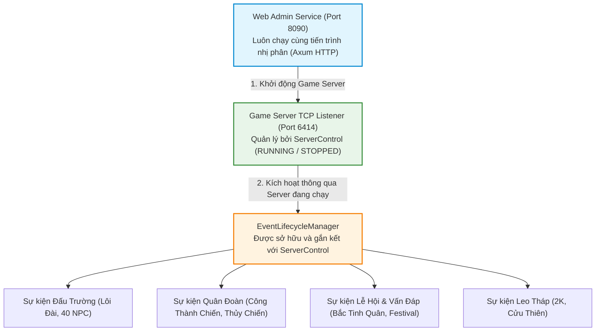

# BÁO CÁO RÀ SOÁT & PHÂN TÍCH GAP HỆ THỐNG SỰ KIỆN ĐẶC BIỆT (SPECIAL EVENTS) TRÊN SERVER RUST

* **Dự án:** `ts_dream` (Rust Game Server parity với Client TS Online `aLogin.exe`)
* **Tài liệu đối chiếu:**
  1. `SPECIAL_EVENTS_SPEC.md` (Đặc tả dịch ngược thực thi `aLogin.exe` và dữ liệu tĩnh).
  2. `concepts_brief.md` (Bản phân tích khái niệm & ý tưởng kiến trúc server Rust).
  3. Source code Rust hiện tại (`src/`).
  4. Trực tiếp thực thi `aLogin.exe` (Delphi 7, PE x86) và mã dịch ngược Ghidra/C (`client_pseudo_c/`).
* **Ngày lập:** 2026-11-04
* **Tác giả:** Antigravity Research Engine

---

## 1. TỔNG QUAN ĐÁNH GIÁ (EXECUTIVE SUMMARY)

Bản rà soát này được thực hiện nhằm mục tiêu đảm bảo server Rust giao tiếp mượt mà 100%, đúng wire protocol byte-exact với client game `aLogin.exe`, hỗ trợ trọn vẹn toàn bộ các tính năng của phân hệ **Sự kiện đặc biệt (Special Events)**. 

Qua quá trình rà soát đối chiếu chéo giữa **Bản đặc tả dịch ngược (`SPECIAL_EVENTS_SPEC.md`)**, **Ý tưởng thiết kế (`concepts_brief.md`)** và **Mã nguồn thực tế (`src/`)**, chúng tôi phát hiện **5 khoảng trống (Gaps) cốt lõi** cần được hiệu chỉnh và bổ sung ngay lập tức:

1. **Hiểu sai bản chất sự kiện "Vấn đáp Bắc Tinh Quân" (North Star Quiz)**:
   - `concepts_brief.md` trước đó chỉ coi Bắc Tinh Quân là cơ chế Anti-Bot Captcha đơn thuần (3-strike ngắt kết nối / tống ngục).
   - **Thực tế dịch ngược từ Client & Gameplay TS Online**: Đây là một **trận chiến ngẫu nhiên đặc biệt (Special Encounter Battle)** kích hoạt khi người chơi di chuyển ngoài bản đồ dã ngoại (gặp NPC 1643/1644). Trong trận chiến này, client bị khoá hoàn toàn các nút kỹ năng/tấn công/bỏ chạy, chỉ hiển thị bảng đố 4 đáp án. Trả lời đúng nhận buff **Thần Tài (`FGod`) x1.5 kinh nghiệm**; trả lời sai bị **giảm toàn bộ HP về 1** và dính debuff **Con Ma (`FGhost`) giảm 50% kinh nghiệm**, bắt buộc phải tìm NPC/Pet **"Bà gọi hồn" (NPC 1752)** hoặc dùng **"Cải vận phù" (Item 46180)** để giải trừ.
2. **Quy trình phân cấp điều khiển Web Admin (Port 8090) ↔ Game Server ↔ Special Events**:
   - Web Admin 8090 là tầng kiểm soát độc lập. Server Game TCP (port 6414) phải được khởi động trước (`RUNNING`). Toàn bộ việc kích hoạt sự kiện đặc biệt phải thông qua instance server game đang chạy. Nếu server game bị dừng (`STOPPED`), mọi sự kiện phải tự động dọn dẹp (graceful drain / cancel), và admin không thể bật sự kiện khi server game chưa chạy.
3. **Thiếu sót nghiêm trọng về trạng thái Thần Tài / Con Ma (`God` / `Ghost`) trong Rust**:
   - Struct `Session` hiện có `god: u32` nhưng **hoàn toàn thiếu trường `ghost: u8`**.
   - Frame xuất hiện nhân vật (`player_appear` - Opcode `0x03`) đang bị hardcode `ghost=0, god=0` tại `src/server/spawn.rs:567-568`.
   - Thiếu hoàn toàn handler gửi frame đồng bộ trạng thái thời gian thực **`S→C 18 08`** (đây là opcode chuẩn client dùng để gắn/gỡ Thần Tài và Con Ma, phát âm thanh `WA0006.wav` và hiện thông báo `"Thần xui đã rời xa bạn!"`).
   - Chưa tích hợp hệ số x1.5 EXP (Thần Tài) và -50% EXP (Con Ma) vào công thức kết thúc trận chiến tại `src/battle/combat_formula.rs`.
4. **Cơ chế chuyển đợt (Wave Chaining) của Chuỗi phụ bản liên tục (40 NPC, 2K, Cửu Thiên)**:
   - Ý tưởng thiết kế đề xuất giữ nguyên session trận đấu nhưng chưa mô tả đúng wire format chuyển tiếp giữa các đợt mà client Delphi kỳ vọng (`0x0B FA` reset wave hay `set_unit_prop` + `entity_npc`).
5. **Đồng bộ hóa dữ liệu Lễ hội (`Festival.Dat`) và Ngày tháng**:
   - `concepts_brief.md` đã nhận diện đúng giá trị timestamp `11.0` (`1900-01-10`) nhưng chưa mô tả đầy đủ 74 thông báo sự kiện theo mùa qua opcode `0x17 39`.

---

## 2. PHÂN TÍCH CHUYÊN SÂU: SỰ KIỆN "BẮC TINH QUÂN", THẦN TÀI & CON MA (GHOST)

Dưới đây là kết quả dịch ngược từ mã nhị phân client `aLogin.exe` giải mã toàn bộ cơ chế của sự kiện này.

### 2.1. Bản chất sự kiện: Trận chiến Ngẫu nhiên (Encounter Battle)
- **Kích hoạt**: Khi người chơi di chuyển (hàm `try_trigger_random_encounter` tại `src/server/handlers/movement.rs`), ngoài việc kiểm tra quái dã ngoại theo `scene.encounters`, nếu sự kiện Bắc Tinh Quân đang bật (hoặc tỷ lệ ngẫu nhiên dã ngoại đạt trúng):
  - Server khởi tạo một trận chiến PvE đặc biệt (Battle Mode `0x0B`).
  - Phía đối thủ xuất hiện **NPC 1643 ("Bắc Tinh Quân")** hoặc **NPC 1644 ("Nam Tinh Quân")**.
- **Chặn quan chiến (Anti-Spectate Guard)**:
  - Bằng chứng tại `client_pseudo_c/007928e4_FUN_007928e4.c:108` và chuỗi literal `0x00798478`:
    > `"Trong khi trả lời câu hỏi Bắc Tinh Quân không thể quan chiến"`
  - Khi một người chơi khác ngoài bản đồ bấm xin quan chiến trận đấu này, server gửi gói từ chối `S→C 21 01 03`. Client lập tức chặn vào xem và hiển thị thông báo trên.

### 2.2. Giao thức Hộp thoại Câu hỏi trong Trận chiến (`Opcode 0x10`)
1. **Server gửi câu hỏi `S→C 10 01`**:
   - Payload cấu trúc:
     ```text
     [0x10][0x01][qLen:u8][question_viscii][opt1Len:u8][opt1_viscii][opt2Len:u8][opt2_viscii][opt3Len:u8][opt3_viscii][opt4_viscii (toàn bộ byte còn lại)]
     ```
   - Client tiếp nhận tại `0x0078E5D7` (`FUN_0078a89c`), lưu câu hỏi vào `*gvar_007D9D94 + 0x134`, nạp 4 đáp án vào `TList` tại `*gvar_007D9D94 + 0x138`, bật cờ hiển thị `+0x148 = 1` và gọi `FUN_0060FF34` vẽ hộp thoại vấn đáp modal lên màn hình.
   - **Vì hộp thoại modal đang mở**: Client không kích hoạt menu chọn lệnh đánh/skill/chạy (`your_turn` `34 01` không nhận tương tác), người chơi bắt buộc phải click vào 1 trong 4 đáp án.
2. **Client gửi đáp án `C→S 10 01`**:
   - Client gửi 6 byte (`FUN_00781A9A`):
     ```text
     [0x10][0x01][answerIndex: u32 LE]  // answerIndex: 1, 2, 3, hoặc 4
     ```
3. **Server gửi kết quả `S→C 10 02`**:
   - Gói tin: `[0x10, 0x02, resultCode: u8]`:
     - `resultCode == 0x01`: Đúng → Client hiện popup `0x0079706C`: *"Thật thông minh! Chúc mừng bạn đã trả lời đúng!!"*.
     - `resultCode == 0x02`: Sai → Client hiện popup `0x007970A8`: *"Ồ! bạn trả lời sai rồi!"*.
     - `resultCode == 0x03`: Sai lần 3 → Client hiện popup `0x007970CC`: *"Ồ! Bạn đã sai đến lần thứ 3 rồi!"* (kèm ngắt kết nối `0x00 02` hoặc `0x00 2E` *"Gian xảo trong vấn đáp của Bắc Đẩu Quân"*).
     - `resultCode == 0x09`: Tống giam → Client hiện popup `0x007970F8`: *"Ồ, Trả lời sai sẽ bị bắt đi đó!"*.

### 2.3. Hiệu ứng Phần thưởng: THẦN TÀI (`FGod` / `god`)
- **Khi trả lời ĐÚNG (`resultCode == 1`)**:
  - Trận chiến lập tức kết thúc với phần thắng cho người chơi (`battle_trailer`).
  - Server cộng số trận Thần Tài cho nhân vật: `session.god = session.god.saturating_add(10)` (tối đa 240 trận, giống quy tắc dùng vật phẩm `46168 Phúc Thần` / `46169 Đại Phúc Thần` tại `src/server/handlers/use_item/books.rs:121`).
  - Server phát gói tin đồng bộ hiệu ứng Thần Tài thời gian thực (xem §2.5 bên dưới):
    `S→C 18 08 [playerId: u32 LE][02 00][01]`.
  - Hình ảnh Thần Tài (ông già áo đỏ cầm đĩnh vàng) bay lơ lửng trên đầu nhân vật.
  - **Tác dụng kinh tế/chiến đấu**: Khi người chơi kết thúc bất kỳ trận chiến dã ngoại/NPC nào, nếu `session.god > 0`:
    - Kinh nghiệm nhận được nhân $1.5$ (tăng thêm 50% EXP).
    - Giảm `session.god` đi 1 trận.
    - Khi `session.god == 0`, server gửi `S→C 18 08 [playerId: u32 LE][02 00][00]` để tắt hiệu ứng Thần Tài.

### 2.4. Hiệu ứng Trừng phạt: CON MA (`FGhost` / `ghost`) & HP = 1
- **Khi trả lời SAI (`resultCode == 2`)**:
  - Trận chiến kết thúc.
  - Server trừ toàn bộ HP của nhân vật xuống còn **1 HP**:
    - Gửi cập nhật thuộc tính: `session.hp = 1`, gửi frame `0x05 03` hoặc cập nhật HP `0x08 01`.
  - Server gán cờ Con Ma: `session.ghost = 1`.
  - Server phát gói tin đồng bộ hiệu ứng Con Ma:
    `S→C 18 08 [playerId: u32 LE][01 00][01]`.
  - Hình ảnh Con Ma màu xanh lam bay lượn trên đầu nhân vật.
  - **Tác dụng trừng phạt**:
    - Trong mọi trận chiến dã ngoại sau đó, nếu `session.ghost == 1`: kinh nghiệm nhận được bị chia đôi hoặc trừ $50\%$ (giảm 1.5 lần).
    - Cờ Con Ma **không tự mất đi theo số trận** (khác với Thần Tài).

### 2.5. Giao thức Đồng bộ Realtime Thần Tài / Con Ma: `Opcode 0x18 08` (Level A)
Bằng chứng giải mã từ `client_pseudo_c/case_021_00790ED5_FUN_00790ed5.c` kết hợp hàm xử lý đồ họa `client_pseudo_c/00729a88_FUN_00729a88.c`:
- **Cấu trúc khung gói tin (9 byte)**:
  ```text
  Header: F4 44 09 00
  Body:   18 08 [playerId: u32 LE][type: u16 LE][value: u8]
  ```
- **Ý nghĩa trường `type` (u16 LE)**:
  - `0x0001` (`type = 1`): Cập nhật trạng thái **Con Ma (Ghost / Thần xui)**. Ghi vào `LocalPlayer + 0x448`.
    - `value = 1`: Dính Con Ma (hiện hình ảnh ma xanh trên đầu).
    - `value = 0`: Giải trừ Con Ma! Client kiểm tra nếu trước đó đang có ma và nay `value == 0` (dòng 73 `00729a88.c`):
      1. Tự động phát file âm thanh: `sound\WA0006.wav`.
      2. Hiển thị thông báo Toast chuỗi `0x00729D0C`:
         > `"Thần xui đã rời xa bạn!"`
  - `0x0002` (`type = 2`): Cập nhật trạng thái **Thần Tài (God / Phúc Thần)**. Ghi vào `LocalPlayer + 0x455`.
    - `value = 1`: Bật Thần Tài (hiện hình ảnh ông Thần Tài trên đầu).
    - `value = 0`: Tắt Thần Tài.

### 2.6. Cơ chế Giải trừ Con Ma: "Bà Gọi Hồn" & Vật phẩm Cải Vận Phù
Khi đang bị dính Con Ma (`session.ghost == 1`), người chơi có 2 cách để giải trừ:
1. **Nói chuyện với NPC 1752 ("Bà Gọi Hồn") hoặc Pet 1752 ("Bà Gọi Hồn")**:
   - NPC 1752 xuất hiện tại các thành thị lớn (hoặc người chơi mang võ tướng/pet Bà Gọi Hồn).
   - Khi người chơi tương tác (qua đối thoại `0x14` Eve script):
     - Server kiểm tra `session.ghost == 1`.
     - Trừ một lượng tiền vàng tượng trưng (ví dụ: 100 ~ 500 lượng) hoặc yêu cầu làm lễ giải hạn.
     - Server thực hiện:
       ```rust
       session.ghost = 0;
       // Gửi gói tin gỡ ma:
       let frame = format!("F44409001808{}010000", encoder::le32(session.id));
       // Client lập tức phát âm thanh WA0006.wav và hiện: "Thần xui đã rời xa bạn!"
       ```
2. **Sử dụng vật phẩm Item 46180 ("Cải vận phù")**:
   - Tại `src/server/handlers/use_item/`, bổ sung handler cho item `46180`:
     - Nếu `session.ghost == 1`: tiêu hao bùa, gán `session.ghost = 0`, gửi frame `0x18 08` (type 1, value 0).

### 2.7. Sửa lỗi Gói tin Xuất hiện Nhân vật (`Player Appear 0x03`)
Theo decompile hàm `FUN_0078bc95` (`client_pseudo_c/case_004_0078BC95_FUN_0078bc95.c` dòng 76–96):
```c
iVar8 = 4; *(undefined1 *)(LocalPlayer + 8)     = packet[4]; // Sex
iVar8 = 5; *(undefined1 *)(LocalPlayer + 0x448) = packet[5]; // Ghost!
iVar8 = 6; *(undefined1 *)(LocalPlayer + 0x455) = packet[6]; // God!
```
- **Hiện trạng lỗi trong `src/server/spawn.rs:567-568`**:
  ```rust
  frames.push(player_appear(
      s.id,
      s.sex,
      0, // <-- Đang hardcode ghost = 0!
      0, // <-- Đang hardcode god = 0!
      s.map_id,
      ...
  ));
  ```
- **Hậu quả**: Khi người chơi đổi map hoặc đăng nhập lại, dù trong DB đang có Thần Tài hoặc Con Ma thì client cũng không hiển thị được đồ họa tương ứng.
- **Giải pháp**: Phải truyền trực tiếp `s.ghost` và `(s.god > 0) as u8` vào `player_appear`.

---

## 3. RÀ SOÁT KIẾN TRÚC ĐIỀU KHIỂN: WEB ADMIN 8090 ↔ GAME SERVER ↔ SPECIAL EVENTS

Yêu cầu vận hành của người dùng:
> *"Lưu ý quy trình là web admin 8090 cần khởi động server, rồi mới thông qua server để kích hoạt các sự kiện đặc biệt trong game."*

### 3.1. Phân tích Mô hình Phân cấp Trạng thái (Hierarchical State Architecture)
Hệ thống phải tuân thủ nghiêm ngặt 3 tầng phân cấp:



### 3.2. Các Gap trong Thiết kế cũ của `concepts_brief.md`
1. **Tách rời EventManager khỏi ServerControl**:
   - `concepts_brief.md` đề xuất `/api/events/{id}/start` gọi thẳng vào một `EventLifecycleManager` độc lập.
   - **Lỗ hổng**: Nếu Web Admin bấm Stop Game Server (`/api/server/stop`), hoặc Game Server chưa bấm Start (`State: STOPPED`), các timer sự kiện vẫn có thể nổ trong nền, cố gắng phát broadcast vào các session rỗng hoặc gửi gói tin khi TCP socket đã đóng!
2. **Thiếu Guardrail kiểm tra trạng thái Server**:
   - Mọi endpoint `/api/events/*` **bắt buộc phải kiểm tra `server_control.is_running().await`**:
     - Nếu `running == false`: Trả về ngay `409 Conflict` kèm thông báo: *"Game server is STOPPED. Please start the Game Server before activating events."*
3. **Quy trình Cascading Drain khi dừng Server**:
   - Khi Web Admin gọi `/api/server/stop`:
     - **Bước 1**: `server_control` lập tức ra lệnh cho `EventLifecycleManager` chuyển toàn bộ các sự kiện đang `Active` sang `Emergency Cleanup`.
     - **Bước 2**: Hủy các trận đấu đặc biệt (gửi `S→C 00 2F` / `00 36`), dọn dẹp túi thuyền (`17 65`), warp người chơi về `savemap`.
     - **Bước 3**: Sau khi dọn sự kiện mới thực hiện phát đếm ngược 5 giây ngắt kết nối (`020C`), lưu DB và đóng cổng TCP 6414.

---

## 4. BẢNG TỔNG HỢP TOÀN BỘ CÁC GAPS (GAP ANALYSIS MATRIX)

Dưới đây là bảng rà soát chi tiết từng phân hệ giữa Client Decompile (`SPECIAL_EVENTS_SPEC.md`), Ý tưởng thiết kế (`concepts_brief.md`) và Mã nguồn Server hiện có:

| Phân hệ / Sự kiện | Client Decompile (`SPECIAL_EVENTS_SPEC.md`) | Đề xuất trong `concepts_brief.md` | Hiện trạng Codebase (`src/`) | Khoảng trống (Gap) & Giải pháp cần khắc phục |
| :--- | :--- | :--- | :--- | :--- |
| **1. Vấn Đáp Bắc Tinh Quân** | Trận đánh ngẫu nhiên dã ngoại vs NPC 1643/1644; Popup `10 01/02`; Khóa quan chiến `21 01 03`; Thần Tài x1.5 EXP / Con Ma -50% EXP; Đồng bộ qua `18 08`. | Chỉ coi là Anti-Bot Captcha popup (`10 01/02`), 3 lần sai thì kick/jail. Chưa mô tả Thần Tài / Con Ma. | Chưa có handler `0x10`; `try_trigger_random_encounter` chưa có nhánh Bắc Tinh Quân; công thức EXP chưa có `god`/`ghost`. | **Gap nghiêm trọng**: Chuyển Bắc Tinh Quân thành Event Encounter tích hợp trong `BattleService`; thêm handler `0x10 01`; thêm đồng bộ `18 08`; thêm cờ `ghost` vào `Session` và `characters` DB. |
| **2. Con Ma & Thần Tài** | Cập nhật realtime `18 08` (type 1/2); Xuất hiện nhân vật `0x03` byte 5 (`ghost`) và byte 6 (`god`); Âm thanh `WA0006.wav` & toast `"Thần xui đã rời xa bạn!"`. | Hoàn toàn chưa đề cập trong brief. | `Session` có `god: u32` nhưng thiếu `ghost: u8`; `spawn.rs` hardcode `0, 0` khi gửi gói `0x03`. | **Gap giao thức**: Thêm `pub ghost: u8` vào `Session`; sửa `spawn::player_appear` lấy đúng `s.ghost` và `s.god`; viết helper `send_god_ghost_update(conn, type, val)`. |
| **3. Giải trừ Con Ma** | Tương tác NPC 1752 ("Bà Gọi Hồn"), Pet 1752 hoặc Item 46180 ("Cải vận phù"); gửi `18 08 .. 01 00 00`. | Hoàn toàn chưa đề cập. | Chưa có handler Item 46180; chưa có kịch bản Eve cho NPC 1752. | **Gap gameplay**: Thêm logic gỡ ma vào `use_item/books.rs` (cho item 46180) và hook NPC 1752 trong Eve dialog `0x14`. |
| **4. Web Admin 8090 ↔ Server** | Client hoàn toàn phụ thuộc vào việc Server phát gói kích hoạt sự kiện. | Đề xuất API `/api/events` độc lập với `ServerControl`. | Dashboard 8090 đã có `/api/server/start` và `/api/server/stop` điều khiển `ServerControl`. | **Gap phân cấp**: Phải gắn `EventLifecycleManager` nằm bên trong `ServerControl`; chặn kích hoạt sự kiện nếu Server đang STOPPED; cascade dừng sự kiện khi dừng server. |
| **5. Khiêu chiến 40 NPC (`Quest 218`)** | Đánh 40 đợt NPC liên tiếp trên map `10851`; client duy trì trận đấu, không thoát ra map giữa các đợt. | Đề xuất in-engine wave chaining nhưng chưa có đặc tả gói tin gửi cho client giữa các đợt. | `BattleService` chỉ hỗ trợ trận đấu đơn lẻ hoặc auto-chain Eve bằng cách warp map. | **Gap engine**: Cần bổ sung phương thức `advance_wave()` trong `BattleRunner`: khi toàn bộ NPC đợt $N$ bị tiêu diệt, gửi frame làm mới đơn vị thay vì `battle_trailer`, tiếp tục đợt $N+1$. |
| **6. Lôi Đài & Bảng Xếp Hạng** | `S→C 24 09` (nạp record 7B), `24 0A` (mở bảng), `25 03` (10 thông báo), `14 28` (bật/tắt), `17 6F` (thu hồi nhẫn 7 ngày). | Đã nhận diện đúng các opcode `24 09`, `25 03`, `17 6F`. | `0x24`, `0x25` đang rơi vào `unimplemented::handle`. | **Gap triển khai**: Port handler Level-1 và Level-2 cho `0x24` và `0x25`; hiện thực hóa bảng xếp hạng theo cấu trúc 7 byte (`FUN_0053BAB8`). |
| **7. Công Thành Chiến (`0x29`)** | 5 thành trì; Bảng trạng thái thành `29 0F`; 13 thông báo chiến sự `29 09`; Đồng bộ vật cản cổng trong `0x03`. | Đã định nghĩa database `guild_cities` và luồng tuyên chiến. | Chưa có handler `0x29`; chưa có bảng dữ liệu thành phố trong RAM. | **Gap chi tiết**: Bổ sung codec gói tin `29 0F` (trạng thái 5 thành) và `29 09` (thông báo giờ công thành). |
| **8. Thủy Chiến (`0x3F`, `0x40`)** | Túi thuyền tạm 25 slot `17 64` / dọn `17 65`; Bắn pháo `40 01`; Đồng bộ chiến thuyền `40 02/03`. | Đã nhận diện `17 64/65` và `40 01`. | Chưa có struct lưu `boat_inventory` trong session. | **Gap cấu trúc**: Thêm container túi chiến thuyền tạm thời vào `Session` (tương tự như 5 containers trong ADR 0005). |
| **9. Lễ Hội `Festival.Dat`** | Timestamp cố định `11.0` (`1900-01-10`); Mở UI qua `24 19` với DWORD LE `19000110`; 74 thông báo `17 39`. | Đã lưu ý timestamp `19000110`. | Chưa có loader `Festival.Dat`; chưa có handler `24 19`. | **Gap dữ liệu**: Nạp `Festival.Dat` vào `GameData`; tạo hàm broadcast `S→C 24 19` và `S→C 17 39`. |
| **10. Đua Thuyền Rồng (`0x46`)** | Map `60510..60521`; Nhấp luân phiên Trái/Phải gửi `C→S 46 01` (2 byte). | Đề xuất token bucket rate-limiter (max 5 packet/s). | Chưa có handler `0x46`. | **Gap an toàn**: Cần chốt chặn chống tool macro bơm gói `46 01` quá nhanh bằng rate limiter. |

---

## 5. BẢN THIẾT KẾ KIẾN TRÚC HIỆU CHỈNH (REVISED ARCHITECTURE BLUEPRINT)

Dựa trên toàn bộ các phát hiện trên, chúng tôi đề xuất cấu trúc triển khai chi tiết cho Server Rust:

### 5.1. Thiết kế Mô-đun Server
```text
src/
├── server/
│   ├── special_events/             // Phân hệ Quản lý Sự kiện Đặc biệt (MỚI)
│   │   ├── mod.rs                  // EventLifecycleManager, EventType enum, EventFsmState
│   │   ├── scheduler.rs            // Bộ lập lịch thời gian thực (Cron 60s)
│   │   ├── arena.rs                // Đấu trường Lôi Đài, Khiêu chiến 40 NPC (0x24, 0x25, 0x3E)
│   │   ├── north_star_quiz.rs      // Vấn đáp Bắc Tinh Quân (0x10, random encounter, God/Ghost)
│   │   ├── siege.rs                // Công Thành Chiến (0x29) & Quân đoàn tích hợp
│   │   ├── water_war.rs            // Thủy Chiến & Túi thuyền (0x3F, 0x40, 17 64/65)
│   │   ├── dragon_boat.rs          // Đua Thuyền Rồng (0x46)
│   │   └── festival.rs             // Lễ hội theo mùa (Festival.Dat, 24 19, 17 39)
│   ├── handlers/
│   │   ├── special_event.rs        // Bộ điều phối Level-2 cho các opcode sự kiện
│   │   └── ...
```

### 5.2. Luồng Vận hành Web Admin (Port 8090)
1. **Khởi động**: Khi server nhị phân chạy, Web Admin (8090) sẵn sàng ngay lập tức. Cột trạng thái ban đầu hiển thị Game TCP Server là `STOPPED` (hoặc tự động `RUNNING` nếu đặt trong config).
2. **Kích hoạt Server**: Admin bấm nút **"Start Server"** trên Web Dashboard (`POST /api/server/start`):
   - TCP Listener port 6414 mở lắng nghe.
   - `server_control` chuyển cờ `running = true`.
   - `EventLifecycleManager` được khởi tạo trạng thái `Ready`.
3. **Quản lý Sự kiện trên Web Dashboard**:
   - Tab **"Special Events Management"** liệt kê danh sách các sự kiện:
     - Lôi Đài Solo / Đoàn P / Loạn Đấu
     - Khiêu chiến 40 NPC
     - Vấn đáp Bắc Tinh Quân (Bật/Tắt tỷ lệ gặp dã ngoại, chỉnh x1.5 EXP Thần Tài)
     - Công Thành Chiến (5 thành)
     - Thủy Chiến & Đua Thuyền Rồng
     - Lễ Hội Mùa & Đố Đèn Nguyên Tiêu
   - Admin chỉ có thể bấm **"Start Event"** khi `Server State == RUNNING`. Nếu bấm khi `STOPPED`, UI trả về thông báo lỗi màu đỏ (Toast HTMX).
4. **Dừng Server**: Khi Admin bấm **"Stop Server"** (`POST /api/server/stop`):
   - Mọi sự kiện đang chạy lập tức kích hoạt chuỗi thu dọn khẩn cấp (drain):
     - Gửi `S→C 00 2F` ngắt mọi trận đấu sự kiện.
     - Dọn dẹp đồ tạm thuyền chiến `S→C 17 65`.
     - Warp tất cả người chơi trong bản đồ sự kiện về `savemap`.
   - Tiến hành đếm ngược 5 giây ngắt kết nối client và đóng socket.

### 5.3. Cải tiến Session & Database Schema
1. **Bổ sung cột trong SQLite `characters`**:
   - `ghost INTEGER NOT NULL DEFAULT 0`: Trạng thái dính ma (0: không, 1: có ma).
   - `god INTEGER NOT NULL DEFAULT 0`: Số trận còn lại của Thần Tài (0..240).
2. **Bổ sung trường trong `Session` (`src/server/session.rs`)**:
   - `pub ghost: u8`: Đồng bộ tức thì trong RAM.
   - `pub god: u32`: Đã có sẵn, cần đồng bộ xuống DB khi lưu session.
3. **Điều chỉnh gói tin `player_appear` (`src/server/spawn.rs`)**:
   - Truyền đúng `s.ghost` vào tham số thứ 3 (byte 5).
   - Truyền `if s.god > 0 { 1 } else { 0 }` vào tham số thứ 4 (byte 6).
4. **Tích hợp tính EXP (`src/battle/combat_formula.rs`)**:
   ```rust
   let mut exp_gained = base_exp;
   if session.god > 0 {
       exp_gained = (exp_gained as f64 * 1.5) as u32;
       session.god = session.god.saturating_sub(1);
       if session.god == 0 {
           // Gửi gói tắt Thần Tài: 18 08 [playerId] 02 00 00
           frames.push(crate::protocol::codecs::god_ghost_frame(session.id, 2, 0));
       }
   } else if session.ghost == 1 {
       exp_gained = (exp_gained as f64 * 0.5) as u32; // Giảm 50% kinh nghiệm
   }
   ```

---

## 6. LỘ TRÌNH TRIỂN KHAI KHUYẾN NGHỊ (RECOMMENDED ACTION PLAN)

Để xây dựng server làm việc mượt mà nhất với client theo từng bước vững chắc:

* **Giai đoạn 1: Sửa nền tảng Trạng thái Nhân vật & Giao thức Thần Tài / Con Ma (`0x18 08`)**
  - Thêm `ghost` vào `Session` và bảng `characters`.
  - Cập nhật `player_appear` không hardcode `0, 0`.
  - Viết builder cho gói `S→C 18 08` (đồng bộ Thần Tài / Con Ma).
  - Viết test kiểm chứng: dính ma, gỡ ma phát âm thanh `WA0006.wav` và toast thông báo.
* **Giai đoạn 2: Sự kiện Vấn Đáp Bắc Tinh Quân Trong Trận Chiến**
  - Mở rộng `try_trigger_random_encounter` cho phép xuất hiện NPC 1643/1644 khi sự kiện bật.
  - Xây dựng handler `0x10 01` (nhận đáp án) và `0x10 02` (trả kết quả, cấp Thần Tài hoặc trừ HP=1 + gán Con Ma).
  - Thêm chốt chặn từ chối quan chiến `S→C 21 01 03`.
  - Bổ sung vật phẩm `46180 Cải vận phù` và NPC 1752 Bà Gọi Hồn để giải trừ ma.
* **Giai đoạn 3: Phân tầng Điều khiển Web Admin 8090 & Quản lý Vòng đời Sự kiện**
  - Gắn `EventLifecycleManager` vào `ServerControl`.
  - Xây dựng các API `/api/events` và giao diện HTMX trên Web Dashboard với điều kiện tiên quyết `Server State == RUNNING`.
  - Cơ chế Cascading Stop khi tắt game server.
* **Giai đoạn 4: Chuỗi Phụ Bản Đấu Trường (Khiêu chiến 40 NPC, Giải cứu Nhị Kiều 2K, 9 Tầng Cửu Thiên)**
  - Hiện thực hoá in-engine wave progression cho 40 NPC (không reload map).
  - Đóng gói kịch bản leo tháp 18 tầng Nhị Kiều và 9 tầng Cửu Thiên theo `QuestStep` và kiểm tra tổ đội/pet theo sau.
* **Giai đoạn 5: Chiến trường Cấp cao & Lễ Hội (Lôi Đài, Công Thành Chiến, Thủy Chiến, Festival)**
  - Triển khai các handler `0x24`, `0x25`, `0x29`, `0x3F`, `0x40`, `0x46`.
  - Nạp dữ liệu `Festival.Dat` và đồng bộ ngày tháng `19000110`.

---
*Tài liệu nghiên cứu được lưu trữ tại `.scratch/special-event-refactor/RESEARCH_AND_GAP_ANALYSIS.md`.*
