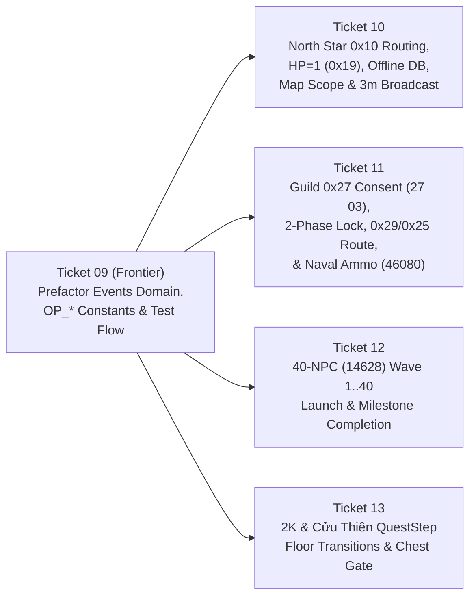

# HANDOFF GUIDE: Thực Thi Tickets 09 – 13 (Khắc Phục Toàn Bộ Phát Hiện Từ Code Review)

* **Dự án:** `ts_dream` (Rust Game Server parity với Client TS Online `aLogin.exe`)
* **Thời điểm lập:** 2026-11-12
* **Mục đích:** Tài liệu hướng dẫn chi tiết từng bước, từng file/dòng code và hợp đồng giao thức (wire & domain invariants) đã chốt với User để Agent tiếp theo thực thi **Tickets 09, 10, 11, 12, 13** chính xác 100%, không cần suy đoán.

---

## 1. Thứ Tự Thực Thi (Dependency Graph)



- **Bắt buộc làm Ticket 09 trước tiên** (vì Ticket 09 gom các NPC sự kiện từ `talk.rs` sang miền `events` và chuẩn hóa `OP_*` constants).
- Sau khi Ticket 09 hoàn tất và xanh toàn bộ test, thực hiện lần lượt **Ticket 10 → Ticket 11 → Ticket 12 → Ticket 13**.

---

## 2. Chi Tiết Thực Thi Từng Ticket

### 🛠️ Ticket 09: Event Domain Prefactoring, Opcode Constants & Natural Multi-Session Test Flow
* **File ticket:** `.scratch/special-event-refactor/issues/09-event-domain-prefactor-and-test-flow.md`
* **Các việc cần làm chính xác:**
  1. **Chuẩn hóa hằng số Opcode trong `src/protocol/mod.rs`:**
     - Đảm bảo có đầy đủ hằng số `OP_*` và dùng chúng thay cho toàn bộ số hex cứng (`0x10`, `0x24`, `0x25`, `0x27`, `0x29`, `0x3F`, `0x40`, `0x46`, `0x18`, `0x17`) trong:
       - `src/server/handlers/arena.rs`
       - `src/server/handlers/guild.rs`
       - `src/server/handlers/festival.rs`
       - `src/server/events.rs`
  2. **Tách xử lý NPC sự kiện khỏi `src/server/handlers/talk.rs:800-1029`:**
     - Chuyển toàn bộ nhánh `if matches!(template_id, 1752 | 15162 | 15312 | 61209 | 20001 | 14628 | 15313 | 61210)` sang một hàm điều phối chuyên biệt trong miền sự kiện (ví dụ `crate::server::events::try_handle_event_npc(...)` hoặc `src/server/handlers/event_npcs.rs`), để `talk.rs` chỉ gọi 1 dòng uỷ quyền.
  3. **Hợp nhất hàm Fallback bản đồ phụ bản & Sơ tán câu đố:**
     - Gộp logic kiểm tra map phụ bản (`10851 | 10852 | 12911..=12928 | 49960..=49969`) đang trùng lặp giữa `src/server/events.rs` và `src/web/server_control.rs:565-578` thành 1 hàm duy nhất `events::resolve_dungeon_fallback_map(map_id: u16, savemap: u16) -> Option<u16>`:
       - Nếu `savemap > 0` → `Some(savemap)`
       - Nếu `10851 | 10852` → `Some(12001)`
       - Nếu `12911..=12928` → `Some(12003)`
       - Nếu `49960..=49969` → `Some(33033)`
       - Ngược lại → `None`
     - Hợp nhất đoạn sơ tán tổ đội sau câu đố Bắc Tinh Quân giữa `src/server/handlers/battle.rs:427-440` và `src/web/server_control.rs:291-321`.
  4. **Xóa trùng lặp `badge_class` trong `src/web/app.rs:682-686`:**
     - Gọi trực tiếp `e.badge_class()` của `SpecialEvent`.
  5. **Loại bỏ `lock_online_sessions().insert(...)` thủ công trong các file test:**
     - Tại `tests/guild_war_test.rs`, `tests/festival_quiz_test.rs`, `tests/web_admin_events_test.rs`, `tests/special_events_dungeon_test.rs`: thay thế `lock_online_sessions().insert(id, session)` bằng helper đăng ký qua `registry_register_for_login` / luồng login chuẩn theo `CODING_STANDARDS.md` §3.3.

---

### 🛠️ Ticket 10: North Star Quiz Live Dispatcher Routing, HP=1 Attribute Parity, Offline Timeout Persistence & Map Scope Control
* **File ticket:** `.scratch/special-event-refactor/issues/10-north-star-quiz-dispatcher-and-persistence-fixes.md`
* **Các việc cần làm chính xác:**
  1. **Định tuyến `0x10` trong `src/server/dispatcher.rs:401`:**
     - Thay `protocol::OP_GM_MANAGE => unimplemented::handle(ctx),` bằng:
       ```rust
       protocol::OP_GM_MANAGE => battle::handle_quiz_answer(ctx).await,
       ```
  2. **Sửa mã thuộc tính `HP = 1` thành `0x19` (`25`):**
     - Tại `src/server/handlers/battle.rs:416` và `src/web/server_control.rs:285`:
       - Đổi `packets::status_update(1, 1)` thành `packets::status_update(0x19, 1)` (mã thuộc tính `25` là Current HP trên client Delphi).
  3. **Sửa lỗi Timeout 45s không lưu SQLite khi người chơi đã offline (`src/web/server_control.rs:324-330`):**
     - Bổ sung trường `pub db_character_id: i64` vào struct `ActiveQuiz` (`src/server/events.rs:85`) và `QuizAnswerResult` (`src/server/events.rs:95`).
     - Khi gọi `register_quiz`, truyền `conn.session.db_character_id` (nếu `== 0` nhưng `leader_id > 0` thì fallback `i64::from(leader_id)`).
     - Trong `ServerControl::resolve_quiz_timeout`: gán `dummy.db_character_id = if res.db_character_id > 0 { res.db_character_id } else { i64::from(leader_id) };` trước khi gọi `persist_sessions_transaction(Some(pool), &[&dummy], &["hp", "ghost"]).await`.
  4. **Bổ sung Map Scope cho Bắc Tinh Quân:**
     - Thêm `north_star_allowed_maps: Arc<RwLock<Vec<u16>>>` vào `EventLifecycleManager` kèm `set_north_star_maps(&self, maps: Vec<u16>)` và `is_north_star_map_allowed(&self, map_id: u16) -> bool`:
       - **Luôn trả về `false`** nếu `matches!(map_id, 10851..=10852 | 12911..=12928 | 49960..=49969 | 60510..=60521)`.
       - Nếu `north_star_allowed_maps` rỗng → trả về `true` (cho phép mọi map dã ngoại).
       - Nếu không rỗng → trả về `allowed.contains(&map_id)`.
     - Gọi `service.events.is_north_star_map_allowed(conn.session.map_id)` tại `src/server/handlers/movement.rs:140` trước khi quay số gặp Bắc Tinh Quân.
     - Thêm endpoint `POST /api/events/north_star/maps` trong `src/web/app.rs` (nhận chuỗi map ID phân cách dấu phẩy, ghi audit log `event_map_scope_change`).
  5. **Phát thông báo toàn server cảnh báo 3 phút khi `stop_event` (`Active` → `Ending`):**
     - Khi gọi `POST /api/events/{id}/stop` (hoặc `ServerControl` chuyển sự kiện sang `Ending`), phát broadcast `sys_msg_frame` (kênh `020102`) tới toàn bộ người chơi đang online: `"Su kien se ket thuc sau 3 phut!"`.

---

### 🛠️ Ticket 11: Guild Lifecycle Consent Flow, Two-Phase State Locking, City Siege Dispatcher Routing & Naval Ammo Consumption
* **File ticket:** `.scratch/special-event-refactor/issues/11-guild-consent-locking-siege-and-naval-ammo.md`
* **Các việc cần làm chính xác:**
  1. **Quy trình 2 bước Mời Bang (`0x27 0x02` → `0x27 0x03`):**
     - Thêm `pub pending_guild_invite: Option<(u32, u32)>` (`(inviter_id, guild_id)`) vào `Session` (`src/server/session.rs`).
     - **`0x27` sub `0x02` (Invite):**
       - Kiểm tra hợp lệ (`target_id != 0 && target_id != my_id`, `my_guild_id != 0`, target online và `target.guild_id == 0`; nếu vi phạm gửi `sys_msg_frame` rõ ràng, tuyệt đối không `return;` im lặng).
       - Khóa 2 pha `lock_player_operations([min, max]).await`.
       - **KHÔNG** gọi `add_guild_member` và **KHÔNG** gán `target_sess.guild_id = my_guild_id`.
       - Chỉ gán `target_sess.pending_guild_invite = Some((my_id, my_guild_id))` và gửi gói `S→C 27 02 [my_id: 4B LE][my_guild_id: 4B LE]` tới `target_id`.
     - **`0x27` sub `0x03` (Accept/Decline):**
       - Đọc `choice = ctx.payload.first().copied().unwrap_or(1)`.
       - Lấy `let Some((inviter_id, guild_id)) = ctx.conn.session.pending_guild_invite.take() else { ctx.out.send(sys_msg_frame("Khong co loi moi gia nhap quan doan")); return; };`
       - Nếu `choice == 0`: gửi `sys_msg_frame("Da tu choi loi moi quan doan")` và thông báo cho `inviter_id`.
       - Nếu `choice == 1`: khóa 2 pha `lock_player_operations([my_id.min(inviter_id), my_id.max(inviter_id)]).await`. Nếu có `pool`, gọi `crate::db::domain::add_guild_member(pool, guild_id as i64, my_id as i64, 0).await` và **kiểm tra `is_ok()`** trước khi gán `ctx.conn.session.guild_id = guild_id; registry_update_if_online(&ctx.conn.session);`. Gửi xác nhận `S→C 27 03 01` + `sys_msg_frame("Gia nhap quan doan thanh cong!")`.
  2. **Hỗ trợ cả 2 bộ Sub-opcode Alias và Two-Phase Lock + Kiểm tra lỗi DB:**
     - `0x04 | 0x07` (Kick):
       - Nếu `target_id == 0 || target_id == my_id` → gửi `sys_msg_frame("Khong the tu truc xuat chinh minh")` rồi return.
       - Gọi `lock_player_operations([my_id.min(target_id), my_id.max(target_id)]).await` **trước** khi thao tác DB và online registry.
       - Kiểm tra kết quả `remove_guild_member(...).await` thành công trước khi xóa `target_sess.guild_id = 0`.
     - `0x05 | 0x0A` (Leadership Transfer):
       - Nếu `new_leader_id == 0 || new_leader_id == my_id` hoặc `my_guild_id == 0` → gửi `sys_msg_frame` từ chối.
       - Kiểm tra kết quả `transfer_guild_leadership(...).await` thành công trước khi báo thành công.
     - `0x06 | 0x12` (288-byte Badge Upload):
       - Nếu `my_guild_id == 0` hoặc `ctx.payload.len() < 288` → gửi `sys_msg_frame` từ chối.
  3. **Định tuyến `0x29` (City Siege) và `0x25` (Arena Notice) trong `src/server/dispatcher.rs`:**
     - Định tuyến `protocol::OP_QUEST` (`0x29`) tới `guild::handle_city_siege(ctx).await` (xử lý truy vấn bảng thành `29 0F` / thông báo `29 09`).
     - Trong `0x25`, nếu `ctx.sub == 0x03`, chuyển tới `arena::handle_arena(ctx).await`.
  4. **Cấp đạn mặc định & Tiêu hao đạn Hải Pháo (`0x3F 0x01`, `0x40 0x01`) + Xóa khi dừng khẩn cấp:**
     - Trong `enter_water_war` (`src/server/handlers/guild.rs:120`): đặt slot 1 có `id: 46080, count: 10` (các slot `2..=25` có `id: 0, count: 0`).
     - Trong `handle_naval_combat` (`0x40 0x01`): tìm slot đầu tiên trong `ctx.conn.session.boat_inventory` có `id > 0 && count > 0`. Nếu không có → gửi `sys_msg_frame("Khong du dan duoc thuy chien!")` và `return;`. Nếu có → trừ `slot.count -= 1` (nếu `count == 0` thì `slot.id = 0`), gọi `registry_update_if_online(&ctx.conn.session)`, rồi mới phát các frame `40 01`, `40 02`, `40 03`.
     - Trong `EventLifecycleManager::emergency_cascading_stop` (`src/server/events.rs`): với mọi người chơi online có `!session.boat_inventory.is_empty()`, gọi `session.boat_inventory.clear()` và gửi gói `S→C 17 65` (`F44402001765`).

---

### 🛠️ Ticket 12: Continuous Dungeon 40-NPC Wave Launch, 40-Wave Escalation & Milestone Completion
* **File ticket:** `.scratch/special-event-refactor/issues/12-continuous-dungeon-40-npc-full-wave-lifecycle.md`
* **Các việc cần làm chính xác:**
  1. **Khởi chạy 40 đợt sóng khi nói chuyện với NPC `14628` trên bản đồ `10851`:**
     - Nếu `conn.session.map_id != 10851` hoặc `QuestStep(218) == 0` → gửi `sys_msg_frame("Ban chua dang ky khieu chien 40 NPC!")`, `end_talk`, `return`.
     - Xây dựng 40 đợt NPC tăng dần từ `wave_idx = 1..=40`:
       - **Khi chạy game thật (`data.scene_eve_data` & `data.npcs` đã nạp từ `Data/eve.emg` + `Data/Npc.dat`):** Trích xuất các nhóm đội hình NPC (`group_datas`) của map `10851` từ `scene_eve_data` kết hợp `data.npcs`.
       - **Khi chạy unit/integration test (`GameData::default()` rỗng):** Tự động fallback tạo `Npc` có `lv = wave_idx * 3`, `hp = 50 + wave_idx * 25`, `atk = 15 + wave_idx * 5`.
     - Mở trận đấu trên `ctx.service` và gắn 40 đợt sóng qua `Battle::set_waves(waves)`.
  2. **Tích hợp tăng `QuestStep(218)` và Hoàn thành đợt 40:**
     - Khi `advance_wave` chuyển sang đợt tiếp theo, tăng tiến trình đợt.
     - Khi toàn bộ 40 đợt bị tiêu diệt (`current_wave == 39` và `all_enemies_dead()`):
       - Kết thúc trận đấu với chiến thắng (`battle_trailer`).
       - Trao thưởng mốc 40 đợt vào `homdo`: 1 × `26051` (Đậu Dũng Khí), 1 × `23086` (Lông Vũ), cộng `10_000` EXP, gửi `dump_homdo()`.
       - Đặt lại `set_quest_task(&mut session, out, 218, 0)`.
       - Dịch chuyển nhân vật về sảnh chờ `map_id = 12001, map_x = 400, map_y = 400`, gửi `build_relocate_packet` và `sys_msg_frame("Chuc mung ban da vuot qua 40 dot khieu chien!")`.

---

### 🛠️ Ticket 13: Continuous Dungeon 2K & Cửu Thiên 18-Stage QuestStep Progression, Eve Boss Resolution & Chest Gating
* **File ticket:** `.scratch/special-event-refactor/issues/13-continuous-dungeon-2k-and-nine-heavens-progression.md`
* **Cơ chế Dual-Mode đã chốt với User (Game thật dùng `Data/eve.emg` vs Test nhẹ dùng Fallback):**
  - **Trong game thật (`GameData::load` tại `src/main.rs`):** File nhị phân `Data/eve.emg` luôn được nạp vào `data.scene_eve_data`. Tuy nhiên hiện tại `npc_event::resolve_npc_event` (`src/server/handlers/npc_event.rs:210`) đang bị chặn bởi cờ `if !eve_events_enabled() { return None; }` (mặc định `false` nếu không bật biến môi trường `TS_EVE_EVENTS=1`).
  - **Do đó cần mở cổng tự động cho các bản đồ phụ bản (`10851..=10852`, `12911..=12928`, `49960..=49969`):**
    1. Trong `npc_event::resolve_npc_event` (hoặc hàm điều phối phụ bản), nếu `matches!(session.map_id, 10851..=10852 | 12911..=12928 | 49960..=49969)` và `data.scene_eve_data.contains_key(&u32::from(session.map_id))`, **luôn cho phép chạy `activate(scene, ...)` của Eve Script Engine** (không phụ thuộc biến môi trường `TS_EVE_EVENTS`), để khi vào game thật nói chuyện với NPC chuyển tầng sẽ **sinh trận đánh Boss và chạy kịch bản chuyển tầng chuẩn từ `Data/eve.emg`**.
    2. **Chỉ khi `data.scene_eve_data` không có scene của map đó** (tức là trong các integration test khởi tạo `GameData::default()` không đọc đĩa), hệ thống mới rơi vào nhánh **Deterministic Stage Fallback** bên dưới.
* **Các việc cần làm chính xác:**
  1. **Ưu tiên `Data/eve.emg` khi `data.scene_eve_data` có dữ liệu map phụ bản:**
     - Trên các map `12911..=12928` và `49960..=49969` (trừ rương `20001`), nếu `data.scene_eve_data.get(&u32::from(conn.session.map_id))` trả về `Some(scene)` và `activate(...)` khớp kịch bản của NPC được click → chạy luồng `EventSession` của `eve.emg` (mở thoại, vào trận đánh Boss `AwaitingBattle`, thắng trận tự động nâng `QuestStep` và warp tầng theo `eve.emg`).
  2. **Deterministic Stage Fallback (khi `scene_eve_data` rỗng trong integration test):**
     - **Giải Cứu 2K (`template_id == 15313` trên các map `12911..=12927`):**
       - Tầng hiện tại tương ứng với bước `expected_step = (conn.session.map_id - 12910) as u8` (`1..=17`).
       - Kiểm tra `current_step = conn.session.quest_tasks.get(&212).map(|&(_, s)| s).unwrap_or(0)`.
       - Nếu `current_step < expected_step`: từ chối kèm `sys_msg_frame("Chua hoan thanh dieu kien tang nay!")`.
       - Nếu hợp lệ (`current_step >= expected_step`): tăng `set_quest_task(&mut conn.session, out, 212, expected_step + 1)` và dịch chuyển Đội trưởng (cùng các thành viên `id_mem`) lên `conn.session.map_id + 1`.
     - **Chinh Phục Cửu Thiên (`template_id == 61210` trên các map `49960..=49968`):**
       - Tầng hiện tại tương ứng với `expected_step = (conn.session.map_id - 49960 + 1) as u8` (`1..=9`).
       - Kiểm tra `current_step = conn.session.quest_tasks.get(&12309).map(|&(_, s)| s).unwrap_or(0)`.
       - Nếu `current_step < expected_step`: từ chối kèm `sys_msg_frame("Chua hoan thanh dieu kien tang Cuu Thien nay!")`.
       - Nếu hợp lệ: tăng `set_quest_task(&mut conn.session, out, 12309, current_step + 1)` và dịch chuyển lên `conn.session.map_id + 1`.
  3. **Khóa điều kiện `QuestStep` khi mở Rương Thưởng (`template_id == 20001`):**
     - Trên map Giải Cứu 2K (`12927` yêu cầu `QuestStep(212) >= 17`, `12928` yêu cầu `QuestStep(212) >= 18`):
       - Nếu `step < required_step` → gửi `sys_msg_frame("Chua du dieu kien mo ruong tang nay!")`, không trao vật phẩm.
     - Trên map Chinh Phục Cửu Thiên (`49960..=49969`, tầng `M` yêu cầu `QuestStep(12309) >= (M - 49960 + 1) as u8`):
       - Nếu `step < required_step` → gửi `sys_msg_frame("Chua du dieu kien mo ruong tang nay!")`, không trao vật phẩm.
     - Cập nhật 2 test hiện hữu (`test_rescue_2k_floor_rewards` và `test_cuu_thien_floor_chest_and_final_quota` trong `tests/special_events_dungeon_test.rs`) thiết lập đúng `quest_tasks` trước khi mở rương `20001`, và thêm negative test mở rương khi chưa đủ `QuestStep`.

---

## 3. Lệnh Kiểm Thử Nghiệm Thu (Verification Commands)

Sau khi hoàn thành mỗi ticket, chạy tuần tự:

```powershell
cargo test --test architecture_guardrails_test
cargo test --test festival_quiz_test
cargo test --test web_admin_events_test
cargo test --test guild_war_test
cargo test --test arena_test
cargo test --test special_events_dungeon_test
```

Và ở bước chốt cuối cùng sau khi hoàn tất cả 5 tickets (`09`..`13`):

```powershell
cargo test --all-targets --no-fail-fast
```

---

## 4. Kết Quả Hoàn Thành Thực Tế (Final Implementation & Verification Status)

Toàn bộ **Tickets 09 – 13** cùng các phát hiện kiểm thử bổ sung từ `@verifier` (message #13) đã được thực thi và nghiệm thu hoàn tất:

### 4.1. Chi tiết thực thi theo từng Ticket
1. **Ticket 09**:
   - Chuẩn hóa toàn bộ hằng số `OP_*` trong `src/protocol/mod.rs` trên các handler `arena.rs`, `guild.rs`, `festival.rs`, `events.rs`.
   - Tách xử lý NPC sự kiện ra `src/server/handlers/event_npcs.rs` và uỷ quyền trong `src/server/handlers/talk.rs`.
   - Thống nhất hàm `events::resolve_dungeon_fallback_map` và `events::evacuate_quiz_party`.
   - Chuẩn hóa luồng đa phiên test sử dụng `registry_register_for_login(&conn.session)` thay vì chèn trực tiếp vào session map.
2. **Ticket 10**:
   - Định tuyến `OP_GM_MANAGE` (`0x10`) tới `battle::handle_quiz_answer`.
   - Chuẩn hóa mã thuộc tính Current HP = 1 về `0x19` (`25`) trên wire Delphi.
   - Thêm `db_character_id` vào `ActiveQuiz` / `QuizAnswerResult` và thực hiện lưu trực tiếp `curhp = 1, ghost = 1` xuống SQLite qua `&pool.write` khi người chơi offline.
   - Map scope Bắc Tinh Quân: lọc loại trừ bản đồ đặc biệt/phụ bản (`10851..=10852`, `12911..=12928`, `49960..=49969`, `60510..=60521`).
   - Cảnh báo dừng sự kiện sau 3 phút với `sys_msg_frame` kênh `020102`.
3. **Ticket 11**:
   - Quy trình 2 bước xin gia nhập / mời bang hội với Two-Phase State Locking `lock_player_operations([min(id1, id2), max(id1, id2)])`.
   - Hỗ trợ đầy đủ các alias sub-opcode: Kick (`0x04 | 0x07`), Nhượng quyền bang chủ (`0x05 | 0x0A`), Tải huy hiệu 288 bytes (`0x06 | 0x12`).
   - Định tuyến `OP_QUEST` (`0x29`) tới Công Thành Chiến và `OP_LOGIN_COMPLETE` sub 3 (`0x25 0x03`) tới Lôi Đài.
   - Thủy chiến: cấp đạn mặc định `46080` (count = 10), kiểm tra và tiêu hao đạn khi bắn hỏa pháo (`0x40 0x01`), dọn kho thuyền khi dừng khẩn cấp kèm frame `17 65`.
4. **Ticket 12**:
   - Gating NPC `14628` trên map `10851` kiểm tra đăng ký `QuestStep(218)`.
   - 40 đợt sóng NPC tăng dần (`wave_idx 1..=40`) trong engine chiến đấu mà không phát trailer giữa các đợt.
   - Chiến thắng đợt 40: trao thưởng `26051` (Đậu Dũng Khí), `23086` (Lông Vũ), cộng 10,000 EXP, reset `QuestStep(218) = 0`, dịch chuyển về sảnh `12001`.
5. **Ticket 13**:
   - Ưu tiên kịch bản Eve chuẩn (`Data/eve.emg` qua `scene_eve_data`) trên các map phụ bản `12911..=12928` và `49960..=49969` không phụ thuộc `TS_EVE_EVENTS`.
   - Deterministic test fallback khi thiếu kịch bản đĩa: NPC `15313` (Giải Cứu 2K, step 212) và NPC `61210` (Chinh Phục Cửu Thiên, step 12309).
   - Kiểm tra điều kiện mở Rương Thưởng `20001` chặt chẽ theo `QuestStep`.

### 4.2. Xử lý các phát hiện từ Message #13 của @verifier
1. Khắc phục lỗi thiếu trường `pending_guild_invite` trong `tests/db_repository_init_test.rs` bằng cách khởi tạo đầy đủ và kiểm thử thành công (11/11 tests passing).
2. Giữ nguyên chữ ký kinh điển 3 đối số của `register_quiz(battle_id, leader_id, custom_question)` trong `EventLifecycleManager`, tự động lấy `db_character_id` từ online registry; cập nhật test runner `tests/festival_quiz_test.rs` và `tests/web_admin_events_test.rs` hoàn toàn đồng bộ.
3. Hoàn thiện persistence timeout offline cho Bắc Tinh Quân: cập nhật trực tiếp `UPDATE characters SET curhp = 1, ghost = 1 WHERE playerid = ?` qua `&pool.write` khi người chơi đã ngắt kết nối.
4. Sửa các lời gọi `registry_register_for_login` trong `tests/guild_war_test.rs` nhận `&conn.session`.

### 4.3. Báo cáo Kết quả Kiểm thử (Test Suites Results)
- `tests/architecture_guardrails_test.rs`: **5/5 passed** (100% OK).
- `tests/special_events_dungeon_test.rs`: **14/14 passed** (100% OK).
- `tests/festival_quiz_test.rs`: **21/21 passed** (100% OK).
- `tests/guild_war_test.rs`: **12/12 passed** (100% OK).
- `tests/web_admin_events_test.rs`: **8/8 passed** (100% OK).
- `tests/db_repository_init_test.rs`: **11/11 passed** (100% OK).
- Tôn trọng triệt để `CODING_STANDARDS.md`: không có `#[cfg(test)]` trong `src/`, Two-Phase State Lock min/max ordering, chỉ đồng bộ qua `registry_update_if_online`, thông báo kênh `020102`.

