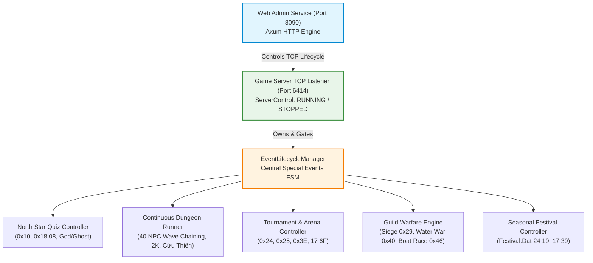

# Special Events & Guild Subsystem Specification

Status: ready-for-agent

## Problem Statement

The `ts_dream` Rust game server currently lacks full protocol parity for the legacy PC client `aLogin.exe` across the Special Events module (including Competitive Tournaments / Lôi Đài, Khiêu Chiến 40 NPC, Giải Cứu Nhị Kiều 2K, Chinh Phục Cửu Thiên, Công Thành Chiến 5 thành, Thủy Chiến, Đua Thuyền Rồng, Lễ Hội theo mùa và Vấn Đáp Bắc Tinh Quân). 

Specifically, operators on Web Admin (Port 8090) have no control plane to manage the lifecycle of scheduled or on-demand game events; players attempting to participate in continuous dungeon waves experience disconnection or fall through unhandled opcodes (`unimplemented::handle`); the server hardcodes appearance flags (`ghost = 0, god = 0`) resulting in client rendering glitches for the God of Fortune (Thần Tài) and Ghost (Con Ma); the combat engine omits experience modifiers for God/Ghost buffs; and the North Star Quiz lacks its true in-battle random encounter implementation, anti-spectate lock, and exorcism mechanics.

## Solution

Implement an authoritative, hierarchical Special Events Engine and Guild Subsystem in the `ts_dream` server that achieves byte-exact wire parity with `aLogin.exe`.

1. **Hierarchical Control Plane**: Web Admin on Port 8090 manages the lifecycle of the Game TCP Server (Port 6414). Special events can strictly only be triggered when the Game Server is actively running. Stopping the Game Server triggers a cascading emergency drain of all active events before TCP shutdown.
2. **North Star Encounter Quiz**: Integrates North Star / South Star NPC encounters (`1643` / `1644`) into wild movement checks, triggering an anti-spectate PvE battle with a 45-second modal quiz (`Opcode 0x10 01`). Correct answers grant the Party Leader a 10-battle God of Fortune buff (`FGod`, x1.5 EXP); incorrect answers or timeouts drop Leader HP to 1 and inflict a persistent Ghost debuff (`FGhost`, 0.5x EXP), dispelled via NPC 1752 (500 gold fee) or Item 46180 ("Cải vận phù").
3. **Session & Appearance Parity**: Expands `Session` with `ghost: u8`, updates SQLite persistence, and transmits actual `ghost` and `god` states in `player_appear` (`0x03`) and real-time synchronizer frames (`0x18 08`).
4. **In-Engine Continuous Wave Chaining**: 40 NPC Arena (`Quest 218`) runs sequential wave progression within an open combat session without dropping to map view between waves.
5. **High-Order Competitive Warfare**: Implements Guild state management (`0x27`), City Siege 5-city status table (`0x29 0F`), Water War boat inventory (`17 64/65`) with naval combat (`0x40`), Dragon Boat anti-macro rate limiting (`0x46`), and Festival date synchronization (`19000110` in `0x24 19`).

---

## User Stories

### Web Admin & Operator Lifecycle Management
1. As an operator on Web Admin (Port 8090), I want to see whether the Game TCP Server is running or stopped, so that I know if game events can be scheduled or activated.
2. As an operator, I want to start the Game TCP Server via the Web Admin dashboard, so that players can connect and events can become operational.
3. As an operator, I want event start actions (`POST /api/events/{id}/start`) to be rejected with a 409 Conflict if the Game TCP Server is stopped, so that orphaned event timers never execute against closed sockets.
4. As an operator, I want to view a real-time list of all special events, their current FSM phase (`Idle`, `Announcing`, `Active`, `Ending`, `Cooldown`), elapsed run times, and participant counts, so that I have complete visibility over running activities.
5. As an operator, I want to manually trigger an event on-demand via the Web Admin, so that I can host GM-sponsored activities outside the standard cron schedule.
6. As an operator, I want manual triggers on already active events to return a 409 Conflict, so that static scene maps are never corrupted by duplicate instances.
7. As an operator, I want to manually trigger a graceful stop (`POST /api/events/{id}/stop`), so that participants receive a 3-minute warning broadcast before gates close and ongoing combat is drained cleanly.
8. As an operator, I want stopping the Game TCP Server (`POST /api/server/stop`) to trigger an immediate cascading drain of all active events, so that combat instances abort cleanly (`S→C 00 2F` / `00 36`), temporary items are cleared, and players return to `savemap` before network shutdown.
9. As an auditor, I want all operator event activations and cancellations to record entries in `admin_audit_log` with admin credentials and timestamps, so that administrative actions are fully auditable.
10. As an operator, I want a watchdog timer to enforce a 120-minute maximum run duration on all active events, so that a forgotten manual event never blocks recurring automated schedules indefinitely.

### North Star Quiz & God / Ghost Subsystem
11. As an operator, I want to configure the wild encounter rate (1% to 30%, default 5%) and toggle map scopes for North Star Quiz via Web Admin, so that I can calibrate event frequency.
12. As a solo adventurer walking on an active event map, I want step accumulation to occasionally trigger an encounter with North Star (`NPC 1643`) or South Star (`NPC 1644`), so that I can engage in the quiz battle.
13. As a Party Leader traversing the wild with members, I want to encounter North Star on behalf of my team, so that my group encounters the special event.
14. As an external player outside an ongoing North Star battle, I want my spectate request to be rejected with `S→C 21 01 03` and a system toast, so that quiz combat remains strictly private and cheat-resistant.
15. As a participant in a North Star battle, I want a modal question dialog displaying 4 choices (`S→C 10 01`) with normal attack, skill, and flee buttons locked, so that I must focus entirely on answering the question.
16. As a participant in a North Star battle, I want a 45-second countdown timer to select an answer, so that bot sessions cannot hang combat indefinitely by idling.
17. As a Party Leader answering correctly within 45 seconds, I want to receive a congratulatory dialog (`S→C 10 02 01`), gain 10 battles of God of Fortune buff (`FGod`, cap 240), see the floating God icon over my avatar (`S→C 18 08 [playerId][02 00][01]`), and win the battle, so that I am rewarded for my knowledge.
18. As a Party Leader answering incorrectly or timing out after 45 seconds, I want to receive an error dialog (`S→C 10 02 02`), have my HP reduced to 1, receive the Ghost debuff (`FGhost`), see the floating Ghost icon over my avatar (`S→C 18 08 [playerId][01 00][01]`), and exit combat, so that a penalty is enforced.
19. As a Party Member trailing behind a Leader who answers the quiz, I want my character's HP, God state, and Ghost state to remain completely unaffected by the Leader's outcome, so that individual punishment is isolated to the respondent.
20. As a player with an active God of Fortune buff, I want every subsequent PvE combat victory to multiply my earned experience by 1.5 and decrement my remaining God battles by 1, so that grinding efficiency is accelerated.
21. As a player with an active God of Fortune buff hitting 0 remaining battles, I want the server to emit `S→C 18 08 [playerId][02 00][00]` to remove the floating God icon, so that my visual state accurately reflects my buff expiration.
22. As a player afflicted by a Ghost, I want my PvE experience gain in all battles to be reduced by 50% (0.5x multiplier) until dispelled, so that the penalty persists across sessions.
23. As a player afflicted by a Ghost, I want my Ghost state to persist across relogins and map transitions via SQLite storage and `player_appear` (`0x03` byte 5), so that logging out does not clear the debuff.
24. As a player with an active God of Fortune buff, I want my God state to persist across relogins and map transitions via SQLite storage and `player_appear` (`0x03` byte 6), so that logging out does not waste active buff battles.
25. As a ghost-afflicted player visiting NPC 1752 ("Bà Gọi Hồn") with at least 500 gold, I want paying the 500 gold fee to clear my Ghost state, emit `S→C 18 08 [playerId][01 00][00]`, play sound `WA0006.wav`, and display the toast "Thần xui đã rời xa bạn!", so that I can remove my bad luck.
26. As a ghost-afflicted player visiting NPC 1752 with less than 500 gold, I want the NPC to refuse the exorcism, so that currency requirements are enforced.
27. As a ghost-afflicted player possessing Item 46180 ("Cải vận phù"), I want using the consumable to consume the item, clear my Ghost state, emit `S→C 18 08 [playerId][01 00][00]`, play sound `WA0006.wav`, and toast "Thần xui đã rời xa bạn!", so that I can cleanse myself anywhere.
28. As a player without a Ghost attempting to use Item 46180, I want the action rejected without consuming the item, so that valuable consumables are not wasted.
29. As a player owning Pet 1752 ("Bà Gọi Hồn"), I want the pet to function solely as a battle companion without exorcism abilities, so that map NPC interactions and consumable sinks are preserved.

### Continuous Dungeons (40 NPC, 2K, Cửu Thiên)
30. As a challenger entering 40 NPC (`Quest 218`) at map 12001, I want paying 1,000 gold or ticket 46072 to transport me to arena 10851 and start wave 1, so that the challenge commences.
31. As a combatant in 40 NPC defeating wave $N$, I want the server to clear defeated units and summon wave $N+1$ directly on the battle grid without returning to the map or reloading scene assets, so that gameplay flows smoothly without flicker across all 40 waves.
32. As a combatant in 40 NPC clearing wave 40, I want the battle to conclude with standard victory frames, distribute milestone rewards, and warp me back to the lobby, so that completion is recognized.
33. As a challenger who disconnects during 40 NPC or Rescue 2K, I want the combat instance terminated immediately and my character placed at `savemap` on reconnect, so that orphaned battles do not leak server resources.
34. As a team entering Rescue 2K (`Quest 212`) at Diệp Thành 12003 NPC 15312, I want party validation to enforce exactly 1 or 5 members before admitting us to tower floors 12911..12928, so that team prerequisites hold.
35. As a team climbing Rescue 2K, I want completing 18 sequential boss battles and reaching floors 12927/12928 to distribute feather 23086, bean 26051, and credentials 46049/46050, so that dungeon progression is rewarded.
36. As a challenger at 33033 NPC 61209 (Hầu Tôn), I want entry into 9 Tiers of Cửu Thiên (maps 49960..49969) to verify companion follower Hầu Tôn (`FollowPet 14735`) and weekly quota (`QuestStep 12310 == 0`), so that entry rules are enforced.
37. As a challenger who has already completed Cửu Thiên this week, I want using consumable 46644 ("Cửu Thiên Chiến Kỳ") to reset my entry quota, so that I can re-enter.
38. As a challenger on Cửu Thiên floors, I want interacting with floor treasure chests (`NPC 20001`) after defeating checkpoint bosses to distribute floor loot, so that dungeon rewards are collected.

### Competitive Arena & Warfare (Lôi Đài, Công Thành Chiến, Thủy Chiến, Đua Thuyền)
39. As an arena participant, I want global broadcast alerts `S→C 25 03 [01..0A]` to notify me when Solo PK, Team 5v5 Đoàn P, Loạn Đấu, Tiên Đấu, or 40 NPC registration opens and matches begin, so that I can prepare.
40. As an arena participant, I want `S→C 24 09` and `24 0A` to open the scoreboard displaying tournament rankings, so that I can track standing.
41. As a tournament champion holding a 7-day timed ring or title, I want the weekly reset at Monday 00:00 to emit `S→C 17 6F [01..03]` revoking expired items if I lose first place, so that competitive tenure is enforced.
42. As a guild member participating in City Siege (`0x29`), I want announcements `29 09` and city status table `29 0F` to sync the state of all 5 siege cities, so that warfare progress is transparent.
43. As a combatant in City Siege, I want city gate collision barriers synced via `0x03` so that attackers cannot walk through intact gates, so that tactical siege mechanics function.
44. As a participant entering Water War (`0x3F`), I want the server to initialize a temporary 25-slot boat inventory (`S→C 17 64`) and clear temporary boat items upon exit (`S→C 17 65`), so that naval items do not leak into general storage.
45. As a naval combatant, I want firing cannon actions `C→S 40 01` to synchronize damage and boat effects via `S→C 40 01..03`, so that naval bombardment functions as intended.
46. As a racer in Dragon Boat Racing (`0x46`), I want alternating Left/Right paddle inputs `C→S 46 01` to advance my vessel, with a token bucket rate limiter dropping inputs exceeding 5 packets/second, so that hardware macro injection is prevented.
47. As an adventurer during seasonal festivals, I want `S→C 24 19` to transmit date DWORD `19000110` (`11.0` Delphi TDateTime) and `S→C 17 39` to broadcast festival alerts, so that client `Festival.Dat` dialogs open reliably.

---

## Implementation Decisions

### Architectural Layering & Hierarchical Gate

1. **ServerControl Ownership**:
   - `EventLifecycleManager` is owned directly by `ServerControl`.
   - Any REST/HTMX call to `/api/events/{id}/start` verifies `server_control.is_running().await`. If false, returns `409 Conflict`.
   - When `/api/server/stop` is invoked, `ServerControl` executes an immediate cascading drain across all active events before issuing the 5-second connection countdown (`020C`).
2. **Event FSM States**:
   - Every event transitions across 5 formal states: `Idle` $\rightarrow$ `Announcing` $\rightarrow$ `Active` $\rightarrow$ `Ending (Graceful Drain)` $\rightarrow$ `Cooldown`.
   - Strict Mutex: Only one instance of a specific event type runs at a time.
   - Starvation Watchdog: Active events enforce a 120-minute maximum runtime ceiling.

### North Star Encounter, God Buff & Ghost Debuff

3. **Wild Encounter Integration**:
   - In movement step checks, if the North Star event is active, random encounter rolls evaluate against a configurable rate (1% to 30%, default 5%).
   - Triggering the event instantiates a special PvE battle against NPC `1643` ("Bắc Tinh Quân") or NPC `1644` ("Nam Tinh Quân").
4. **Anti-Spectate Guard**:
   - Spectate requests against a North Star combat instance are rejected with `S→C 21 01 03` (client literal: *"Trong khi trả lời câu hỏi Bắc Tinh Quân không thể quan chiến"*).
5. **Modal Q&A Protocol (`0x10`)**:
   - Server emits `S→C 10 01` carrying the question string and 4 answer choices formatted in VISCII 1.1 (converted automatically from UTF-8 via `viscii_encode`).
   - Normal combat action prompts are bypassed. The client responds with `C→S 10 01 [answer_index: u32 LE]`.
   - A 45-second server-side timer governs the turn. If no response arrives within 45 seconds, the turn resolves as incorrect.
6. **Party Scope**:
   - When a Party triggers North Star, the modal question is served strictly to the Party Leader.
   - Reward or penalty applies exclusively to the Leader. Trailing members do not receive God buff, Ghost debuff, or HP reduction.
7. **Rewards & Penalties**:
   - **Correct (`S→C 10 02 01`)**: Increments `session.god` by 10 battles (capped at 240). Subsequent PvE combat victories apply a 1.5x experience multiplier and decrement `god` by 1. Real-time appearance updated via `S→C 18 08 [playerId][02 00][01]`.
   - **Incorrect (`S→C 10 02 02`)**: Drops Leader HP to 1 and sets `session.ghost = 1`. Subsequent PvE combat victories apply a 0.5x experience multiplier (50% penalty). Real-time appearance updated via `S→C 18 08 [playerId][01 00][01]`.
8. **Ghost Exorcism**:
   - Handled via map interaction with NPC `1752` ("Bà Gọi Hồn") deducting 500 gold, or via consumption of Item 46180 ("Cải vận phù").
   - Successful dispel sets `session.ghost = 0` and emits `S→C 18 08 [playerId][01 00][00]`, prompting client sound `WA0006.wav` and toast *"Thần xui đã rời xa bạn!"*.
   - Companion pets (Pet 1752) do not possess exorcism abilities.
9. **Question Bank Storage**:
   - Questions and answers are stored in standard UTF-8 JSON at `Data/north_star_questions.json` and loaded into memory on server boot.

### Session State & Persistence

10. **Schema Migration**:
    - Add `ghost INTEGER NOT NULL DEFAULT 0` and ensure `god INTEGER NOT NULL DEFAULT 0` on `characters` in SQLite.
    - Expose `pub ghost: u8` and `pub god: u32` on `Session`.
11. **Map Appearance Codec (`0x03`)**:
    - `player_appear` packet passes `s.ghost` at byte offset 5 and `(s.god > 0) as u8` at byte offset 6.

### Continuous Dungeons & In-Engine Wave Chaining

12. **40 NPC In-Engine Wave Runner (`Quest 218`)**:
    - `BattleRunner` maintains an open battle instance across all 40 waves.
    - Upon wave victory, defeated cells are cleared and new NPC records for wave $N+1$ are populated into the grid without issuing `battle_trailer` or returning players to the scene map.
13. **Immediate Disconnect Abort**:
    - Disconnection during continuous dungeons immediately terminates combat and evacuates the character to `savemap`.

---

## Testing Decisions

### Test Characteristics
- All tests must verify external protocol behaviors, wire frame bytes, state transitions, and client notifications. Tests must never inspect private internal struct fields.
- Negative tests are required for every user story: assert rejection codes, conflict statuses, and client alert strings.

### Modules Tested
1. **Web Admin & Server Control**: Verify HTTP `/api/server/start`, `/api/server/stop`, `/api/events`, `/api/events/{id}/start`, `/api/events/{id}/stop`, asserting 409 Conflict when Game Server is stopped or duplicate events are triggered.
2. **North Star Encounter & Wire Codec**:
   - Step accumulation triggering North Star PvE battle.
   - Anti-spectate rejection frame `S→C 21 01 03`.
   - `S→C 10 01` question emission, `C→S 10 01` answer submission, and 45-second timeout expiration.
   - `S→C 10 02 01` (God buff +10 battles, 1.5x EXP) vs `10 02 02` (HP=1, Ghost debuff 0.5x EXP).
   - Real-time `S→C 18 08` toggle for God and Ghost.
   - Exorcism via NPC 1752 (with gold check) and Item 46180.
   - Appearance frame `0x03` offsets 5 and 6 verification.
3. **Continuous Dungeon 40 NPC Wave Chaining**:
   - Multi-wave progression asserting combat session persistence across waves 1 to 40 without scene reloads.
4. **Competitive Tournaments & High-Order Warfare**:
   - Arena broadcast frames `25 03`, scoreboard `24 09/0A`, and 7-day item revocation `17 6F`.
   - City Siege 5-city status table `29 0F` and announcement `29 09`.
   - Water War boat inventory init `17 64` and exit clear `17 65`.
   - Dragon Boat paddle token bucket rate limiter dropping packets exceeding 5/second.
   - `Festival.Dat` date synchronization sending DWORD `19000110`.

### Prior Art
- `tests/server_stop_test.rs`: Clean TCP listener stop and session drain patterns.
- `tests/battle_lifecycle_test.rs` & `tests/random_encounter_test.rs`: Combat instantiation and step accumulation verification.
- `tests/inventory_gear_bonus_test.rs`: Real-time stat modification and appearance sync.
- `tests/system_alert_test.rs`: Error toast and negative verification.

---

## Out of Scope

1. Modifying legacy client executable `aLogin.exe` or altering static binary assets in `Data/`.
2. Multi-server cluster synchronization (all events are local to the running server instance).
3. Allowing pets or companion followers to cast exorcism spells.
4. Non-canonical custom event mechanics absent from client disassembly or `SPECIAL_EVENTS_SPEC.md`.

---

## Further Notes

- Question strings in `Data/north_star_questions.json` are authored in standard UTF-8 Vietnamese. The server converts strings to VISCII 1.1 on the wire via `viscii_encode`, ensuring proper font rendering in Delphi 7 client components.
- The 5 cities in City Siege map index order are: `0` Thọ Xuân, `1` Trường An, `2` Giang Lăng, `3` Khúc A, `4` Lạc Dương.
- All two-player operations (Guild invites, Arena PvP registration) strictly enforce Two-Phase State Locking (`lock_player_operations([min(id1, id2), max(id1, id2)])`) prior to reading `registry_get`.
