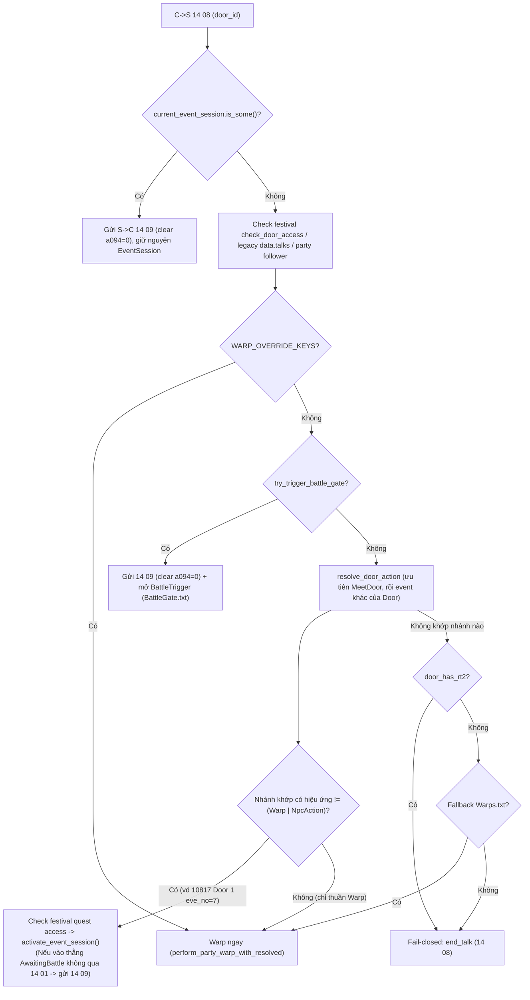

# Kế hoạch Triển khai: Sửa Lỗi `0x14 0x08` Door Eve (`10817` & Toàn Game) + Chuyển Quà `31007` Sang Quest `10037` (`10851..=10870`)

- **Ngày cập nhật**: 2026-11-19
- **Trạng thái**: Đã chốt toàn bộ quyết định qua `/grill-me` (Rounds 1–3) và `/research` bổ sung; chờ user phê duyệt (`/plan`) để triển khai.
- **Tài liệu liên quan**:
  - [handoff.md](file:///D:/VUDT/GIT_PCC/ts_dream/.scratch/sysmsg-and-map10817-eve/handoff.md)
  - [research.md](file:///D:/VUDT/GIT_PCC/ts_dream/.scratch/sysmsg-and-map10817-eve/research.md)
  - [research-newbie-gift-and-mineral-battle.md](file:///D:/VUDT/GIT_PCC/ts_dream/.scratch/starter-item-and-mineral-battle/research-newbie-gift-and-mineral-battle.md)
  - [research-10867-npc15049-item31007.md](file:///D:/VUDT/GIT_PCC/ts_dream/.scratch/starter-item-and-mineral-battle/research-10867-npc15049-item31007.md)
  - [ADR 0001](file:///D:/VUDT/GIT_PCC/ts_dream/docs/adr/0001-newbie-rename-tanthu.md), [ADR 0009](file:///D:/VUDT/GIT_PCC/ts_dream/docs/adr/0009-eve-quest-engine-and-persistence.md), [ADR 0010](file:///D:/VUDT/GIT_PCC/ts_dream/docs/adr/0010-warp-door-sceneinfo-and-battlegate.md)

---

## 1. Mô tả Mục tiêu (Goal Description)

Kế hoạch hợp nhất hai hạng mục đã chốt yêu cầu:

### Hạng mục A — Sửa lỗi `0x14 0x08` bỏ qua hội thoại & sự kiện Eve trước khi Warp (`10817` Door `1` & toàn game)
1. Khi chạm vùng cổng (`Door`), `aLogin.exe` gửi `C->S 0x14 0x08 <door_id: u16 LE>` (`FUN_005EA3E0` → `FUN_007830fc`, bật cờ bận `PlayerState+0xA094 = 1`). Hiện [`talk::handle_talk_warp`](file:///D:/VUDT/GIT_PCC/ts_dream/src/server/handlers/talk.rs#L417-L428) → [`quest::handle_warp_confirm`](file:///D:/VUDT/GIT_PCC/ts_dream/src/server/handlers/quest.rs#L1238-L1353) → [`quest::resolve_door_warp`](file:///D:/VUDT/GIT_PCC/ts_dream/src/server/handlers/quest.rs#L976-L1050) chỉ trích duy nhất `DomainEffect::Warp` (`rt = 2`) và bỏ qua toàn bộ 6 câu thoại (`rt = 1`, `mean_no = 10447..10452`) + 2 hoạt ảnh (`rt = 5`) của `10817` `Door 1` (`eve_no = 7`), cũng như `687` nhánh `Door -> NpcEvent` tương tự trong `Data/eve.emg`.
2. `handle_talk_warp` chưa kiểm tra `conn.session.current_event_session.is_some()`, nên có thể ghi đè `idtalking` và warp ngay cả khi `MeetDoor` (`06 01`) hoặc `ClickNpc` (`14 01`) vừa mở `EventSession`.
3. Mục tiêu:
   - Chạy đầy đủ chuỗi tiền-Warp của `Door -> NpcEvent` qua `EventRunner`, giữ nguyên 100% hợp đồng `ADR 0010` cho cổng warp thuần (`WARP_OVERRIDE_KEYS`, `BattleGate`, `fail-closed`, `Warps.txt` fallback).
   - Đồng bộ thứ tự ưu tiên `MeetDoor`-first (`when_happen[1] || when_happen[2]`) trước rồi mới fallback các event khác của `Door` ở cả `resolve_door_action` và `resolve_door_warp`.
   - Phát `0x14 0x09` (`clear a094 = 0`) khi `14 08` gặp `EventSession` đang mở, hoặc khi `14 08` vào thẳng `BattleGate` / `AwaitingBattle` mà chưa phát `14 01`.



### Hạng mục B — Gỡ `31007` khỏi khởi tạo nhân vật & thưởng `#19001` + `31007` qua Quest `10037` (`10851..=10870`)
1. Khảo sát thực tế `Data/eve.emg` ([research-10867-npc15049-item31007.md](file:///D:/VUDT/GIT_PCC/ts_dream/.scratch/starter-item-and-mineral-battle/research-10867-npc15049-item31007.md)) xác nhận trên cả 20 tutorial map `10851..=10870` (bao gồm `10867`, đích warp từ `10817`):
   - `#15049` (*Bắc Tinh Quân*, `eve_no = 4`) chỉ nói chuyện.
   - `#15050` (*Nam Tinh Quân*, `eve_no = 3`) mới là NPC chạy Quest `10037` (`Surface 3`, choice `30 | 31`) và phát thưởng `1x #19737` (*Bộ Áo Hiện Đại*) — vốn đang bị trùng với `#19737` mặc sẵn ở `trangbi` slot `2` lúc tạo nhân vật.
2. Mục tiêu đã chốt:
   - **Gỡ `31007 × 1` khỏi `homdo` slot `2`** khi tạo nhân vật mới (`apply_to_session`), giữ nguyên `32012 × 4` (`homdo` slot `1`), `#19737 × 1` (`trangbi` slot `2`), và `characters.newbie = 0`.
   - Khi người chơi hoàn thành Quest `10037` với **NPC `#15050` (*Nam Tinh Quân*, `eve_no = 3`) trên bất kỳ map nào thuộc `10851..=10870`**:
     - **Thay thế** phần thưởng `#19737` bằng **`1x #19001` (*Giáp Bạch Bì*)**.
     - **Tặng kèm `1x #31007` (*Vé đoái hoán tâm*)** vào `homdo` tối đa **1 lần duy nhất mỗi nhân vật** dựa trên `character_bit_flags` (`Session.bit_flags`), giữ nguyên `characters.newbie` cho `TSVN123/TSVN456` và sách `46238`.
     - Kiểm tra **All-or-Nothing** trong `preflight_probe_batch` (nếu túi không đủ chỗ cho cả `#19001` và `#31007`, ví dụ `24/25`, từ chối sạch bằng `HomdoFull` mà không tiêu tốn Quest `10037` hay set `bit_flags`).

---

## 2. Quyết Định Đã Chốt & Lưu Ý Triển Khai (User Review Required)

> [!IMPORTANT]
> **Các thay đổi hành vi test hiện có**:
> 1. [`tcp_map_10817_door_14_08_does_not_deadlock`](file:///D:/VUDT/GIT_PCC/ts_dream/tests/server_network/eve_tcp_and_sysmsg.rs#L218-L257): chuyển từ assert `14 07` ngay khi gửi `14 08 01 00` sang kiểm chứng mở `14 01` (`eve_no = 7`), chạy 6× `14 06`, rồi mới nhận `14 2C Unlock` + `14 07` + `0x0C` tới `10867 (890, 510)`, kèm test TCP riêng cho cổng warp thuần (`12000` Door `14`).
> 2. [`tests/server_network/create_char_atomic.rs`](file:///D:/VUDT/GIT_PCC/ts_dream/tests/server_network/create_char_atomic.rs): cập nhật 4 test đang assert `31007` có sẵn ở `homdo` slot `2` khi tạo nhân vật / Enter Game sang assert **không** có `31007` khi tạo nhân vật (vẫn giữ `32012 × 4` ở `homdo` slot `1`, `19737 × 1` ở `trangbi` slot `2`, và `characters.newbie = 0`).

> [!NOTE]
> **Quyết định thiết kế đã thống nhất**:
> - **Ưu tiên `when_happen`**: cả `resolve_door_action` và `resolve_door_warp` ưu tiên `MeetDoor` (`when_happen[1] || when_happen[2]`) trước, rồi fallback các event còn lại của `Door`.
> - **Cờ bận client `0xA094`**: phát `0x14 0x09` khi `14 08` kích hoạt `BattleGate` hoặc `EventSession` vào `AwaitingBattle` mà chưa phát `14 01`.
> - **Cờ idempotency `31007`**: dùng hằng số `FLAG_TUTORIAL_31007: u32 = 1` trong `character_bit_flags` (`Session.bit_flags`), tuyệt đối không dùng `characters.newbie`.

---

## 3. Câu Hỏi Mở (Open Questions)

Không còn câu hỏi mở nào; mọi nhánh thiết kế đã được chốt xong qua Rounds 1–3.

---

## 4. Thay Đổi Đề Xuất (Proposed Changes)

### 4.1. Wire Codec `0x14` (`src/protocol/codecs/npc_talk.rs`)

#### [MODIFY] [npc_talk.rs](file:///D:/VUDT/GIT_PCC/ts_dream/src/protocol/codecs/npc_talk.rs)
- Bổ sung `pub const SUB_CLEAR_PENDING: u8 = 0x09;` và helper:
  ```rust
  /// Hex string representation of the pending-busy clear frame (`0x14 0x09`).
  /// Clears client `PlayerState + 0xA094 = 0` without closing an active talk UI.
  pub fn build_clear_pending_hex() -> &'static str {
      "F44402001409"
  }
  ```

---

### 4.2. Phân Giải Hành Động Cửa & Bảo Vệ `0x14 0x08` (`quest.rs`, `talk.rs`)

#### [MODIFY] [quest.rs](file:///D:/VUDT/GIT_PCC/ts_dream/src/server/handlers/quest.rs)
1. Thêm helper chung sắp xếp danh sách `eve_no` của một `Door` theo thứ tự ưu tiên `MeetDoor` (`when_happen[1] || when_happen[2]`) trước, giữ nguyên thứ tự gốc trong từng nhóm:
   ```rust
   fn collect_prioritized_door_events(scene: &crate::data::loaders::SceneEveData, door_id: u16) -> Vec<u16> {
       let raw: Vec<u16> = if let Some(evs) = scene
           .door_events_by_door
           .get(&door_id)
           .filter(|v| !v.is_empty())
       {
           evs.clone()
       } else if let Some(door) = scene.doors.get(&door_id) {
           door.events.iter().map(|&e| u16::from(e)).collect()
       } else {
           return Vec::new();
       };
       let mut meet_first = Vec::with_capacity(raw.len());
       let mut others = Vec::new();
       for eve_no in raw {
           let is_meet = scene
               .npc_events
               .get(&eve_no)
               .is_some_and(|ev| ev.when_happen[1] || ev.when_happen[2]);
           if is_meet {
               meet_first.push(eve_no);
           } else {
               others.push(eve_no);
           }
       }
       meet_first.extend(others);
       meet_first
   }
   ```
2. Dùng `collect_prioritized_door_events` trong cả `resolve_door_warp` (giữ nguyên chữ ký `pub fn resolve_door_warp(...) -> Option<ResolvedWarp>`) lẫn `resolve_door_action` mới để bảo đảm `check_door_access` / `BattleGate` và `resolve_door_action` luôn chọn cùng một nhánh.
3. Thêm `DoorActionResolution` (`pub(crate)`) và `resolve_door_action(data, session, map_id, door_id)`:
   - Kiểm tra `WARP_OVERRIDE_KEYS` → `ImmediateWarp`.
   - Với `door_events = collect_prioritized_door_events(scene, door_id)`:
     - Snapshot state bằng `snapshot_state_with_data(session, Some(data), None)` và `DotNetRandom`.
     - Duyệt từng `eve_no` khớp `plan_chain`:
       - Kiểm tra:
         ```rust
         let requires_event_runner = planned.effects.iter().any(|eff| {
             !matches!(
                 eff,
                 crate::eve::planner::DomainEffect::Warp { .. }
                     | crate::eve::planner::DomainEffect::NpcAction(_)
             )
         });
         ```
       - Nếu `requires_event_runner` → trả `DoorActionResolution::RunEventSession(EventSession { trigger_kind: EventTriggerKind::MeetDoor, npc_click_id: i32::from(door_id), map_id: i32::from(map_id), eve_no: i32::from(eve_no), ... })`.
       - Ngược lại, tìm `DomainEffect::Warp { warp_id }` đầu tiên gọi `resolve_scene_info_warp(data, map_id, warp_id)` → trả `ImmediateWarp(resolved)`. (Nếu chuỗi chỉ có `NpcAction` không có `Warp`, tiếp tục xét `eve_no` kế tiếp.)
     - Nếu không có nhánh nào khớp và `door_has_rt2` → trả `Blocked` (fail-closed theo `ADR 0010`).
   - Cuối cùng fallback `resolve_warps_txt_row(data, map_id, door_id)`.
4. Cập nhật `handle_warp_confirm(conn, data, env, out)`:
   - Nếu `conn.session.current_event_session.is_some()` → gửi `NpcTalkCodec::build_clear_pending_hex()` và `return`.
   - Giữ nguyên `check_door_access`, `data.talks`, và guard `id_leader > 0 && id_leader != id`.
   - Nếu `WARP_OVERRIDE_KEYS.contains(&(map_id, warp_id_u16))`: warp qua `resolve_warps_txt_row` nếu có.
   - Kiểm tra `try_trigger_battle_gate(&mut conn.session, data, map_id, warp_id_u16)`: nếu trúng → gửi `NpcTalkCodec::build_clear_pending_hex()` (`14 09`) + gán `out.battle_trigger = Some(trigger)` + `return`.
   - Gọi `resolve_door_action(data, &conn.session, map_id, warp_id_u16)`:
     - `RunEventSession(event_session)`:
       - Kiểm tra `check_event_session_quest_access`.
       - Đặt `idtalking = i32::from(warp_id_u16)`, `talk_type = "DOOR"`, `talk_count = 0`.
       - Gọi `talk::activate_event_session(&mut conn.session, event_session, data, env.pool, out).await`.
       - Nếu sau `activate_event_session`, `conn.session.current_event_session.as_ref().is_some_and(|ev| ev.phase == EventPhase::AwaitingBattle)` và `out.outgoing` chưa phát `0x14 0x01` (tức vào thẳng trận `rt=3` không có thoại mở đầu) → gửi thêm `NpcTalkCodec::build_clear_pending_hex()` (`14 09`).
     - `ImmediateWarp(resolved)`: gọi `perform_party_warp_with_resolved` và dọn `idtalking / select_menu / talk_count / warp_finish`.
     - `Blocked`: gọi `end_talk(conn, out)`.

#### [MODIFY] [talk.rs](file:///D:/VUDT/GIT_PCC/ts_dream/src/server/handlers/talk.rs)
- Trong `handle_talk_warp` (`talk.rs:417-428`), chặn trước khi ghi đè `idtalking`:
  ```rust
  if conn.session.current_event_session.is_some() {
      out.send(NpcTalkCodec::build_clear_pending_hex());
      return;
  }
  ```

---

### 4.3. Gỡ `31007` Khỏi Khởi Tạo Nhân Vật (`character.rs`, `session.rs`)

#### [MODIFY] [character.rs](file:///D:/VUDT/GIT_PCC/ts_dream/src/server/handlers/character.rs)
- Trong `apply_to_session` (`character.rs:224-285`):
  - Xóa block gán `31007 × 1` tại `homdo` slot `2` (`:270-275`), chỉ giữ `32012 × 4` ở `homdo` slot `1` và `19737 × 1` ở `trangbi` slot `2`.
  - Cập nhật comment `:229-231` mô tả đúng starter bag (`32012×4 slot 1`) và starter trangbi (`19737×1 slot 2`).

#### [MODIFY] [session.rs](file:///D:/VUDT/GIT_PCC/ts_dream/src/db/modern/sqlite/session.rs)
- Cập nhật comment `:606-608` trong `create_and_seed` bỏ nhắc `31007×1 slot 2`.

---

### 4.4. Hook Quest `10037` NPC `#15050` Trên `10851..=10870` (`eve_runner.rs`)

#### [MODIFY] [eve_runner.rs](file:///D:/VUDT/GIT_PCC/ts_dream/src/server/handlers/eve_runner.rs)
1. Định nghĩa hằng số cờ `character_bit_flags` và các hằng số miền:
   ```rust
   /// Bit flag in `character_bit_flags` (`Session.bit_flags`) guarding the one-time
   /// tutorial bonus `1x 31007` (Vé đoái hoán tâm) awarded alongside Quest 10037.
   pub const FLAG_TUTORIAL_31007: u32 = 1;
   ```
2. Thêm một helper thuần duy nhất để ánh xạ `MutateItem` khi ở đúng ngữ cảnh Quest `10037`:
   - Điều kiện khớp ngữ cảnh:
     - `(10851..=10870).contains(&map_id)`
     - `eve_no == 3`
     - `npc_template_id == 15050` (xác định từ `data.scene_eve_data.get(&(map_id as u32)).and_then(|s| s.npcs.get(&(npc_click_id as u16))).map(|n| n.npc_id)` và fallback `session.idnpctalking`)
     - `item_id == 19737 && delta > 0`
   - Khi khớp ngữ cảnh, helper trả danh sách item hiệu lực:
     - Thay `19737` bằng `(19001, delta, wire_result với parameter = 19001)` (*Giáp Bạch Bì*).
     - Nếu `!bit_flags.contains(&FLAG_TUTORIAL_31007)`: bổ sung `(31007, 1, wire_result với parameter = 31007)` (*Vé đoái hoán tâm*).
3. Dùng chung helper này ở **cả hai nơi** (không trùng lặp logic):
   - **`preflight_probe_batch`**: truyền thêm ngữ cảnh event đang chạy (`Option<(u16, i32, i32)>` = `(map_id, eve_no, npc_click_id)`), kiểm tra `can_add_item` lần lượt cho `#19001` và `#31007` trên `trial_homdo`. Nếu túi đang `24/25` (chỉ đủ 1 ô), trả `Err(PreFlightError::HomdoFull { item_id: 31007 })` để từ chối All-or-Nothing trước khi `Quest 10037` bị nâng step hay set `bit_flags`.
   - **`execute_mutate_item` / `process_single_domain_effect`**: lấy cùng danh sách item hiệu lực từ helper:
     - Thêm `#19001` vào `session.homdo`, phát `0x14 01` (`parameter = 19001`).
     - Nếu có thưởng kèm `#31007`: thêm `1x 31007` vào `session.homdo`, chèn `FLAG_TUTORIAL_31007` vào `session.bit_flags`, phát `0x14 01` (`parameter = 31007`), `session.dump_homdo()` (`17 05`), `sys_msg_frame("Bạn nhận được 1x Vé đoái hoán tâm!")` (`02 0C`), và `registry_update_if_online(session)`.
     - Khi hết chuỗi `eve_no = 3` (`idx >= len`), `finish_event_session_with_pool_iter` tự động ghi cả `inventories` (`19001`, `31007`), `character_quest_tasks` (`10037`), lẫn `character_bit_flags` (`FLAG_TUTORIAL_31007`) xuống SQLite trong cùng một write transaction.

---

### 4.5. Kiểm Thử Tự Động (`tests/`)

#### [MODIFY] [eve_tcp_and_sysmsg.rs](file:///D:/VUDT/GIT_PCC/ts_dream/tests/server_network/eve_tcp_and_sysmsg.rs)
1. Cập nhật `tcp_map_10817_door_14_08_does_not_deadlock`:
   - `F444040014080100` trên `10817` không phát `14 07` ngay mà phát `06 02`, `14 2C Lock`, `14 01` (`eve_no = 7` thoại 1).
   - Gửi tiếp 6 lần `F44402001406` → nhận `14 2C Unlock` + `14 07` + `0x0C` tới `10867 (890, 510)`, kiểm tra `/where` trả `02 0C`.
2. Thêm `tcp_pure_warp_door_14_08_warps_immediately_without_deadlock`:
   - Map `12000`, gửi `14 08` cho `Door 14` → nhận `14 07` + `0x0C` tới `12441` ngay và `/where` trả `02 0C`.
3. Thêm `tcp_14_08_does_not_interrupt_active_event_session`:
   - Kiểm chứng cả 2 kịch bản: (a) đi bộ `06 01` kích hoạt `MeetDoor` tại `10817` `Door 1` rồi gửi `14 08 01 00`, và (b) `14 01 04 00` (click NPC `15009`) rồi gửi `14 08 01 00` — cả hai đều nhận `F44402001409`, không warp sớm, và `14 06` đi hết thoại bình thường.

#### [MODIFY] [warp_door_sceneinfo_parity.rs](file:///D:/VUDT/GIT_PCC/ts_dream/tests/eve_quest/warp_door_sceneinfo_parity.rs)
- Bổ sung test trên `shared_game_data()` cho `10817 Door 1` qua `0x14 0x08` mở `EventSession` (`eve_no = 7`), hoàn tất 6 thoại mới warp `10867 (890, 510)`; giữ nguyên toàn bộ các trường hợp `ADR 0010` (`12000:14`, `25303:2`, `11901:2`, `49902:2`, fail-closed).
- Bổ sung unit/integration test cho case `14 08` gặp `BattleGate` (ví dụ `49901:2`) phát `14 09` kèm `BattleTrigger`.

#### [MODIFY] [create_char_atomic.rs](file:///D:/VUDT/GIT_PCC/ts_dream/tests/server_network/create_char_atomic.rs)
- Cập nhật 4 test tạo nhân vật / Enter Game / in-memory fallback để khẳng định `31007` **không** được cấp lúc tạo nhân vật hay lúc Enter Game (`homdo` chỉ có `32012 × 4` ở slot `1`, `trangbi` có `19737 × 1` ở slot `2`, `characters.newbie == 0`).

#### [MODIFY] [npc_talk_multistep.rs](file:///D:/VUDT/GIT_PCC/ts_dream/tests/eve_quest/npc_talk_multistep.rs) (hoặc submodule trong `tests/eve_quest/`)
- Bổ sung test đầu-cuối (với `setup_test_db` + `shared_game_data()`) cho NPC `#15050` (`eve_no = 3`) trên `10867` và `10851`:
  - Positive: chọn `Surface 3` (`30` / `31`) và đi hết 7 thoại → nhận `1x #19001` (*Giáp Bạch Bì*, **không** nhận thêm `#19737`) + `1x #31007` (*Vé đoái hoán tâm*), phát `0x14 01` (`19001` & `31007`), `17 05`, `02 0C`; DB có `19001`, `31007`, `quest_tasks[10037] == 1`, `character_bit_flags` chứa `FLAG_TUTORIAL_31007`, và `characters.newbie == 0`.
  - Cross-map idempotency (`10851..=10870`): nhân vật đã nhận `31007` (ví dụ có sẵn `FLAG_TUTORIAL_31007`) sang map tutorial khác không nhận trùng `31007`.
  - Negative (túi `24/25` chỉ còn 1 ô trống, không chứa `19001`/`31007`): từ chối All-or-Nothing (`HomdoFull`), không thêm `#19001` hay `#31007`, không nâng `quest_tasks[10037]`, không set `FLAG_TUTORIAL_31007`.
  - Collateral integrity: `32012 × 4` ở slot `1` và `trangbi` `#19737 × 1` ở slot `2` còn nguyên vẹn.

---

## 5. Kế Hoạch Kiểm Chứng (Verification Plan)

### Kiểm thử tự động (Automated Tests)
1. Trong lúc phát triển từng phần:
   - `cargo test --test server_network_test eve_tcp_and_sysmsg`
   - `cargo test --test server_network_test create_char_atomic`
   - `cargo test --test eve_quest_test warp_door_sceneinfo_parity`
   - `cargo test --test eve_quest_test npc_talk_multistep`
2. Trước khi bàn giao (toàn bộ workspace):
   - `cargo test --all-targets --no-fail-fast`

### Kiểm thử thủ công trên `aLogin.exe` (Manual Verification)
1. Tạo nhân vật mới → vào game tại map `10817`: kiểm tra túi `homdo` **chỉ** có `32012 × 4` (không có `31007`), `trangbi` mặc sẵn `#19737`.
2. Đi chạm cổng `Door 1` `(1300, 700)` trên map `10817`: xác nhận mở đúng **6 câu thoại `eve_no = 7`** với Bạch Lão Nhân, đi hết thoại + hoạt ảnh mới warp sang `10867 (890, 510)`.
3. Trên map `10867`, nói chuyện với Nam Tinh Quân (`#15050`), hoàn tất Quest `10037`: xác nhận nhận **`1x #19001` (*Giáp Bạch Bì*)** (không nhận trùng `#19737`) kèm **`1x #31007` (*Vé đoái hoán tâm*)** và thông báo hệ thống; relogin vẫn giữ nguyên trong túi, không bị lặp.
4. Đi qua các cổng warp thuần (không thoại) để xác nhận vẫn chuyển map ngay và `BattleGate` vẫn mở trận đánh không kẹt client.
