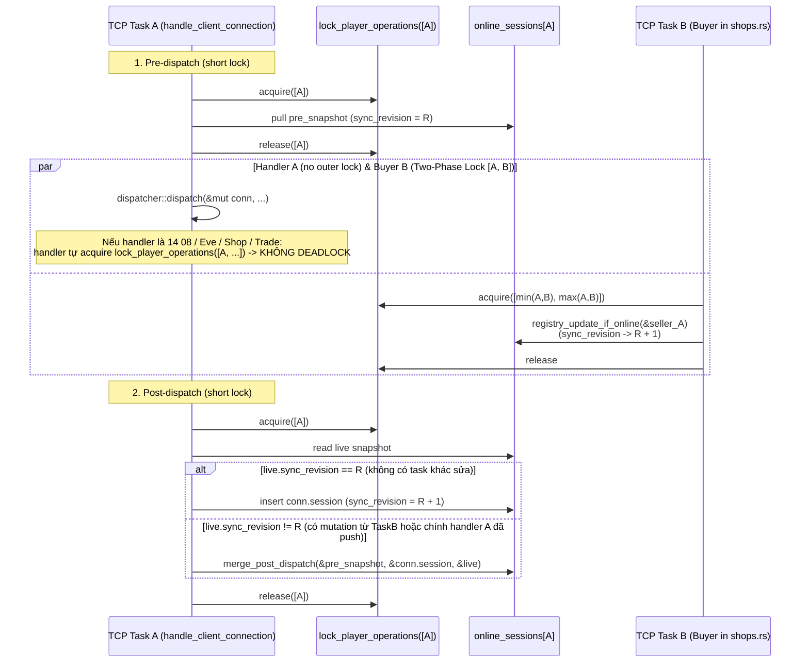

# Implementation Plan: Chuẩn hóa `sys_msg_frame` (`02 0C`) / `announce_frame` (`02 00`), Triệt tiêu Self-Deadlock `ServerControl`, và Minh bạch Startup `eve.emg`

## Goal Description

Sửa dứt điểm 2 nhóm lỗi thực tế khi đăng nhập và chơi tại map đầu tiên `10817` (Tiệm Nét):

1. **Sai kênh & sai layout frame của `sys_msg_frame` và `announce_frame` (`OP_CHAT 0x02`)**:
   - `sys_msg_frame` ([`src/server/spawn.rs`](file:///D:/VUDT/GIT_PCC/ts_dream/src/server/spawn.rs#L363-L367)) hiện phát `02 01 02 <visc>`, khiến `aLogin.exe` (`FUN_0078b6fc`, `case 1:`) hiểu nhầm là kênh `CHAT_SUB_ANGEL` (`(Thần)Thiên thần`, bị gate kênh) và ăn `02` + 3 byte đầu thông điệp làm `id: 4B LE`, làm cụt 3 ký tự đầu.
   - `announce_frame` ([`src/server/spawn.rs`](file:///D:/VUDT/GIT_PCC/ts_dream/src/server/spawn.rs#L370-L372)) gọi `text_banner(CHAT_SUB_SYSTEM, msg)`, chèn thừa `"00000000"` vào `02 0C` vốn **không** có trường `id` trong `case 0xc:`.
   - Chuẩn hóa theo quyết định đã chốt: `sys_msg_frame` dùng **`02 0C <visc>`** (`CHAT_SUB_SYSTEM`, không `id`); `announce_frame` dùng **`02 00 00000000 <visc>`** (`CHAT_SUB_BROADCAST`, `id = 0` 4B LE) để phân biệt thông báo cá nhân vs toàn server.

2. **Treo cứng kết nối TCP tại `C→S F444040014080100` và Bạch Lão Nhân (`15009`) trên map `10817` + log startup thiếu minh bạch**:
   - [`ServerControl::handle_client_connection`](file:///D:/VUDT/GIT_PCC/ts_dream/src/web/server_control.rs#L893-L910) đang giữ non-reentrant `tokio::sync::Mutex` (`lock_player_operations([logined_id])`) xuyên suốt `dispatcher::dispatch(...)`. Mọi handler nội bộ tự gọi `lock_player_operations` (như `quest::perform_party_warp_with_resolved` từ `14 08 01 00` hoặc từ `eve_runner.rs:952` của Bạch Lão Nhân `15009`, cũng như `shops`, `trade`, `crafting`, `respec`, `guild`, `battle`, `event_npcs`) đều bị **self-deadlock vĩnh viễn** trên kết nối thật.
   - Bỏ outer lock quanh `dispatch()`, giữ `lock_player_operations([logined_id])` ngắn khi pull/push `conn.session <-> online_sessions` kết hợp `sync_revision: u64` trên `Session` để hợp nhất an toàn nếu task khác cập nhật `online_sessions` trong lúc `dispatch()` chạy.
   - Giữ `eve.emg` trong `optional_binary` nhưng phát `tracing::warn!` nếu thiếu hoặc rỗng, và log `scene_eve_data.len()` + `eve_events_enabled()` tại startup trong [`src/main.rs`](file:///D:/VUDT/GIT_PCC/ts_dream/src/main.rs#L119-L126).

---

## User Review Required

> [!IMPORTANT]
> **Các thay đổi kiến trúc đã chốt qua `/grill-with-docs`**:
> - `sys_msg_frame` đổi wire prefix từ `020102` sang `020C`; `announce_frame` đổi từ `020C00000000` sang `020000000000`. Toàn bộ test assert `"020102"` và tài liệu `CODING_STANDARDS.md §2.1`, `docs/adr/0007` sẽ được cập nhật đồng bộ.
> - `ServerControl::handle_client_connection` không còn giữ `lock_player_operations` xuyên suốt `dispatch()`. Trách nhiệm Two-Phase State Lock hoàn toàn thuộc về các handler tương tác chéo; đồng bộ `conn.session <-> online_sessions` sử dụng `Session.sync_revision` + hợp nhất an toàn ở biên pull/push.
> - Hành vi `14 08` giữ nguyên theo ADR 0010 (`resolve_door_warp`); không thêm ADR 0012 mới và không chỉnh `GLOSSARY.md`.

---

## Proposed Changes

### Component 1: Wire Protocol — `sys_msg_frame` (`0x02 0x0C`) & `announce_frame` (`0x02 0x00`)

Chuẩn hóa builder trong `src/server/spawn.rs` theo đúng phân nhánh `FUN_0078b6fc` (`aLogin.exe`) và cập nhật comment/tài liệu quy chuẩn.

#### [MODIFY] [spawn.rs](file:///D:/VUDT/GIT_PCC/ts_dream/src/server/spawn.rs)
- Cập nhật `text_banner` thành helper chuyên biệt cho broadcast (`CHAT_SUB_BROADCAST`) hoặc đổi tên/inline rõ ràng cho `announce_frame`, loại bỏ việc dùng `text_banner` với `CHAT_SUB_SYSTEM`.
- Sửa `sys_msg_frame(msg)` phát `02 0C <visc>` (dùng `CHAT_SUB_SYSTEM` từ `crate::protocol::CHAT_SUB_SYSTEM`).
- Sửa `announce_frame(msg)` phát `02 00 00000000 <visc>` (dùng `CHAT_SUB_BROADCAST` từ `crate::protocol::CHAT_SUB_BROADCAST`).

```rust
/// Build system broadcast banner packet (`02 00 00000000 <visc>` — `CHAT_SUB_BROADCAST` with `id = 0`).
pub fn announce_frame(msg: &str) -> String {
    let visc = crate::encoding::viscii_encode(msg);
    let mut body = String::from("00000000");
    body.push_str(&encoder::strhex(&visc));
    crate::protocol::frame(&format!("02{:02X}", CHAT_SUB_BROADCAST), &body)
}

/// Build system message frame (`02 0C <visc>` — `CHAT_SUB_SYSTEM`, no 4-byte `id`).
pub fn sys_msg_frame(msg: &str) -> String {
    let visc = crate::encoding::viscii_encode(msg);
    crate::protocol::frame(&format!("02{:02X}", CHAT_SUB_SYSTEM), &encoder::strhex(&visc))
}
```
*(Nếu `text_banner` không còn caller nào ngoài `announce_frame`, xóa `text_banner` để tuân thủ `CODING_STANDARDS.md §4`.)*

#### [MODIFY] [mod.rs](file:///D:/VUDT/GIT_PCC/ts_dream/src/server/handlers/use_item/mod.rs)
- Cập nhật doc comment ở dòng `176` từ ``channel `020102` `` sang ``channel `020C` (`CHAT_SUB_SYSTEM`)``.

#### [MODIFY] [CODING_STANDARDS.md](file:///D:/VUDT/GIT_PCC/ts_dream/CODING_STANDARDS.md)
- Cập nhật §2.1 (dòng `37-40`):
  - Chuẩn hóa kênh Thông báo Hệ thống cá nhân là `02 0C` (`CHAT_SUB_SYSTEM`, không kèm 4-byte `id`) qua `src/server/spawn.rs::sys_msg_frame(msg)`, và kênh thông báo toàn server là `02 00 00000000` (`CHAT_SUB_BROADCAST`) qua `announce_frame(msg)`.
  - Cập nhật quy tắc cấm tự sinh byte `020102` / `020C` cục bộ và giữ cảnh báo không dùng `02 0B` làm thông báo chữ đỏ.

#### [MODIFY] [0007-compound-wire-parity-and-crafting-engine.md](file:///D:/VUDT/GIT_PCC/ts_dream/docs/adr/0007-compound-wire-parity-and-crafting-engine.md)
- Cập nhật dòng `36`: sửa mô tả `02 01 02 <len> <nội dung VISCII>` (`sys_msg_frame`) thành `02 0C <nội dung VISCII>` (`sys_msg_frame`).

---

### Component 2: Concurrency & Session Registry — Loại bỏ Self-Deadlock & Bảo vệ `sync_revision`



#### [MODIFY] [session.rs](file:///D:/VUDT/GIT_PCC/ts_dream/src/server/session.rs)
- Thêm trường runtime-only vào `pub struct Session` (khởi tạo `0` trong `Session::default()`):
  ```rust
  /// Monotonic in-memory revision bumped by [`registry_update_if_online`] and
  /// [`ServerControl`] post-dispatch sync to detect concurrent cross-player updates.
  /// Runtime-only; never persisted.
  pub sync_revision: u64,
  ```
- Cập nhật `registry_update_if_online(s: &Session)`:
  ```rust
  pub fn registry_update_if_online(s: &Session) {
      let mut sessions = lock_online_sessions();
      if let Some(existing) = sessions.get_mut(&s.id) {
          let mut next = s.clone();
          next.sync_revision = existing.sync_revision.wrapping_add(1);
          *existing = next;
      }
  }
  ```
- Thêm helper thuần `pub fn merge_post_dispatch(base: &Session, local: &Session, remote: &Session) -> Session` để xử lý trường hợp `remote.sync_revision != base.sync_revision`:
  - **Nhận xét quan trọng**: Cần phân biệt 2 tình huống khi `remote.sync_revision != base.sync_revision`:
    1. Chính handler của kết nối hiện tại đã gọi `registry_update_if_online(&conn.session)` trong lúc giữ lock ở `dispatch()` (và không có task thứ 3 nào chen vào sau đó) → lúc này `remote` đã phản ánh mọi thay đổi của `local` (chỉ khác `sync_revision`), và kết quả merge giữ nguyên `remote`.
    2. Một task khác (ví dụ Buyer B mua sạp hàng của A, hoặc Leader warp thành viên A) đã mutate `online_sessions[A]` khi A đang chạy một handler nhẹ không gọi `registry_update_if_online` (ví dụ di chuyển `map_x/map_y`, cập nhật `last_chat_ms`, `talk_count`, `idtalking`, `open_shop_id`, `pending_pass`, `encounter_steps`, ...).
  - Trong `merge_post_dispatch(base, local, remote)`:
    - Bắt đầu từ `let mut merged = remote.clone();` (ưu tiên authoritative state do task giữ `lock_player_operations` ghi).
    - Với các nhóm trạng thái cục bộ của kết nối mà task ngoài không bao giờ thay đổi độc lập nếu `local` vừa thay đổi còn `remote` không đổi (`if local.<field> != base.<field> && remote.<field> == base.<field>`), áp dụng giá trị từ `local` vào `merged`:
      - Vị trí/di chuyển cục bộ: `map_x`, `map_y`, `gocnhin`, `dongtac`, `encounter_steps`, `encounter_threshold`, `boat_last_paddle`, `boat_paddle_tokens`, `boat_last_paddle_ms`
      - Trạng thái phiên/UI cục bộ: `logined`, `in_world`, `authed`, `pending_pass`, `pending_new_char_name`, `open_shop_id`, `last_chat_ms`, `idtalking`, `idnpctalking`, `talk_count`, `talk_type`, `select_menu`, `warp_finish`, `talk_locked`, `current_event_session`, `talking_battle`, `click_npc_id`
      - Các trường gameplay/economy khác (nếu `remote == base && local != base`, ví dụ local handler trang bị/nhặt đồ/chat chỉnh sửa mà không gọi `registry_update_if_online`): sử dụng macro nội bộ `apply_if_local_only_changed!(merged, base, local, remote, [ ... ])` cho toàn bộ các trường game state còn lại (`gold`, `bank_gold`, `shop_point`, `homdo`, `trangbi`, `tientrang`, `tuideo`, `luulang`, `shop`, `pets`, `active_pet_stt`, `horse_pet_id`, `quest_tasks`, `quest_dont`, `bit_flags`, `completed_eve_counts`, `role_count_values`, `completed_quests`, `quest_steps`, `warp_steps`, `id_mem`, `id_leader`, `id_qs`, `guild_id`, `pending_guild_invite`, `trade`, `battle_id`, `pending_battle_gate`, `passed_battle_gates`, `pending_evacuate_map`, `savemap`, `savemap_x`, `savemap_y`, `hp`, `hp_max`, `sp`, `sp_max`, `point`, `skill_point`, `level`, `reborn`, `job`, `texp`, `int1`, `atk`, `def`, `hpx`, `spx`, `agi`, `int2`, `atk2`, `def2`, `hpx2`, `spx2`, `agi2`, `skills`, `ball_point`, `dragon_balls`, `skill_rb2`, `hotkeys`, `boat_inventory`, `hp_store`, `sp_store`, `newbie`, `tiengtam`, `god`, `ghost`, `pk`, `tham_chien`, `color`, `last_battle_end_ms`, `map_id`).
    - Nhờ rule 3-way `if local.F != base.F && remote.F == base.F { merged.F = local.F.clone(); }`:
      - Nếu B mua sạp của A (`remote.gold != base.gold`, `remote.homdo != base.homdo`, `remote.shop != base.shop`) trong khi A vừa đi 1 bước (`local.map_x != base.map_x`): **cả tiền/đồ sạp hàng của B lẫn tọa độ mới của A đều được bảo toàn 100%**!
      - Nếu cả hai chạm cùng một trường: `remote` (bên vừa commit qua `registry_update_if_online` dưới `lock_player_operations`) thắng, `sync_revision` được tăng thêm 1.
    - Cuối cùng `merged.sync_revision = remote.sync_revision.wrapping_add(1);` (chỉ tăng khi `merged` khác `remote` hoặc khi fast-path `remote.sync_revision == base.sync_revision`).
  - *(Kiểm tra `PartialEq` trên các struct con của `Session` như `InventoryItem`, `PetState`, `PlayerShopState`, `TradeState`, `HotkeySlot`, `EventSession` — bổ sung `#[derive(PartialEq)]` nếu struct nào chưa có.)*

#### [MODIFY] [server_control.rs](file:///D:/VUDT/GIT_PCC/ts_dream/src/web/server_control.rs)
- Tại `handle_client_connection` (dòng `878-920`):
  1. **Xóa** việc xây `operation_ids` và giữ `let _operation_guards = lock_player_operations(operation_ids).await;` bao quanh `dispatcher::dispatch(...)` (dòng `878-894`).
  2. **Pre-dispatch (khóa ngắn)**:
     ```rust
     let pre_snapshot = if logined_id > 0 {
         let _guard = crate::server::session::lock_player_operations([logined_id]).await;
         if let Some(snapshot) = crate::server::session::registry_get(logined_id) {
             conn.session = snapshot.clone();
             Some(snapshot)
         } else {
             None
         }
     } else {
         None
     };
     ```
  3. Chạy `let out = dispatcher::dispatch(&mut conn, &decoded, &data, &service, &env).await;` **không giữ outer lock**.
  4. **Post-dispatch (khóa ngắn + `sync_revision` check/merge)**:
     ```rust
     let id = conn.session.id;
     if logined_id > 0 {
         let _guard = crate::server::session::lock_player_operations([logined_id]).await;
         let merged = {
             let mut sessions = lock_online_sessions();
             let next = match (pre_snapshot.as_ref(), sessions.get(&logined_id)) {
                 (Some(base), Some(remote)) if remote.sync_revision != base.sync_revision => {
                     crate::server::session::merge_post_dispatch(base, &conn.session, remote)
                 }
                 _ => {
                     let mut next = conn.session.clone();
                     next.sync_revision = sessions
                         .get(&logined_id)
                         .map_or(0, |s| s.sync_revision.wrapping_add(1));
                     next
                 }
             };
             sessions.insert(logined_id, next.clone());
             next
         };
         conn.session = merged.clone();
         service.register_sender(
             i64::from(logined_id),
             Arc::new(tokio::sync::RwLock::new(merged)),
             tx.clone(),
         );
     }
     ```
  5. Tại nhánh `out.eve_battle` (dòng `953-964`): bọc cập nhật `online_sessions` bằng khóa ngắn `lock_player_operations([logined_id])` và `registry_update_if_online(&conn.session)` (hoặc cập nhật `sync_revision` nhất quán) trước `service.register_sender(...)`.
- Lưu ý: Kiểm tra không vi phạm `tests/architecture_guardrails_test.rs` (`server_control.rs` nằm ở `src/web/`, không phải `src/server/handlers/`, nên guardrail `lock_online_sessions().insert` trong handlers không bị ảnh hưởng; nhưng dùng helper rõ ràng ở `session.rs` càng sạch).

---

### Component 3: Startup `eve.emg` Observability & Warning

#### [MODIFY] [loader.rs](file:///D:/VUDT/GIT_PCC/ts_dream/src/data/loader.rs)
- Trong `GameData::load_binary` (dòng `359-374`):
  - Giữ `"eve.emg"` trong `optional_binary` để các unit test không có `Data/` tiếp tục chạy bình thường.
  - Khi `resolve_data_file(data_dir, file_name)` trả về `None` và `file_name.eq_ignore_ascii_case("eve.emg")`, phát cảnh báo:
    ```rust
    tracing::warn!(
        data_dir = %data_dir.display(),
        "optional data file eve.emg not found; Eve NPC/door scenarios will be disabled"
    );
    ```
  - Sau khi nạp xong `eve.emg`, nếu `self.scene_eve_data.is_empty()`, phát thêm `tracing::warn!("eve.emg loaded 0 scenes")`.

#### [MODIFY] [main.rs](file:///D:/VUDT/GIT_PCC/ts_dream/src/main.rs)
- Cập nhật log tại dòng `119-126` để hiển thị rõ số lượng `eve_scenes`, `quest_marks` và trạng thái `eve_events_enabled()`:
  ```rust
  tracing::info!(
      "data loaded: {} npcs, {} items, {} skills, {} eve_scenes, {} quest_marks, {} legacy_talks, eve_events={} (data_dir={})",
      data.npcs.len(),
      data.items.len(),
      data.skills.len(),
      data.scene_eve_data.len(),
      data.quest_marks.len(),
      data.talks.len(),
      ts_dream::server::handlers::npc_event::eve_events_enabled(),
      data_dir.display()
  );
  ```

---

### Component 4: Test Suite Updates & Integration Tests

#### [MODIFY] Existing `"020102"` & `announce_frame` Assertions
Cập nhật các assertion kiểm tra kênh `sys_msg_frame` từ `"020102"` sang `"020C"`, và kiểm tra nội dung đầy đủ (không mất 3 ký tự đầu, đúng layout `020C<visc>` / `020000000000<visc>`):
- [`tests/server_network/chat.rs`](file:///D:/VUDT/GIT_PCC/ts_dream/tests/server_network/chat.rs) (`sys_msg_frame` → `"020C"`, `announce_frame` → `"020000000000"`)
- [`tests/economy_inventory/economy_wire.rs`](file:///D:/VUDT/GIT_PCC/ts_dream/tests/economy_inventory/economy_wire.rs) (dòng `1981-1985`)
- [`tests/battle/pvp_party_and_flee.rs`](file:///D:/VUDT/GIT_PCC/ts_dream/tests/battle/pvp_party_and_flee.rs) (dòng `493, 506, 519, 531`)
- [`tests/events_arena/festival_gating_and_evacuation.rs`](file:///D:/VUDT/GIT_PCC/ts_dream/tests/events_arena/festival_gating_and_evacuation.rs) (dòng `256`)
- [`tests/events_arena/festival_quiz.rs`](file:///D:/VUDT/GIT_PCC/ts_dream/tests/events_arena/festival_quiz.rs) (dòng `184, 251, 280`)
- [`tests/events_arena/special_events_dungeon.rs`](file:///D:/VUDT/GIT_PCC/ts_dream/tests/events_arena/special_events_dungeon.rs) (dòng `136, 325, 353, 426, 460, 493, 533, 698`)
- [`tests/eve_quest/pure_planner_event_runner_and_preflight.rs`](file:///D:/VUDT/GIT_PCC/ts_dream/tests/eve_quest/pure_planner_event_runner_and_preflight.rs) (dòng `297`)
- [`tests/compound_test.rs`](file:///D:/VUDT/GIT_PCC/ts_dream/tests/compound_test.rs) (dòng `425, 515, 573, 647, 757, 979`)
- [`tests/skill_job_system_test.rs`](file:///D:/VUDT/GIT_PCC/ts_dream/tests/skill_job_system_test.rs) (dòng `758, 803`)

*(Không sửa `tests/battle/open_leader.rs:13` và `tests/battle/open_self_kind.rs:26` vì `0201020304...` là mảng byte tuần tự, không phải frame chat.)*

#### [NEW] Submodule under `tests/server_network/` (khai báo trong `tests/server_network_test.rs`, tuân thủ `CODING_STANDARDS.md §3.1`)
Bổ sung bài test TCP end-to-end qua `ServerControl` (dùng pattern `start_test_server` + `TcpStream` + XOR `0xAD` như `tests/server_network/packet_logging.rs`):
1. **Test 1 — TCP `14 08 01 00` trên map `10817` không deadlock**:
   - Đăng nhập nhân vật tại `map_id = 10817`, gửi `25 01` (`OP_LOGIN_COMPLETE`), sau đó gửi `F444040014080100` qua TCP thật (có timeout ngắn, ví dụ `2s`).
   - Khẳng định server **không** bị treo: nhận được frame phản hồi `14 07` + `0x0C` (warp map đích) từ socket và vẫn tiếp tục xử lý gói tin kế tiếp (ví dụ `00` liveness hoặc `02` chat) ngay sau đó.
2. **Test 2 — TCP nói chuyện Bạch Lão Nhân (`MapObjectID = 4`, `15009`) trên map `10817` tới bước `DomainEffect::Warp` không deadlock**:
   - Đứng trong tầm `±150 px` quanh `(1430, 660)` trên map `10817`, gửi `14 01 04 00` và 6× `14 06` qua TCP thật.
   - Khẳng định chuỗi hội thoại chạy hết tới bước thứ 7 (`DomainEffect::Warp`) và warp thành công không treo task.
3. **Test 3 — `merge_post_dispatch` bảo vệ concurrent cross-player update**:
   - Giả lập `base` snapshot (`sync_revision = 1`), `local` thay đổi tọa độ `map_x` / `last_chat_ms` trong khi `remote` thay đổi `gold` / `homdo` / `shop` (`sync_revision = 2`): khẳng định `merge_post_dispatch` giữ nguyên cả `map_x` mới lẫn `gold`/`homdo`/`shop` mới từ `remote`.
4. **Test 4 — Wire parity `sys_msg_frame` & `announce_frame`**:
   - Khẳng định `sys_msg_frame("Welcome")` giải mã thành `02 0C` theo sau trực tiếp bởi `"Welcome"` (không bị chèn `02` hay `00000000`, giữ nguyên ký tự đầu `'W'`).
   - Khẳng định `announce_frame("Notice")` giải mã thành `02 00 00000000` theo sau bởi `"Notice"`.

---

## Verification Plan

### Automated Tests
1. Chạy từng domain test trong quá trình phát triển:
   - `cargo test --test server_network_test`
   - `cargo test --test eve_quest_test`
   - `cargo test --test data_loaders_test`
   - `cargo test --test economy_inventory_test`
   - `cargo test --test compound_test`
   - `cargo test --test events_arena_test`
   - `cargo test --test battle_test`
   - `cargo test --test skill_job_system_test`
   - `cargo test --test architecture_guardrails_test`
2. Chốt chặn handoff bắt buộc (`CODING_STANDARDS.md §3.6`):
   - `cargo test --all-targets --no-fail-fast`

### Manual Verification
1. Khởi động server (`cargo run`), kiểm tra log console lúc start in rõ số lượng `eve_scenes` (> 3,800) và `eve_events=true`.
2. Đăng nhập vào game bằng client tại map `10817` (Tiệm Nét):
   - Kiểm tra tin nhắn chào mừng `"Welcome to TS Dream"` hiển thị trên kênh `(Công bố hệ thống)` và **không** bị mất 3 ký tự đầu (`"Wel"`).
   - Đi tới gần Bạch Lão Nhân (`15009`, `(1430, 660)`), bấm nói chuyện đến hết thoại để xác nhận chuyển cảnh không bị đứng, và thử chạm cổng `14 08 01 00` trên Live SSE Terminal để xác nhận có `s2c` trả về ngay lập tức.
