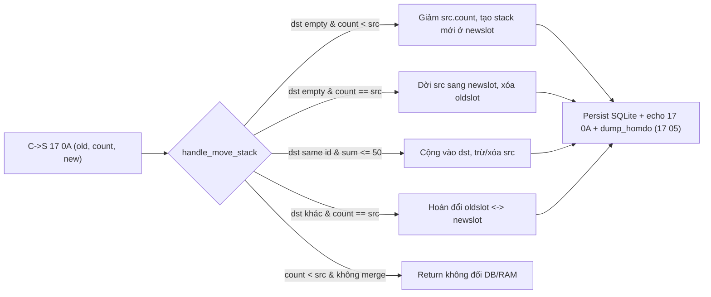
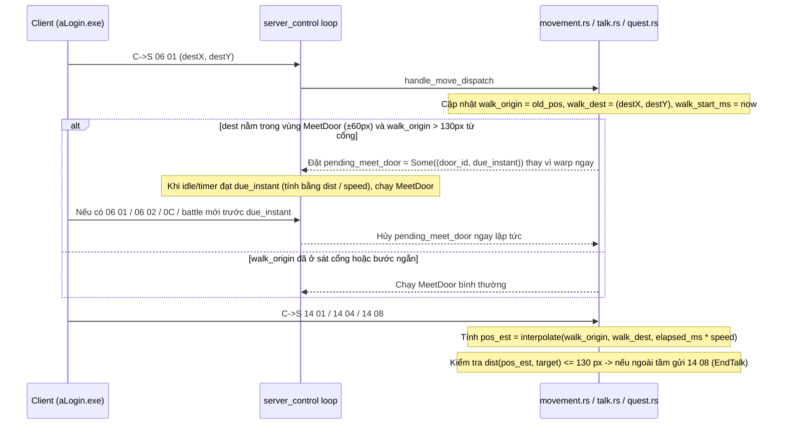

# Implementation Plan — Khắc Phục Lỗi Live-Test & Chuẩn Hóa Kiến Trúc Tương Tác

## Goal Description

Triển khai toàn bộ các quyết định đã chốt qua `/grill-with-docs` (`Q1`–`Q9`) dựa trên điều tra tại [live_test_research.md](file:///D:/VUDT/GIT_PCC/ts_dream/.scratch/sysmsg-and-map10817-eve/live_test_research.md) để xử lý triệt để 5 nhóm vấn đề phát hiện khi live-test với `aLogin.exe`:

1. **Bền vững hóa màu ngoại hình nhân vật (`session.color`)**: Tạo migration `0004_character_color.sql` thêm cột `color` vào bảng `characters`, đồng bộ đầy đủ `create_and_seed`, `load`, `save_in_tx`, `reborn`, `auto_save::fingerprint`, và cập nhật [GLOSSARY.md](file:///D:/VUDT/GIT_PCC/ts_dream/GLOSSARY.md).
2. **Hòm đồ `homdo` (`0x17`) — Split (`0x0A`) & Sort (`0x3C`)**: Sửa lỗi tách một phần (`count < src_count`) ở `handle_move_stack`, gửi kèm `dump_homdo()` (`17 05`) để ép redraw 25 ô tức thời, và thêm handler `0x17 0x3C` (gộp stack $\le 50$, sắp theo `item_id` tăng dần, lưu DB, gửi `17 05`).
3. **Chống kích hoạt NPC / Cổng Warp từ xa (`130 px` + nội suy `0x06 0x01` + trễ `MeetDoor`)**: Theo dõi hành trình `(walk_origin, walk_dest, walk_start_ms)` trên `Session` theo tốc độ thật của `aLogin.exe` (`160 px/s` map thường, `128 px/s` world map `map_id % 1000 == 0`), áp dụng bán kính Euclidean `130 px` thống nhất cho `14 01`, `14 04`, `14 08` (im lặng gửi `14 08` EndTalk khi ngoài tầm), và hẹn `MeetDoor` sau `travel_ms` (hủy khi đổi hướng/dừng). Lập **ADR 0012**.
4. **Map `10917` NPC `#16015` (Tiểu Nhị) & Quán trọ / Tiền trang theo `Data/eve.emg`**: Chạy `npc_event::resolve_npc_event` trước cho mọi NPC, hỗ trợ executor `rt=7, rc=7` (`ps=1,2,4,5,15`) trong `planner.rs` / `eve_runner.rs`, giữ nhánh `talk.rs` làm fallback và sửa `0100` hardcoded trong `handle_inn_menu` thành `idtalking`.
5. **Chờ animation `PlayMovie` (`rt=5`) & `MoveEntity` (`rt=4`) trước `Warp` (`rt=2`)**: Giữ nguyên `Data/eve.emg`, đánh dấu `PlayMovie` và `MoveEntity` là blocking step chờ `14 06` trong `DomainEffect::is_blocking_or_terminal()` / `eve_runner.rs` (kèm kiểm chứng thực tế trên client khi live-test).

---

## User Review Required

> [!IMPORTANT]
> **Migration thủ công SQLite (`0004_character_color.sql`) theo ADR 0004**:
> Server không tự chạy migration lúc khởi động (`src/db/pool.rs:129-148`). Sau khi triển khai, `verify_schema()` sẽ kiểm tra cột `characters.color` và báo lỗi hướng dẫn nếu DB chưa được migrate. Bạn cần chạy `sqlite3 DB/ts_dream.db < migrations/0004_character_color.sql` (và cho `DB/ts_dream_dev.db` nếu tách DB live-test) trước khi bật server.

> [!WARNING]
> **Hai điểm cần xác nhận thêm bằng `TS_PACKET_LOGGING=true` trong bước Manual Verification**:
> 1. **Nút Sort `homdo`**: Xác nhận client gửi `C->S 17 3C` hay chuỗi `17 0A` (nhánh `0x3C` và `17 05` sau `17 0A` được thiết kế để phủ cả hai trường hợp).
> 2. **Kết thúc `TMovie` (`rt=5`) trên `10817 Door 1` (`eve_no = 7`)**: Kiểm tra xem người chơi/client có gửi `14 06` để thoát trạng thái blocking sau `PlayMovie` hay không; nếu client đứng im không gửi `14 06` khi `0xa096 == 0`, sẽ chuyển bước tiếp theo sang cơ chế trễ (`send_delayed` / timer).

---

## Proposed Changes

### 1. Domain Model & Architecture Docs (`GLOSSARY.md`, ADR `0012`)

#### [MODIFY] [GLOSSARY.md](file:///D:/VUDT/GIT_PCC/ts_dream/GLOSSARY.md)
- Gỡ `color` khỏi mục **`Deferred Drift (Đã Cleanup Sau ADR 0001)`** (dòng `274`) vì `characters.color` đã được persist chính thức xuống SQLite.
- Thêm/làm rõ định nghĩa **`Appearance Color (Màu ngoại hình)`** (8 byte / 16 hex chars từ `0x09 0x01` `payload[4..12]` và `reborn`, tách biệt với `hair` 1 byte kiểu tóc) và **`Proximity Gate & Walk Interpolation`** (`130 px` Euclidean, nội suy từ `(walk_origin, walk_dest, walk_start_ms)` với tốc độ `160 px/s` / `128 px/s`).

#### [NEW] [0012-walk-interpolation-proximity-and-color-persistence.md](file:///D:/VUDT/GIT_PCC/ts_dream/docs/adr/0012-walk-interpolation-proximity-and-color-persistence.md)
- Ghi lại các quyết định có đánh đổi kiến trúc và ngữ cảnh từ `client_pseudo_c/`:
  1. Tại sao `0x06 0x01` của `aLogin.exe` gửi tọa độ đích ngay khi click và không thể dùng trực tiếp `destX/destY` cho `MeetDoor`/`14 01`/`14 04`/`14 08`; cơ chế nội suy theo tốc độ client (`0.16` / `0.128` px/ms) + `MeetDoor` cancellable timer.
  2. Chuẩn hóa bán kính `130 px` Euclidean thay hộp `±150 px` và áp dụng đồng nhất cho `14 01`, `14 04`, `14 08`.
  3. Khôi phục cột `characters.color` (`TEXT DEFAULT '0000000000000000'`) tách khỏi `hair`.

---

### 2. Character Color Persistence (Migration `0004` & SQLite)

#### [NEW] [0004_character_color.sql](file:///D:/VUDT/GIT_PCC/ts_dream/migrations/0004_character_color.sql)
```sql
-- Bổ sung cột color (16 ký tự hex = 8 byte màu tóc, da, áo, quần, giày từ packet 0x09 0x01 / reborn)
ALTER TABLE characters ADD COLUMN color TEXT NOT NULL DEFAULT '0000000000000000';
```

#### [MODIFY] [pool.rs](file:///D:/VUDT/GIT_PCC/ts_dream/src/db/pool.rs)
- Trong [`verify_schema`](file:///D:/VUDT/GIT_PCC/ts_dream/src/db/pool.rs#L187-L205): kiểm tra cột `"color"` trong `PRAGMA table_info(characters)` cùng thông báo trỏ tới `migrations/0004_character_color.sql` nếu thiếu.

#### [MODIFY] [session.rs](file:///D:/VUDT/GIT_PCC/ts_dream/src/db/modern/sqlite/session.rs)
- Thêm helper chuẩn hóa `normalize_color_hex(raw: &str) -> String`: đảm bảo luôn là chuỗi hex 16 ký tự chữ hoa (`"0000000000000000"` nếu rỗng hoặc không hợp lệ).
- [`load`](file:///D:/VUDT/GIT_PCC/ts_dream/src/db/modern/sqlite/session.rs#L20-L53): `SELECT ..., c.color, ...` và nạp `session.color = normalize_color_hex(&color)`.
- [`save_in_tx`](file:///D:/VUDT/GIT_PCC/ts_dream/src/db/modern/sqlite/session.rs#L319-L337): bổ sung `color=?` trong câu `UPDATE characters SET ...`.
- [`create_and_seed`](file:///D:/VUDT/GIT_PCC/ts_dream/src/db/modern/sqlite/session.rs#L571-L594): bổ sung cột `color` vào `INSERT INTO characters (...)` và bind `normalize_color_hex(&session.color)`.

#### [MODIFY] [persist.rs](file:///D:/VUDT/GIT_PCC/ts_dream/src/db/persist.rs) & [inventory.rs](file:///D:/VUDT/GIT_PCC/ts_dream/src/server/handlers/inventory.rs) & [auto_save.rs](file:///D:/VUDT/GIT_PCC/ts_dream/src/server/auto_save.rs)
- Trong `persist.rs`: thêm helper `update_player_text(pool, player_id, column, value)` (hoặc xử lý `"Color" | "color"` riêng vì `update_player` nhận `i64`), và gọi trong [`handle_reborn`](file:///D:/VUDT/GIT_PCC/ts_dream/src/server/handlers/inventory.rs#L508-L576) sau khi cập nhật `conn.session.color`.
- Trong [`auto_save::fingerprint`](file:///D:/VUDT/GIT_PCC/ts_dream/src/server/auto_save.rs#L54): hash thêm `s.color.as_bytes()` để AutoSave phát hiện mọi thay đổi màu ngoại hình.

#### [MODIFY] [test_db.rs](file:///D:/VUDT/GIT_PCC/ts_dream/tests/common/test_db.rs)
- Nạp `MIGRATION_0004` (`include_str!("../../migrations/0004_character_color.sql")`) và chạy trong [`reset_schema`](file:///D:/VUDT/GIT_PCC/ts_dream/tests/common/test_db.rs#L147-L161).

---

### 3. Inventory Split (`0x17 0x0A`) & Sort (`0x17 0x3C`)



#### [MODIFY] [mod.rs](file:///D:/VUDT/GIT_PCC/ts_dream/src/protocol/mod.rs)
- Bổ sung hằng số sub-opcode chuẩn theo `CODING_STANDARDS.md §4`:
  - `pub const ITEM_SUB_HOMDO_DUMP: u8 = 0x05;`
  - `pub const ITEM_SUB_MOVE_STACK: u8 = 0x0A;`
  - `pub const ITEM_SUB_SORT: u8 = 0x3C;`

#### [MODIFY] [inventory.rs](file:///D:/VUDT/GIT_PCC/ts_dream/src/server/handlers/inventory.rs)
- Chặn `reject_if_in_battle(conn, out)` hoặc giữ guard nhất quán trong `handle_move_stack` và `handle_sort_homdo`.
- Trong [`handle_move_stack`](file:///D:/VUDT/GIT_PCC/ts_dream/src/server/handlers/inventory.rs#L221-L323):
  - Kiểm tra `count == 0 || count > src_count || oldslot == newslot || !(1..=HOMDO_SLOTS).contains(&newslot)` → return sớm (không gửi frame lỗi giả).
  - Nhánh `None` (`dst` trống):
    ```rust
    if count < src_count {
        conn.session.homdo[src_idx].count = (src_count - count) as u8;
        let mut split = src.clone();
        split.slot = newslot;
        split.count = count as u8;
        conn.session.homdo.push(split.clone());
        let remaining = conn.session.homdo[src_idx].clone();
        persist::upsert_item(pool, conn.session.id, "homdo", &remaining).await;
        persist::upsert_item(pool, conn.session.id, "homdo", &split).await;
    } else {
        // full move (count == src_count)
        ...
    }
    ```
  - Cuối mọi nhánh thành công của `handle_move_stack` (kể cả equipment move/swap, `None`, `Some` merge/swap): gửi echo `hex_of(decoded)` **và** `out.send(conn.session.dump_homdo())` (`17 05`).
- Thêm nhánh `ITEM_SUB_SORT => handle_sort_homdo(conn, out, pool).await` vào [`handle_inventory`](file:///D:/VUDT/GIT_PCC/ts_dream/src/server/handlers/inventory.rs#L53-L87):
  1. Bỏ qua nếu `reject_if_in_battle(conn, out)` hoặc `conn.session.trade.active`.
  2. Tách các item hợp lệ (`id > 0 && count > 0`):
     - Trang bị (`(1..=6).contains(&item.effective_equip_pos())`) hoặc item có `count > STACK_CAP as u8`: giữ nguyên từng record, không gộp.
     - Vật phẩm xếp chồng (`effective_equip_pos() == 0`): gộp các record có cùng `id` (và cùng thuộc tính động `doben, long_val, giatri_long, khang, texp`) lên tối đa `STACK_CAP` (`50`), phần dư tách sang record mới.
  3. Sắp xếp toàn bộ record theo `(item.id, item.slot)` tăng dần và gán lại `slot = 1..=N` (tối đa `HOMDO_SLOTS = 25`).
  4. Persist nguyên tử qua `clear_items(pool, id, "homdo")` + upsert (hoặc `persist_sessions_transaction(pool, &[&conn.session], &["homdo"])` với snapshot rollback nếu DB lỗi), gọi `registry_update_if_online(&conn.session)`, và phát `out.send(conn.session.dump_homdo())` (`17 05`).

---

### 4. Proximity Gate (`130 px`) & Walk Interpolation + Delayed `MeetDoor`



#### [MODIFY] [state.rs](file:///D:/VUDT/GIT_PCC/ts_dream/src/eve/state.rs)
- Cập nhật `MAX_INTERACT_DISTANCE_SQ` từ `200 * 200` thành **`130 * 130`** (`INTERACT_RADIUS_PX = 130`), dùng chung cho cả `resolve_npc` (`14 01`), `ClickDoor` (`14 04`), `TalkWarp` (`14 08`), và `is_within_range`.

#### [MODIFY] [session.rs](file:///D:/VUDT/GIT_PCC/ts_dream/src/server/session.rs)
- Thêm các trường runtime-only (không persist DB) cho `Session`:
  - `pub walk_origin: (u16, u16)`
  - `pub walk_dest: (u16, u16)`
  - `pub walk_start_ms: u64`
  - `pub pending_meet_door: Option<PendingMeetDoor>` (`map_id: u16, door_id: u16, due_ms: u64`)
- Thêm helper thuần trên `Session`:
  - `walk_speed_px_per_sec(&self) -> f64`: trả `128.0` nếu `self.map_id % 1000 == 0`, ngược lại `160.0` (theo `aLogin.exe` `FUN_0070d86c`).
  - `estimated_position_at(&self, now_ms: u64) -> (i32, i32)`: nội suy tuyến tính từ `walk_origin` tới `walk_dest` theo `elapsed_ms * speed`, trả `(map_x, map_y)` nếu chưa có hành trình (`walk_start_ms == 0`) hoặc đã đi hết thời gian `travel_ms`.
  - `clear_walk_tracking(&mut self)`: gọi khi login, relocate/warp (`0x0C` / `perform_party_warp_with_resolved`), hoặc bắt đầu battle.

#### [MODIFY] [movement.rs](file:///D:/VUDT/GIT_PCC/ts_dream/src/server/handlers/movement.rs)
- Trong [`handle_move_inner`](file:///D:/VUDT/GIT_PCC/ts_dream/src/server/handlers/movement.rs#L199-L255):
  - Trước khi cập nhật `conn.session.map_x = x; conn.session.map_y = y;`, tính `prev_pos = conn.session.estimated_position_at(now_ms)`.
  - Nếu `sub == 1`: lưu `walk_origin = (prev_pos.0 as u16, prev_pos.1 as u16)`, `walk_dest = (x, y)`, `walk_start_ms = now_ms`, và reset `pending_meet_door = None`.
  - Nếu `sub == 2` (`06 02` dừng/reconcile): đặt `walk_origin = (x, y)`, `walk_dest = (x, y)`, `walk_start_ms = 0`, `pending_meet_door = None`.
- Trong [`handle_move_dispatch`](file:///D:/VUDT/GIT_PCC/ts_dream/src/server/handlers/movement.rs#L89-L151):
  - Khi phát hiện `closest_door = Some((door_id, _))`:
    - Tính `travel_ms` từ `walk_origin` đến `(door.x, door.y)` (hoặc `walk_dest`) theo `walk_speed_px_per_sec()`.
    - Nếu `travel_ms > 250` ms (tức người chơi vừa click từ xa tới cổng, chưa tới nơi): set `conn.session.pending_meet_door = Some(PendingMeetDoor { map_id, door_id, due_ms: now_ms + travel_ms })` và **không** kích hoạt warp/battle ngay trong turn `06 01`.
    - Nếu đã ở sát cổng (`travel_ms <= 250` ms): thực thi `MeetDoor` ngay như hiện tại (bảo toàn 100% các test unit/replay đặt sẵn tọa độ sát cổng).
  - Trích helper `pub async fn trigger_meet_door_for_door(...)` để cả `handle_move_dispatch` lẫn timer ở `server_control.rs` gọi chung một luồng duy nhất (không nhân đôi logic).

#### [MODIFY] [server_control.rs](file:///D:/VUDT/GIT_PCC/ts_dream/src/web/server_control.rs)
- Trong vòng lặp `tokio::select!` của connection ([dòng 826-854](file:///D:/VUDT/GIT_PCC/ts_dream/src/web/server_control.rs#L826-L854)):
  - Thêm nhánh ngủ tới `pending_meet_door.due_ms` (khi `conn.session.pending_meet_door.is_some()` và `battle_id == 0` và `current_event_session.is_none()`).
  - Khi timer đến hạn: sync pre-snapshot qua `lock_player_operations([logined_id])`, xác minh `pending_meet_door` vẫn khớp `(map_id, door_id)` và player chưa đổi map/vào battle, gọi `movement::trigger_meet_door_for_door(...)`, đẩy frame outgoing/broadcast/direct_messages/eve_battle qua cùng pipeline post-dispatch với loop chính.

#### [MODIFY] [talk.rs](file:///D:/VUDT/GIT_PCC/ts_dream/src/server/handlers/talk.rs) & [quest.rs](file:///D:/VUDT/GIT_PCC/ts_dream/src/server/handlers/quest.rs)
- [`resolve_npc`](file:///D:/VUDT/GIT_PCC/ts_dream/src/server/handlers/talk.rs#L104-L127): dùng `conn.session.estimated_position_at(now_ms)` và `PlayerEventState::is_within_range(px, py, npc.x, npc.y)` (`130 px` Euclidean) thay cho hộp `-150..=150` trên `map_x/map_y`.
- Thêm helper chung `is_player_near_door(session: &Session, data: &GameData, door_id: i32) -> bool`: tra tọa độ `scene.doors.get(&(door_id as u16))`, kiểm tra `is_within_range(px, py, door.x, door.y)` bằng `estimated_position_at(now_ms)` (cho phép pass nếu scene/door không có tọa độ trong `scene_eve_data`, ví dụ synthetic `Warps.txt`-only door hoặc `px == 0 && py == 0`).
- Gọi gate `is_player_near_door` ở đầu [`handle_talk_click_door`](file:///D:/VUDT/GIT_PCC/ts_dream/src/server/handlers/talk.rs#L346) (`14 04`) và [`handle_warp_confirm`](file:///D:/VUDT/GIT_PCC/ts_dream/src/server/handlers/quest.rs#L1376) (`14 08`) → nếu ngoài `130 px`, gọi `end_talk(conn, out)` (`14 08`) và return.
- Trong [`perform_party_warp_with_resolved`](file:///D:/VUDT/GIT_PCC/ts_dream/src/server/handlers/quest.rs): gọi `clear_walk_tracking()` cho leader và thành viên cùng warp để vị trí sau khi chuyển map không bị nội suy theo quãng đường map cũ.

---

### 5. Map `10917` NPC `#16015` (Tiểu Nhị) & Quán Trọ / Tiền Trang Chuẩn `eve.emg` (`rt=7 rc=7`)

#### [MODIFY] [planner.rs](file:///D:/VUDT/GIT_PCC/ts_dream/src/eve/planner.rs)
- Thêm `NpcServiceOp` và `DomainEffect::NpcService(NpcServiceOp)` cho `result_type == 7 && result_class == 7`:
  - `ps == 1`: `NpcServiceOp::BankClose` (gửi `1D 06` + `14 09`)
  - `ps == 2`: `NpcServiceOp::BankOpen` (gửi `1D 09 00` + `1D 04 <bank_gold>` + `1D 05` + `14 09`)
  - `ps == 4`: `NpcServiceOp::InnShop` (gửi `1B 03` + giữ/re-open surface nếu cần)
  - `ps == 5`: `NpcServiceOp::InnHeal` (hồi đầy `hp = hp_max`, `sp = sp_max`, gửi `build_stat_update(0x19)` + `build_stat_update(0x1A)`)
  - `ps == 15`: `NpcServiceOp::BankExchangeOrSpecial` (ghi nhận thêm theo log / `Talk` đối chiếu với `talk.rs`, fail-closed hoặc no-op an toàn nếu chưa có handler riêng, không bao giờ gửi `rt=7` thô qua `0x14 01`)
  - Mọi `rt=7` khác (`result_class != 7` hoặc `ps` lạ) tiếp tục rơi về `DomainEffect::Unsupported`.
- Trong [`is_blocking_or_terminal`](file:///D:/VUDT/GIT_PCC/ts_dream/src/eve/planner.rs#L157-L165): giữ `NpcService` là non-blocking (`StepOutcome::Continue` sau khi thực thi để chuỗi `EventSession` đóng sạch bằng `finish_event_session` trừ trường hợp `BankOpen`/`BankClose` giữ form mở qua `14 09` nếu cần — kiểm tra theo `talk.rs:274-285`).

#### [MODIFY] [eve_runner.rs](file:///D:/VUDT/GIT_PCC/ts_dream/src/server/handlers/eve_runner.rs)
- Thêm arm `DomainEffect::NpcService(op)` trong [`process_single_domain_effect`](file:///D:/VUDT/GIT_PCC/ts_dream/src/server/handlers/eve_runner.rs#L723):
  - Thực thi đúng hiệu ứng Tiền trang / Quán trọ (`1D ..`, `1B 03`, hồi HP/SP `08 01` + `persist::persist_sessions_transaction` + `registry_update_if_online`).
  - Bảo toàn invariant: **`rt >= 7` không bao giờ phát thô qua `0x14 01`** (giữ pass test `missing_eve_effect_executors.rs:425-428`).

#### [MODIFY] [talk.rs](file:///D:/VUDT/GIT_PCC/ts_dream/src/server/handlers/talk.rs)
- Trong [`handle_talk_start`](file:///D:/VUDT/GIT_PCC/ts_dream/src/server/handlers/talk.rs#L154-L227):
  1. Kiểm tra `if !in_range { end_talk(conn, out); return; }` ngay sau `resolve_npc`.
  2. Giữ `event_npcs::try_handle_event_npc` cho các event NPC đặc biệt (`1752`, `15162`, ...).
  3. **Ưu tiên gọi `npc_event::resolve_npc_event(..., NpcTrigger::ClickNpc(map_object_id), ...)` TRƯỚC**:
     - Trên map `10917`, `#16015` (`eid=2`) giải ra `NpcEvent 4` (Quest `10033`: mở Surface `2`, chọn `30` nhận `#26001` Xôi), **không còn bị chặn nhầm bởi nhánh Innkeeper**.
     - Trên các map Quán trọ (`13242`, `15242`, `19241`, `11241`, `12244`, ...) và Tiền trang (`28012`, `11261`, ...), `eve.emg` giải ra đúng cây 3..6 nhánh có `NpcService` (`rt=7, rc=7`).
  4. **Chỉ fallback** xuống nhánh hardcoded Banker (`16080 | 16004 | 16011 | 16023`) / Inn (`15002 | 16001 | 16016 | 15118 | 16015`) khi `resolve_npc_event` trả về `None`.
- Trong [`handle_inn_menu`](file:///D:/VUDT/GIT_PCC/ts_dream/src/server/handlers/talk.rs#L313-L344):
  - Thay `"0100"` hardcoded ở nhánh `30 =>` và `32 =>` bằng `encoder::le16(conn.session.idtalking as u16)` (cũng áp dụng helper build `06 03` thay vì chuỗi format trùng lặp).

---

### 6. `PlayMovie` (`rt=5`) & `MoveEntity` (`rt=4`) Blocking Trước `Warp` (`rt=2`)

#### [MODIFY] [planner.rs](file:///D:/VUDT/GIT_PCC/ts_dream/src/eve/planner.rs) & [eve_runner.rs](file:///D:/VUDT/GIT_PCC/ts_dream/src/server/handlers/eve_runner.rs)
- Trong [`DomainEffect::is_blocking_or_terminal`](file:///D:/VUDT/GIT_PCC/ts_dream/src/eve/planner.rs#L157-L165): bổ sung `Self::PlayMovie(_)` và `Self::MoveEntity(_)`.
- Trong [`process_single_domain_effect`](file:///D:/VUDT/GIT_PCC/ts_dream/src/server/handlers/eve_runner.rs#L830-L846):
  - `DomainEffect::MoveEntity(res)`: nếu record hợp lệ (`result_class == 3 && result_value >= 10_000`), gửi `14 01` và trả **`StepOutcome::Halt`**; nếu record không hợp lệ bị skip thì vẫn trả `StepOutcome::Continue`.
  - `DomainEffect::PlayMovie(res)`: gửi `14 01` và trả **`StepOutcome::Halt`**.
- Trong [`preflight_probe_batch`](file:///D:/VUDT/GIT_PCC/ts_dream/src/server/handlers/eve_runner.rs#L121-L127): `PlayMovie` và `MoveEntity` có thể đi xuyên qua như `TalkStep` hoặc dừng ở `Warp`/`StartBattle`/`AwaitMenuChoice` (giữ hành vi All-or-Nothing trước khi phát movie).
- Cập nhật các test đang giả định `rt=4`/`rt=5` auto-continue trong một lần gọi (như `tests/eve_quest/missing_eve_effect_executors.rs` và `tests/server_network/eve_tcp_and_sysmsg.rs` kịch bản `10817 Door 1` `eve_no=7` vốn có 2x `rt=5` sau 6 `TalkStep` → tăng số lần gửi `14 06` lên 9 để đi qua 6 thoại + 2 movie trước khi warp `10867`).

---

## Verification Plan

### Automated Tests
1. Chạy từng suite domain trong lúc phát triển (theo `CODING_STANDARDS.md §3.6`):
   - **Color migration & persistence**: Thêm test vào `tests/db/` & `tests/server_network/create_char_atomic.rs` kiểm tra tạo nhân vật `0x09 0x01` với 8 byte màu khác 0 → reload DB / relog nhận đúng `color` trong `0x03`, `handle_reborn` lưu `color` mới xuống DB. Chạy:
     ```powershell
     cargo test --test db_test
     cargo test --test server_network_test
     ```
   - **Inventory `17 0A` & `17 3C`**: Thêm test vào `tests/economy_inventory/inventory_roundtrip.rs` (tuân thủ `CODING_STANDARDS.md §3.2` đặt item phụ cận ở slot kế cận để chống ăn lan):
     - Tách một phần (`count < src_count`) vào ô trống (`dst == None`) → còn lại ở `oldslot`, tách đúng `count` sang `newslot`, lưu DB, phát `17 0A` + `17 05`.
     - Negative test: tách `count < src_count` sang ô có item khác loại hoặc gộp vượt `50` → giữ nguyên RAM/DB.
     - Sort `0x17 0x3C`: gộp stack cùng `id` tới 50, không gộp trang bị, sắp xếp `id` tăng dần vào `1..=N`, lưu DB, phát `17 05`.
     ```powershell
     cargo test --test economy_inventory_test
     ```
   - **Proximity `130 px`, Walk Interpolation, Delayed `MeetDoor`, `10917 #16015`, `rt=7 rc=7`, `PlayMovie`/`MoveEntity`**: Thêm test vào `tests/eve_quest/` & `tests/server_network/`:
     - Click `06 01` từ xa tới cổng `MeetDoor` → không warp tức thì ở lượt `06 01`; `14 01`/`14 04`/`14 08` khi vị trí nội suy > `130 px` → trả `14 08` (EndTalk); đi đủ gần (`<= 130 px`) hoặc hết `travel_ms` → mở thoại / warp.
     - Map `10917`: click NPC `2` (`#16015`) mở đúng Surface `2` của `NpcEvent 4`, chọn `30` nhận `26001` (không nhảy sang `0100` `#16009`); kiểm tra `13242` `#16015` và `28012` `#16080` chạy `rt=7, rc=7`; kiểm tra `handle_inn_menu` fallback dùng `idtalking`.
     - Map `10817 Door 1` (`eve_no = 7`): `14 01 (rt=5)` dừng chờ `14 06`, không gửi `14 07` + `0x0C` trong cùng burst TCP với `rt=5`.
     ```powershell
     cargo test --test eve_quest_test
     cargo test --test server_network_test
     ```
2. Chốt chặn cuối trước handoff:
   ```powershell
   cargo test --all-targets --no-fail-fast
   ```
   *(Kiểm tra luôn `architecture_guardrails_test` để đảm bảo không vi phạm rule nào trong `CODING_STANDARDS.md`.)*

### Manual Verification (Live Test với `aLogin.exe`)
1. Áp dụng migration cho DB dev/live trước khi chạy:
   ```powershell
   sqlite3 DB/ts_dream_dev.db ".read migrations/0004_character_color.sql"
   $env:TS_DATABASE_URL="sqlite://DB/ts_dream_dev.db"
   $env:TS_PACKET_LOGGING="true"
   cargo run --bin ts_dream
   ```
2. **Kiểm tra Màu ngoại hình**: Tạo nhân vật mới với màu tóc/da/áo/quần/giày tùy chỉnh → thoát game đăng nhập lại → xác nhận client hiển thị đúng màu đã chọn.
3. **Kiểm tra Hòm đồ**:
   - Giữ `Shift`/kéo tách một phần item xếp chồng sang ô trống → kiểm tra `homdo` tách đúng số lượng và vẽ lại ngay không cần mở lại/relog.
   - Bấm nút **Sắp xếp** trên `homdo` → quan sát UI tự sắp xếp & redraw ngay, đồng thời xem log `c2s` trong Dashboard (`http://127.0.0.1:8090/`) xác nhận client gửi `17 3C` (hay chuỗi `17 0A`).
4. **Kiểm tra Khoảng cách NPC & Cổng Warp**:
   - Đứng xa click vào NPC hoặc click đi thẳng về phía cổng warp → nhân vật phải đi bộ lại gần mới nói chuyện hoặc chuyển map (không warp tức thì khi mới click).
5. **Kiểm tra Map `10917` NPC `#16015`**: Nói chuyện với Tiểu Nhị (`#16015`) trên `10917` → kiểm tra hội thoại/phần thưởng đúng của Tiểu Nhị, không bị dính sang `#16009` Chủ Lò Rèn; thử thêm Quán trọ / Tiền trang ở thành phố (ví dụ `13242` / `11241`).
6. **Kiểm tra `PlayMovie` (`rt=5`)**: Chạm vào cổng `10817 Door 1` (hoặc kích hoạt event có `rt=5`) → xác nhận hoạt cảnh phát xong và ghi nhận trong log `c2s` xem client có tự/cho phép gửi `14 06` sau `rt=5` hay cần chỉnh delay trước `Warp`.
