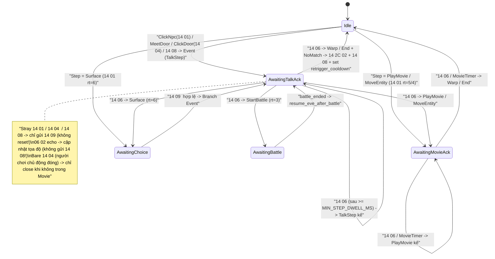

# Nghiên cứu chuyên sâu: `shoppoint` DB `1000` → Game `10000` & Đồng bộ Trạng thái Talk (`10817 Door #1`, `PlayMovie`, `Talks` liên tiếp)

- **Ngày**: 2026-11-20
- **Phạm vi**: Nghiên cứu thuần túy từ nguồn gốc (`src/`, `migrations/`, `tests/`, `docs/`, `spec/`, `.scratch/`). Không chỉnh sửa mã nguồn hay test của repository.
- **Quy ước trích dẫn**: Mọi khẳng định về hành vi code, opcode, payload, và trạng thái đều gắn đường dẫn + khoảng dòng đã đọc trực tiếp; các giả thuyết về hành vi runtime của `aLogin.exe` chưa có capture thực tế được đánh dấu rõ `[Cần live-test log]`.

---

## Tóm tắt Điều hành (Executive Summary)

1. **Vấn đề 1 (`shoppoint` trong DB là `1000` nhưng hiển thị `10000` trong game)**:
   - Trước hết, đính chính tên bảng: cột `shoppoint` không nằm trong bảng `characters` ([`migrations/0001_init.sql#L42-L81`](file:///D:/VUDT/GIT_PCC/ts_dream/migrations/0001_init.sql#L42-L81)) mà nằm trong bảng 1:1 **`character_money.shoppoint`** ([`migrations/0001_init.sql#L87-L92`](file:///D:/VUDT/GIT_PCC/ts_dream/migrations/0001_init.sql#L87-L92)), khởi tạo mặc định **`1000`** từ `Session::default()` ([`src/server/session.rs#L559`](file:///D:/VUDT/GIT_PCC/ts_dream/src/server/session.rs#L559)).
   - **Nguyên nhân gốc rễ kép** khiến DB `1000` nhưng trong game lại thấy `10000`:
     1. **Phát nhầm `23 04` (`store_frame`) với `hp_store = 10000` và `sp_store = 10000` khi đăng nhập**: Tại [`src/server/spawn.rs#L661-L663`](file:///D:/VUDT/GIT_PCC/ts_dream/src/server/spawn.rs#L661-L663), server gửi 3 gói `23 04` (`god=0`, `hp_store=10000`, `sp_store=10000`). Theo `FUN_00792BAD` `case 4` ([`.scratch/client-pseudo-op-code/opcode_23.md#L98-L105,L210`](file:///D:/VUDT/GIT_PCC/ts_dream/.scratch/client-pseudo-op-code/opcode_23.md#L98-L105), [`.scratch/client-pseudo-op-code/economy/08_verification_report.md#L400-L463`](file:///D:/VUDT/GIT_PCC/ts_dream/.scratch/client-pseudo-op-code/economy/08_verification_report.md#L400-L463)), `23 04` **không phải HP/SP Store**: client đọc `A = 10000`, `B = 0`, in banner 10.000 ms + chat-log **`"Điểm số còn dư 10000"`** và ghi đè `player+0x146C = A*100 + B = 1_000_000` (cùng ô `player+0x146C` mà `0x42 0x02` sử dụng).
     2. **Lệch cấu trúc `1A 03` / `1A 04` do hai tài liệu spec `.scratch/` mâu thuẫn nhau**: Theo [`.scratch/economy-refactor/ECONOMY_CLIENT_SPEC.md#L42-L43,L407-L408`](file:///D:/VUDT/GIT_PCC/ts_dream/.scratch/economy-refactor/ECONOMY_CLIENT_SPEC.md#L407-L408), code hiện tại ([`shops.rs#L12-L26`](file:///D:/VUDT/GIT_PCC/ts_dream/src/server/handlers/shops.rs#L12-L26), [`spawn.rs#L627,L633`](file:///D:/VUDT/GIT_PCC/ts_dream/src/server/spawn.rs#L627-L633)) gửi `1A 04 <gold:4B>` (6B) và `1A 03 <shop_point:4B>` (6B). Tuy nhiên theo `FUN_0079175f` + `0072bcf8` ([`.scratch/client-pseudo-op-code/opcode_1a.md#L95-L96,L164-L191`](file:///D:/VUDT/GIT_PCC/ts_dream/.scratch/client-pseudo-op-code/opcode_1a.md#L95-L96), [`.scratch/client-pseudo-op-code/economy/06_currency_model.md#L21-L23,L142-L145`](file:///D:/VUDT/GIT_PCC/ts_dream/.scratch/client-pseudo-op-code/economy/06_currency_model.md#L21-L23), [`09-code-review-remediation.md#L17-L19`](file:///D:/VUDT/GIT_PCC/ts_dream/.scratch/quest-refactor/issues/09-code-review-remediation.md#L17-L19)), **`1A 03` không đọc số nào** (chỉ bật banner *"Dung lượng tiền bạc không đủ"*), còn **`1A 04` mới là gói 10 byte `[1A][04][gold:4B LE -> +0x12F8][point:4B LE -> +0x1300]`**. Vì gửi thiếu 4 byte `P[6..9]` và đẩy `1000` vào `1A 03`, giá trị `shoppoint = 1000` hoàn toàn không được nạp vào `player+0x1300` lúc login (nhưng khi giao dịch Eve lại phát `1A 05`/`1A 06` tác động lên chính `player+0x1300`!).

2. **Vấn đề 2a (`10817 Door #1` `(1300, 700)` `eve_no = 7` đang nói ở bước 6, sang `PlayMovie` lại tự phát lại bước 1 nhưng sau hoạt cảnh `Warp` vẫn chạy đúng)**:
   - Kiểm tra [`eve_runner.rs#L993-L1137`](file:///D:/VUDT/GIT_PCC/ts_dream/src/server/handlers/eve_runner.rs#L993-L1137) xác nhận: nếu `current_event_session` giữ nguyên ở `idx = 6` (`PlayMovie(17)`), server **không thể** tự lùi `current_index` về `0` (`10447`) hay `auto_chain` về `eve_no = 7` (bị `detect_same_chain` chặn).
   - Tuy nhiên, có **4 khe hở đồng bộ hóa state thực sự trong `src/`** xung quanh `MeetDoor`, `14 04`, `14 08`, `PlayMovie` (`rt=5`):
     1. **Bare `14 04` (`payload.len() < 2`) bypass `clear_pending_if_active_event`** tại [`talk.rs#L389-L395`](file:///D:/VUDT/GIT_PCC/ts_dream/src/server/handlers/talk.rs#L389-L395) → hủy `current_event_session` trước khi kịp bảo vệ.
     2. **`14 08` mở `EventSession` (`quest.rs#L1522-L1525`) phát thừa `06 02` + frame lỗi 3-byte `F4440300142C01` thiếu `CharID`**, đồng thời không xóa `pending_meet_door` và không có cooldown chống re-trigger tại vùng cửa `(1300, 700)`.
     3. **`PlayMovie` (`rt=5`, `ps=2` rồi `ps=1`, `mean=0`) gửi qua `14 01` mà chưa đóng `gvar_007DA5A8` (`14 08`) và đang `StepOutcome::Halt` chờ `14 06`**: chưa có packet capture live của `eve_no = 7` đi qua `rt=5` ([`handoff_3.md#L82`](file:///D:/VUDT/GIT_PCC/ts_dream/.scratch/sysmsg-and-map10817-eve/handoff_3.md#L82), [`research_playmovie_10817.md#L23,L90`](file:///D:/VUDT/GIT_PCC/ts_dream/.scratch/sysmsg-and-map10817-eve/research_playmovie_10817.md#L23)); cần log `TS_PACKET_LOGGING=true` để xác nhận chính xác `aLogin.exe` tự render lại thoại cũ ở `TMovie`, hay tự phát C→S `14 04` / `06 01` / `14 08` / `14 06` kích hoạt lại sự kiện rồi chuyển sang `Warp`.

3. **Vấn đề 2b (`Talks` NPC mở 2–3 hội thoại liên tiếp trôi quá nhanh, chưa kịp đọc)**:
   - **Nguyên nhân gốc ở luồng legacy (`data.talks`)**: [`talk_messages`](file:///D:/VUDT/GIT_PCC/ts_dream/src/server/handlers/talk.rs#L73-L83) (được gọi từ [`quest.rs#L150,L157,L1421,L1428,L1438,L1458`](file:///D:/VUDT/GIT_PCC/ts_dream/src/server/handlers/quest.rs#L150-L157) và [`response.rs#L74-L76`](file:///D:/VUDT/GIT_PCC/ts_dream/src/server/response.rs#L74-L76)) cắt chuỗi `F444...` và đẩy toàn bộ bằng `out.send_delayed(frame, 500)`. Tại [`server_control.rs#L919-L924,L1090-L1098`](file:///D:/VUDT/GIT_PCC/ts_dream/src/web/server_control.rs#L1090-L1098), server chỉ `tokio::time::sleep(500 ms)` giữa các gói `14 01` mà **không chờ `C->S 14 06` (`TalkContinue`)** — mỗi câu thoại bị đè mất sau đúng **0,5 giây**, đồng thời block luôn vòng `select!` của socket.
   - **Nguyên nhân phối hợp ở luồng Eve (`eve_runner.rs` / `talk.rs`)**:
     - Các hiệu ứng non-blocking có phát `14 01` (`MutateItem` tại `eve_runner.rs#L362-L364`, `NpcTeam` tại `L813-L825`, `RewardPet` tại `L687,L715`) chạy dồn 0 ms trong cùng batch trước `TalkStep`/`AwaitMenuChoice`.
     - [`handle_talk_continue`](file:///D:/VUDT/GIT_PCC/ts_dream/src/server/handlers/talk.rs#L264-L285) không có debounce/seq guard nên nếu nhiều `14 06` đến trong cùng burst TCP (`server_control.rs#L1010`) hoặc `FUN_005EE30C` tự bơm `14 06` (~30 ms/lần nếu còn vé `0x44F`), các bước thoại trôi qua tức thời.

---

## Phần 1: Vấn đề 1 — `shoppoint` trong DB `1000` nhưng Hiển thị Game `10000`

### 1.1. Truy vết Vòng đời `shoppoint`, `hp_store`, `sp_store`, `gold`

#### 1.1.1. Schema DB & Giá trị Khởi tạo Mặc định
- **`characters` không có cột `shoppoint`**: Bảng `characters` tại [`migrations/0001_init.sql#L42-L81`](file:///D:/VUDT/GIT_PCC/ts_dream/migrations/0001_init.sql#L42-L81) chỉ lưu thông số nhân vật (`playerid, name, level, hair, ...`), không có `shoppoint`, `hp_store`, `sp_store`.
- **`character_money.shoppoint`**: Nằm trong bảng 1:1 [`character_money`](file:///D:/VUDT/GIT_PCC/ts_dream/migrations/0001_init.sql#L87-L92):
  ```sql
  CREATE TABLE IF NOT EXISTS character_money (
      playerid  INTEGER PRIMARY KEY,
      gold      INTEGER DEFAULT 0,
      bankgold  INTEGER DEFAULT 0,
      shoppoint INTEGER DEFAULT 0
  );
  ```
- **Giá trị mặc định trong `Session::default()`** ([`src/server/session.rs#L524-L525,L558-L559`](file:///D:/VUDT/GIT_PCC/ts_dream/src/server/session.rs#L524-L559)):
  - `hp_store: 10000`
  - `sp_store: 10000`
  - `shop_point: 1000`
  - `god: 0`, `gold: 0`, `bank_gold: 0`

#### 1.1.2. Khi Tạo Nhân vật & Nạp DB
1. **Tạo nhân vật**: `create_char_db` gọi `apply_to_session` ([`src/server/handlers/character.rs#L205-L280`](file:///D:/VUDT/GIT_PCC/ts_dream/src/server/handlers/character.rs#L205-L280)). Hàm này giữ nguyên `session.shop_point = 1000`, `hp_store = 10000`, `sp_store = 10000`. Sau đó [`SqliteSessionRepository::create_and_seed`](file:///D:/VUDT/GIT_PCC/ts_dream/src/db/modern/sqlite/session.rs#L612-L617) ghi vào `character_money`:
   ```sql
   INSERT INTO character_money (playerid, gold, bankgold, shoppoint) VALUES (?, ?, ?, ?)
   -- bind(account_id), bind(session.gold = 0), bind(session.bank_gold = 0), bind(session.shop_point = 1000)
   ```
   Do đó nhân vật mới trong DB có `character_money.shoppoint = 1000`.
2. **Nạp khi đăng nhập**: [`SqliteSessionRepository::load`](file:///D:/VUDT/GIT_PCC/ts_dream/src/db/modern/sqlite/session.rs#L43-L44,L93-L95) đọc `COALESCE(m.shoppoint, 0) AS shop_point` và gán `session.shop_point = row.get::<i64, _>("shop_point") as u32;` (`1000`). Còn `hp_store`/`sp_store` là runtime-only (khi sử dụng item `26456/26457/46145/46146` ở [`src/server/handlers/use_item/books.rs#L224-L240`](file:///D:/VUDT/GIT_PCC/ts_dream/src/server/handlers/use_item/books.rs#L224-L240) cũng không lưu DB) nên lúc login luôn mang mặc định **`10000`**.

#### 1.1.3. Tất cả Gói tin Tiền tệ / Điểm gửi về Client (`build_logined_sequence_session_ext` & Handlers)
Tại chuỗi đăng nhập `Logined1` ([`src/server/spawn.rs#L625-L664`](file:///D:/VUDT/GIT_PCC/ts_dream/src/server/spawn.rs#L625-L664)):
- **Step 12** (`L626-L633`):
  - `gold_frame(s.gold)` ([`src/server/handlers/shops.rs#L12-L18`](file:///D:/VUDT/GIT_PCC/ts_dream/src/server/handlers/shops.rs#L12-L18)): `F44406001A04` + `le32(gold.min(9_999_999))` → **payload 6 byte**.
  - `F44406001D04` + `le32(bank_gold.min(9_999_999))` → **payload 6 byte**.
  - `point_frame(s.shop_point)` ([`src/server/handlers/shops.rs#L21-L26`](file:///D:/VUDT/GIT_PCC/ts_dream/src/server/handlers/shops.rs#L21-L26)): `F44406001A03` + `le32(1000)` = `F44406001A03E8030000` → **payload 6 byte**.
- **Step 21** (`L660-L663`):
  - `store_frame(s.god)` (`0`) → `F44412002304 00000000 00×12`
  - `store_frame(s.hp_store)` (`10000`) → `F44412002304 10270000 00×12`
  - `store_frame(s.sp_store)` (`10000`) → `F44412002304 10270000 00×12`
  (Định nghĩa `store_frame` ở [`src/server/spawn.rs#L386-L391`](file:///D:/VUDT/GIT_PCC/ts_dream/src/server/spawn.rs#L386-L391): `F44412002304` + `le32(point)` + 12 byte `00`, payload **18 byte**).
- **Các call site runtime khác**:
  - `OP_GAME_POINTS (0x22)` ([`src/server/handlers/system.rs#L64-L71`](file:///D:/VUDT/GIT_PCC/ts_dream/src/server/handlers/system.rs#L64-L71)) và `/setgold` ([`src/server/gm.rs#L275`](file:///D:/VUDT/GIT_PCC/ts_dream/src/server/gm.rs#L275)): cũng gọi `store_frame(gold)` (`23 04`)!
  - `OP_GM_SHOP (0x42)` ([`src/server/handlers/system.rs#L12-L17,L165,L171`](file:///D:/VUDT/GIT_PCC/ts_dream/src/server/handlers/system.rs#L12-L17)): `shop_points_frame` gửi `F44406004202` + `le16(points as u16)` + `0100`.
  - Eve `MutateMoney` (`rc=5`) ([`src/server/handlers/eve_runner.rs#L498-L510`](file:///D:/VUDT/GIT_PCC/ts_dream/src/server/handlers/eve_runner.rs#L498-L510)): cộng/trừ `session.shop_point` dùng **`1A 05 <add:4B LE>`** và **`1A 06 <sub:4B LE>`** (không dùng `1A 03`, xem [`tests/server_network/code_review_remediation.rs#L192-L238`](file:///D:/VUDT/GIT_PCC/ts_dream/tests/server_network/code_review_remediation.rs#L192-L238)).

---

### 1.2. Đối chiếu Đặc tả `aLogin.exe` & Nguyên nhân Gốc rễ

Đối chiếu trực tiếp bảng giải mã `aLogin.exe` từ bộ decompile đã kiểm chứng (`opcode_1a.md`, `opcode_23.md`, `opcode_42.md`, `06_currency_model.md`, `08_verification_report.md`):

| Gói tin server đang phát | Offset/Hàm `aLogin.exe` thực tế | Tác động thực tế trên Client | Nguồn chứng minh |
|---|---|---|---|
| `1A 04 <gold:4B>` (**6B**, thiếu `P[6..9]`) | `FUN_0079175f` `case 4` → `FUN_0072bcf8`: đọc **2 DWORD**: `P[2..5]` → `player+0x12F8` (Kim), **`P[6..9]` → `player+0x1300` (Điểm/Point)** | Vì thiếu 4 byte `P[6..9]`, `_LStrCopy(RP, 6, 4)` không đủ độ dài → `player+0x1300` **không được set** thành `1000` (nguy cơ `_BoundErr` hoặc giữ `0`) | [`opcode_1a.md#L96,L172-L187`](file:///D:/VUDT/GIT_PCC/ts_dream/.scratch/client-pseudo-op-code/opcode_1a.md#L172-L187), [`08_verification_report.md#L371-L383`](file:///D:/VUDT/GIT_PCC/ts_dream/.scratch/client-pseudo-op-code/economy/08_verification_report.md#L371-L383) |
| `1A 03 <shop_point=1000:4B>` (**6B**) | `FUN_0079175f` `case 3`: **KHÔNG đọc payload** (`RP` bị bỏ qua hoàn toàn) | Hiện banner 2000 ms `"Dung lượng tiền bạc không đủ"` (`0x7980B4`); giá trị `1000` **bị bỏ qua 100%** | [`opcode_1a.md#L95,L164-L170`](file:///D:/VUDT/GIT_PCC/ts_dream/.scratch/client-pseudo-op-code/opcode_1a.md#L164-L170), [`06_currency_model.md#L142`](file:///D:/VUDT/GIT_PCC/ts_dream/.scratch/client-pseudo-op-code/economy/06_currency_model.md#L142) |
| `23 04 <hp_store=10000:4B><0×12>` (**18B**, ×2 ở `L662-L663`) | `FUN_00792BAD` `case 4`: đọc `A = P[2..5]`, `B = P[6..9]`, `D = P[10..17]`; gán **`player+0x146C = A*100 + B`** | 1) Hiện **banner 10.000 ms** + **1 dòng chat-log** **`"Điểm số còn dư 10000"`** (`DAT_0079889c` + `IntToStr(10000 + 0)`);<br>2) Ghi đè **`player+0x146C = 1_000_000`** (`10000 * 100 + 0`), ghi đè luôn vùng bộ đếm hiển thị dùng chung với `42 02` | [`opcode_23.md#L98-L105,L210`](file:///D:/VUDT/GIT_PCC/ts_dream/.scratch/client-pseudo-op-code/opcode_23.md#L98-L105), [`08_verification_report.md#L401-L463`](file:///D:/VUDT/GIT_PCC/ts_dream/.scratch/client-pseudo-op-code/economy/08_verification_report.md#L401-L463) |
| `42 02 <points:2B LE> 01 00` | `FUN_00522ab8` Mode 2: đọc `P[2..5]` (`u32 LE`) → ghi **`player+0x146C`** + refresh `gvar_007DA35C` (`VMT+0x20`) | Ghi `u32` (của `<points:2B><01 00>`, tức `points + 0x00010000` nếu đọc cả 4B `P[2..5]`!) vào `player+0x146C` | [`opcode_42.md#L53,L76-L83`](file:///D:/VUDT/GIT_PCC/ts_dream/.scratch/client-pseudo-op-code/opcode_42.md#L76-L83) |

> [!IMPORTANT]
> **Giải thích chính xác hiện tượng "DB `1000` → Game hiển thị `10000`"**:
> 1. **Số `10000` mà người chơi nhìn thấy khi vào game đến từ `s.hp_store = 10000` và `s.sp_store = 10000` bị gửi qua `store_frame` (`23 04`) tại [`src/server/spawn.rs#L662-L663`](file:///D:/VUDT/GIT_PCC/ts_dream/src/server/spawn.rs#L662-L663)**. Client `aLogin.exe` (`FUN_00792BAD` `case 4`) diễn giải `23 04` là thông báo ***"Điểm số còn dư 10000"*** (banner 10s + dòng chat-log) và gán `player+0x146C = 1_000_000`.
> 2. **Cùng lúc đó, `shoppoint = 1000` trong DB lại không bao giờ hiển thị đúng** vì:
>    - Login gửi `1A 03` (`point_frame(1000)`) vốn chỉ là thông báo lỗi tĩnh *"Dung lượng tiền bạc không đủ"* (`opcode_1a.md#L164-L170`), **không** ghi vào `player+0x1300` (trường Điểm/Point trần `2_000_000_000`, được vẽ trên HUD bởi `00632e3c`, xem [`06_currency_model.md#L76-L92`](file:///D:/VUDT/GIT_PCC/ts_dream/.scratch/client-pseudo-op-code/economy/06_currency_model.md#L76-L92)) cũng **không** ghi vào `player+0x146C`.
>    - Còn `1A 04` (`gold_frame`) lại bị cắt còn 6 byte thay vì 10 byte `[1A][04][gold:4B LE][shop_point:4B LE]`, nên `player+0x1300` bị bỏ trống (`0`).
> 3. **Cộng thêm lỗi phụ ở `42 02` (`shop_points_frame` tại [`system.rs#L12-L17`](file:///D:/VUDT/GIT_PCC/ts_dream/src/server/handlers/system.rs#L12-L17))**: `FUN_00522ab8` Mode 2 đọc **4 byte** `P[2..5]` (`DWORD LE`) ghi vào `player+0x146C` (`opcode_42.md#L78-L80`), nhưng `shop_points_frame` chỉ ghi `le16(points as u16)` + `"0100"` (tức ghép `0x0001` vào 2 byte cao → `1000` thành `66536` nếu client mở panel `0x42`, và bị cắt tràn nếu `points > 65535`).

#### Tại sao repo lại tồn tại sai lệch `1A 03` / `1A 04` này? (Mâu thuẫn tài liệu nội bộ)
- [`.scratch/economy-refactor/ECONOMY_CLIENT_SPEC.md#L42-L43,L407-L410`](file:///D:/VUDT/GIT_PCC/ts_dream/.scratch/economy-refactor/ECONOMY_CLIENT_SPEC.md#L407-L410) từng viết nhầm rằng `1A 03` gọi `FUN_0072c070` ghi `+0x1300` (6B) còn `1A 04` chỉ đọc 6B ghi `+0x12F8` (và `1A 06` là lỗi *"Dung lượng tiền bạc không đủ"*). Tài liệu đó đã bị truyền vào [`GLOSSARY.md`](file:///D:/VUDT/GIT_PCC/ts_dream/GLOSSARY.md), [`docs/client-opcodes.md`](file:///D:/VUDT/GIT_PCC/ts_dream/docs/client-opcodes.md), [`shops.rs`](file:///D:/VUDT/GIT_PCC/ts_dream/src/server/handlers/shops.rs), [`spawn.rs`](file:///D:/VUDT/GIT_PCC/ts_dream/src/server/spawn.rs), và [`tests/economy_inventory/economy_wire.rs#L54-L76`](file:///D:/VUDT/GIT_PCC/ts_dream/tests/economy_inventory/economy_wire.rs#L54-L76).
- Về sau, khi kiểm chứng lại trực tiếp ASM/C của `FUN_0079175f` và `FUN_0072bcf8` trong [`.scratch/client-pseudo-op-code/opcode_1a.md#L91-L197`](file:///D:/VUDT/GIT_PCC/ts_dream/.scratch/client-pseudo-op-code/opcode_1a.md#L91-L197), [`06_currency_model.md#L136-L150`](file:///D:/VUDT/GIT_PCC/ts_dream/.scratch/client-pseudo-op-code/economy/06_currency_model.md#L136-L150), [`08_verification_report.md#L371-L463`](file:///D:/VUDT/GIT_PCC/ts_dream/.scratch/client-pseudo-op-code/economy/08_verification_report.md#L371-L463), nhánh Eve (`eve_runner.rs#L498-L510` & [`code_review_remediation.rs#L192-L238`](file:///D:/VUDT/GIT_PCC/ts_dream/tests/server_network/code_review_remediation.rs#L192-L238)) đã được sửa sang **`1A 05`/`1A 06`** đúng chuẩn `FUN_0079175f`, nhưng **`spawn.rs`, `shops.rs`, `system.rs`, `gm.rs` và `economy_wire.rs` chưa được đồng bộ theo**.

---

### 1.3. Phương án Sửa & Cải thiện cho Vấn đề 1

1. **Sửa `gold_frame` / `currency_sync_frame` (`1A 04`) về đúng 10 byte (`[1A][04][gold:4B LE][shop_point:4B LE]`)** ([`src/server/handlers/shops.rs#L12-L26`](file:///D:/VUDT/GIT_PCC/ts_dream/src/server/handlers/shops.rs#L12-L26), [`src/server/spawn.rs#L627,L633`](file:///D:/VUDT/GIT_PCC/ts_dream/src/server/spawn.rs#L627-L633)):
   - Luôn phát `F4440A001A04` + `le32(gold.min(GOLD_CAP))` + `le32(shop_point.min(POINT_CAP))` (10 byte payload) khi đồng bộ số dư lúc login (và khi cập nhật tuyệt đối `gold` mà cần bảo toàn `player+0x1300`).
   - **Xóa** lời gọi `point_frame(s.shop_point)` (`1A 03`) ở [`spawn.rs#L633`](file:///D:/VUDT/GIT_PCC/ts_dream/src/server/spawn.rs#L633) (hoặc chỉ giữ `1A 03` dạng 2-byte static error frame `"F44402001A03"` đúng với *"Dung lượng tiền bạc không đủ"*).
   - *Rủi ro/Hệ quả*: Cần giữ `gold_frame(gold)` truyền thêm `shop_point` hoặc giữ `gold_frame` dùng `1A 01`/`1A 02` cho delta khi mua/bán shop và chỉ dùng `1A 04 <gold><shop_point>` khi sync tuyệt đối (nếu gọi `1A 04 <gold> 00000000` sau khi mua đồ NPC sẽ ghi đè `player+0x1300` về `0`!). Cần cập nhật `tests/economy_inventory/economy_wire.rs#L54-L85` và `docs/client-opcodes.md` / `GLOSSARY.md`.
2. **Gỡ bỏ việc phát nhầm `store_frame` (`23 04`) cho `god` / `hp_store` / `sp_store` / `gold`**:
   - Tại [`src/server/spawn.rs#L660-L663`](file:///D:/VUDT/GIT_PCC/ts_dream/src/server/spawn.rs#L660-L663): bỏ 3 lời gọi `store_frame(s.god)`, `store_frame(s.hp_store)`, `store_frame(s.sp_store)` để ngừng spam `"Điểm số còn dư 10000"` + ngừng ghi đè `player+0x146C = 1_000_000`.
   - Tại [`src/server/handlers/system.rs#L64-L71`](file:///D:/VUDT/GIT_PCC/ts_dream/src/server/handlers/system.rs#L64-L71) (`OP_GAME_POINTS 0x22`) và [`src/server/gm.rs#L275`](file:///D:/VUDT/GIT_PCC/ts_dream/src/server/gm.rs#L275) (`/setgold`): thay `store_frame` bằng `1A 04 <gold><shop_point>` (cho `/setgold`) hoặc frame đúng theo nghiệp vụ `0x22` (không dùng `23 04` làm tiền tệ).
3. **Chuẩn hóa `42 02` (`shop_points_frame`) tại [`src/server/handlers/system.rs#L12-L17`](file:///D:/VUDT/GIT_PCC/ts_dream/src/server/handlers/system.rs#L12-L17)** *(nếu sử dụng UI Kỳ Trân Các `0x42`)*:
   - Theo `opcode_42.md#L53,L78-L80`, `42 02` nhận **`DWORD LE` 4 byte** `F44406004202` + `le32(points)` (tổng payload 6 byte, không nhét `"0100"` vào 2 byte cao!).
   - *Rủi ro*: Cần kiểm tra bằng capture thực tế trên `aLogin.exe` xem UI bạn đang nhìn thấy `10000` là banner/chat-log `"Điểm số còn dư 10000"` (`23 04`), HUD `0x1300` (`1A 04`), hay panel Thương Thành `0x42` (`player+0x146C`).

---

## Phần 2: Vấn đề 2 — Đồng bộ Trạng thái Nhân vật khi ở Talk (`10817 Door #1`, `PlayMovie`, `Talks` liên tiếp)

### 2.1. Phân tích Hiện tượng 2a: `10817 Door #1 (1300, 700)` (`eve_no = 7`) phát lại Bước 1 ở `PlayMovie`, sau đó vẫn `Warp`

#### 2.1.1. Dữ liệu Kịch bản & Đường đi Code Hiện tại của `eve_no = 7`
Theo [`.scratch/special-event-refactor/data_files/eve/eve_full.jsonl#L18`](file:///D:/VUDT/GIT_PCC/ts_dream/.scratch/special-event-refactor/data_files/eve/eve_full.jsonl#L18), trên map `10817`:
- **Door #1** ở `(1300, 700)` gắn **`eve_no = 7`** với `when_happen = [false, true, false, false]` (`OnStrokeObject` = `MeetDoor`).
- Chuỗi `results` của `eve_no = 7` (9 bước):
  - `idx 0..=5` (`no = 1..6`): `rt=1` (`TalkStep`), `mean_no = 10447, 10448, 10449, 10450, 10451, 10452` (`rc` xen kẽ `7` = self, `3` = `param=4` NPC #4 Bạch Lão Nhân).
  - `idx 6` (`no = 7`): `rt=5, rc=0, param=0, ps=2, val=17, mean=0` (`PlayMovie #1`).
  - `idx 7` (`no = 8`): `rt=5, rc=0, param=0, ps=1, val=18, mean=0` (`PlayMovie #2`).
  - `idx 8` (`no = 9`): `rt=2, rc=7, param=1, ps=0, val=0, mean=0` (`Warp` sang `10867` `(890, 510)`).
- So sánh với **NPC #4** (`15009`, `(1430, 660)`, `eve_no = 4`, `when_happen = [true, false, false, false]`): cũng có 6 câu thoại `10447..10452`, nhưng `idx 6` đi thẳng sang `rt=2, param=1` (`Warp`), **không có `PlayMovie`**.

Luồng xử lý trên server hiện tại:
1. **Kích hoạt `MeetDoor` (`06 01`)**:
   - [`handle_move_dispatch`](file:///D:/VUDT/GIT_PCC/ts_dream/src/server/handlers/movement.rs#L65-L120) kiểm tra cửa gần nhất trong hộp `±60 px` quanh `(map_x, map_y)`.
   - Nếu `travel_ms > 250`, đặt [`session.pending_meet_door`](file:///D:/VUDT/GIT_PCC/ts_dream/src/server/handlers/movement.rs#L98-L106) rồi rời hàm; vòng `tokio::select!` ở [`server_control.rs#L831-L918`](file:///D:/VUDT/GIT_PCC/ts_dream/src/web/server_control.rs#L831-L918) ngủ tới `due_ms` (chỉ khi `battle_id == 0 && current_event_session.is_none()`), xóa `pending_meet_door = None` (`L860`), rồi gọi [`trigger_meet_door_for_door`](file:///D:/VUDT/GIT_PCC/ts_dream/src/server/handlers/movement.rs#L150-L221) → [`activate_event_session`](file:///D:/VUDT/GIT_PCC/ts_dream/src/server/handlers/eve_runner.rs#L1180-L1200).
   - `activate_event_session` bật `session.talk_locked = true`, gửi `06 02`, `14 2C <char_id> 01`, và chạy `idx = 0` (`14 01` bước 1 `mean=10447`).
2. **Bảo vệ chống ngắt ngang đã có (theo [`handoff_3.md#L39-L42`](file:///D:/VUDT/GIT_PCC/ts_dream/.scratch/sysmsg-and-map10817-eve/handoff_3.md#L39-L42))**:
   - [`clear_pending_if_active_event`](file:///D:/VUDT/GIT_PCC/ts_dream/src/server/handlers/talk.rs#L160-L166): gửi `14 09` để xóa `PlayerState+0xA094` khi `14 01`, `14 04 <door>`, `14 08` đến trong lúc `current_event_session.is_some()`.
   - [`movement.rs#L286-L294`](file:///D:/VUDT/GIT_PCC/ts_dream/src/server/handlers/movement.rs#L286-L294): khi `06 02` echo về, chỉ phát `14 08` nếu `current_event_session.is_none() && !talk_locked`.
   - Test [`map_10817_door_1_survives_14_04_and_06_02_echo_then_plays_movies`](file:///D:/VUDT/GIT_PCC/ts_dream/tests/eve_quest/missing_eve_effect_executors.rs#L980-L1059) mới kiểm tra các frame tổng hợp `14 04 01 00` → `06 02` → `14 01` → `10 × 14 06`, **chưa** kiểm tra kịch bản client gửi bare `14 04`, hay các gói phát sinh thực sự từ `aLogin.exe` khi nhận `rt=5` (`PlayMovie`).
3. **Thực thi `PlayMovie` (`rt=5`)**:
   - [`DomainEffect::is_blocking_or_terminal`](file:///D:/VUDT/GIT_PCC/ts_dream/src/eve/planner.rs#L170-L180) coi `PlayMovie` là blocking.
   - [`process_single_domain_effect`](file:///D:/VUDT/GIT_PCC/ts_dream/src/server/handlers/eve_runner.rs#L844-L847) gửi `14 01` (`rt=5`) và trả về `StepOutcome::Halt`, chờ `C->S 14 06`.

#### 2.1.2. Tại sao Bước 1 (`10447`) có thể phát lại tại `PlayMovie` trong khi `Warp` vẫn xảy ra?

**1. Khẳng định từ mã nguồn `src/`**:
- Trong [`execute_event_step_core`](file:///D:/VUDT/GIT_PCC/ts_dream/src/server/handlers/eve_runner.rs#L993-L1137), `ev.current_index` chỉ tăng tiến (+1 ở `talk.rs#L281` khi có `14 06`, hoặc +1 ở `eve_runner.rs#L1097`), không có bất kỳ nhánh nào reset `current_index` về `0`.
- `auto_chain_after` ([`eve_runner.rs#L918-L923`](file:///D:/VUDT/GIT_PCC/ts_dream/src/server/handlers/eve_runner.rs#L918-L923)) chỉ chạy khi `idx >= len` (`idx >= 9`), và `detect_same_chain` ([`src/eve/auto_chain.rs#L218-L225`](file:///D:/VUDT/GIT_PCC/ts_dream/src/eve/auto_chain.rs#L218-L225)) chặn nối lại cùng `(eve_no=7, matched_condition_no=1)`.
- **Kết luận**: Server **không tự ý** nhảy từ `idx = 6` về `idx = 0` trong một `EventSession` liên tục. Để bước 1 (`10447`) phát lại vào thời điểm `PlayMovie`, **hoặc** `current_event_session` đã bị hủy/re-trigger qua một khe hở bên ngoài `eve_runner`, **hoặc** `aLogin.exe` tự render lại / kích hoạt lại phía client khi nhận `14 01 (rt=5)`.

**2. Các khe hở cụ thể đã tìm thấy trong `src/` + Đặc tả `aLogin.exe`**:

1. **Khe hở A — Bare `14 04` (`EndTalk` 2 byte) lọt qua guard `clear_pending_if_active_event` ([`talk.rs#L389-L395`](file:///D:/VUDT/GIT_PCC/ts_dream/src/server/handlers/talk.rs#L389-L395))**:
   - Trong `handle_talk_click_door`:
     ```rust
     if payload.len() < 2 {
         end_talk(conn, out); // <-- ĐÓNG LUÔN EventSession, gửi 14 2C 02 + 14 08!
         return;
     }
     if clear_pending_if_active_event(&conn.session, out) {
         return;
     }
     ```
   - Nếu client gửi `F44402001404` (hoặc sub không hợp lệ rơi vào `_ => end_talk` ở [`talk.rs#L99`](file:///D:/VUDT/GIT_PCC/ts_dream/src/server/handlers/talk.rs#L99)), server xóa sạch `current_event_session` và mở khóa di chuyển. Ngay khi có gói `06 01` hoặc `14 08` tiếp theo tại `(1300, 700)`, `eve_no = 7` bị mở lại từ bước 1 (`10447`).
2. **Khe hở B — Xung đột giữa `PendingMeetDoor` (`06 01`), `14 04 <door_id>`, và `14 08 <door_id>`**:
   - Khi người chơi đi bộ từ xa tới `(1300, 700)`, `06 01` đặt `pending_meet_door = Some(...)` (`movement.rs#L100-L104`).
   - Nếu trong lúc chờ `due_ms` (khi `current_event_session` vẫn là `None`), client chạm vùng chữ nhật cửa trên `aLogin.exe` (`FUN_005EE590` / `FUN_005EA3E0`, [`opcode_14.md#L242`](file:///D:/VUDT/GIT_PCC/ts_dream/.scratch/client-pseudo-op-code/opcode_14.md#L242)) và gửi:
     - `14 04 01 00` → `ClickDoor(1)` không khớp `eve_no = 7` (`when_happen[0] == false`, [`auto_chain.rs#L66`](file:///D:/VUDT/GIT_PCC/ts_dream/src/eve/auto_chain.rs#L66)) nên `talk.rs#L442` gửi **`14 08`**, sau đó `pending_meet_door` vẫn nổ lúc `due_ms`.
     - `14 08 01 00` → đi qua `handle_warp_confirm` → `DoorActionResolution::Event` ([`quest.rs#L1522-L1545`](file:///D:/VUDT/GIT_PCC/ts_dream/src/server/handlers/quest.rs#L1522-L1545)): hàm này **không xóa `pending_meet_door`** và phát thừa `F44402000602` + **frame lỗi 3 byte `F4440300142C01` (thiếu `CharID: 4B LE`, có thể gây `_BoundErr` hoặc lệch trạng thái actor trong `FUN_0074641c` ở [`opcode_14.md#L183-L190`](file:///D:/VUDT/GIT_PCC/ts_dream/.scratch/client-pseudo-op-code/opcode_14.md#L183-L190))** trước khi gọi `activate_event_session`.
   - Đồng thời, trên `Movement` (`06 01`) và `Door` hoàn toàn **không có trạng thái anti-retrigger / cooldown** sau khi `EventSession` kết thúc hoặc bị hủy ngay tại tọa độ `(1300, 700)`.
3. **Khe hở C — Máy trạng thái `aLogin.exe` khi nhận `S->C 14 01` (`rt=5`, `PlayMovie`) giữa phiên thoại chưa đóng (`14 08` chưa gửi) `[Cần live-test log]`**:
   - Theo [`opcode_14.md#L140,L151,L243`](file:///D:/VUDT/GIT_PCC/ts_dream/.scratch/client-pseudo-op-code/opcode_14.md#L140) và [`live_test_research.md#L58-L62`](file:///D:/VUDT/GIT_PCC/ts_dream/.scratch/sysmsg-and-map10817-eve/live_test_research.md#L58-L62):
     - Mọi `S->C 14 01` ghi vào `PlayerState + 0xA09B..+0xA0A9`, xóa `a094 = 0`, ghi `TWF_BigNpcBmp+4 = 0x14`, rồi gọi `FUN_005EB530`.
     - Khi `B2 = 5` (`PlayMovie`, `val=17, ps=2` rồi `val=18, ps=1`), `FUN_005EB530` mở/sửa `a096` theo `B4` (`ps`), đặt **`gvar_007DA37C+0x1D = 1`** và chạy `TMovie` (`FUN_00618668`) — **nhưng `14 08` chưa được gửi** nên form thoại `gvar_007DA5A8` và dữ liệu hội thoại trước đó vẫn chưa dọn cờ `a095`/`a0D4`/`scene+0x1D` theo chu trình `case 8`.
     - Mặt khác, như [`research_playmovie_10817.md#L23,L87-L90`](file:///D:/VUDT/GIT_PCC/ts_dream/.scratch/sysmsg-and-map10817-eve/research_playmovie_10817.md#L87-L90) đã chỉ ra, **`eve_no = 7` chưa từng có packet capture live đi qua `rt=5`**. Nếu tại `PlayMovie`, `aLogin.exe` hoặc người chơi không gửi `14 06` đúng như test giả lập mà:
       - *(i)* gửi một chuỗi gói C→S mới (như `14 04` / `06 01` / `14 08` khi thoát `TMovie` quay về `0x1D = 2`), **hoặc**
       - *(ii)* `aLogin.exe` tự mở/vẽ lại hộp thoại cũ của `eve_no=7`/`eve_no=4` khi thoát `TMovie` (`gvar_007DA37C+0x1D` chuyển từ `1` về `2`) hoặc do người chơi đứng trong tầm `136 px` giữa Door #1 `(1300, 700)` và NPC #4 `(1430, 660)`,
       thì sẽ xuất hiện đúng triệu chứng: tại bước 6 → `PlayMovie` bị lặp lại bước 1 rồi vẫn `Warp` sang `10867`. Cần **1 bản log `TS_PACKET_LOGGING=true` đi qua `(1300, 700)`** để xác định chắc chắn bước 1 lặp là do gói `S->C 14 01 (10447)` thứ hai từ server hay do UI `aLogin.exe` tự phát lại.

---

### 2.2. Phân tích Hiện tượng 2b: `Talks` mở 2–3 Hội thoại Liên tiếp diễn ra rất nhanh

Đối chiếu cả 2 cơ chế phát thoại trong `src/`:

#### 2.2.1. Luồng Legacy `data.talks` — `talk_messages` phát Burst theo Timer 500 ms (Nguyên nhân trực tiếp)
- Tại [`src/server/handlers/talk.rs#L71-L83`](file:///D:/VUDT/GIT_PCC/ts_dream/src/server/handlers/talk.rs#L71-L83):
  ```rust
  pub fn talk_messages(conn: &mut Conn, talk_string: &str, out: &mut HandleOutcome) {
      for part in talk_string.split("F444") {
          if !part.is_empty() {
              let frame = format!("F444{part}");
              if frame == "F44402001408" {
                  conn.session.select_menu = 40;
              }
              out.send_delayed(frame, 500);
          }
      }
  }
  ```
- Các điểm gọi trực tiếp vào `talk_messages`: [`quest.rs#L150,L157`](file:///D:/VUDT/GIT_PCC/ts_dream/src/server/handlers/quest.rs#L150-L157) (`try_quest_h6`), [`quest.rs#L1421,L1428,L1438,L1458`](file:///D:/VUDT/GIT_PCC/ts_dream/src/server/handlers/quest.rs#L1421-L1458) (`handle_warp_confirm`), và [`response.rs#L74-L76`](file:///D:/VUDT/GIT_PCC/ts_dream/src/server/response.rs#L74-L76).
- Tại [`src/web/server_control.rs#L919-L925,L1090-L1098`](file:///D:/VUDT/GIT_PCC/ts_dream/src/web/server_control.rs#L1090-L1098):
  ```rust
  for frame in &out.outgoing {
      if frame.delay_ms > 0 {
          tokio::time::sleep(Duration::from_millis(frame.delay_ms)).await;
      }
      match tx.try_send(frame.frame.clone()) { ... }
  }
  ```
- **Hai hệ quả nghiêm trọng**:
  1. Server đẩy toàn bộ 2–3+ frame `14 01` liên tiếp chỉ cách nhau **500 ms**, **hoàn toàn không dừng chờ `C->S 14 06`** từ người chơi! Phía `aLogin.exe`, mỗi `14 01` ghi đè thẳng `PlayerState + 0xA09B` và vẽ đè hộp thoại mới lên `gvar_007DA5A8` nên người chơi chỉ thấy mỗi câu thoại thoáng qua **0,5 giây**.
  2. Trong suốt lúc `sleep(500 ms)` × `N` câu thoại ở [`server_control.rs#L1095`](file:///D:/VUDT/GIT_PCC/ts_dream/src/web/server_control.rs#L1095), task TCP connection **ngừng đọc socket (`read_half.read`) và ngừng nhận timer `pending_meet_door`** cho tới khi gửi xong toàn bộ các mảnh!

#### 2.2.2. Luồng Eve Engine — 3 Điểm Rủi ro gây "Trôi Nhanh"
Mặc dù [`DomainEffect::TalkStep`](file:///D:/VUDT/GIT_PCC/ts_dream/src/server/handlers/eve_runner.rs#L730-L733) có trả `StepOutcome::Halt` chờ `14 06`, vẫn còn 3 vấn đề đồng bộ hóa khiến chuỗi thoại nhiều bước có thể trôi qua rất nhanh:
1. **Không có debounce / pacing / ACK guard trong `handle_talk_continue` (`14 06`)** ([`src/server/handlers/talk.rs#L264-L285`](file:///D:/VUDT/GIT_PCC/ts_dream/src/server/handlers/talk.rs#L264-L285)):
   - Hàm chỉ chặn `AwaitingChoice` và `AwaitingBattle`.
   - Nếu client gửi nhiều `14 06` liên tiếp (do tick pump `FUN_005EE30C` chạy mỗi ~30 ms khi cờ `TFConnect+0x44F` còn sót từ lần warp trước — xem [`research_playmovie_10817.md#L17-L19,L54`](file:///D:/VUDT/GIT_PCC/ts_dream/.scratch/sysmsg-and-map10817-eve/research_playmovie_10817.md#L17-L19), hoặc do người chơi nhấn nhanh / giữ phím Enter gửi nhiều `14 06` vào cùng 1 buffer đọc ở [`server_control.rs#L1010`](file:///D:/VUDT/GIT_PCC/ts_dream/src/web/server_control.rs#L1010)), server xử lý sạch tất cả trong cùng 1 lần `read` (~micro-giây) và phát dồn 2–3 gói `14 01` liên tiếp mà người chơi không kịp đọc.
2. **Các hiệu ứng non-blocking phát `14 01` nằm trước `TalkStep` trong cùng vòng lặp**:
   - `execute_mutate_item` ([`eve_runner.rs#L362-L364`](file:///D:/VUDT/GIT_PCC/ts_dream/src/server/handlers/eve_runner.rs#L362-L364)), `DomainEffect::NpcTeam` ([`L813-L825`](file:///D:/VUDT/GIT_PCC/ts_dream/src/server/handlers/eve_runner.rs#L813-L825)), `execute_reward_pet` ([`L687,L715`](file:///D:/VUDT/GIT_PCC/ts_dream/src/server/handlers/eve_runner.rs#L687-L715)) đều gọi `out.send(NpcTalkCodec::build_talk_step_hex(...))` rồi trả về `StepOutcome::Continue`. Khi chuỗi Eve có nhiều step `14 01` loại này liền trước `TalkStep` hoặc `AwaitMenuChoice`, toàn bộ bị đẩy trong cùng 1 burst TCP (`0 ms`).
3. **`auto_chain_after` nối ngay trong cùng turn** ([`eve_runner.rs#L918-L923,L1006-L1012`](file:///D:/VUDT/GIT_PCC/ts_dream/src/server/handlers/eve_runner.rs#L1006-L1012)):
   - Khi event A kết thúc mà event B nối tiếp ngay (`AutoChainResult::Chained(new_ev)`), vòng lặp `continue;` chạy thẳng sang bước 1 của event B **mà không reset/sync lại trạng thái dialog hoặc ngắt nhịp** nếu bước cuối của event A vừa phát một thông báo `14 01` non-blocking.

---

### 2.3. Đề xuất Kiến trúc Đồng bộ Trạng thái Talk & Phương án Cải thiện

#### 2.3.1. Kiến trúc Đề xuất: Talk State Machine Chuẩn Hóa (Tuân thủ `CODING_STANDARDS.md`)

Tách rõ trạng thái tương tác trên `Session` (không lưu trong DB, cập nhật đầy đủ trong `merge_post_dispatch` ở [`src/server/session.rs#L925-L1037`](file:///D:/VUDT/GIT_PCC/ts_dream/src/server/session.rs#L925-L1037) theo nguyên tắc **Two-Phase State Lock**):



Các thành phần cốt lõi của máy trạng thái mới:
1. **Mở rộng `EventPhase` (`src/eve/auto_chain.rs`)**:
   - Thêm các pha rõ ràng: `AwaitingTalkAck`, `AwaitingMovieAck` (hoặc `AwaitingAnimation`), bên cạnh `Executing`, `AwaitingChoice`, `AwaitingBattle`.
   - Lưu thêm trên `EventSession` (runtime-only):
     - `last_step_sent_ms: u64`: mốc thời gian gửi frame `14 01` blocking gần nhất (chống burst `14 06` từ `FUN_005EE30C` hoặc double-click).
     - `active_door_id: Option<u16>`: đánh dấu cửa đang chạy kịch bản.
2. **Chống re-trigger `MeetDoor` (`Session.door_trigger_cooldown: Option<(u16, u16, u64)>`)**:
   - Ghi nhận `(map_id, door_id, until_ms)` khi `EventSession` tại cửa kết thúc/hủy (nếu không warp sang map khác), hoặc khi người chơi vừa bước ra khỏi vùng `±60 px` mới cho kích hoạt lại.
   - Bất kỳ lời gọi mở `EventSession` nào (`activate_event_session`, `handle_warp_confirm`) **bắt buộc xóa `session.pending_meet_door = None`**.
3. **Chuẩn hóa giao thức `14 08` & `14 04` & `06 02`**:
   - **Sửa ngay bug ở [`quest.rs#L1523-L1524`](file:///D:/VUDT/GIT_PCC/ts_dream/src/server/handlers/quest.rs#L1523-L1524)**: xóa 2 dòng phát thừa `06 02` và `F4440300142C01` (thiếu `CharID`); để duy nhất `activate_event_session` phát `06 02` + `14 2C <char_id:4B LE> 01`.
   - **Bảo vệ bare `14 04` (`talk.rs#L389`)**: nếu đang ở `AwaitingMovieAck` (trong lúc `PlayMovie`), không cho `14 04` ngắt giữa chừng (chỉ trả `14 09`), tránh `06 01` kích hoạt lại bước 1. Ngoài ra, bất cứ khi nào kết thúc talk mà nghi ngờ client còn giữ vé `TFConnect+0x44F` (`14 07`), luôn đảm bảo `14 08` được phát sau `14 07` khi load xong map (`0x0C 0x01`) để tắt `FUN_005EE30C`.

#### 2.3.2. Phương án Cải thiện Cụ thể cho 2a (`PlayMovie`) & 2b (`Talks` liên tiếp)

| Vấn đề | Phương án | Cách triển khai chi tiết | Ưu điểm | Nhược điểm / Rủi ro |
|---|---|---|---|---|
| **2a: `PlayMovie` (`rt=5`) & lặp bước 1** | **PA-2A1 (Khuyến nghị nếu client tự gửi `14 06` hoặc người chơi bấm tiếp)**: Giữ Blocking + Chống re-trigger | Giữ `PlayMovie`/`MoveEntity` là `StepOutcome::Halt`, sửa `quest.rs#L1523-L1524`, xóa `pending_meet_door` khi mở event, thêm `door_trigger_cooldown` khi đóng event không warp, và log/chặn mọi `14 04` bare trong `AwaitingMovieAck`. | Khớp chuẩn từng bước với `eve.emg`, không đoán mò thời lượng phim. | Nếu `aLogin.exe` **không** gửi `14 06` sau khi kết thúc `TMovie` (do `TFConnect+0x44F == 0`), người chơi sẽ bị treo ở màn hình sau phim. |
| **2a: `PlayMovie` (`rt=5`)** | **PA-2A2 (Nếu capture xác nhận client đứng im sau `TMovie`)**: Non-blocking `tokio::select!` Movie Timer | Thay `StepOutcome::Halt` bằng hẹn giờ `pending_eve_advance { due_ms }` trong vòng `tokio::select!` của [`server_control.rs`](file:///D:/VUDT/GIT_PCC/ts_dream/src/web/server_control.rs) (giống mẫu `pending_meet_door`), **tuyệt đối không** dùng `tokio::time::sleep` chặn socket loop. | Tự động đi tiếp `PlayMovie(17)` → `PlayMovie(18)` → `Warp(10867)` mà không bắt user bấm thêm và không block TCP read. | Phải ước lượng thời lượng mỗi `movie_id` (`val=17, 18`); nếu timer quá ngắn có thể cắt ngang hoạt cảnh trước `Warp`. |
| **2b: `Talks` liên tiếp trôi nhanh** | **PA-2B1 (Khuyến nghị — Chuẩn tương tác theo ACK)**: Thay `talk_messages` 500ms-burst bằng Step Queue chờ `14 06` | Loại bỏ `send_delayed(frame, 500)` cho chuỗi thoại `14 01` ở [`talk.rs#L73-L83`](file:///D:/VUDT/GIT_PCC/ts_dream/src/server/handlers/talk.rs#L73-L83) & [`quest.rs`](file:///D:/VUDT/GIT_PCC/ts_dream/src/server/handlers/quest.rs): lưu `pending_legacy_dialogs: VecDeque<String>` (hoặc bọc thành `EventSession` synthetic) trên `Session`, phát **1 câu/lần**, chỉ gửi câu kế tiếp khi nhận `C->S 14 06`. Kèm **debounce `MIN_TALK_STEP_DWELL_MS` (~150–250 ms)** trong `handle_talk_continue` để triệt tiêu burst `14 06` từ `FUN_005EE30C` hay double-click. | Người chơi đọc thoải mái theo tốc độ bấm của mình; bỏ hẳn `tokio::time::sleep(500)` gây nghẽn `select!` trong `server_control.rs#L1095`. | Cần kiểm tra kỹ các golden/legacy test trong `tests/` đang gọi `try_quest_h6` / `talk_messages` kỳ vọng nhận hết frame trong 1 `HandleOutcome` (cần cập nhật test hoặc giữ tương thích cho non-1401 frames). |
| **2b: `Talks` liên tiếp** | **PA-2B2 (Tạm thời / Ít xâm lấn)**: Tăng pacing + dọn `send_delayed` | Chỉ áp dụng nếu giữ legacy `talk_messages`: bỏ `sleep` block socket, chuyển sang `tokio::select!` timer với delay lớn hơn (vd 2000–3000 ms) + tách từng `14 01` non-blocking trong Eve. | Ít đổi luồng `quest.rs` legacy. | Vẫn có thể quá nhanh (câu dài) hoặc quá chậm (câu ngắn); không đúng trải nghiệm bấm "Tiếp tục" chuẩn của TS Online. |

**Lưu ý tuân thủ `CODING_STANDARDS.md`**:
- Không giữ `lock_player_operations` qua bất kỳ `.await` ngủ hoặc timer nào (`server_control.rs#L1030-L1033`).
- Mọi field mới thêm vào `Session` phục vụ Talk state machine (`door_trigger_cooldown`, `pending_legacy_dialogs`, các field trên `EventSession`) phải được xử lý đồng bộ trong [`merge_post_dispatch`](file:///D:/VUDT/GIT_PCC/ts_dream/src/server/session.rs#L924-L1037) để không bị ghi đè mất khi có tương tác liên người chơi (party warp, trade, battle).
- Không tạo `*_test.rs` lẻ ở `tests/`; test cho Talk sync & `10817 Door #1` đưa vào `tests/eve_quest/` và `tests/server_network/` ([`AGENTS.md`](file:///D:/VUDT/GIT_PCC/ts_dream/AGENTS.md)).

---

## Phần 3: Danh sách Điểm Cần Kiểm chứng bằng Live-Test Packet Log (`TS_PACKET_LOGGING=true`)

Để khép kín 100% các giả định về `aLogin.exe` trước khi triển khai sửa đổi, cần thu thập log `c2s`/`s2c` trên môi trường dev (`TS_PACKET_LOGGING=true`, DB riêng `DB/ts_dream_dev.db`) cho 4 kịch bản sau:

1. **Xác nhận nguồn hiển thị `10000` của `shoppoint` khi login**:
   - Đăng nhập với nhân vật có `character_money.shoppoint = 1000` (và `hp_store = 10000, sp_store = 10000`).
   - Đối chiếu dòng log `s2c` ở Step 12 (`1A 04`, `1A 03`) và Step 21 (`23 04`) với vị trí hiển thị số `10000` trên màn hình (`"Điểm số còn dư 10000"` banner/chat-log hay ô Điểm trong Thương Thành `0x42` / HUD).
   - Khi mở Thương Thành (`0x42`), kiểm tra gói `c2s 42 03` / `42 01` và xem `aLogin.exe` đọc số điểm từ `player+0x1300` hay `player+0x146C`.
2. **Capture trọn vẹn `10817 Door #1 (1300, 700)` (`eve_no = 7`) đi qua bước 6 → `PlayMovie` (`rt=5`)**:
   - Đứng ở tọa độ `(442, 758)`, click đi bộ thẳng tới `(1300, 700)` (tránh click nhầm NPC #4 ở `(1430, 660)`).
   - Kiểm tra chính xác chuỗi gói `c2s` và `s2c` quanh bước 6 (`10452`) và bước 7 (`rt=5, val=17`):
     - Client có gửi `14 04` (2B hoặc 4B), `06 01`, `14 08`, hay `14 06` trước/trong/sau `PlayMovie` không?
     - Server có thực sự phát lại `F4441100140100...CF28` (`mean = 10447`) lần thứ 2 không, hay chính `aLogin.exe` tự render lại dialog cũ?
     - Sau khi `PlayMovie(17)` và `PlayMovie(18)` kết thúc, client có tự phát `C->S 14 06` hay đứng chờ?
3. **Capture `Talks` liên tiếp trôi nhanh**:
   - Tương tác với NPC mở 2–3 hội thoại liên tiếp bị trôi nhanh để xác nhận hội thoại đó đi qua nhánh legacy `talk_messages` (`data.talks`, 500 ms delay) hay đi qua nhánh `eve_runner.rs` (kèm gói `c2s 14 06` tự bơm hay multi-`14 01` trong cùng 1 burst `s2c`).
4. **Kiểm tra `42 02` (`shop_points_frame`)**:
   - Xác nhận payload `42 02` dài 6 byte (`42 02 <points:u32 LE>`) hiển thị đúng `1000` (không còn `+0x10000` do `"0100"` ở 2 byte cao).
