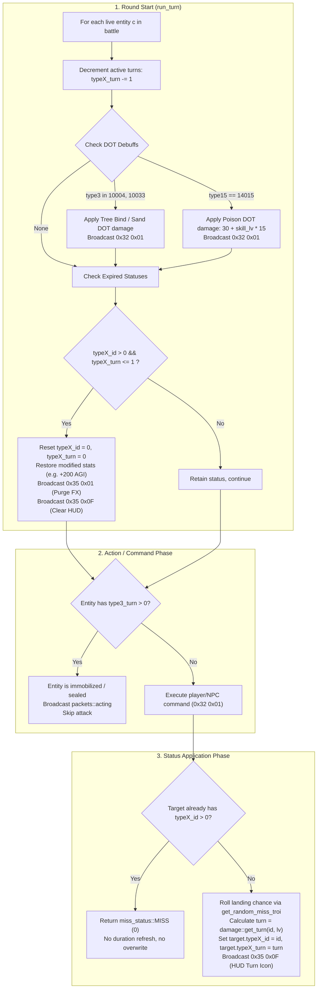

# Battle Buff & Debuff Lifecycle and Turn Duration Parity

*   **Author:** tuan.vu
*   **Status:** Approved (Post-Review Converged)
*   **Date:** 2026-11-03

--------------------------------------------------------------------------------

## Overview

In TS Online (PC version `aLogin.exe`), combat turns, tactical pacing, and character survival depend on buff and debuff status effects (such as Cây tinh/Tree bind, Băng phong/Freeze, Kính/Mirror, Bỏ độc/Poison, and Hỗn loạn/Confusion).

This design addresses a severe defect in the server's combat engine ([`src/battle/runner.rs`](file:///mnt/d/VUDT/GIT_PCC/ts_dream/src/battle/runner.rs)) and data loader ([`src/data/loaders/skill_pc.rs`](file:///mnt/d/VUDT/GIT_PCC/ts_dream/src/data/loaders/skill_pc.rs)), where the visual animation state ID (`pc.state`) from `Data/Skill.Dat` was improperly loaded as turn duration. This caused Freeze to last only 1 turn instead of 5, while Mirror lasted 103 turns and Poison lasted 171 turns.

This document establishes [`src/battle/damage.rs:get_turn`](file:///mnt/d/VUDT/GIT_PCC/ts_dream/src/battle/damage.rs#L226) as the single source of truth for duration, enforces strict anti-stacking rules per status channel, verifies auto-dispel mechanics on turn completion, safeguards secondary attack status durations in `combat_formula.rs`, and delivers a deterministic integration test suite.

--------------------------------------------------------------------------------

## The Problem

1. **Duration Corruption via Visual State Index Leaking into Round Attributes**:
   In PC `Data/Skill.Dat` (86 bytes per record), byte 37 (`state`) represents the client's visual sprite animation ID (`0x35 0x01`), not the combat turn duration. In [`src/data/loaders/skill_pc.rs:309`](file:///mnt/d/VUDT/GIT_PCC/ts_dream/src/data/loaders/skill_pc.rs#L309), this byte was mapped to `BinarySkillDef.round`. In [`src/battle/runner.rs:123-127`](file:///mnt/d/VUDT/GIT_PCC/ts_dream/src/battle/runner.rs#L123-L127), `skill_round` prioritized `binary_skill_def.round`, corrupting durations across all skills:
   * **Băng phong (11014)**: `state = 1` -> lasted only 1 turn (auto-dispelled at the start of the next turn).
   * **Kính (10015)**: `state = 103` -> lasted 103 turns (permanent reflect exploit).
   * **Bỏ độc (14015)**: `state = 171` -> lasted 171 turns.
   * **Hỗn loạn (14021)**: `state = 173` -> lasted 173 turns.
   The canonical duration table in [`src/battle/damage.rs:get_turn`](file:///mnt/d/VUDT/GIT_PCC/ts_dream/src/battle/damage.rs#L226-L314) was completely bypassed.

2. **Secondary Attack Status Infliction Fragility in `combat_formula.rs`**:
   Zeroing `BinarySkillDef.round` without updating [`src/battle/runner.rs:164-184`](file:///mnt/d/VUDT/GIT_PCC/ts_dream/src/battle/runner.rs#L164-L184) (`binary_skill_input`) causes `SkillFormulaInput.round` to be 0 for all attacks. In [`src/battle/combat_formula.rs:107`](file:///mnt/d/VUDT/GIT_PCC/ts_dream/src/battle/combat_formula.rs#L107), secondary status infliction evaluates `if skill.hit_status > 0 && skill.round > 0`. If `round` is 0, all damaging attack skills with secondary debuffs (such as stun or freeze attached to physical/magic hits) silently fail to inflict their status.

3. **Absence of Dedicated Lifecycle Verification**:
   The existing test suite lacks integration coverage verifying that debuff durations decrement correctly each round, that damage-over-time (DOT) executes, that anti-stacking rules reject re-application, and that auto-dispel triggers broadcast packets `0x35 0x01` and `0x35 0x0F` when duration expires.

--------------------------------------------------------------------------------

## Goals

* **G1 (SSoT Restoration & Fallback Protection)**: Filter non-zero rounds in `skill_round` and fall back to [`damage::get_turn(skill_id, skill_lv)`](file:///mnt/d/VUDT/GIT_PCC/ts_dream/src/battle/damage.rs#L226-L314) as the Single Source of Truth. In [`src/battle/runner.rs:164-184`](file:///mnt/d/VUDT/GIT_PCC/ts_dream/src/battle/runner.rs#L164-L184) (`binary_skill_input`), ensure `round` resolves via `damage::get_turn(skill_id, 1)` when `def.round == 0`. Clean `round: 0` in [`src/data/loaders/skill_pc.rs`](file:///mnt/d/VUDT/GIT_PCC/ts_dream/src/data/loaders/skill_pc.rs) with explanatory comments.
* **G2 (Duration Parity)**: Ensure exact canonical durations:
  * Băng phong (`11014`): 5 turns.
  * Cây tinh (`10004`): 3 turns.
  * Kính (`10015`): 2 turns (Lv 1..2), 3 turns (Lv 3..4), 4 turns (Lv 5).
  * Bỏ độc (`14015`): 3 turns.
  * Hỗn loạn (`14021`): 2..6 turns (Lv 1..5).
* **G3 (Anti-Stacking & Multi-Channel Integrity)**: Enforce that duplicate skills in the same channel (Type 3, Type 4, Type 15) return `MISS` and do not refresh duration, while allowing concurrent effects across distinct channels (e.g. Type 3 Freeze + Type 15 Poison).
* **G4 (Auto-Dispel Broadcast Parity)**: Verify that when `turn <= 1` at the start of a round, status fields are reset to 0, and packets `0x35 0x01` (purge FX) and `0x35 0x0F` (clear HUD) are broadcast.
* **G5 (Comprehensive Test Suite)**: Add [`tests/battle_buff_debuff_lifecycle_test.rs`](file:///mnt/d/VUDT/GIT_PCC/ts_dream/tests/) with 5 deterministic, in-memory integration test cases.

--------------------------------------------------------------------------------

## Non-Goals

* **NG1 (No Client Binary Edits)**: No modification to Delphi `aLogin.exe` or the binary layout of `Data/Skill.Dat`.
* **NG2 (No Stacking Counter Buffs)**: The TS Online protocol and Delphi client HUD have no support for stacked numeric buff tiers (e.g. 5x poison stacks); this design maintains strict 1-active-state semantics.
* **NG3 (Deferred Dispel Refactor)**: Unifying all active dispels into a single matrix is out of scope and deferred to a dedicated follow-up slice. Existing dispel routing in `apply_dispel16` (handling `10009` Giải kết giới) and `apply_dispel5` remains unchanged.
* **NG4 (No Elemental Affinities on Debuffs)**: Adding custom elemental weakness multipliers to debuff landing rates is out of scope.

--------------------------------------------------------------------------------

## Open Questions

* **Question 1**: Should [`damage::get_turn`](file:///mnt/d/VUDT/GIT_PCC/ts_dream/src/battle/damage.rs#L312) emit telemetry when an uncataloged skill hits the fallback `_ => 3` branch?
  * *Status*: Resolved — Use `tracing::debug!` to allow diagnostic tracing without risking production log saturation or I/O bottleneck.

--------------------------------------------------------------------------------

## Critical User Journeys (CUJs)

### CUJ 1: Casting Freeze and Auto-Dispelling After Turn Expiration

*   **Given**: Player A (Water element) in combat against Enemy B. Enemy B has 0 active buffs/debuffs (`type3_id = 0`, `type3_turn = 0`).
*   **When**: Player A successfully casts Băng phong (`11014`, canonical duration 5 turns) on Enemy B in Round 1.
*   **Then**:
    1. Enemy B is assigned `type3_id = 11014`, `type3_turn = 5`. Round 1 counts as Turn 1.
    2. During Rounds 2, 3, and 4, Enemy B's `type3_turn` decrements ($5 \to 4 \to 3 \to 2$) at round start and Enemy B is incapacitated (disabled for 4 rounds total).
    3. At the beginning of Round 5, `type3_turn` decrements from 2 to $1 \le 1$.
    4. Enemy B's `type3_id` and `type3_turn` are reset to 0, and packets `0x35 0x01` (`PURGE_TYPE_DISABLE`) and `0x35 0x0F` (`STATUS_SEAL_RESIST_PCT`) are broadcast. Enemy B is freed to act in Round 5.

### CUJ 2: Anti-Stacking Rejection on Controlled Target

*   **Given**: Enemy B is currently rooted by Cây tinh (`10004`, `type3_id = 10004`, `type3_turn = 2`).
*   **When**: Player A casts Băng phong (`11014`) on Enemy B.
*   **Then**:
    1. The cast returns `miss_status::MISS` (`0`).
    2. Enemy B's `type3_id` remains `10004` and `type3_turn` remains 2 (no refresh, no overwrite).
    3. No visual freeze effect is applied. Friendly-fire control exploitation in PvP is blocked by standard hostile targeting constraints.

### CUJ 3: Cross-Channel Debuff Concurrency (Poison + Freeze)

*   **Given**: Enemy B is frozen under Băng phong (`type3_id = 11014`, `type3_turn = 4`).
*   **When**: Player C (Fire/Earth) casts Bỏ độc (`14015`, Type 15) on Enemy B.
*   **Then**:
    1. The Type 15 debuff applies independently: Enemy B receives `type15_id = 14015`, `type15_turn = 3`.
    2. Enemy B now holds both `type3` (Freeze) and `type15` (Poison) simultaneously.
    3. At the start of the next turn, Enemy B suffers poison damage ($30 + \text{skill\_lv} \times 15$) while remaining frozen.

--------------------------------------------------------------------------------

## Technical Plan (Architecture)

### 1. Architectural Component Boundaries & Single Source of Truth

```
┌─────────────────────────────────────────────────────────────────────────────┐
│ 1. Data Loader Layer: src/data/loaders/skill_pc.rs                          │
│    - Parses PC Skill.Dat (86B records).                                     │
│    - Sets 'BinarySkillDef.round = 0' with documentation on visual state ID. │
└──────────────────────────────────────┬──────────────────────────────────────┘
                                       │
                                       ▼
┌─────────────────────────────────────────────────────────────────────────────┐
│ 2. Domain Combat Rule Engine: src/battle/damage.rs                          │
│    - 'damage::get_turn(skill_id, skill_lv)' is the SOLE SSoT for duration.  │
│    - Groups: GROUP_a (2..3T), GROUP_b (2..4T), GROUP_c (3T: Cây tinh, Độc), │
│              GROUP_d (4T), GROUP_e (5T: Băng phong), GROUP_f (2..5T).       │
│    - Default fallback '_ => 3' logs tracing::debug!.                        │
└──────────────────────────────────────┬──────────────────────────────────────┘
                                       │
                                       ▼
┌─────────────────────────────────────────────────────────────────────────────┐
│ 3. Stateful Battle Runner: src/battle/runner.rs                             │
│    - 'skill_round' filters 's.round > 0', falling back to 'damage::get_turn'.│
│    - 'binary_skill_input' resolves 'round' via 'damage::get_turn(id, 1)'.   │
│    - Enforces 4 orthogonal status channels: type3, type4, type15, type19.   │
│    - Enforces anti-stacking within same channel (returns MISS).             │
│    - Decrements turn at round start: 'turn -= 1'.                           │
│    - Executes DOT damage (Tree bind, Poison).                               │
│    - Auto-dispels when 'turn <= 1': resets fields, emits 0x35 01 & 0x35 0F. │
└─────────────────────────────────────────────────────────────────────────────┘
```

### 2. Status Channels Reference Table

| Channel | Domain Semantic | Sample Skills | Auto-Dispel Broadcast Frame |
|---|---|---|---|
| **Type 3** | Crowd Control & Immobilization | Băng phong (`11014`), Cây tinh (`10004`), Hôn mê (`14008`) | `0x35 0x01` (`PURGE_TYPE_DISABLE`) + `0x35 0x0F` (`STATUS_SEAL_RESIST_PCT`) |
| **Type 4** | Protective Barriers & Reflect | Kính (`10015`), Kết giới (`10010`), Lẫn tránh (`13003`) | `0x35 0x01` (`PURGE_TYPE_BUFF`) + `0x35 0x0F` (`STATUS_DEF_MODIFIER` / `ATK`) |
| **Type 15**| Stat Curses & Damage-Over-Time | Bỏ độc (`14015`), Thu nhỏ (`13011`), Hỗn loạn (`14021`) | `0x35 0x01` (`PURGE_TYPE_DEBUFF`) + `0x35 0x0F` (`STATUS_DEF_MODIFIER` / `ATK`) |
| **Type 19**| Job Specialization Passive Auras | Bá ý (`14040`), Thiên thần thuẫn (`14044`), Ngưng khí (`14046`)| `0x35 0x01` (`PURGE_TYPE_AURA`) + `0x35 0x0F` (`STATUS_DMG_BONUS_PCT`) |

### 3. Turn Lifecycle & Auto-Dispel State Machine



### 4. Detailed Component Modifications

#### A. Data Loader: `src/data/loaders/skill_pc.rs`
- In `pc_to_binary`:
  ```rust
  // Note: PC Skill.Dat record has no round field. pc.state represents the client
  // visual sprite animation ID (e.g. 1=Ice, 3=Tree, 103=Mirror, 171=Poison). Do NOT map
  // pc.state to round; combat turn durations are determined by damage::get_turn.
  round: 0,
  ```

#### B. Battle Damage Rules: `src/battle/damage.rs`
- In `get_turn`:
  Add debug telemetry on the wildcard branch:
  ```rust
  _ => {
      tracing::debug!(skill_id = id_skill, "uncataloged skill hit default turn fallback (3)");
      3
  }
  ```

#### C. Battle Runner: `src/battle/runner.rs`
- In `skill_round`:
  ```rust
  fn skill_round(data: &BattleData<'_>, skill_id: i64, skill_lv: i64) -> i64 {
      binary_skill_def(data, skill_id)
          .map(|skill| i64::from(skill.round))
          .filter(|&r| r > 0)
          .unwrap_or_else(|| damage::get_turn(skill_id, skill_lv))
  }
  ```
- In `binary_skill_input`:
  ```rust
  round: if def.round > 0 {
      i64::from(def.round)
  } else {
      damage::get_turn(skill_id, 1)
  },
  ```

--------------------------------------------------------------------------------

## Alternatives Considered

### Alternative A: Idiomatic Filter Fallback in `skill_round` (Selected)

*   **Mechanism**: Set `BinarySkillDef.round` to 0 in `skill_pc.rs`, add `.filter(|&r| r > 0)` in `skill_round`, and ensure `binary_skill_input` resolves `round` via `damage::get_turn(skill_id, 1)`.
*   **Pros**:
    *   Restores a Single Source of Truth (SSoT) for all skill turn durations.
    *   Immediately restores canonical durations for Băng phong (5 turns), Cây tinh (3 turns), Kính (2..4 turns), Bỏ độc (3 turns), and Hỗn loạn (2..6 turns).
    *   Preserves extensibility if future binary catalogs supply valid non-zero durations.
    *   Protects secondary status infliction on attack skills in `combat_formula.rs`.
*   **Cons**:
    *   Uncataloged skills must be added to `damage::get_turn` to avoid the 3-turn default.
*   **Selection Rationale**: Preserves protocol parity, adheres to domain-driven design, and eliminates all corrupted durations with minimal blast radius (~8–10 lines of production code).

### Alternative B: Expanding the Binary Record Layout of `Data/Skill.Dat`

*   **Mechanism**: Add a dedicated 1-byte `round` field to the binary record layout of `Skill.Dat`.
*   **Pros**:
    *   Embeds turn duration directly within the static data file.
*   **Cons**:
    *   `aLogin.exe` (Delphi 7 x86 PE) strictly requires a fixed 86-byte record structure (Pack=1).
    *   Modifying record size immediately crashes the client binary or causes byte-offset misalignment.
*   **Reason for Rejection**: Rejected by author: Violates hard non-negotiable constraint of zero client binary modifications.

### Alternative C: Hybrid Fallback with Manual Overrides in `runner.rs`

*   **Mechanism**: Keep `skill_round` reading `binary_skill_def.round`, but add a `match` statement in `runner.rs` to override IDs with known visual state collisions (e.g. 10015, 11014, 14015, 14021).
*   **Pros**:
    *   Avoids modifying the `SkillDatLoaderPc` loader.
*   **Cons**:
    *   Creates dual, fragmented sources of truth: some skills resolved via `damage::get_turn`, others via `Skill.Dat`, others via `runner.rs` overrides.
*   **Reason for Rejection**: Rejected by author: Violates coding standards §1-§2 by introducing fragmented domain logic.

--------------------------------------------------------------------------------

## Detailed Implementation Plan

### Target Files to Create/Modify

#### 1. `src/battle/runner.rs` (Modify)

*   **Type / Scope**: Battle Execution Engine
*   **Rationale**:
    *   In `skill_round(data, skill_id, skill_lv)` (lines 123–127), add `.filter(|&r| r > 0)` so that zeroed binary skill records fall back directly to `damage::get_turn(skill_id, skill_lv)` as the Single Source of Truth:
        ```rust
        fn skill_round(data: &BattleData<'_>, skill_id: i64, skill_lv: i64) -> i64 {
            binary_skill_def(data, skill_id)
                .map(|skill| i64::from(skill.round))
                .filter(|&r| r > 0)
                .unwrap_or_else(|| damage::get_turn(skill_id, skill_lv))
        }
        ```
    *   In `binary_skill_input(data, skill_id)` (lines 164–184), ensure `round` resolves via `damage::get_turn(skill_id, 1)` when `def.round == 0`, safeguarding secondary status infliction in `combat_formula.rs`:
        ```rust
        round: if def.round > 0 {
            i64::from(def.round)
        } else {
            damage::get_turn(skill_id, 1)
        },
        ```

#### 2. `src/data/loaders/skill_pc.rs` (Modify)

*   **Type / Scope**: Static Data Loader (PC Binary Format)
*   **Rationale**:
    *   In `pc_to_binary` (line 309), assign `round: 0` to `BinarySkillDef`.
    *   Add documentation clarifying that `pc.state` represents the Delphi client's visual sprite animation ID (`0x35 0x01`) and must never be interpreted as combat round duration.

#### 3. `src/battle/damage.rs` (Modify)

*   **Type / Scope**: Domain Combat Rules & Formulas
*   **Rationale**:
    *   In `get_turn(id_skill, lv_skill)` (line 312), add debug telemetry (`tracing::debug!`) on the wildcard fallback branch `_ => 3`:
        ```rust
        _ => {
            tracing::debug!(skill_id = id_skill, "uncataloged skill hit default turn fallback (3)");
            3
        }
        ```

#### 4. `tests/battle_buff_debuff_lifecycle_test.rs` (Create)

*   **Type / Scope**: Integration Test Driver
*   **Rationale**:
    *   Validate all aspects of buff/debuff mechanics in a self-contained in-memory test suite importing `ts_dream::battle::*` and `ts_dream::data::tables::*`.
    *   **Test Case 1 (`test_skill_round_table_parity`)**: Assert exact turn durations for canonical skills: Băng phong (`11014` -> 5T), Cây tinh (`10004` -> 3T), Kính (`10015` -> 2/3/4T), Bỏ độc (`14015` -> 3T), Hỗn loạn (`14021` -> 2..6T), Kết giới (`10010` -> 2..5T).
    *   **Test Case 2 (`test_anti_stacking_enforcement`)**: Assert that casting Type 3 (Freeze) on a target already under Type 3 (Tree bind) yields `miss_status::MISS`, leaving existing duration and ID untouched. Validate identical anti-stacking behavior for Type 4 and Type 15 channels.
    *   **Test Case 3 (`test_cross_channel_concurrency`)**: Verify that an entity can simultaneously hold `type3` (Freeze) + `type4` (Mirror) + `type15` (Poison) + `type19` (Job Aura) without cross-channel clobbering.
    *   **Test Case 4 (`test_attack_secondary_status_infliction`)**: Verify that a damaging attack skill with `hit_status > 0` correctly obtains duration via `binary_skill_input` and applies the secondary status to target upon successful status check.
    *   **Test Case 5 (`test_turn_countdown_dot_and_auto_dispel_lifecycle`)**: Run turn-by-turn simulation. Verify active turns decrement each round, poison DOT deals $30 + \text{skill\_lv} \times 15$ damage, and when `type15_turn <= 1` at round start, the engine resets `type15_id = 0`, broadcasting `0x35 0x01` (`PURGE_TYPE_DEBUFF`), `0x35 0x0F` (`STATUS_DEF_MODIFIER`), and `0x35 0x0F` (`STATUS_ATK_MODIFIER`).

--------------------------------------------------------------------------------

## Non-Functional Requirements

*   **Performance & Latency**: Test suite executes purely in memory without SQLite database I/O. Execution runtime must be under 100ms.
*   **Wire Parity**: Status updates and clears emit byte-exact Delphi `0x35 0x01` and `0x35 0x0F` frames.
*   **Deterministic Execution**: All RNG rolls in tests use `DotNetRandom` initialized with fixed seeds to guarantee 100% reproducible test outcomes with zero flakiness.
*   **Repository Guardrails**: Complies with `CODING_STANDARDS.md` §3 (no inline `#[cfg(test)]` in `src/`, all tests located in `tests/`).

--------------------------------------------------------------------------------

## Verification Plan

*   **Compilation**:
    ```bash
    cargo check
    ```
*   **Targeted Integration Test**:
    ```bash
    cargo test --test battle_buff_debuff_lifecycle_test -- --nocapture
    ```
*   **Existing Skill & Battle Test Suites**:
    ```bash
    cargo test --test skill_job_system_test
    cargo test --test battle_timing_wiring_test
    ```
*   **Architecture Guardrails Validation**:
    ```bash
    cargo test --test architecture_guardrails_test
    ```

--------------------------------------------------------------------------------

*Drafted with EGM*
