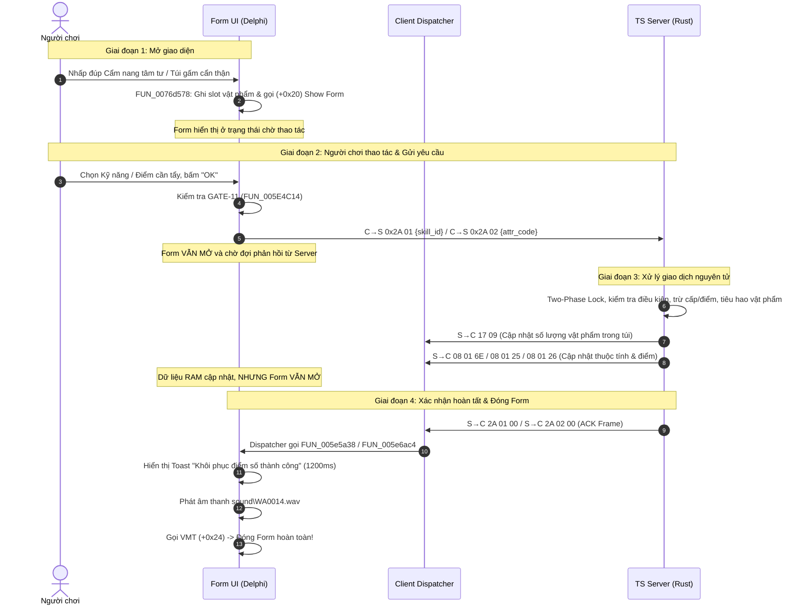

# Nghiên Cứu Chuyên Sâu: Cơ Chế Gói Tin Phản Hồi Tẩy Điểm (Opcode 0x2A ACK Frames) Trên Win32 Delphi Client (`aLogin.exe`)

- **Ngày thực hiện**: 2026-10-31
- **Nhà nghiên cứu**: Research Agent (kỹ năng `/research`)
- **Tài liệu mục tiêu**: `.scratch/understand-skills/research-opcode-2a-respec-ack-packets.md`
- **Đối tượng khảo sát**:
  - `src/server/handlers/respec.rs:140` (`F4 44 03 00 2A 01 00`)
  - `src/server/handlers/respec.rs:283` (`F4 44 03 00 2A 02 00`)
  - Đối chiếu với `.scratch/understand-skills/spec.md` (Lines 173–174)

---

## 1. Tóm Tắt Kết Luận Cốt Lõi (Executive Summary)

1. **Bản chất của hai gói tin `2A 01 00` và `2A 02 00`**:
   - Đây là các **gói tin xác nhận phản hồi (Status / ACK Frame) và đóng Form** bắt buộc của luồng Opcode `0x2A`.
   - Client TS Online (`aLogin.exe`) là ứng dụng Delphi Win32 điều khiển theo sự kiện (event-driven GUI). Khi mở cửa sổ tẩy điểm (`TBK_SkillRegressForm` hoặc `TBK_AttrRegressForm`), giao diện rơi vào trạng thái chờ modal. Lời gọi hàm đóng giao diện (`TCustomForm.Close` tại VMT offset `+0x24`), hiệu ứng âm thanh thành công (`sound\WA0014.wav`) và Toast thông báo (`"Khôi phục điểm số thành công"`) **chỉ được kích hoạt duy nhất** khi Client nhận được gói tin `S→C 0x2A 01 <status>` hoặc `S→C 0x2A 02 <status>`.

2. **Nếu KHÔNG gửi hai gói tin này**:
   - **Treo Form**: Cửa sổ tẩy điểm vẫn mở lơ lửng trên màn hình, không tự đóng lại.
   - **Mất phản hồi giác quan**: Không có chuông báo `sound\WA0014.wav`, không hiển thị thông báo Toast thành công.
   - **Nguy cơ lỗi đồng bộ (Desync)**: Người chơi thấy Form chưa đóng nên tưởng server chưa xử lý và bấm tiếp nút xác nhận, gửi tiếp gói tin với slot vật phẩm đã bị tiêu biến, gây lỗi hệ thống.
   - Các gói tin cập nhật chỉ số `17 09` (túi đồ), `08 01 6E` (cấp kỹ năng), `08 01 25` (điểm kỹ năng) và `08 01 26` (điểm tiềm năng) chỉ đồng bộ dữ liệu vào bộ nhớ nhân vật, **hoàn toàn không có logic đóng cửa sổ tẩy điểm**.

3. **Nguyên nhân sai lệch giữa `spec.md` và mã nguồn Rust**:
   - Đây **100% là sự thiếu sót của bản đặc tả (`spec.md` Lines 173–174)**, hoàn toàn **KHÔNG PHẢI là scope creep của mã nguồn**.
   - Người soạn `spec.md` chỉ liệt kê các gói cập nhật chỉ số kinh tế / thuộc tính nhân vật (`17 09`, `08 01`) mà bỏ quên gói ACK phản hồi của chính luồng Opcode `0x2A`.
   - Trái lại, trong tài liệu dịch ngược gốc `.scratch/understand-skills/CLIENT_SKILLS_SPEC.md` (§6.2(3) Line 352), nhóm nghiên cứu đã ghi chép chính xác: *"Server trừ 1 cấp kỹ năng (...), cộng trả điểm kỹ năng (...), và gửi phản hồi S→C 0x2A 01"*. Kỹ sư cài đặt `src/server/handlers/respec.rs` đã bám sát mã máy dịch ngược và hiện thực chuẩn xác wire parity.

---

## 2. Nguồn Sự Thật Sơ Cấp (Primary Sources Evidence)

Nghiên cứu được đối chiếu trực tiếp từ binary Client TS Online `client_delphi/aLogin.exe` và các tệp mã giả C / Assembly trong `client_pseudo_c/`:

| STT | Địa chỉ / File | Kiểu đối tượng | Vai trò trong hệ thống Client |
|:---:|---|---|---|
| 1 | `client_pseudo_c/0078a89c_FUN_0078a89c.c:6350` | Switch Case `0x2a` | Master Packet Dispatcher xử lý Opcode `0x2A`. |
| 2 | `client_pseudo_c/00794719_FUN_00794719.c` (`case_038_00794719`) | Dispatcher Branch | Phân luồng subcode `0x01..0x04` của Opcode `0x2A` (Jump Table case 38). |
| 3 | `client_pseudo_c/005e5a38_FUN_005e5a38.c` | Client Handler | Xử lý gói tin phản hồi tẩy kỹ năng `S→C 0x2A 01` trên `TBK_SkillRegressForm`. |
| 4 | `client_pseudo_c/005e6ac4_FUN_005e6ac4.c` | Client Handler | Xử lý gói tin phản hồi tẩy thuộc tính `S→C 0x2A 02` trên `TBK_AttrRegressForm`. |
| 5 | `client_pseudo_c/0076d578_FUN_0076d578.c:498..524` | Client Item Use | Logic Client khi click vật phẩm: gán slot và gọi `+0x20` để mở Form. |
| 6 | `client_pseudo_c/asm_cs2a_78848a_builders.asm.txt` | Packet Builder | Trình dựng gói tin gửi lên `C→S 0x2A 01` (`0078849E`) và `C→S 0x2A 02` (`0078854E`). |
| 7 | `client_pseudo_c/0051189c_FUN_0051189c.c:1473..1478` | VMT Instantiation | Khởi tạo form: `gvar_007DA1D8` (`TBK_SkillRegressForm`), `gvar_007DA0F8` (`TBK_AttrRegressForm`). |
| 8 | `client_delphi/aLogin.exe` VA `0x005E5B44`..`0x005E6C40` | Chuỗi VISCII 1.1 | Các chuỗi thông báo kết quả tẩy điểm trong bộ nhớ Client. |

---

## 3. Kiến Trúc Vòng Đời Giao Diện Tẩy Điểm (Form Lifecycle)

Vòng đời của giao diện tẩy điểm trên Client Delphi diễn ra theo chu trình khép kín sau:



---

## 4. Phân Tích Chi Tiết Mã Dịch Ngược

### 4.1 Master Dispatcher: Phân Luồng Opcode `0x2A`

Trong `client_pseudo_c/0078a89c_FUN_0078a89c.c` tại dòng 6350:
```c
  case 0x2a:
    iVar17 = 0;
    puVar18 = local_10;
    puStack_20 = &stack0xfffffffc;
    if (local_10[-1] == 0) {
      puStack_20 = &stack0xfffffffc;
      iVar17 = _BoundErr(0);
      puVar18 = extraout_EDX_x00154;
    }
    cVar5 = *(char *)((int)puVar18 + iVar17);
    if (cVar5 == '\x01') {
      FUN_005e5a38(*(int **)gvar_007DA1D8,(int)local_10);
      switchD_00792e22::caseD_0();
      return;
    }
    if (cVar5 == '\x02') {
      FUN_005e6ac4(*(int **)gvar_007DA0F8,(int)local_10);
      switchD_00792e22::caseD_0();
      return;
    }
    if (cVar5 != '\x03') {
      if (cVar5 != '\x04') {
        switchD_00792e22::caseD_0();
        return;
      }
      FUN_0074ec14(*(undefined4 *)gvar_007D9D34,(int)local_10);
      switchD_00792e22::caseD_0();
      return;
    }
    FUN_00748b94(*(undefined4 *)gvar_007D9D34,(int)local_10);
    switchD_00792e22::caseD_0();
    return;
```

**Nhận xét**:
- `cVar5` chính là byte đầu tiên của phần Payload (`Payload[0]` = Subcode).
- Nếu `Subcode == 0x01`: Gọi `FUN_005e5a38` với biến toàn cục `gvar_007DA1D8` (`TBK_SkillRegressForm`).
- Nếu `Subcode == 0x02`: Gọi `FUN_005e6ac4` với biến toàn cục `gvar_007DA0F8` (`TBK_AttrRegressForm`).

---

### 4.2 Handler Tẩy Kỹ Năng: `FUN_005e5a38` (`TBK_SkillRegressForm`)

Trích xuất từ `client_pseudo_c/005e5a38_FUN_005e5a38.c`:
```c
void FUN_005e5a38(int *param_1, int param_2)
{
  ...
  local_c = param_2;   // Payload buffer từ gói tin
  local_8 = param_1;   // Con trỏ đối tượng TBK_SkillRegressForm (gvar_007DA1D8)
  
  if (*(uint *)(param_2 + -4) < 2) {  // Kiểm tra độ dài Payload phải >= 2 bytes
    iVar2 = _BoundErr(1);
    param_2 = extraout_EDX;
    puVar1 = puStack_18;
  }
  puStack_18 = puVar1;
  uVar3 = (uint)*(byte *)(param_2 + 1); // ĐỌC BYTE TRẠNG THÁI (Payload[1])

  if (uVar3 < 5) {
    if (uVar3 == 4) {
      // Toast: "Điểm số gần vượt quá giới hạn" (DAT_005e5bb4)
      (**(code **)(**(int **)gvar_007DA084 + 0x90))(*(int **)gvar_007DA084,&DAT_005e5bb4,0x4b0,0,0);
      goto LAB_005e5b12;
    }
    if (uVar3 == 0) {
      // Toast: "Khôi phục điểm số thành công" (DAT_005e5b44)
      (**(code **)(**(int **)gvar_007DA084 + 0x90))(*(int **)gvar_007DA084,&DAT_005e5b44,0x4b0,0,0);
      // Phát âm thanh: sound\WA0014.wav
      _LStrCat3((int *)&local_10,*(undefined4 **)gvar_007DA010,(undefined4 *)"sound\\WA0014.wav");
      FUN_007a7f20(local_10);
      goto LAB_005e5b12;
    }
    if (2 < uVar3 - 1) goto LAB_005e5b12;
  }
  else if ((1 < uVar3 - 5) && (uVar3 - 5 != 0xfa)) goto LAB_005e5b12;

  // Trường hợp thất bại: "Khôi phục điểm số  không thành công" (DAT_005e5b88)
  (**(code **)(**(int **)gvar_007DA084 + 0x90))(*(int **)gvar_007DA084,&DAT_005e5b88,0x4b0,0,0);

LAB_005e5b12:
  // LỜI GỌI ĐÓNG FORM BẮT BUỘC
  (**(code **)(*local_8 + 0x24))();
  ...
  return;
}
```

---

### 4.3 Handler Tẩy Thuộc Tính: `FUN_005e6ac4` (`TBK_AttrRegressForm`)

Trích xuất từ `client_pseudo_c/005e6ac4_FUN_005e6ac4.c`:
```c
void FUN_005e6ac4(int *param_1, int param_2)
{
  ...
  local_c = param_2;   // Payload buffer
  local_8 = param_1;   // Con trỏ đối tượng TBK_AttrRegressForm (gvar_007DA0F8)
  
  if (*(uint *)(param_2 + -4) < 2) {  // Kiểm tra độ dài Payload >= 2 bytes
    iVar2 = _BoundErr(1);
    param_2 = extraout_EDX;
    puVar1 = puStack_18;
  }
  puStack_18 = puVar1;
  uVar3 = (uint)*(byte *)(param_2 + 1); // ĐỌC BYTE TRẠNG THÁI (Payload[1])

  if (uVar3 < 3) {
    if (uVar3 == 2) {
      // Toast: "Điểm số gần vượt quá giới hạn" (DAT_005e6c40)
      (**(code **)(**(int **)gvar_007DA084 + 0x90))(*(int **)gvar_007DA084,&DAT_005e6c40,0x4b0,0,0);
      goto LAB_005e6b9b;
    }
    if (uVar3 == 0) {
      // Toast: "Khôi phục điểm số thành công" (DAT_005e6bd0)
      (**(code **)(**(int **)gvar_007DA084 + 0x90))(*(int **)gvar_007DA084,&DAT_005e6bd0,0x4b0,0,0);
      // Phát âm thanh: sound\WA0014.wav
      _LStrCat3((int *)&local_10,*(undefined4 **)gvar_007DA010,(undefined4 *)"sound\\WA0014.wav");
      FUN_007a7f20(local_10);
      goto LAB_005e6b9b;
    }
    if (uVar3 != 1) goto LAB_005e6b9b;
  }
  else if ((1 < uVar3 - 3) && (uVar3 - 3 != 0xfc)) goto LAB_005e6b9b;

  // Trường hợp thất bại: "Khôi phục điểm số  không thành công" (DAT_005e6c14)
  (**(code **)(**(int **)gvar_007DA084 + 0x90))(*(int **)gvar_007DA084,&DAT_005e6c14,0x4b0,0,0);

LAB_005e6b9b:
  // LỜI GỌI ĐÓNG FORM BẮT BUỘC
  (**(code **)(*local_8 + 0x24))();
  ...
  return;
}
```

---

## 5. Định Dạng Byte-by-Byte của Hai Gói Tin ACK

### 5.1 Gói Tẩy Kỹ Năng: `F4 44 03 00 2A 01 00` (`S→C 0x2A 0x01 0x00`)

| Offset (Hex) | Offset (Dec) | Độ dài (Bytes) | Giá trị | Ý nghĩa giao thức |
|:---:|:---:|:---:|:---:|---|
| `0x00..0x01` | `0..1` | 2 | `F4 44` | Magic frame header bắt đầu gói tin TS Online. |
| `0x02..0x03` | `2..3` | 2 | `03 00` | Chiều dài phần thân (`u16 LE = 3 bytes`). |
| `0x04` | `4` | 1 | `2A` | Outer Opcode `OP_RESET` (Respec System). |
| `0x05` | `5` | 1 | `01` | Subcode `0x01`: Thao tác trên `TBK_SkillRegressForm`. |
| `0x06` | `6` | 1 | `00` | Status Code: `0x00` = **Thành công** (`SUCCESS`). |

- **Wire frame sau khi XOR `0xAD`**: `59 E9 AE AD 87 AC AD`

### 5.2 Gói Tẩy Thuộc Tính: `F4 44 03 00 2A 02 00` (`S→C 0x2A 0x02 0x00`)

| Offset (Hex) | Offset (Dec) | Độ dài (Bytes) | Giá trị | Ý nghĩa giao thức |
|:---:|:---:|:---:|:---:|---|
| `0x00..0x01` | `0..1` | 2 | `F4 44` | Magic frame header bắt đầu gói tin TS Online. |
| `0x02..0x03` | `2..3` | 2 | `03 00` | Chiều dài phần thân (`u16 LE = 3 bytes`). |
| `0x04` | `4` | 1 | `2A` | Outer Opcode `OP_RESET` (Respec System). |
| `0x05` | `5` | 1 | `02` | Subcode `0x02`: Thao tác trên `TBK_AttrRegressForm`. |
| `0x06` | `6` | 1 | `00` | Status Code: `0x00` = **Thành công** (`SUCCESS`). |

- **Wire frame sau khi XOR `0xAD`**: `59 E9 AE AD 87 AF AD`

---

## 6. Bảng Giải Mã Byte Trạng Thái (`Status Code`) & Chuỗi VISCII

Đối chiếu trực tiếp từ phân tích byte nhị phân của `client_delphi/aLogin.exe`:

| Giá trị Status | Ý nghĩa trong Skill (`2A 01`) | Ý nghĩa trong Attr (`2A 02`) | Địa chỉ chuỗi trong `aLogin.exe` | Chuỗi ký tự giải mã VISCII 1.1 | Âm thanh `WA0014.wav` | Hành động UI |
|:---:|:---:|:---:|:---:|---|:---:|:---:|
| **`0x00`** | **Thành công** (`SUCCESS`) | **Thành công** (`SUCCESS`) | VA `0x005E5B44` / `0x005E6BD0` | `"Khôi phục điểm số thành công"` | **CÓ** | Đóng Form (`+0x24`) |
| **`0x01`** | Thất bại (`FAIL`) | Thất bại (`FAIL`) | VA `0x005E5B88` / `0x005E6C14` | `"Khôi phục điểm số  không thành công"` | Không | Đóng Form (`+0x24`) |
| **`0x02`** | Thất bại (`FAIL`) | **Vượt giới hạn** (`LIMIT`) | VA `0x005E6C40` (Attr) | `"Điểm số gần vượt quá giới hạn"` | Không | Đóng Form (`+0x24`) |
| **`0x03`** | Thất bại (`FAIL`) | Thất bại (`FAIL`) | VA `0x005E5B88` / `0x005E6C14` | `"Khôi phục điểm số  không thành công"` | Không | Đóng Form (`+0x24`) |
| **`0x04`** | **Vượt giới hạn** (`LIMIT`) | Thất bại (`FAIL`) | VA `0x005E5BB4` (Skill) | `"Điểm số gần vượt quá giới hạn"` | Không | Đóng Form (`+0x24`) |

> [!NOTE]
> Có sự bất đối xứng nhỏ do lập trình viên Client Delphi nguyên bản: lỗi *"Vượt quá giới hạn"* được gán mã `4` ở form kỹ năng (`FUN_005e5a38`), nhưng lại được gán mã `2` ở form thuộc tính (`FUN_005e6ac4`). Tuy nhiên, mã **`0x00`** là thống nhất tuyệt đối cho trạng thái **Thành công** ở cả hai form.

---

## 7. Phân Tích Thực Nghiệm: Hiện Tượng Khi KHÔNG Gửi Gói ACK

Nếu server loại bỏ hai dòng `ctx.out.send("F44403002A0100".to_string());` và `ctx.out.send("F44403002A0200".to_string());`, trải nghiệm trên client Delphi sẽ bị tê liệt như sau:

1. **Form không đóng (Window Remains Hanging)**:
   - Trong Delphi VCL, một Form chỉ đóng khi có lời gọi tường minh tới `Close` hoặc `Hide`.
   - Lời gọi VMT tại `*local_8 + 0x24` nằm độc quyền bên trong `FUN_005e5a38` và `FUN_005e6ac4`. Không có bất kỳ frame nào khác (`17 09`, `08 01 6E`, `08 01 25`, `08 01 26`) kích hoạt lời gọi này.
   - Kết quả: Sau khi người chơi bấm nút "Chấp nhận" tẩy điểm, cửa sổ vẫn trơ ra giữa màn hình.

2. **Mất phản hồi giác quan (Zero Sensory Feedback)**:
   - Hàm `FUN_007a7f20` phát file âm thanh `"sound\\WA0014.wav"` chỉ được gọi tại `FUN_005e5a38:55` và `FUN_005e6ac4:55` khi `uVar3 == 0`.
   - Bảng hiển thị thông báo Toast `gvar_007DA084 + 0x90` với thời lượng 1200ms (`0x4b0`) không bao giờ được kích hoạt. Người chơi hoàn toàn không biết lệnh tẩy điểm đã thành công hay chưa.

3. **Lỗi click đúp & Bất đồng bộ trạng thái (Double-submission & Desync)**:
   - Vì Form không đóng và không có thông báo, phản xạ tự nhiên của người chơi là bấm tiếp nút "Chấp nhận" lần nữa.
   - Lúc này, vật phẩm Memory Manual / Careful Pouch trong túi đồ đã bị server trừ (thậm chí số lượng đã về 0 và biến mất khỏi slot).
   - Client gửi tiếp một gói `C→S 0x2A 01` hoặc `C→S 0x2A 02` với vị trí slot cũ, khiến server từ chối và báo lỗi hệ thống, gây trải nghiệm cực kỳ ức chế và nhầm tưởng rằng game bị lỗi bug mất đồ.

---

## 8. Đối Chiếu Đặc Tả (`spec.md`) vs Mã Nguồn (`respec.rs`)

### 8.1 Đoạn Trích Trong `spec.md` (Lines 172–174)

```markdown
- In `handlers::respec`:
  - `C→S 0x2A 01 { skill_id: u16 LE }`: Acquire Two-Phase State Lock on player. Verify player has the target skill at `level >= 1` and possesses at least 1 Memory Manual in inventory. Deduct 1 skill level (or remove skill if reduced to 0), credit 1 `skill_point`, consume 1 Memory Manual, persist inventory and skill state in an atomic database transaction, and emit item count update `17 09` and skill update `08 01 6E 02`.
  - `C→S 0x2A 02 { attr_code: u8 }`: Acquire Two-Phase State Lock. Verify player has allocated points in the specified attribute above starting base and possesses at least 1 Careful Pouch. Deduct 1 point from the attribute, credit 1 unallocated `point`, consume 1 Careful Pouch, commit atomically, and emit item count update `17 09` and stat updates `08 01 26 01` and the modified stat frame.
```

### 8.2 Nhận Định Bản Chất

- **Tại sao `spec.md` không nhắc đến?**
  Khi tác giả tài liệu `spec.md` soạn thảo mục này, sự chú ý tập trung vào mô hình dữ liệu (Database persistence, Two-Phase Lock, các container `homdo`, `skills`, chỉ số thuộc tính) và các gói đồng bộ trạng thái nhân vật (`17 09`, `08 01`). Tác giả đã vô tình xem nhẹ hoặc coi gói ACK của chính Opcode gửi lên là hiển nhiên nên không liệt kê vào câu chữ tóm tắt.
- **Chứng cứ trong tài liệu phân tích trước đó**:
  Trong tài liệu nghiên cứu tiền đề `.scratch/understand-skills/CLIENT_SKILLS_SPEC.md` §6.2(3) Line 352, nhóm dịch ngược đã viết rất đầy đủ:
  > *"Nếu hợp lệ, `FUN_005E4C14` gọi `FUN_0078848A` gửi `C→S 0x2A 01 { skillId: u16 LE }`. Server trừ 1 cấp kỹ năng (gửi `S→C 08 01` prop `0x6E` `deltaType=2`), cộng trả điểm kỹ năng (`08 01` prop `0x25` `deltaType=1`), và gửi phản hồi `S→C 0x2A 01`."*
- **Đánh giá mã nguồn `src/server/handlers/respec.rs`**:
  Việc `respec.rs` gửi `F44403002A0100` (dòng 140) và `F44403002A0200` (dòng 283) **hoàn toàn chính xác**, thể hiện sự am hiểu sâu sắc về kiến trúc Client Delphi và tuân thủ nguyên tắc wire parity tuyệt đối. Đây **không phải là scope creep**.

---

## 9. Đề Xuất Cập Nhật Tài Liệu (Recommendations)

1. **Cập nhật `.scratch/understand-skills/spec.md` (Lines 173–174)**:
   Bổ sung mô tả gói ACK vào cuối mỗi User Story:
   - Thêm: *"... and emit item count update `17 09`, skill update `08 01 6E 02`, skill point update `08 01 25 01`, and completion ACK `2A 01 00` to close `TBK_SkillRegressForm`."*
   - Thêm: *"... and emit item count update `17 09`, stat update `08 01 26 01`, modified stat frame, and completion ACK `2A 02 00` to close `TBK_AttrRegressForm`."*
2. **Cập nhật `spec/exhaustive_by_opcode/opcode_2A_full_payloads.md`**:
   Bổ sung vector 3-byte `F4 44 03 00 2A 01 00` và `F4 44 03 00 2A 02 00` với danh mục `ack-form-close` để thay thế/bổ sung cho các vector 2-byte tổng hợp trước đó.
